# PropERP database guide for data analytics

**Audience:** the data analytics team, connecting Power BI and Tableau directly to the PropERP MySQL database.

**Database:** MySQL 8, schema name `propertyx` (the production name may differ; ask the backend team for a read-only user). The schema described here is the one in force on 2026-10-22, with every migration applied.

**What this guide gives you:** for every business table, what one row means, how it joins to other tables, what each status value means and which rows you should normally count, plus worked SQL you can paste as a custom SQL source. It is written so that you can answer questions such as "which units are occupied and by whom" from the database alone, without reading the application code.

## 0. Read this first: conventions that apply to every table

### 0.1 What the system is

PropERP is the ERP of a property management company. The company manages properties on behalf of landlords for a management fee. Tenants lease spaces in those properties. The company invoices tenants, receives their payments, pays the suppliers who service the properties, and remits what is left to the landlord. The tables fall into these areas, and this guide has one section per area:

| Section | Area | Core tables |
|---|---|---|
| 1 | Companies, people and access | `users`, `user_groups`, `companies`, `roles`, `facility_user`, `facility_role` |
| 2 | Properties, spaces, occupancy, utilities | `facilities`, `facility_floors`, `facility_spaces`, `utility_meters` |
| 3 | Leases and tenant accounts | `leases`, `lease_items`, `lease_item_components`, `tenant_statements` |
| 4 | Lease applications and letters of offer | `lease_applications`, `loos` |
| 5 | Tenant invoices, receipts, credit notes, bank accounts | `facility_invoices`, `facility_receipts`, `facility_credit_notes`, `bank_accounts` |
| 6 | Supplier contracts, bills, expenses, remittances, landlord payouts | `facility_contracts`, `facility_bills`, `facility_remittances`, `facility_payment_vouchers` |
| 7 | Procurement and the purchase catalogue | `facility_procurement_requests`, `facility_procurement_lpos`, `facility_purchase_items` |
| 8 | Approvals, pending tasks, notifications, activity log | `approval_steps`, `pending_tasks`, `activity_log` |
| 9 | Reference data, settings, uploads, integrations | `currencies`, `taxes`, `settings`, `uploads`, `customer_invoices` |
| 10 | Property operations: tickets, site visits, inventory | `facility_tickets`, `facility_site_visit_reports`, `facility_inventories` |

Section 11 lists every table with the section that documents it, the class-name-to-table map for polymorphic columns, and a glossary.

### 0.2 Naming

- A **facility** is a property. The screens say "Property"; the tables and columns say `facility`. `facility_id` always points to `facilities.id`.
- A **space** (`facility_spaces`) is a lettable unit: a shop, office, flat, parking bay or signage position. The screens say "Unit" or "Space".
- A **vendor** is a supplier. Columns named `vendor_id` point to a supplier's row in `users`.
- A **user** is any person or organisation the system deals with: staff, tenants, landlords, suppliers. One table, `users`, holds them all. Section 1 explains how to tell them apart.
- **LOO** is a letter of offer, **LPO** a local purchase order, **ETR/CU** the Kenya Revenue Authority electronic tax register and its control unit, **EPMAS** the previous system that this one replaced.
- Table names are plural snake case. A pivot table that joins two tables with no data of its own is named after the two singular table names (`facility_user`, `facility_role`, `lease_utility_meter`).

### 0.3 Keys and joins

- Every table has an integer primary key `id` (`bigint unsigned`, auto-increment).
- A column named `<something>_id` points to the `id` of another table. Most point to the table named by the prefix (`facility_floor_id` to `facility_floors`), but the prefix is sometimes a role rather than a table: `landlord_id`, `tenant_id`, `vendor_id`, `created_by_id`, `acted_by_id`, `payee_id` all point to `users.id`. Each section's "Points to" column tells you the target.
- About two thirds of these links are declared as foreign key constraints in MySQL; the rest are enforced only by the application. Power BI and Tableau do not read the constraints anyway, so define relationships yourself from the join lists in this guide.
- `created_by_id` (the staff user who created the row) exists on most tables.
- Many tables carry `company_id`. The system is multi-company; the current databases hold one company, so you will rarely need to filter on it, but include it in joins between company-scoped tables when there is more than one.

### 0.4 Polymorphic links

A pair of columns `<x>_type` and `<x>_id` points to a row in one of several tables. `<x>_type` holds the PHP class name of the model, and the class name tells you the table:

| Value stored in the `_type` column | Table the `_id` points to |
|---|---|
| `App\Models\Facility` | `facilities` |
| `App\Models\Lease` | `leases` |
| `App\Models\FacilityInvoice` | `facility_invoices` |
| `App\Models\FacilityContract` | `facility_contracts` |
| `App\Models\User` | `users` |

Section 11.2 has the complete class-to-table list. The value is stored with single backslashes. In SQL a backslash inside a quoted string must be doubled, so write:

```sql
WHERE transaction_type = 'App\\Models\\FacilityInvoice'
```

This exact literal matches on the live database. Every worked query in this guide uses this form.

### 0.5 Deleted, cancelled and rejected rows

- 70 tables have a `deleted_at` column. A row with `deleted_at IS NOT NULL` was deleted in the application and is invisible to its users. **Always add `WHERE deleted_at IS NULL`** on those tables (the worked queries do). Exception: `users.deleted_at` exists but is never written.
- Documents are never physically removed once they are issued. A cancelled invoice, receipt, bill or credit note stays in its table with status `cancelled` and must be excluded from money totals. Sections 5 and 6 state the "live" filter per table.
- Anything that goes through an approval chain (letters of offer, leases, invoices, receipts, credit notes, bills, exit notices, procurement requests, purchase orders) can end in status `rejected`. Rejected is terminal: the record is kept for the audit trail and never resubmitted. Treat it like cancelled.
- `pending` on a money document means it is still in approval. Pending receipts and credit notes "hold" money against invoices but are not yet collections; see section 5.

### 0.6 Money, tax and currency

- Money columns are `decimal(50,5)` and hold amounts in currency units (shillings, not cents). Sum them directly.
- `taxes.value` is a fraction: `0.16` means 16 %. Multiply by it, never divide by 100. Withholding tax rates in `withholding_taxes` follow the same convention (section 9).
- Every property has a reporting currency (`facilities.reporting_currency_id`). Documents carry their own `currency_id` where it matters. The live databases are almost entirely KES; `currencies` holds KES (id 1) and USD (id 2).

### 0.7 Dates and times

- `created_at` and `updated_at` exist on almost every table and are not listed again in the sections. `created_at` is when the row was inserted; for documents imported from EPMAS it is the import time, not the business date. Use the business date columns (`date`, `invoice_date`, `transaction_at`, `start_date`, `end_date`, `period_start`) named in each section.
- The application writes timestamps in **Africa/Nairobi (UTC+3)**. MySQL `timestamp` columns are converted through the connection's time zone, so set your BI connection to `Africa/Nairobi` (or `+03:00`) to see the same values the application shows. `date` and `datetime` columns are not converted.

### 0.8 Status columns

Most tables have a `status` column defined as a MySQL `enum(...)`. Each section lists the values, what they mean and which ones count as live. Where the list in the database differs from what the application can actually produce today, the section says so.

### 0.9 The EPMAS migration

The company moved from EPMAS to PropERP at the end of September 2026. Consequences for analysis:

- 107 tables have `old_system_id`: the id of the same record in EPMAS (`NULL` for anything created in PropERP).
- Tenant and supplier balances were carried over as **opening-balance documents** dated at the cut-over (section 3, `lease_opening_balances`, and the invoices, credit notes and bills they created).
- The tenant ledger before the cut-over (December 2018 to 30 Sep 2026) is kept **for reference only** in `lease_history_billings` and `lease_history_collections` (section 3), with cutover reconciliation rows that make it add up to the opening balances. It is never part of a balance: the live tables and every figure the application shows ignore it. Use it for trends, and combine it with live data only as the section 3 worked query does.
- The property expense ledger and the landlord remittances before the cut-over are kept the same way in `facility_history_expenses` and `facility_history_remittances` (section 6). The live `facility_expenses` and `facility_remittances` start on 1 Oct 2026, so a series that runs across the cut-over takes history up to 30 Sep 2026 23:59:59 and live rows after it (section 6 worked query).
- `relative_url` on many tables is the path of the record in the web app; ignore it.

### 0.10 Tables you can ignore

Framework and housekeeping tables carry no business data: `migrations`, `jobs`, `failed_jobs`, `sessions`, `password_reset_tokens`, `personal_access_tokens`, `telescope_entries`, `telescope_entries_tags`, `telescope_monitoring`, `epmas_import_aliases`. A few other tables in the schema belong to modules the company does not use; they are empty and this guide does not describe them.

### 0.11 The big picture

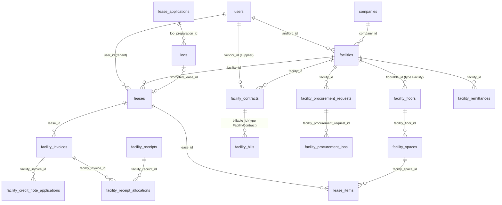

Read it top to bottom: a landlord's property is split into floors and spaces; a tenant's lease takes one or more spaces through lease items; the lease is invoiced, and receipts and credit notes settle the invoices; suppliers hold contracts and raise bills, or are paid through procurement orders; the property's net collections are remitted to the landlord.

### 0.12 Answering the common questions

| Question | Where to look |
|---|---|
| Which units are occupied, and by whom? | Section 2 (`facility_spaces`, worked query on occupancy); the tenant is `users` through `leases.user_id` |
| What does a tenant pay, and when does it escalate? | Section 3: `lease_item_components`, `lease_escalations`, `lease_billings` |
| What does a tenant owe? | Section 3 `tenant_statements`; section 5 aged receivables query |
| Collections per property per month | Section 5 worked queries |
| What do we owe suppliers, and what have we paid? | Section 6: `facility_bills`, `facility_vendor_statements`, `facility_payment_vouchers` |
| What was remitted to each landlord? | Section 6: `facility_remittances` |
| Leasing pipeline: enquiries to signed leases | Section 4 |
| Who is responsible for a property? | Section 1: `facility_role` (named role holders) and `facility_user` (allocated staff) |
| Who approved what, and when? | Section 8: `approval_steps`, `activity_log` |

### 0.13 Facts that cut across sections

Each of these is explained in full in its section. They are gathered here because getting one wrong silently breaks a report.

- **A space has no `facility_id`.** `facility_spaces` points at a floor, and a floor points at a property, a block or a wing through `floorable_type` / `floorable_id`. Section 2 gives a reusable derived table that resolves any floor to its property.
- **Occupancy is the space's `status`.** Occupied means `status IN ('only service charge available', 'on notice', 'unavailable')`; the other three values (`available`, `only rent available`, `under consideration`) are vacant. `rent_occupied_by_lease_id` names the lease holding the rent; parking bays and signage slots do not get that pointer, so their occupant comes from `lease_items`.
- **A lease occupies a space through `lease_items`** (`lease_id`, `facility_space_id`), and holds it while `leases.status IN ('active', 'suspended')`. A lease runs until `terminated_at`, not `end_at`: an active lease with `end_at` in the past is still live.
- **The tenant is `leases.user_id`**, the landlord is `facilities.landlord_id`, the supplier is any `vendor_id`. All three point at `users`. A user's kind comes from `user_user_group` (group ids: 1 agent, 2 tenant, 3 app = staff, 4 vendor = supplier, 5 saas, 6 landlord), and one user can be in several groups.
- **The managing company is itself a supplier.** The `settings` row with key `default_vendor` names the `users` row under which management fees, letting fees, salaries and deposit refunds are billed in `facility_bills` and `facility_contracts`. Filter it out when you report on third-party suppliers.
- **Invoices and credit notes reach the property and the tenant only through the lease** (`facility_invoices.lease_id`, then `leases.facility_id` and `leases.user_id`). Receipts carry `facility_id` and `paying_user_id` directly but no lease; the lease comes from the allocation to an invoice.
- **`facility_invoices.paid` includes credit notes.** Cash collected is the sum of confirmed `facility_receipt_allocations`. Credit note money columns are stored negative.
- **The business date of a document is `COALESCE(transaction_at, created_at)`.** Opening-balance documents from the migration are dated 2026-09-30 but were created in October 2026.
- **`utility_id` columns point at `lease_components`, not at `utilities`.** A utility is a lease component with `is_utility_charge = 1`; the `utilities` and `utility_prices` tables are legacy and empty.
- **Fee settings live on `facility_management_contracts`**, not on the copies in `facilities`. A contract has no `expired` status; it is expired when `end_at` is in the past.
- **Expense categories have no "kind" column.** Which `expense_categories` row is rent, service charge or service is a per-company `settings` row (`rent_expense_category_id`, `service_charge_expense_category_id`, `service_expense_category_id`). Every `settings.value` is text, so cast it before joining; the staff settings (`default_account_*_staff`) hold a `company_users.id`, not a `users.id`.
- **`tenant_statements` is append-only.** A tenant's balance is `SUM(debit) - SUM(credit)` over all rows, including the `cancelled` reversal rows.

# 1. Companies, people (staff, tenants, landlords, suppliers) and access

This domain holds every organisation and person the system knows about, and what each of them may do. The single most important fact: **`users` is one table for every kind of party**. The managing company's staff, tenants, landlords, suppliers (called "vendors" in every column and class name, "Supplier" only on screen) and the sub-users of those accounts are all rows in `users`. There is no `type` column. What a user *is* comes from the portals they belong to, recorded in the `user_user_group` pivot against the six fixed rows of `user_groups` (`tenant`, `app` = staff, `vendor`, `landlord`, plus the unused `agent` and `saas`). A user can belong to several groups at once (every landlord on dev is also in the staff group), so "is this a tenant?" is always a question about `user_user_group`, never about a flag on `users`.

`companies` is the managing company (one row on dev). `company_users` is the staff employment record that ties a user to a company with a status; it is the only reliable definition of "staff". Access is Spatie-style: `roles` (per portal, company-wide or global) carry `permissions` through `role_has_permissions`, and users hold roles through `model_has_roles`. Property-level responsibility is separate: `facility_user` says which users are allocated to (may see) which property, and `facility_role` says which user is *named* for a property-bound role such as Property Manager on a given property. `billing_addresses` holds the addresses a tenant, supplier, landlord or property is billed at, and `document_billing_addresses` records which address each financial document printed. The remaining tables are login plumbing (tokens, sessions, one-time codes) and are not for analytics.

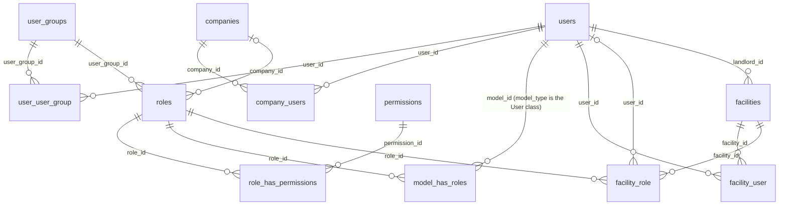

## users

**One row per:** person or organisation that can log in or be billed: a staff member, a tenant, a landlord, a supplier, or a sub-user of one of those. **Model:** `App\Models\User`. **Company-scoped:** no (there is no `company_id`; a user is global and is linked to a company only through `company_users`). **Soft deletes:** no. The `deleted_at` column exists but the model does not use soft deletes; it is NULL on every row. **Rows in dev DB:** 3,988.

Rows are created by staff from the Staff, Tenants, Suppliers and Landlords screens, by the lease form and lease applications (a new tenant), by tenant self-registration, and by the EPMAS import (3,984 of the 3,988 dev rows carry an `old_system_id`). Tax and registration columns are used for tenants and suppliers (a supplier's VAT status and withholding flags drive bills and LPOs); profile columns such as `pin`, `signature` and `two_factor_*` are staff login features.

**Status:** `status` is a plain varchar, not a DB enum. Values seen on dev: `active` (3,896), `inactive` (92, all of them deactivated staff). The code also allows `suspended`.
Live rows are `status = 'active'`. Do not filter on `deleted_at`; it is never set.

| Column | Type | Points to | Meaning |
|---|---|---|---|
| id | bigint | | Primary key. Referenced by about 260 foreign keys across the database (`leases.user_id` = tenant, `facilities.landlord_id` = landlord, `facility_bills.vendor_id` = supplier, every `created_by_id`, and so on). |
| name | varchar | | Display name: a person's name, or the business name for a company-type tenant or supplier. Do not copy into reports with personal data. |
| email | varchar | | Login email, unique. |
| phone | varchar | | Phone number (3,930 rows have one). Used for SMS/WhatsApp. |
| status | varchar | | `active` / `inactive` / `suspended`, see above. |
| tax_pin | varchar | | Tax PIN (KRA PIN). 2,635 rows have one; this is what ETR signing reads. |
| business_registration_number | varchar | | Company registration number for business tenants and suppliers (2,602 rows). |
| address | varchar | | Free-text physical address (689 rows). Superseded for documents by `billing_addresses`. |
| postal_address, postal_code | varchar | | Postal fields; empty on every dev row. |
| country_id | bigint | countries.id | Supplier's country; NULL on every dev row. |
| city_id | bigint | cities.id | Supplier's city; NULL on every dev row. |
| withholds | json | | JSON array of `withholding_taxes.id` values. On a **landlord** it lists the withholding taxes that may be deducted on bills and LPOs for their properties. 3,987 rows hold an array; only 17 are non-empty, the rest are `[]`. |
| has_vat | tinyint | | 1 = VAT registered (578 rows, mostly suppliers). |
| is_statutory_vendor | tinyint | | 1 = supplier is a statutory body (18 rows). Supplier flag. |
| is_withholding_exempt | tinyint | | 1 = no withholding tax is deducted from this supplier. 0 on every dev row. |
| is_tax_merchant | tinyint | | Supplier tax flag (1 row). |
| is_visible_to_staff | tinyint | | Written at creation (true for parties created from staff screens, false for EPMAS-imported parties) and **never read by any query**. On dev it is 1 for exactly the 186 staff rows, which is a coincidence of the import, not a definition of staff. |
| auto_assign_facilities | tinyint | | 1 = this staff user is allocated to every property of their company automatically. 0 on every dev row. |
| email_verified_at | timestamp | | Never set on dev. |
| pin, pin_set_at | varchar, timestamp | | Hashed 4-digit session-lock PIN for the staff app and when it was set (10 rows). Operational. |
| two_factor_secret, two_factor_recovery_codes, two_factor_confirmed_at | text, text, timestamp | | Two-factor login; unused on dev. Operational. |
| signature | longtext | | Encrypted PNG of the user's signature for signing documents. Empty on dev. Never readable from SQL. |
| profile_photo_path | varchar | | Stored photo path; empty on dev. |
| current_team_id | int | | Framework leftover, always NULL. Not a foreign key to anything. |
| welcome_emailed_at | timestamp | | When the welcome email went out (7 rows). |
| alerts_digest_sent_on | date | | Local date of the user's last alerts digest email. |
| old_system_id | varchar | | The id in the old EPMAS system. |
| deleted_at | timestamp | | Present but never set. |

**Joins:**
- `users.id ← user_user_group.user_id`: one user, many group memberships. This is how you find out whether the user is a tenant, staff member, supplier or landlord.
- `users.id ← company_users.user_id`: one user, zero or one staff record per company (unique per user and company on dev; no DB unique key).
- `users.id ← model_has_roles.model_id` where `model_has_roles.model_type = 'App\\Models\\User'`: roles held (no DB constraint, polymorphic).
- `users.id ← facility_user.user_id` and `users.id ← facility_role.user_id`: property allocation and named property roles.
- `users.id ← leases.user_id`: the **tenant** of a lease (relationship name `Lease::user`). Every `leases.user_id` on dev is in the tenant group.
- `users.id ← facilities.landlord_id`: the landlord of a property. Every `facilities.landlord_id` on dev is in the landlord group.
- `users.id ← facility_bills.vendor_id`, `facility_contracts.vendor_id`, `facility_procurement_requests.default_vendor_id` and similar `vendor_id` columns: the supplier. Every distinct `facility_bills.vendor_id` on dev is in the vendor group.
- `users.id ← facility_payouts.recipient_id`: payee of a payout. `users.id ← customers.user_id`: the party's customer record in a company (customer invoices domain).
- `users.id ← billing_addresses.billable_id` where `billable_type = 'App\\Models\\User'` (polymorphic, no DB constraint).
- `users.country_id → countries.id`, `users.city_id → cities.id`: lookup tables; NULL on dev.
- `users.id ← tenant_users.tenant_id`, `landlord_users.landlord_id`, `vendor_users.vendor_id` (the account) and `*.user_id` (the sub-user).

**Gotchas:**
- There is no column that says what kind of party a user is. Use `user_user_group`. 62 dev users are in two groups, 11 in three or four: all 48 landlords are also in the staff (`app`) group, 25 users are both tenant and supplier, and so on.
- Being in the `app` group does **not** make a user staff: 47 `app` members have no `company_users` row (they are landlords). Define staff as "has a row in `company_users`".
- `users.status = 'inactive'` on dev is exactly the set of staff whose `company_users.status = 'inactive'`. A tenant or supplier is not deactivated this way; a tenant's activity comes from their leases.
- Money and tax flags apply to a role the user plays, not to the row as a whole: `has_vat` matters for suppliers (bills) and tenants (invoices); `withholds` matters only for landlords.
- Polymorphic type strings are stored with single backslashes (`App\Models\User`, 15 characters). In a normal MySQL client you write `'App\\Models\\User'`. If your BI tool passes backslashes through differently, `CONCAT('App', CHAR(92), 'Models', CHAR(92), 'User')` always works.
- `name`, `email`, `phone`, `tax_pin` and `business_registration_number` are personal data; aggregate or key on `id` in shared reports.

## user_groups

**One row per:** portal (type of user). **Model:** `App\Models\UserGroup`. **Company-scoped:** no. **Soft deletes:** no. **Rows in dev DB:** 6, fixed by the seeder and never added to.

The six rows and their ids are stable across every install. `title` is the machine key the code uses; `label` is what screens show.

| id | title | label | Who is in it | Members on dev |
|---|---|---|---|---|
| 1 | `agent` | Agent | Reserved for managing agents; unused | 0 |
| 2 | `tenant` | Tenant | Tenants (the party on a lease) | 3,124 |
| 3 | `app` | Staff | Staff portal users. Also holds every landlord, see gotchas | 233 |
| 4 | `vendor` | Vendor (shown as Supplier) | Suppliers and their technicians | 668 |
| 5 | `saas` | SaaS Owner | System owner; unused | 0 |
| 6 | `landlord` | Landlord | Property owners | 48 |

| Column | Type | Points to | Meaning |
|---|---|---|---|
| id | bigint | | Primary key, stable ids above. |
| title | varchar | | Machine key: `agent`, `tenant`, `app`, `vendor`, `saas`, `landlord`. |
| label | varchar | | Display name. |
| description | text | | Seeded description. |
| can_register | tinyint | | 1 = self-registration is offered for this portal (only `tenant` on dev). Not enforced server-side. |
| require_company | tinyint | | 1 = the portal runs inside a company context (`app`, `landlord`). |
| created_by_id | bigint | users.id | Who created the row (NULL for seeded rows). |

**Joins:**
- `user_groups.id ← user_user_group.user_group_id`: members.
- `user_groups.id ← roles.user_group_id`: the portal a role belongs to (no DB constraint).
- `user_groups.id ← permissions.user_group_id` and the JSON list `permissions.user_group_ids`: the portals a permission may be granted in.
- Also referenced by `alerts`, `bank_accounts`, `facility_ledgers`, `facility_tickets`, `notifications`, `pending_tasks` (`user_group_id`): which portal a record belongs to or was raised from.

**Gotchas:** `app` is the staff portal, not "the application". Rows never change; hard-coding `user_group_id = 2` for tenants is safe.

## user_user_group

**One row per:** membership of one user in one portal group. **Model:** `App\Models\UserUserGroup` (pivot). **Company-scoped:** no. **Soft deletes:** no. **Rows in dev DB:** 4,073.

A row is written when a user is created for a portal, when staff add an existing user to another portal (adding never removes other groups), or by the EPMAS import. This pivot connects `users` and `user_groups`.

**Status:** `status` enum `pending`, `active`, `suspended`, `inactive`. Every dev row is `active`.
Live rows are `status = 'active'`.

| Column | Type | Points to | Meaning |
|---|---|---|---|
| id | bigint | | Primary key. |
| user_id | bigint | users.id | The member. |
| user_group_id | bigint | user_groups.id | The portal. |
| status | enum | | Membership status, see above. |
| welcomed_at | timestamp | | When the user acknowledged the first-login welcome in that portal (7 rows, all in the staff group). NULL means not yet welcomed. |

**Joins:** `user_user_group.user_id → users.id` (many memberships per user); `user_user_group.user_group_id → user_groups.id`.

**Gotchas:** there is no unique key on (user_id, user_group_id); the code avoids duplicates but older data could hold two rows for the same pair (none on dev). One dev user (id 1) has no membership at all. Count users with `COUNT(DISTINCT user_id)`.

## companies

**One row per:** managing company (the organisation that runs the system and manages properties). **Model:** `App\Models\Company`. **Company-scoped:** no (it is the company). **Soft deletes:** yes (`deleted_at`). **Rows in dev DB:** 1 (id 1, active, not deleted).

Almost every operational table carries a `company_id` pointing here (see Conventions). On a single-company install every row is company 1.

**Status:** `status` enum `active`, `inactive`. Live rows are `status = 'active' AND deleted_at IS NULL`.

| Column | Type | Points to | Meaning |
|---|---|---|---|
| id | bigint | | Primary key. |
| name, slug | varchar | | Company name and unique URL slug. |
| user_id | bigint | users.id | The company owner's user account (NULL on dev). |
| tax_pin | varchar | | The company's tax PIN. |
| has_vat | tinyint | | VAT registered. |
| withholds | json | | JSON array of `withholding_taxes.id` the company applies (`[]` on dev). |
| service_managed | enum | | `rent`, `sc` (service charge), `both`: what the company manages. NULL on dev. |
| services | json | | JSON array of service names offered, for example `["Valuation", "Management", ...]`. |
| type_of_properties | json | | JSON array of property types handled (NULL on dev). |
| collection_contract | tinyint | | 1 = the company collects on behalf of landlords under a collection contract. |
| is_selected | tinyint | | 1 = the currently selected company; creating a company clears the flag on the others. |
| registration_type, registration_number | enum, varchar | | `national_id`, `business_license`, `passport` and the number. |
| registration_upload_id, tax_pin_cert_upload_id, other_docs_upload_id | bigint | uploads.id | Uploaded registration documents. |
| address, postal_address, company_phone, company_email, company_website, twitter_handle, facebook_url, company_tagline, timezone | varchar/text | | Contact and branding text. |
| brand_color, text_color_on_brand_bg, accent_color, text_color_on_accent_bg | varchar(7) | | Hex colours for documents. |
| profile_photo_path, light_logo_path | varchar | | Logo paths. |
| status | enum | | See above. |
| created_by_id | bigint | users.id | Creator. |
| old_system_id | varchar | | The id in the old EPMAS system. |
| deleted_at | timestamp | | Soft delete. |

**Joins:** `companies.id ← company_users.company_id` (staff); `companies.id ← roles.company_id` (company-scoped roles); `companies.id ← facilities.company_id`, `leases.company_id` and every other `company_id` column; `companies.user_id → users.id` (owner).

**Gotchas:** `companies.user_id` (owner) is distinct from `created_by_id`; both NULL on dev. The company owner, when set, is treated as a member of the company even without a `company_users` row.

## company_users

**One row per:** employment of one user by one company (the staff record). **Model:** `App\Models\CompanyUser`. **Company-scoped:** no global scope, but every row has `company_id`. **Soft deletes:** no. **Rows in dev DB:** 186 (94 active, 92 inactive).

Created from the Staff screen (and by the EPMAS staff import). **This table is the definition of staff**: a user is a staff member of a company if and only if they have a row here. Checked on every staff-portal request.

**Status:** `status` enum `active`, `inactive`, `suspended`. Live rows are `status = 'active'`.

| Column | Type | Points to | Meaning |
|---|---|---|---|
| id | bigint | | Primary key. |
| company_id | bigint | companies.id | Employer. |
| user_id | bigint | users.id | The staff member. One row per (company, user) on dev. |
| company_office_id | bigint | company_offices.id | Office; NULL on every dev row. |
| company_department_id | bigint | company_departments.id | Department; NULL on every dev row. |
| company_department_division_id | bigint | company_department_divisions.id | Division; NULL on every dev row. |
| role | enum | | `staff` or `agent`. Every dev row is `staff`. Not related to Spatie roles. |
| status | enum | | Employment status, see above. |
| created_by_id | bigint | users.id | Who added them. |
| old_system_id | varchar | | The id in the old EPMAS system. |

**Joins:** `company_users.user_id → users.id`; `company_users.company_id → companies.id`; the three org-unit columns to their tables (all NULL on dev).

**Gotchas:** `role` here is a two-value employment type, not the user's access role; access roles are in `model_has_roles`. A user in the `app` group without a row here is not staff (see `users`).

## company_departments

**One row per:** department of a company. **Model:** `App\Models\CompanyDepartment`. **Company-scoped:** yes. **Soft deletes:** no. **Rows in dev DB:** 0.

Organisation units that staff records can be filed under. Unused on dev.

| Column | Type | Points to | Meaning |
|---|---|---|---|
| id | bigint | | Primary key. |
| company_id | bigint | companies.id | Owning company. |
| name, code, description | varchar/text | | Labels. |
| status | varchar | | Default `active`. |
| created_by_id | bigint | users.id | Creator. |
| old_system_id | varchar | | The id in the old EPMAS system. |

**Joins:** `company_departments.id ← company_users.company_department_id`; `company_departments.id ← company_department_divisions.company_department_id`.

## company_department_divisions

**One row per:** division inside a department. **Model:** `App\Models\CompanyDepartmentDivision`. **Company-scoped:** yes. **Soft deletes:** no. **Rows in dev DB:** 0.

| Column | Type | Points to | Meaning |
|---|---|---|---|
| id | bigint | | Primary key. |
| company_id | bigint | companies.id | Owning company. |
| company_department_id | bigint | company_departments.id | Parent department. |
| name, code, description | varchar/text | | Labels. |
| status | varchar | | Default `active`. |
| created_by_id | bigint | users.id | Creator. |

**Joins:** `company_department_divisions.id ← company_users.company_department_division_id`; `company_department_divisions.company_department_id → company_departments.id`.

## company_offices

**One row per:** office (branch) of a company. **Model:** `App\Models\CompanyOffice`. **Company-scoped:** yes. **Soft deletes:** no. **Rows in dev DB:** 0.

| Column | Type | Points to | Meaning |
|---|---|---|---|
| id | bigint | | Primary key. |
| company_id | bigint | companies.id | Owning company. |
| name, code, email, phone, address, postal_code | varchar/text | | Office contact details. |
| country_id | bigint | countries.id | Country. |
| city_id | bigint | cities.id | City. |
| status | varchar | | Default `active`. |
| created_by_id | bigint | users.id | Creator. |

**Joins:** `company_offices.id ← company_users.company_office_id`.

## company_messaging_channels

**One row per:** outbound messaging channel configured by a company (one row per channel per company, unique). **Model:** `App\Models\CompanyMessagingChannel`. **Company-scoped:** yes. **Soft deletes:** no. **Rows in dev DB:** 0.

Which provider sends the company's email, SMS and WhatsApp. When no active row exists the platform defaults from configuration are used. Operational, not for analytics.

**Status:** `status` enum `active`, `inactive`. Live rows are `status = 'active'`.

| Column | Type | Points to | Meaning |
|---|---|---|---|
| id | bigint | | Primary key. |
| company_id | bigint | companies.id | Owning company. |
| channel | enum | | `email`, `sms`, `whatsapp`. |
| driver | varchar | | Provider key: email `resend`, `smtp`, `log`; sms `africas_talking`, `log`; whatsapp `meta_cloud`, `log`. |
| credentials | text | | Encrypted provider credentials; unreadable from SQL. |
| webhook_token | varchar | | Secret for inbound delivery callbacks. |
| created_by_id | bigint | users.id | Creator. |

**Joins:** `company_messaging_channels.company_id → companies.id`.

## tenant_users

**One row per:** sub-user of a tenant account: a second login that acts for a tenant. **Model:** `App\Models\TenantUser`. **Company-scoped:** no. **Soft deletes:** no. **Rows in dev DB:** 0.

Both sides are `users` rows: `tenant_id` is the tenant account, `user_id` is the extra person's own account. The current code has policies for these rows but no screen that creates them, so expect the table to stay empty.

**Status:** `status` enum `active`, `suspended`, `inactive`. Live rows are `status = 'active'`.

| Column | Type | Points to | Meaning |
|---|---|---|---|
| id | bigint | | Primary key. |
| tenant_id | bigint | users.id | The tenant account being acted for. |
| user_id | bigint | users.id | The sub-user's own account. |
| status | enum | | See above. |
| old_system_id | varchar | | The id in the old EPMAS system. |

**Joins:** `tenant_users.tenant_id → users.id` (one tenant, many sub-users); `tenant_users.user_id → users.id`.

**Gotchas:** a sub-user is not the tenant: leases, invoices and receipts always point at `tenant_id`'s user, never at the sub-user. Sub-users do not get the Tenant Admin role automatically.

## landlord_users

**One row per:** sub-user of a landlord account. **Model:** `App\Models\LandlordUser`. **Company-scoped:** no. **Soft deletes:** no. **Rows in dev DB:** 0.

Same shape as `tenant_users`: `landlord_id` is the landlord's account, `user_id` the sub-user's. No current screen creates rows.

**Status:** `status` enum `active`, `suspended`, `inactive`. Live rows are `status = 'active'`.

| Column | Type | Points to | Meaning |
|---|---|---|---|
| id | bigint | | Primary key. |
| landlord_id | bigint | users.id | The landlord account. |
| user_id | bigint | users.id | The sub-user's account. |
| access_level | enum | | `user` or `agent`. Not read anywhere in the current code. |
| accessible_companies | json | | Intended list of company ids; not read anywhere in the current code. |
| status | enum | | See above. |
| old_system_id | varchar | | The id in the old EPMAS system. |

**Joins:** `landlord_users.landlord_id → users.id`; `landlord_users.user_id → users.id`.

## vendor_users

**One row per:** sub-user of a supplier account (a staff member or technician of the supplier). **Model:** `App\Models\VendorUser`. **Company-scoped:** no. **Soft deletes:** no. **Rows in dev DB:** 0.

Created by the supplier from the supplier portal's Users screen: a `users` row is created for the person, put in the `vendor` group, and linked here. Technicians can be assigned to procurement requests (`procurement_request_vendors.technician_id` points at this table).

**Status:** `status` enum `active`, `suspended`, `inactive`. Live rows are `status = 'active'`.

| Column | Type | Points to | Meaning |
|---|---|---|---|
| id | bigint | | Primary key. |
| vendor_id | bigint | users.id | The supplier account. |
| user_id | bigint | users.id | The sub-user's account. |
| is_technician | tinyint | | 1 = can be assigned as technician on jobs. |
| qualifications | text | | Free text. |
| attachment_id | bigint | uploads.id | Uploaded qualification document. |
| status | enum | | See above. |
| old_system_id | varchar | | The id in the old EPMAS system. |

**Joins:** `vendor_users.vendor_id → users.id`; `vendor_users.user_id → users.id`; `vendor_users.id ← procurement_request_vendors.technician_id`.

**Gotchas:** bills, contracts and LPOs always name the supplier account (`vendor_id` = the account's `users.id`), never the technician.

## roles

**One row per:** named access role within one portal, either global or belonging to one company. **Model:** `App\Models\Role` (Spatie). **Company-scoped:** no global scope, but `company_id` is set on company roles. **Soft deletes:** no. **Rows in dev DB:** 29.

Seeded for the staff portal (System Admin, Caretaker, Property Manager, Senior Property Manager, Agency, Procurement Manager, Finance Manager, Executive Signatory, Finance Assistant, Auditors, Finance Payable, Finance Accounts Receivable, Finance Billables, Legal Counsel, Internal Counsel, Director, and others) and for the portals. Three global portal roles (`company_id` NULL) give an account full use of its portal: **Tenant Admin** (id 26, held by all 3,124 tenants), **Vendor Admin** (id 27, held by 668 suppliers) and **Landlord Admin** (id 28, held by all 48 landlords). Staff and sub-users only hold roles that were explicitly assigned.

| Column | Type | Points to | Meaning |
|---|---|---|---|
| id | bigint | | Primary key. |
| name | varchar | | Role name. Unique only together with `user_group_id`, `company_id` and `guard_name`, so the same name can exist twice (dev has a company-scoped and a global "Vendor Admin" and "Landlord Admin"). |
| user_group_id | bigint | user_groups.id | The portal this role is for (no DB constraint). 3 = staff roles. |
| company_id | bigint | companies.id | NULL = global role; otherwise the company that owns it. |
| enforce_on_facility | tinyint | | 1 = a **property-bound role**: it is held per property by naming a user in `facility_role` (Property Manager, Senior Property Manager, Caretaker on dev). 0 = company-wide. |
| guard_name | varchar | | Always `web`. |
| description | varchar | | Free text. |
| created_by_id | bigint | users.id | Creator. |

**Joins:**
- `roles.id ← model_has_roles.role_id`: who holds the role.
- `roles.id ← role_has_permissions.role_id`: what the role may do.
- `roles.id ← facility_role.role_id`: the named holder per property.
- `roles.id ← approval_template_steps.role_id`, `approval_steps.role_id`, `procurement_request_step_templates.role_id`, `facility_procurement_request_steps.role_id`, `responsibility_transfer_items.role_id`, `approval_template_bypass_roles.role_id`: workflow steps addressed to a role.
- `roles.user_group_id → user_groups.id`; `roles.company_id → companies.id`.

**Gotchas:** filter by `user_group_id = 3` when you mean staff roles; group by `name` with care because of the duplicates. Role ids differ between installs; names are stable.

## permissions

**One row per:** named ability (permission slug). **Model:** `App\Models\Permission` (Spatie). **Company-scoped:** no. **Soft deletes:** no. **Rows in dev DB:** 407, all `guard_name = 'web'`.

Seeded from a catalogue; new names are added by a seeder on each deploy. Names keep the internal words (`view-facility-invoice`, `create-vendor-user`) even though screens say Property and Supplier.

| Column | Type | Points to | Meaning |
|---|---|---|---|
| id | bigint | | Primary key. |
| name | varchar | | Slug, for example `view-facility-bill`. |
| resource | varchar | | Resource label the permission belongs to (`Facility Invoice`, `Landlord`, ...). |
| tag | varchar | | Module heading: `Property Management` (285), `Facility Management` (50), `Access Management` (33), `Project Management` (13), `Vendor`, `Landlord`, `Tenant` (7 each), `General` (5). |
| sub_tag | varchar | | Always NULL on dev. |
| user_group_id | bigint | user_groups.id | Legacy single portal (no DB constraint). |
| user_group_ids | json | | JSON array of `user_groups.id` the permission may be granted in, for example `[3]` (staff only, 338 rows), `[2, 3]` (tenant and staff, 22 rows). This list, not `user_group_id`, decides whether a role in a portal can ever hold the permission. |
| guard_name | varchar | | Always `web`. |

**Joins:** `permissions.id ← role_has_permissions.permission_id`; `permissions.id ← model_has_permissions.permission_id`.

## role_has_permissions

**One row per:** permission granted to a role. **Model:** none (Spatie pivot). **Company-scoped:** no. **Soft deletes:** no. **Rows in dev DB:** 3,844.

Connects `roles` and `permissions`. Composite primary key (`permission_id`, `role_id`).

| Column | Type | Points to | Meaning |
|---|---|---|---|
| permission_id | bigint | permissions.id | The ability. |
| role_id | bigint | roles.id | The role. |

**Gotchas:** most staff roles were seeded with every permission of their portal, so they hold 280 to 381 permissions, while a few were trimmed by hand (Senior Property Manager 92, Procurement Intern 46, Finance Payable 9, Internal Counsel 1) and eight (Finance Assistant, Auditors, Finance- General, Finance Billables, Receptionist, Valuer, Valuation Admin, Data Analytics) hold none. Permission counts are therefore a poor proxy for seniority.

## model_has_roles

**One row per:** role held by a user. **Model:** none (Spatie pivot). **Company-scoped:** no. **Soft deletes:** no. **Rows in dev DB:** 4,695, every one with `model_type = 'App\\Models\\User'`.

Polymorphic by design, but only users ever hold roles here. Composite primary key (`role_id`, `model_id`, `model_type`).

| Column | Type | Points to | Meaning |
|---|---|---|---|
| role_id | bigint | roles.id | The role. |
| model_type | varchar | polymorphic: see below | Always `App\Models\User` (stored with single backslashes). |
| model_id | bigint | users.id when model_type is App\Models\User | The holder (no DB constraint). |

**Joins:** `model_has_roles.model_id → users.id` with `model_type = 'App\\Models\\User'` (one user, several roles: 3,311 users hold one, 649 two, 28 three or four); `model_has_roles.role_id → roles.id`.

**Gotchas:** on staff routes only roles whose `company_id` matches the company in use (or is NULL) count. One dev row names a user who is not in the role's portal group. Being *named* in `facility_role` is not the same as holding the role here (40 of the 101 named Property Managers on dev do not hold the Property Manager role in this table).

## model_has_permissions

**One row per:** permission granted directly to a user, bypassing roles. **Model:** none (Spatie pivot). **Company-scoped:** no. **Soft deletes:** no. **Rows in dev DB:** 0. The application never writes it.

| Column | Type | Points to | Meaning |
|---|---|---|---|
| permission_id | bigint | permissions.id | The ability. |
| model_type | varchar | polymorphic | Would be `App\Models\User`. |
| model_id | bigint | users.id | The holder (no DB constraint). |

## facility_user

**One row per:** allocation of one user to one property (facility). **Model:** `App\Models\FacilityUser` (table `facility_user`; also the `Facility::users` / `User::facilities` pivot). **Company-scoped:** no. **Soft deletes:** no. **Rows in dev DB:** 5,198, covering all 101 properties and 139 users; unique on (facility_id, user_id).

Property allocation is the key to staff visibility: a staff user sees only the properties they are allocated to, with no bypass. Rows are written when staff allocate a user to properties, when a user is named for a property role (naming also allocates), automatically for users with `auto_assign_facilities` and for holders of company-wide roles when a property is created, and for the property's creator and landlord.

| Column | Type | Points to | Meaning |
|---|---|---|---|
| id | bigint | | Primary key. |
| facility_id | bigint | facilities.id | The property. |
| user_id | bigint | users.id | The allocated user. |

**Joins:** `facility_user.facility_id → facilities.id`; `facility_user.user_id → users.id`. Join to `company_users` on `user_id` to keep only current staff (one dev landlord holds 42 allocations as well).

**Gotchas:** allocation is about visibility, not responsibility; "who is responsible for this property" is `facility_role`. On dev every property has 40 to 67 allocated users, 33 to 44 of them active staff. 12 `facility_role` holders on dev are not allocated to the property they are named on (older data).

## facility_role

**One row per:** property-bound role on one property, together with the user named for it (`Facility::roles` pivot). **Model:** `App\Models\FacilityRole` (table `facility_role`). **Company-scoped:** no. **Soft deletes:** no. **Rows in dev DB:** 303.

Written from the property form (create and update sync one row per role chosen) and by responsibility handovers. This is where the **Property Manager of a property** lives: the row with `role_id` of the "Property Manager" role (id 7 on dev) and the property's `facility_id`. On dev every one of the 101 properties has exactly one Property Manager and one Senior Property Manager row; 99 also have a Procurement Manager row and 2 a Caretaker row. Workflow steps for a property-bound role (`roles.enforce_on_facility = 1`) go to the user named here; for a company-wide role the rows here are ignored and the step goes to holders of the role who are allocated to the property.

| Column | Type | Points to | Meaning |
|---|---|---|---|
| id | bigint | | Primary key. |
| facility_id | bigint | facilities.id | The property. |
| role_id | bigint | roles.id | The role (Property Manager, Senior Property Manager, Caretaker, ...). |
| user_id | bigint | users.id | The user named for it. Nullable (a role slot with nobody named); every dev row has a user. |

**Joins:** `facility_role.facility_id → facilities.id` (one property, one row per role); `facility_role.role_id → roles.id`; `facility_role.user_id → users.id`. Also `facility_utilities.alertable_facility_role_id → facility_role.id` and `responsibility_transfer_items.facility_role_id → facility_role.id`.

**Gotchas:** no unique key on (facility_id, role_id), but the sync keeps one row per pair (0 duplicates on dev). Match the role by name (`roles.name = 'Property Manager' AND roles.user_group_id = 3`) rather than hard-coding id 7, since ids differ per install. The 99 Procurement Manager rows name a company-wide role, so they carry no workflow meaning.

## billing_addresses

**One row per:** address a party is billed at. **Model:** `App\Models\BillingAddress`. **Company-scoped:** no (an address belongs to the party, like `users.tax_pin`). **Soft deletes:** yes. **Rows in dev DB:** 0 (feature shipped 2026-10-22; a backfill command creates one default address per party from `users.address`, `users.tax_pin` and `facilities.physical_address`).

A party is a `User` (tenant, supplier, landlord) or a `Facility` (property). Each party has exactly one `is_default` address among its non-deleted rows, any number of `is_shipping` (an LPO's "Deliver to") and any number of `always_cc` (copied on every document email). Once a document has printed an address it is locked; an edit to a locked address writes a new row and soft-deletes the old one, so documents keep printing what they were issued with.

| Column | Type | Points to | Meaning |
|---|---|---|---|
| id | bigint | | Primary key. |
| billable_type | varchar | polymorphic: see below | `App\Models\User` or `App\Models\Facility`. |
| billable_id | bigint | users.id or facilities.id | The party. |
| name | varchar | | Billing name printed on documents. |
| contact_person, email, phone | varchar | | Contact details; document emails go To `email` of the default address. |
| physical_address | text | | Printed address. |
| tax_pin | varchar | | Tax PIN printed on documents (ETR signing still uses `users.tax_pin`). |
| is_shipping | tinyint | | 1 = usable as delivery address. |
| is_default | tinyint | | 1 = the party's default (one per party). |
| always_cc | tinyint | | 1 = copied on every document email to the party. |
| locked_at | timestamp | | Set the first time a document printed it; NULL = still editable in place. |
| created_by_id | bigint | users.id | Creator. |
| deleted_at | timestamp | | Soft delete: a replaced address. |

**Joins:** `billing_addresses.billable_id → users.id` where `billable_type = 'App\\Models\\User'`, or `→ facilities.id` where `billable_type = 'App\\Models\\Facility'` (no DB constraint); `billing_addresses.id ← document_billing_addresses.billing_address_id`.

**Gotchas:** for "the party's current address" use `is_default = 1 AND deleted_at IS NULL`; for "what a document printed" go through `document_billing_addresses` and include soft-deleted rows.

## document_billing_addresses

**One row per:** address a financial document printed for one of its parties (role). **Model:** `App\Models\DocumentBillingAddress`. **Company-scoped:** no. **Soft deletes:** no. **Rows in dev DB:** 0. Unique on (documentable_type, documentable_id, role).

Written when a document is created and again when the party column of the document changes; the stamped address is locked at the same time. Documents that stamp, and the roles each uses:

| documentable_type | Roles stamped |
|---|---|
| `App\Models\FacilityInvoice` | `property`, `tenant`, `landlord` |
| `App\Models\FacilityCreditNote` | `property`, `tenant`, `landlord` |
| `App\Models\FacilityReceipt` | `property`, `tenant` (the paying user), `landlord` |
| `App\Models\FacilityProcurementLpo` | `property`, `property_shipping` (deliver to), `vendor`, `landlord` |
| `App\Models\FacilityPaymentVoucher` | `payee` |
| `App\Models\FacilityRemittance` | `property`, `landlord` |
| `App\Models\CustomerInvoice` | `customer` |

| Column | Type | Points to | Meaning |
|---|---|---|---|
| id | bigint | | Primary key. |
| documentable_type | varchar | polymorphic: see above | The document's class. |
| documentable_id | bigint | the document table's id | `facility_invoices.id`, `facility_credit_notes.id`, `facility_receipts.id`, `facility_procurement_lpos.id`, `facility_payment_vouchers.id`, `facility_remittances.id` or `customer_invoices.id` (no DB constraint). |
| role | enum | | `property`, `property_shipping`, `tenant`, `landlord`, `vendor`, `payee`, `customer`: whose address this is on the document. Matches the PHP enum exactly. |
| billing_address_id | bigint | billing_addresses.id | The stamped address (may be soft-deleted; join without a `deleted_at` filter). |

**Joins:** `document_billing_addresses.billing_address_id → billing_addresses.id`; `documentable_id` to the document table chosen by `documentable_type`.

**Gotchas:** a role whose party had no address is simply absent (no row), and the document falls back to the party's own columns. Emails use the party's *current* default address, not the stamped one.

## personal_access_tokens

**One row per:** API token issued to a user (Sanctum). **Model:** `App\Models\PersonalAccessToken`. **Company-scoped:** no. **Soft deletes:** no. **Rows in dev DB:** 8. Operational, not for analytics.

| Column | Type | Points to | Meaning |
|---|---|---|---|
| id | bigint | | Primary key. |
| tokenable_type, tokenable_id | varchar, bigint | polymorphic: `App\Models\User` → users.id | Token owner. |
| name | varchar | | Client name (host, IP, time). |
| token | varchar | | Hashed token. |
| abilities | text | | JSON list, `["*"]`. |
| last_used_at, expires_at | timestamp | | Usage and expiry (NULL = never expires). |

## sessions

**One row per:** web session. **Model:** none (framework). **Company-scoped:** no. **Soft deletes:** no. **Rows in dev DB:** 14, all with `user_id` NULL. Operational, not for analytics.

| Column | Type | Points to | Meaning |
|---|---|---|---|
| id | varchar | | Session id (primary key). |
| user_id | bigint | users.id | Logged-in user, NULL for guests (no DB constraint). |
| ip_address, user_agent | varchar, text | | Client. |
| payload | longtext | | Serialised session. |
| last_activity | int | | Unix timestamp of last request. |

## user_auth_activities

**One row per:** login or logout event. **Model:** `App\Models\UserAuthActivity`. **Company-scoped:** no (`company_id` nullable, NULL on every dev row). **Soft deletes:** no. **Rows in dev DB:** 94 (51 `login`, 43 `logout`). Written by the login action; feeds the access-management dashboard. Operational, but usable for "last login" questions.

| Column | Type | Points to | Meaning |
|---|---|---|---|
| id | bigint | | Primary key. |
| user_id | bigint | users.id | Who. |
| company_id | bigint | companies.id | Company context, NULL on dev. |
| action | varchar | | `login` or `logout`. |
| ip_address, user_agent | varchar, text | | Client. |

**Joins:** `user_auth_activities.user_id → users.id`. Use `created_at` for the event time.

## user_approval_codes

**One row per:** one-time code issued to a user to authorise a batch of approval decisions from the approvals inbox. **Model:** `App\Models\UserApprovalCode`. **Company-scoped:** no. **Soft deletes:** no. **Rows in dev DB:** 3. Operational, not for analytics.

| Column | Type | Points to | Meaning |
|---|---|---|---|
| id | bigint | | Primary key. |
| user_id | bigint | users.id | Recipient. |
| code | varchar | | Hashed code. |
| expires_at, used_at | timestamp | | Validity and when spent. |
| attempts | tinyint | | Wrong guesses so far. |
| channels | json | | Channels it was sent on (`sms`, `email`, ...). |

## user_password_reset_codes

**One row per:** one-time password reset code. **Model:** `App\Models\UserPasswordResetCode`. **Company-scoped:** no. **Soft deletes:** no. **Rows in dev DB:** 3. Same columns as `user_approval_codes` (`user_id → users.id`, hashed `code`, `expires_at`, `used_at`, `attempts`, `channels`). Operational, not for analytics.

## user_temporary_pins

**One row per:** one-time PIN that lets a user back into the session lock after forgetting their PIN. **Model:** `App\Models\UserTemporaryPin`. **Company-scoped:** no. **Soft deletes:** no. **Rows in dev DB:** 1. Columns: `user_id → users.id`, hashed `pin`, `expires_at`, `used_at`, `channels` (json). Operational, not for analytics.

## password_reset_tokens

**One row per:** email address with a pending framework password-reset link. **Model:** none (framework). **Company-scoped:** no. **Soft deletes:** no. **Rows in dev DB:** 0. Columns: `email` (primary key, matches `users.email`, no DB constraint), `token`, `created_at`. Operational, not for analytics.

## Worked queries

**How many users are in each portal group, and how many of them are active?**

```sql
SELECT ug.id AS user_group_id,
       ug.title,
       ug.label,
       COUNT(DISTINCT uug.user_id) AS users,
       COUNT(DISTINCT CASE WHEN u.status = 'active' THEN u.id END) AS active_users
FROM user_groups ug
LEFT JOIN user_user_group uug ON uug.user_group_id = ug.id AND uug.status = 'active'
LEFT JOIN users u ON u.id = uug.user_id
GROUP BY ug.id, ug.title, ug.label
ORDER BY ug.id;
```

Returned 6 rows on dev: agent 0, tenant 3,124 (all active), app 233 (141 active), vendor 668, saas 0, landlord 48.

**Which staff member is the Property Manager of each property, who is the Senior Property Manager, and how many active staff are allocated to it?**

```sql
SELECT f.id AS facility_id,
       f.name AS property,
       f.status AS property_status,
       pm.user_id AS property_manager_user_id,
       spm.user_id AS senior_property_manager_user_id,
       (SELECT COUNT(*)
        FROM facility_user fu
        JOIN company_users cu ON cu.user_id = fu.user_id AND cu.status = 'active'
        WHERE fu.facility_id = f.id) AS active_staff_allocated,
       (SELECT GROUP_CONCAT(fu.user_id ORDER BY fu.user_id)
        FROM facility_user fu
        JOIN company_users cu ON cu.user_id = fu.user_id AND cu.status = 'active'
        WHERE fu.facility_id = f.id) AS allocated_staff_user_ids
FROM facilities f
LEFT JOIN facility_role pm
       ON pm.facility_id = f.id
      AND pm.role_id = (SELECT id FROM roles WHERE name = 'Property Manager' AND user_group_id = 3 AND company_id = f.company_id LIMIT 1)
LEFT JOIN facility_role spm
       ON spm.facility_id = f.id
      AND spm.role_id = (SELECT id FROM roles WHERE name = 'Senior Property Manager' AND user_group_id = 3 AND company_id = f.company_id LIMIT 1)
WHERE f.deleted_at IS NULL
ORDER BY f.id;
```

Returned 101 rows on dev; every property has one Property Manager and one Senior Property Manager, with 33 to 44 active staff allocated each. To list the allocated staff one per row instead, join `facility_user` to `company_users` and `users` directly.

**Every tenant with how many leases they hold, and how many are active.** The tenant of a lease is `leases.user_id`.

```sql
SELECT u.id AS tenant_user_id,
       u.status AS user_status,
       u.has_vat,
       COUNT(l.id) AS leases_total,
       SUM(l.status = 'active') AS active_leases,
       SUM(l.status = 'terminated') AS terminated_leases
FROM users u
JOIN user_user_group uug ON uug.user_id = u.id AND uug.user_group_id = 2 AND uug.status = 'active'
LEFT JOIN leases l ON l.user_id = u.id
GROUP BY u.id, u.status, u.has_vat
ORDER BY leases_total DESC;
```

Returned 3,124 tenants on dev: 3,082 hold at least one lease, 2,086 hold an active lease, 4,142 leases in total, the largest tenant holding 26.

**Which staff roles does each staff member of the company hold?** Roles are filtered to the staff portal and to the company (or global roles), and the polymorphic type string is written with doubled backslashes.

```sql
SELECT cu.user_id,
       cu.status AS employment_status,
       u.status AS user_status,
       GROUP_CONCAT(DISTINCT r.name ORDER BY r.name SEPARATOR ', ') AS roles_held
FROM company_users cu
JOIN users u ON u.id = cu.user_id
LEFT JOIN model_has_roles mhr
       ON mhr.model_id = cu.user_id
      AND mhr.model_type = 'App\\Models\\User'
LEFT JOIN roles r
       ON r.id = mhr.role_id
      AND r.user_group_id = 3
      AND (r.company_id = cu.company_id OR r.company_id IS NULL)
WHERE cu.company_id = 1
GROUP BY cu.user_id, cu.status, u.status
ORDER BY cu.user_id;
```

Returned 186 staff rows on dev, none without a role; the most common single roles are Caretaker (89 staff), Property Manager (31), Auditors (20), System Admin (9) and Finance Assistant (9). If your client sends backslashes through unchanged and the join returns nothing, replace the literal with `CONCAT('App', CHAR(92), 'Models', CHAR(92), 'User')`.

# 2. Properties, space hierarchy, occupancy and utilities

A **property** (the UI word) is a row in `facilities`; the tables and model classes keep the older name "facility". A property belongs to a landlord (a `users` row) and is managed by the company under a `facility_management_contracts` row that fixes the management, letting and re-letting fees and which party holds the collection account. Physically, a property is carved into an optional layer of **blocks** and **wings**, then **floors**, then **spaces** (`facility_spaces`): a space is the unit that gets let, and it is also where parking bays and signage slots live. Occupancy is recorded on the space itself: `facility_spaces.status` plus two pointers, `rent_occupied_by_lease_id` and `service_charge_occupied_by_lease_id`, which name the lease that currently holds the rent and the service charge of that space. Those three columns are a cache written by one routine in the application from the underlying `lease_items` rows (a lease item ties a lease to a space) and the lease's status, so an analyst can both read the cache and recompute it from source; both ways are shown under `facility_spaces` below. The tenant of a lease is `leases.user_id` (a `users` row) and the landlord is `facilities.landlord_id` (also a `users` row). The utilities half of the domain is per-property settings for each metered utility (`facility_utilities`), the meters (`utility_meters`), which lease each meter serves (`lease_utility_meter`), the readings taken (`utility_meter_readings`) and the saved billing runs (`utility_billings`). The `utilities`, `utility_prices`, `facility_units` and `facility_residential_units` tables are legacy or not yet used and are empty in dev; a utility is in practice a `lease_components` row flagged `is_utility_charge = 1`.

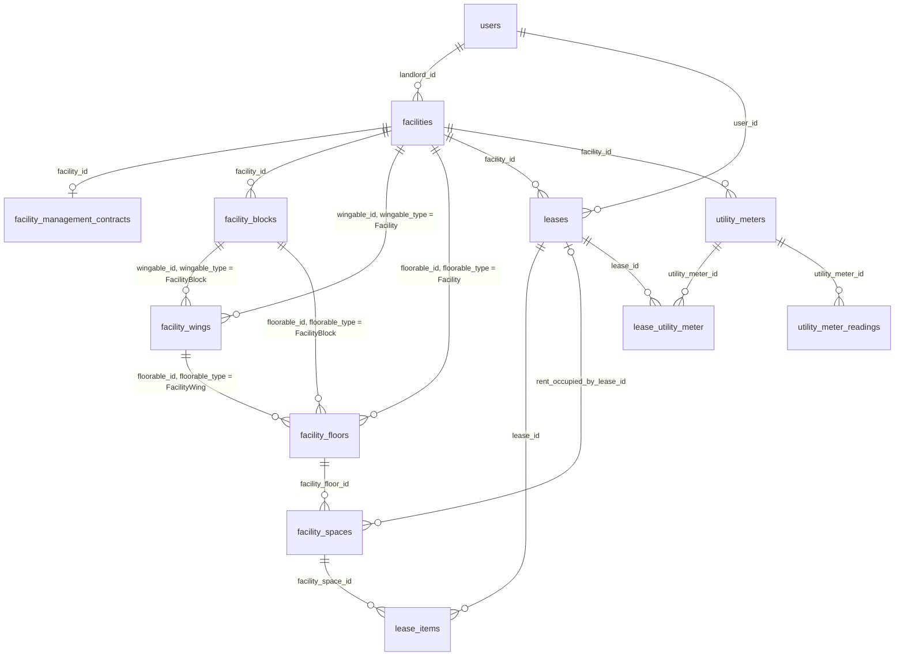

A note on the polymorphic type strings used throughout this section: they are stored as the PHP class name with single backslashes, for example `App\Models\Facility` (19 characters). In a MySQL string literal the backslash is an escape character, so you must write it doubled: `'App\\Models\\Facility'`. If your tool does not treat backslash as an escape (for example when `sql_mode` contains `NO_BACKSLASH_ESCAPES`) write it single. A tool-independent alternative is `floorable_type = CONCAT('App', CHAR(92), 'Models', CHAR(92), 'Facility')`, or the suffix test `floorable_type LIKE '%Facility'` (which does not match `...FacilityBlock`). Every query below was run against the dev database as written.

## facility_types

**One row per:** property class. **Model:** `App\Models\FacilityType`. **Company-scoped:** no. **Soft deletes:** no. **Rows in dev DB:** 3.

A small lookup that classifies a property and decides how its area is divided. The three rows in dev are id 1 `Commercial` (division `size`, taxed), id 2 `Residential` (division `unit`, not taxed) and id 3 `Mixed Use` (division `both`, taxed). The same table is referenced by `facility_spaces.type_id` to give an individual space its own class on a mixed-use property.

| Column | Type | Points to | Meaning |
|---|---|---|---|
| id | bigint | | Primary key. |
| title | varchar | | Class name shown in the UI. |
| has_tax | tinyint(1) | | 1 when leases of this class normally attract VAT. Informational: utility billing ignores it. |
| division_type | enum(`size`,`unit`,`both`) | | How space is measured: `size` = area in the property's space unit (square feet in dev), `unit` = counted units (a residential unit type), `both`. |

**Joins:**
- `facilities.facility_type_id → facility_types.id`, many properties to one type.
- `facility_spaces.type_id → facility_types.id`, many spaces to one type (null on parking and signage spaces).
- `leases.facility_type_id → facility_types.id` and `lease_applications.facility_type_id → facility_types.id` also point here (sections 3 and 4).

**Gotchas:** none.

## facilities

**One row per:** property under management. **Model:** `App\Models\Facility`. **Company-scoped:** yes (`company_id`). **Soft deletes:** yes (`deleted_at`). **Rows in dev DB:** 101 (all `active`, none deleted, all in company 1, 48 distinct landlords).

Created when a property is onboarded (by staff in the UI, by the onboarding sheet import, or by the EPMAS migration: every dev row carries `old_system_id`). The row holds the property's identity, its landlord, its physical structure totals, the indicative rates used for budgets and availability listings, and a set of fee and collection settings that are duplicated from, and superseded by, the property's `facility_management_contracts` row.

**Status:** `status` enum(`pending`,`active`,`inactive`), default `active`.
- `pending` : onboarded but not yet live.
- `active` : under management.
- `inactive` : no longer managed.
Live rows are `status = 'active' AND deleted_at IS NULL`. The PHP enum (`Status`) is a wider list shared by many tables; only these three values can be stored here.

| Column | Type | Points to | Meaning |
|---|---|---|---|
| id | bigint | | Primary key. |
| company_id | bigint | companies.id | Managing company. Nullable in the schema, always set in dev. |
| landlord_id | bigint | users.id | The landlord. A `users` row; there is no separate landlords table. |
| facility_type_id | bigint | facility_types.id | Commercial / Residential / Mixed Use. |
| name | varchar | | Property name. |
| lr_number | varchar | | Land registration number. |
| paybill_number, paybill_account_number | varchar | | M-Pesa paybill details for this property. |
| has_blocks | tinyint(1) | | 1 when the property is split into `facility_blocks` (4 of 101 in dev). When set, floors hang off the blocks, not the property. |
| has_wings | tinyint(1) | | 1 when the property itself has `facility_wings` (none in dev). |
| space_unit_id | bigint | stock_keeping_units.id | Unit of every area column here and of `facility_spaces.size`. Square foot (id 6) on all dev rows. |
| leasable_space, common_space, landlord_space | int | | Total area of each kind, in `space_unit_id` units. |
| allocated_leasable_space, allocated_common_space, allocated_landlord_space | int | | How much of each total has been carved into floors/spaces. These are structure counters, not occupancy: they equal the sum of the floors' `leasable_space` (verified on sampled properties). |
| open_parkings, closed_parkings | int | | Number of parking bays of each kind. |
| allocated_open_parkings, allocated_closed_parkings | int | | Bays already created as parking spaces. |
| indicative_rent_rate_per_space_unit, indicative_service_charge_rate_per_space_unit | decimal(50,5) | | Asking rates per space unit, used for budgets and listings. |
| indicative_open_parking_fee_per_lot, indicative_closed_parking_fee_per_lot | decimal(50,5) | | Asking parking fees per bay. |
| deposit_months | int | | Months of rent taken as security deposit on new leases (default 3). |
| bill_legal_fees, legal_fee_type, indicative_legal_rate | tinyint, enum(`per space unit`,`fixed`), decimal | | Whether and how legal fees are billed on new leases. |
| auto_generate_utility_meters | tinyint(1) | | Stored flag only; meters are no longer generated automatically. |
| construction_date | datetime | | |
| country_id, city_id | bigint | countries.id, cities.id | Location. Always set in dev. |
| physical_address, coordinates | varchar | | |
| withholds | tinyint(1) | | 1 when withholding tax is deducted on this property's remittances (31 of 101 in dev). |
| status | enum | | See above. |
| esd_type, esd_config | enum(`incotex`,`tevin`,`novitas`,`etims`), text | | Electronic tax register device for this property. `esd_config` is encrypted; `esd_type` is null on every dev row. |
| collection_account_holder | enum(`agent`,`landlord`) | | Who holds the collection account. Duplicated on the management contract, which is what the application reads. |
| default_collection_bank_account_id | bigint | bank_accounts.id | Null on every dev row. The collection account is resolved from `facility_bank_accounts` instead. |
| management_fee_type, management_fee_value | enum(`percentage`,`fixed`), decimal(50,5) | | Duplicates of the management contract's fee. Agree with the contract on 98 (type) and 100 (rate) of 101 dev rows; the contract wins. |
| components_to_deduct_management_fee, exclude_vat_from_management_fee | json, tinyint | | Older fee settings; null / 0 on sampled dev rows. |
| letting_fee_percentage, components_to_deduct_letting_fee, exclude_vat_from_letting_fee | decimal(50,10), json, tinyint | | Older letting-fee settings; null on sampled dev rows. The contract row holds the live values. |
| re_letting_fee_percentage, components_to_deduct_re_letting_fee, exclude_vat_from_re_letting_fee | decimal(50,10), json, tinyint | | Same for re-letting. |
| expenditure_limit | decimal(50,10) | | Spend ceiling for procurement on this property (default 50,000). |
| contract_upload_id | bigint | uploads.id | Null on every dev row; the signed contract file sits on the management contract row. |
| utility_bill_distribution_method | enum(`utility provider rate`,`distribute to tenants`,`defined`) | | Property-wide default; the per-utility value on `facility_utilities` is what billing uses. |
| lease_component_allocation_priority_method | enum(`order`,`percentage`,`proportional`) | | How a receipt is spread across the lease components of an invoice (section 5). |
| reporting_currency_id | bigint | currencies.id | The property's reporting currency (set on every dev row). Leases, receipts and bills carry their own `currency_id`. |
| created_by_id | bigint | users.id | Staff member who created the row. |
| budget_cycle, residential_units_income_estimate, commercial_units_income_estimate, expenditure_budget_derivative, expenditure_budget_derivative_operation, expenditure_budget_derivative_operation_amount, expenditure_budget_derivative_average_periods, budget_at_risk_threshold_percent | varchar / decimal(8,2) / int | | Budget settings consumed by `facility_budgets` (section 6). Note the decimal(8,2) estimates cap at 999,999.99. |
| old_system_id | varchar | | The id in the old EPMAS system. |

**Joins:**
- `facilities.landlord_id → users.id`, many properties to one landlord user.
- `facilities.facility_type_id → facility_types.id`, many to one.
- `facilities.company_id → companies.id`, many to one.
- `facilities.space_unit_id → stock_keeping_units.id`, many to one.
- `facilities.reporting_currency_id → currencies.id`, many to one.
- `facilities.country_id → countries.id`, `facilities.city_id → cities.id`, many to one.
- `facility_management_contracts.facility_id → facilities.id`, one contract per property (exactly one in dev).
- `facility_blocks.facility_id → facilities.id`, one property to many blocks.
- `facility_floors.floorable_id → facilities.id` where `floorable_type = 'App\\Models\\Facility'` (polymorphic, no DB constraint); the same for `facility_wings.wingable_id` and `facility_residential_units.residential_unitable_id`.
- `facility_bank_accounts.facility_id`, `facility_utilities.facility_id`, `utility_meters.facility_id`, `utility_prices.facility_id`, `utility_billings.facility_id → facilities.id`, one to many.
- `leases.facility_id → facilities.id` (section 3) and some forty other tables listed in the FK file (bills, expenses, invoices, receipts, remittances, tickets, assets, roles, users) all hang off `facilities.id` with a plain `facility_id` column.
- `facility_user.facility_id → facilities.id` and `facility_role.facility_id → facilities.id` give the staff allocated to a property (section 1).

**Gotchas:**
- There is no `facility_id` on `facility_floors` or `facility_spaces`. To attach a space to its property you must walk `facility_spaces.facility_floor_id → facility_floors` and then resolve `floorable_type`/`floorable_id` through blocks and wings (see `facility_floors` and the worked queries).
- Fee and collection settings exist on both this table and `facility_management_contracts`. The application computes management fees, letting fees, remittances and the collection account holder from the contract row. Use the contract.
- `allocated_*` columns measure how much of the property has been drawn as floors and spaces, not how much is let. For occupancy use `facility_spaces`.
- Money columns are `decimal(50,5)` in currency units (see Conventions); the budget estimates are `decimal(8,2)`.
- `has_blocks` is the only reliable flag for whether floors are reachable directly: a property with `has_blocks = 1` has no floors of its own in dev.

## facility_management_contracts

**One row per:** management agreement between the managing company and the landlord for one property. **Model:** `App\Models\FacilityManagementContract`. **Company-scoped:** yes. **Soft deletes:** yes. **Rows in dev DB:** 101 (one per property, all `active`).

Created with the property (or by the EPMAS migration). It is the record the application reads for the management fee, the letting and re-letting fees, which lease components are remitted to the landlord, which expense types are deducted before remittance, the wages the landlord funds, and who holds the collection account. `Facility::managementContract` is a has-one, so treat it as a one-to-one extension of `facilities`.

**Status:** `status` enum(`active`,`suspended`,`terminated`), default `active`.
- `active` : in force.
- `suspended` : paused.
- `terminated` : ended by the parties.
Live rows are `status = 'active' AND deleted_at IS NULL`. There is **no `expired` value in the database**: the application derives "expired" at read time when `status = 'active'` and `end_at` is in the past. In dev 70 of the 101 active contracts have `end_at < today`, so a report that needs "contracts in force" must add `AND (end_at IS NULL OR end_at >= CURDATE())`.

| Column | Type | Points to | Meaning |
|---|---|---|---|
| id | bigint | | Primary key. |
| company_id | bigint | companies.id | Managing company. |
| facility_id | bigint | facilities.id | The property. One contract per property. |
| management_fee_type | enum(`none`,`percentage`,`fixed`,`custom`) | | How the management fee is charged. |
| management_fee_rate | decimal(20,5) | | Percent when `percentage` (2.5 means 2.5%), an amount when `fixed`. |
| letting_fee_type, letting_fee_rate | enum, decimal(20,5) | | Fee for letting a new lease, same convention (3.75 = 3.75% of the fee base). |
| re_letting_fee_type, re_letting_fee_rate | enum, decimal(20,5) | | Fee for re-letting / renewals. |
| letting_fee_components | json | | Array of `lease_components.id` the letting fee is computed on, for example `[1, 2]` = Rent and Service Charge. |
| start_at, end_at | date | | Contract term. Both set on every dev row. |
| period_in_years, period_in_months | int | | Term length as entered. |
| collection_account_holder | enum(`landlord`,`agent`) | | `agent` = the managing company collects and remits; `landlord` = tenants pay the landlord's own account. 46 agent, 55 landlord in dev. |
| remittable_components | json | | Array of `lease_components.id` whose collections are remitted to the landlord. |
| deductible_expenses | json | | Array of expense category ids deducted from collections before remittance (empty `[]` on sampled rows). |
| management_fee_expense_category_id | bigint | expense_categories.id | Expense category under which the management fee is booked. Set on every dev row. |
| compute_management_fee_components | json | | Array of `lease_components.id` the management fee percentage is applied to. |
| exclude_vat_from_management_fee | tinyint(1) | | 1 = apply the fee to amounts net of VAT. |
| wages | json | | `{"has_wages": true, "items": [{"role": "...", "wages": 25000}]}`: staff wages the landlord funds through the property. |
| contract_upload_id | bigint | uploads.id | Scanned contract file. |
| created_by_id | bigint | users.id | |
| status | enum | | See above. |
| old_system_id | varchar | | The id in the old EPMAS system. |

**Joins:**
- `facility_management_contracts.facility_id → facilities.id`, one to one in practice.
- `facility_management_contracts.management_fee_expense_category_id → expense_categories.id`, many to one.
- `facility_management_contracts.contract_upload_id → uploads.id`, many to one.
- The JSON arrays hold `lease_components.id` values; expand them with `JSON_CONTAINS(remittable_components, CAST(lc.id AS JSON))`.

**Gotchas:**
- Expiry is not stored (see Status).
- The `facilities` table carries older copies of the fee columns; this table is authoritative.
- `*_rate` columns hold a percent for `percentage` types and a currency amount for `fixed`; always read the matching `*_type`.

## facility_bank_accounts

**One row per:** bank account attached to a property for a purpose. **Model:** `App\Models\FacilityBankAccount`. **Company-scoped:** no. **Soft deletes:** yes. **Rows in dev DB:** 204 (99 properties with 2 rows, 2 with 3).

Links a property to the `bank_accounts` rows it uses: the account tenants pay into (`collection`) and the account expenses are paid from (`expense`). A row may be restricted to certain lease components (for example a separate service-charge collection account). Unique on (`facility_id`, `bank_account_id`, `purpose`).

| Column | Type | Points to | Meaning |
|---|---|---|---|
| id | bigint | | Primary key. |
| facility_id | bigint | facilities.id | The property. |
| bank_account_id | bigint | bank_accounts.id | The account (`bank_accounts.type` is `system` for the company's own accounts and `user` for a landlord's account). |
| purpose | varchar, default `collection` | | Application values: `collection`, `expense`, `both`, `remittance`. Dev has only `collection` (103) and `expense` (101). Not a DB enum. |
| lease_components | json | | Null = account applies to every component. Otherwise an array of `lease_components.id`, for example `[2]` = Service Charge only (2 dev rows). |
| is_active | tinyint(1) | | 1 on every dev row. |

**Joins:**
- `facility_bank_accounts.facility_id → facilities.id`, many to one.
- `facility_bank_accounts.bank_account_id → bank_accounts.id`, many to one.

**Gotchas:**
- The property's default collection account is not a column: the application takes the active row whose `purpose` is `collection` or `both`, preferring rows with a null or empty `lease_components`, lowest `id` first.
- `purpose` is free text in the schema; filter with the four values above and expect `both` to count for both purposes.

## landlord_default_accounts

**One row per:** default bank account of a landlord for a purpose (optionally for one lease component). **Model:** `App\Models\LandlordDefaultAccount`. **Company-scoped:** no. **Soft deletes:** no. **Rows in dev DB:** 120 (57 collection, 56 expense, 7 remittance; `lease_component_id` is null on all).

Reference data kept on the landlord's profile: which of the landlord's bank accounts is proposed by default when a new property of theirs is set up. Rows are written when the landlord profile is saved and by the EPMAS migration. Every dev row names a user who is `landlord_id` of at least one property, and 113 of the 120 rows (all the `collection` and `expense` ones) coincide with a `facility_bank_accounts` row of one of that landlord's properties; the 7 `remittance` rows have no property-level counterpart because `facility_bank_accounts` carries no `remittance` rows in dev. No billing, remittance or payout code reads this table; the per-property `facility_bank_accounts` rows are what matter for money.

| Column | Type | Points to | Meaning |
|---|---|---|---|
| id | bigint | | Primary key. |
| landlord_id | bigint | users.id | The landlord user. |
| bank_account_id | bigint | bank_accounts.id | The account. |
| component_type | enum(`remittance`,`expense`,`collection`), default `collection` | | What the account is the default for. |
| lease_component_id | bigint | lease_components.id | When set, the default applies to that component only (null on every dev row). |
| old_system_id | varchar | | The id in the old EPMAS system. |

**Joins:**
- `landlord_default_accounts.landlord_id → users.id`, many to one.
- `landlord_default_accounts.bank_account_id → bank_accounts.id`, many to one.
- `landlord_default_accounts.lease_component_id → lease_components.id`, many to one.

**Gotchas:**
- A landlord can have more than one row per `component_type` (one landlord has 4 collection rows in dev); there is no uniqueness and no "primary" flag.
- No `deleted_at` and no `status`: every row is live.

## facility_blocks

**One row per:** block (a separate building or wing-group) of a property. **Model:** `App\Models\FacilityBlock`. **Company-scoped:** no. **Soft deletes:** yes. **Rows in dev DB:** 9 (on 4 properties; 133 floors hang off them).

Optional layer between a property and its floors. A property either has blocks or has floors directly, never both (enforced by the application; verified in dev: the 4 block properties have 0 direct floors). Unique on (`facility_id`, `name`).

| Column | Type | Points to | Meaning |
|---|---|---|---|
| id | bigint | | Primary key. |
| facility_id | bigint | facilities.id | The property. |
| name | varchar | | Block name. |
| has_wings | tinyint(1) | | 1 when the block is further split into `facility_wings`. |
| leasable_space, common_space, landlord_space, allocated_* | int | | Same structure counters as on `facilities`, scoped to the block. |
| open_parkings, closed_parkings, allocated_open_parkings, allocated_closed_parkings | int | | Parking bays of the block. |
| old_system_id | varchar | | The id in the old EPMAS system. |

**Joins:**
- `facility_blocks.facility_id → facilities.id`, many to one.
- `facility_floors.floorable_id → facility_blocks.id` where `floorable_type = 'App\\Models\\FacilityBlock'` (no DB constraint).
- `facility_wings.wingable_id → facility_blocks.id` where `wingable_type = 'App\\Models\\FacilityBlock'` (no DB constraint).
- `facility_residential_units.residential_unitable_id → facility_blocks.id` where `residential_unitable_type = 'App\\Models\\FacilityBlock'` (no DB constraint).

**Gotchas:** none beyond the polymorphic joins.

## facility_wings

**One row per:** wing of a property or of a block. **Model:** `App\Models\FacilityWing`. **Company-scoped:** no. **Soft deletes:** yes. **Rows in dev DB:** 0.

Optional layer under a property (`wingable_type = 'App\\Models\\Facility'`) or under a block (`wingable_type = 'App\\Models\\FacilityBlock'`); floors can hang off a wing. Unique on (`wingable_id`, `wingable_type`, `name`). Supported by the code and the import, unused in dev.

| Column | Type | Points to | Meaning |
|---|---|---|---|
| id | bigint | | Primary key. |
| wingable_type | varchar | polymorphic: see below | Owner class. |
| wingable_id | bigint | polymorphic: see below | Owner id. |
| name | varchar | | Wing name. |
| leasable_space, common_space, landlord_space, allocated_*, open_parkings, closed_parkings, allocated_open_parkings, allocated_closed_parkings | int | | Structure counters as on `facilities`. |
| old_system_id | varchar | | The id in the old EPMAS system. |

**Joins:**
- `wingable_type`/`wingable_id` → `facilities.id` when `wingable_type = 'App\\Models\\Facility'`, → `facility_blocks.id` when `'App\\Models\\FacilityBlock'` (no DB constraint; no rows in dev to confirm the strings, taken from the model code).
- `facility_floors.floorable_id → facility_wings.id` where `floorable_type = 'App\\Models\\FacilityWing'`.

**Gotchas:** empty in dev, but any hierarchy query should still handle the wing branch so it keeps working when a wing is created.

## facility_floors

**One row per:** floor of a property, block or wing. **Model:** `App\Models\FacilityFloor`. **Company-scoped:** no. **Soft deletes:** yes. **Rows in dev DB:** 622 (489 directly on properties, 133 on blocks, 0 on wings; 19 floors have no spaces; 1 property has no floors at all).

The level spaces hang off. The owner is polymorphic: `floorable_type` is `App\Models\Facility`, `App\Models\FacilityBlock` or `App\Models\FacilityWing`. Unique on (`floorable_id`, `floorable_type`, `name`). Both polymorphic columns are nullable in the schema but never null in dev.

| Column | Type | Points to | Meaning |
|---|---|---|---|
| id | bigint | | Primary key. |
| floorable_type | varchar | polymorphic: see below | Owner class. |
| floorable_id | bigint | polymorphic: see below | Owner id. |
| name | varchar | | Floor name (for example "Ground Floor"). |
| is_parking | tinyint(1) | | 1 for a dedicated parking level (2 in dev). Parking spaces also sit on ordinary floors. |
| is_divisible | tinyint(1) | | 1 when the floor is carved into spaces by area (all dev rows). |
| leasable_space, common_space, landlord_space | int | | Floor totals in the property's space unit. The sum over a property's floors equals `facilities.leasable_space` (verified on sampled properties). |
| allocated_leasable_space, allocated_common_space, allocated_landlord_space | int | | Area already drawn as spaces; equals the sum of the floor's space sizes on sampled properties. |
| open_parkings, closed_parkings, allocated_open_parkings, allocated_closed_parkings | int | | Parking bays on this floor. |
| old_system_id | varchar | | The id in the old EPMAS system. |

**Joins:**
- `facility_floors.floorable_id → facilities.id` when `floorable_type = 'App\\Models\\Facility'` (489 rows in dev), `→ facility_blocks.id` when `'App\\Models\\FacilityBlock'` (133 rows), `→ facility_wings.id` when `'App\\Models\\FacilityWing'` (0 rows). No DB constraint on any of them.
- `facility_spaces.facility_floor_id → facility_floors.id`, one floor to many spaces.
- `facility_units.floor_id → facility_floors.id` (legacy, empty).
- `facility_residential_units.residential_unitable_id → facility_floors.id` where `residential_unitable_type = 'App\\Models\\FacilityFloor'` (empty in dev).

Resolving a floor to its property, reusable as a derived table in any query:

```sql
SELECT fl.id AS facility_floor_id,
       CASE fl.floorable_type
         WHEN 'App\\Models\\Facility'      THEN fl.floorable_id
         WHEN 'App\\Models\\FacilityBlock' THEN b.facility_id
         WHEN 'App\\Models\\FacilityWing'  THEN COALESCE(wb.facility_id, w.wingable_id)
       END AS facility_id
FROM facility_floors fl
LEFT JOIN facility_blocks b  ON fl.floorable_type = 'App\\Models\\FacilityBlock' AND b.id = fl.floorable_id
LEFT JOIN facility_wings  w  ON fl.floorable_type = 'App\\Models\\FacilityWing'  AND w.id = fl.floorable_id
LEFT JOIN facility_blocks wb ON w.wingable_type  = 'App\\Models\\FacilityBlock' AND wb.id = w.wingable_id
WHERE fl.deleted_at IS NULL
```

**Gotchas:**
- There is no `facility_id` column. Any join from a space to a property goes through the CASE above.
- The `allocated_*` counters say how much of the floor is drawn, not how much is let.

## facility_spaces

**One row per:** lettable unit: a shop, office, flat, parking bay or signage slot. **Model:** `App\Models\FacilitySpace`. **Company-scoped:** yes. **Soft deletes:** yes. **Rows in dev DB:** 6,619 (3,536 ordinary spaces, 2,933 parking bays, 150 signage slots; none deleted; all `space_type = 'leasable'`).

This is the table that answers "which units are occupied and by whom". A space sits on a floor and is let through `lease_items` (section 3): one `lease_items` row ties one lease to one space, and the item's `lease_item_components` rows say which charges that lease pays on that space (rent, service charge, parking fee, signage fee, ...). From those rows the application maintains three cached columns on the space: `status`, `rent_occupied_by_lease_id` and `service_charge_occupied_by_lease_id`. Rent and service charge are tracked separately because they can be held by different leases (for example an owner-occupier who pays only service charge, or a tenant who pays rent while the owner's own lease carries the service charge).

**Status:** `status` enum(`available`,`only rent available`,`only service charge available`,`under consideration`,`on notice`,`unavailable`), default `available`. Meaning, and how the application assigns it:
- `available` : nothing live holds the space (2,574 in dev).
- `only rent available` : a live lease holds the service charge but no live lease holds the rent; the rent side can still be let (419). Counts as **vacant**.
- `only service charge available` : a live lease holds the rent, none holds the service charge (312). Counts as **occupied**.
- `under consideration` : no live holder, but an open lease application (`lease_applications.status` in `pending`, `review`) names the space through `lease_application_facility_space` (7). Counts as vacant.
- `on notice` : the rent-holding lease has a tenant exit notice in `pending-review` (2). Counts as occupied.
- `unavailable` : fully occupied: both rent and service charge are held by live leases, or, for a parking bay or signage slot, its single slot is held (3,305).
Live rows are `deleted_at IS NULL`; for occupancy counts treat `only service charge available`, `on notice` and `unavailable` as occupied and the other three as vacant (this is the application's own rule, `SpaceStatus::countsAsOccupied`). A space is offered to applicants when its status is `available`, `only rent available` or `on notice`.

**How the cache is computed** (the only writer is `SyncFacilitySpaceStatusAction`, run whenever a lease is activated, suspended, terminated, a lease item is added or removed, an application space is attached or detached, an exit notice is created or deleted, and by the onboarding import):
1. A lease **holds** a space while `leases.status` is `active` or `suspended`. `pending` leases do not hold yet, `terminated` and `rejected` leases have released it. Suspension does not release a space.
2. Which slot it holds is decided by the lease item's components: `lease_item_components.lease_component_id → lease_components` with `is_rent = 1` gives the rent slot (`rent_occupied_by_lease_id`), `is_service_charge = 1` the service-charge slot, `is_parking_fee = 1` a parking bay, `is_signage_fee = 1` a signage slot. In dev these are lease components 1 (Rent), 2 (Service Charge), 8 (Parking) and 9 (Signage).
3. If several live leases have an item on the same space for the same slot, the item with the highest `lease_items.id` wins (there is no uniqueness on `lease_items.facility_space_id`).
4. Ordinary spaces: `on notice` if the rent holder has a pending exit notice (`tenant_exit_notices.lease_id` or `tenant_exit_notice_items.lease_id` with `tenant_exit_notices.status = 'pending-review'`); else `unavailable` if both slots held; `only service charge available` if only rent held; `only rent available` if only service charge held; `under consideration` if an open application names the space; else `available`.
5. Parking bays and signage slots (`is_parking = 1` or `is_signage = 1`) have one slot: `on notice`, `unavailable` (held through the parking/signage fee), `under consideration` or `available`. **Their two pointer columns are normally NULL even when they are occupied**: in dev 1,463 parking and 74 signage spaces are `unavailable` with both pointers null. Read their occupant from `lease_items` (see worked query 1).

| Column | Type | Points to | Meaning |
|---|---|---|---|
| id | bigint | | Primary key. |
| company_id | bigint | companies.id | Managing company (always set in dev, equal to the property's). |
| facility_floor_id | bigint | facility_floors.id | The floor. The only path to the property. |
| name | varchar | | Unit name / number. |
| type_id | bigint | facility_types.id | The space's own class (Commercial or Residential), used on Mixed Use properties. Set on every ordinary space, NULL on every parking and signage space (3,083 nulls). |
| facility_residential_unit_id | bigint | facility_residential_units.id | Residential unit type the space belongs to. Null on every dev row. |
| description | longtext | | |
| space_type | enum(`landlord`,`common`,`leasable`) | | Which area pool the space is drawn from. Only `leasable` occurs in dev. |
| size | int, default 1 | | Area in the property's space unit (square feet). Meaningful on size-divided (Commercial) properties; on unit-divided (Residential) properties it is 0 or 1. 543 ordinary spaces have size 0 in dev, so area-weighted occupancy understates those properties. Parking and signage spaces have size 1. |
| rooms | int | | Room count (0 to 5 in dev). |
| status | enum | | See above. |
| rent_occupied_by_lease_id | bigint | leases.id | Live lease holding the rent (2,080 set in dev; every one points to an `active` lease that has a matching `lease_items` row). |
| service_charge_occupied_by_lease_id | bigint | leases.id | Live lease holding the service charge (2,174 set). Where both are set they name the same lease on 1,752 spaces and never different leases in dev. |
| is_parking | tinyint(1) | | 1 = parking bay (2,933). |
| parking_type | enum(`closed`,`open`) | | Set only when `is_parking = 1` (open 936, closed 1,997). |
| is_signage | tinyint(1) | | 1 = signage slot (150). |
| is_mansion | tinyint(1) | | Flag entered on creation; 0 on every dev row. |
| occupier_type, occupier_id | varchar, bigint | | **Dead columns.** No code reads or writes them and both are NULL on all 6,619 rows. Ignore. |
| created_by_id | bigint | users.id | |
| old_system_id | varchar | | The id in the old EPMAS system (set on every dev row). |

**Joins:**
- `facility_spaces.facility_floor_id → facility_floors.id`, many spaces to one floor.
- `facility_spaces.rent_occupied_by_lease_id → leases.id` and `facility_spaces.service_charge_occupied_by_lease_id → leases.id`, many spaces to one lease (a lease can hold several spaces).
- `lease_items.facility_space_id → facility_spaces.id`, one space to many lease items over time (6,513 items in dev, 43 of them with a NULL space; 5,112 distinct spaces; 671 spaces appear only on terminated leases).
- `facility_spaces.type_id → facility_types.id`, `facility_spaces.facility_residential_unit_id → facility_residential_units.id`, `facility_spaces.company_id → companies.id`, `facility_spaces.created_by_id → users.id`.
- `lease_application_facility_space.facility_space_id → facility_spaces.id` (pivot with `lease_application_id`), the spaces an application asks for.
- `loo_spaces.facility_space_id`, `facility_tickets.facility_space_id`, `storage_rooms.facility_space_id → facility_spaces.id` (sections 4 and 10).
- Tenant of an occupied space: `facility_spaces.rent_occupied_by_lease_id → leases.id`, then `leases.user_id → users.id` (`users.name`). There is no `tenant_id` column on `leases`. Landlord: through the floor walk to `facilities.landlord_id → users.id`.

**Gotchas:**
- The three cached columns are usually right but not guaranteed: in dev the pointer is never set wrongly, but it is **missing** on 60 spaces where a live lease carries a rent component on the space (31 ordinary spaces still `available`, 4 `only rent available`, 21 signage, 4 parking). Where it matters, recompute from source with:

```sql
SELECT s.id AS space_id, s.status, s.rent_occupied_by_lease_id AS cached_rent_lease_id,
       d.rent_lease_id AS derived_rent_lease_id
FROM facility_spaces s
LEFT JOIN (
  SELECT li.facility_space_id,
         SUBSTRING_INDEX(GROUP_CONCAT(li.lease_id ORDER BY li.id DESC), ',', 1) + 0 AS rent_lease_id
  FROM lease_items li
  JOIN leases l ON l.id = li.lease_id AND l.status IN ('active','suspended')
  JOIN lease_item_components lic ON lic.lease_item_id = li.id
  JOIN lease_components lc ON lc.id = lic.lease_component_id AND lc.is_rent = 1
  GROUP BY li.facility_space_id
) d ON d.facility_space_id = s.id
WHERE s.deleted_at IS NULL AND NOT (d.rent_lease_id <=> s.rent_occupied_by_lease_id);
```
  (60 rows in dev; swap `is_rent` for `is_service_charge`, `is_parking_fee` or `is_signage_fee` for the other slots.)
- A space with a live lease item is not necessarily occupied. Of the 240 lease items on active leases that sit on `available` ordinary spaces in dev, 157 have no component rows at all and most of the rest carry only utility components (Electricity, Water); those spaces stay `available`, correctly. Only the 31 whose item carries Rent are the stale cases listed above.
- "Everything except `available` is occupied" is wrong: `only rent available` and `under consideration` are vacant.
- Occupancy over a period (was the space let at any time between two dates) cannot come from the cache. The reports use `lease_items` joined to `leases` with `leases.start_at <= :to AND COALESCE(leases.terminated_at, '9999-12-31') >= :from`, counting every lease status; a lease runs until `terminated_at`, not until `end_at`.
- A space can carry items from two live leases at once (10 spaces in dev), typically rent on one lease and service charge on another.
- `leases.user_id` is a `users` row; 10 users in dev are both a tenant and a landlord. `tenant_users` and `landlord_users` (sub-users of a tenant or landlord organisation) are empty in dev and are not needed to find the tenant.

## facility_residential_units

**One row per:** residential unit type (for example "2 bedroom") offered on a property, block, wing or floor, with how many exist. **Model:** `App\Models\FacilityResidentialUnit`. **Company-scoped:** yes. **Soft deletes:** yes. **Rows in dev DB:** 0.

Intended for unit-divided (Residential) properties: a type row says how many units of that kind exist (`quantity`) and how many have been drawn as spaces (`allocated`); a space then points back with `facility_spaces.facility_residential_unit_id`, and availability per type is `quantity` minus the spaces of that type whose rent is held. Types can nest (`parent_facility_residential_unit_id`) so a block-level or floor-level type rolls up to the property-level type. Not used in dev data.

| Column | Type | Points to | Meaning |
|---|---|---|---|
| id | bigint | | Primary key. |
| company_id | bigint | companies.id | |
| residential_unitable_type, residential_unitable_id | varchar, bigint | polymorphic: see below | Owner: `App\Models\Facility`, `App\Models\FacilityBlock`, `App\Models\FacilityWing` or `App\Models\FacilityFloor` (from the model code; no rows to confirm). |
| parent_facility_residential_unit_id | bigint | facility_residential_units.id | Parent type, for roll-up. |
| title | varchar | | Type name. |
| bedrooms | int | | |
| quantity | decimal(10,3) | | Units of this type (cast to integer by the application). |
| allocated | int | | Units already created as spaces. |
| indicative_rent_per_unit, indicative_service_charge_per_unit | decimal(50,5) | | Asking rates per unit. |
| old_system_id | varchar | | The id in the old EPMAS system. |

**Joins:**
- `facility_spaces.facility_residential_unit_id → facility_residential_units.id`, one type to many spaces.
- `facility_budget_income_items.facility_residential_unit_id` and `lease_application_residential_unit_types.facility_residential_unit_id → facility_residential_units.id` (sections 6 and 4).
- Polymorphic owner as above (no DB constraint).

**Gotchas:** empty; `quantity` is a decimal in the schema but an integer in practice.

## facility_units

**One row per:** unit on a floor (legacy). **Model:** `App\Models\FacilityUnit`. **Company-scoped:** no. **Soft deletes:** yes. **Rows in dev DB:** 0.

An early version of `facility_spaces` that was superseded. No code outside the model class references it and nothing writes to it. Documented only so it is not mistaken for the unit table.

| Column | Type | Points to | Meaning |
|---|---|---|---|
| id | bigint | | Primary key. |
| floor_id | bigint | facility_floors.id | The floor. |
| name | varchar | | |
| is_leasable, is_common | tinyint(1) | | Kind of unit. |
| size | int | | Area. |
| old_system_id | varchar | | The id in the old EPMAS system. |

**Joins:** `facility_units.floor_id → facility_floors.id`, many to one.

**Gotchas:** do not use; `facility_spaces` is the unit table.

## facility_utilities

**One row per:** metered utility configured on a property. **Model:** `App\Models\FacilityUtility`. **Company-scoped:** yes. **Soft deletes:** no. **Rows in dev DB:** 202 (every property has exactly Electricity and Water).

Per-property settings for one utility: the reading unit, how the provider's bill is distributed to tenants, whether unmetered ("indirect") consumption is billed to tenants, the supplier, and which property role is alerted. Unique on (`facility_id`, `utility_id`). **`utility_id` points to `lease_components`, not to `utilities`**: the live notion of a utility is a lease component with `is_utility_charge = 1` (ids 6 Electricity and 7 Water in dev).

| Column | Type | Points to | Meaning |
|---|---|---|---|
| id | bigint | | Primary key. |
| company_id | bigint | companies.id | |
| facility_id | bigint | facilities.id | The property. |
| utility_id | bigint | lease_components.id | The utility charge component (DB constraint to `lease_components`). |
| reading_unit_id | bigint | stock_keeping_units.id | Unit meters are read in (kWh, m3). Set on 198 of 202 dev rows. |
| utility_bill_distribution_method | enum(`utility provider rate`,`distribute to tenants`,`defined`) | | `utility provider rate`: tenants pay their metered units at the provider's per-unit price (bill amount / bill consumption); `distribute to tenants`: the whole bill is spread over tenants' metered units; `defined`: a rate typed in at billing time. All dev rows use `utility provider rate`. |
| bill_indirect_consumption | tinyint(1) | | 1 = units the provider billed that no tenant meter accounts for (common areas, losses) are charged to tenants in proportion to their space size as a second invoice line; 0 = the landlord absorbs them. 0 on every dev row. |
| vendor_id | bigint | users.id | The utility supplier (a vendor user). Set on 79 dev rows. |
| alertable_facility_role_id | bigint | facility_role.id | Property role notified about this utility (null in dev). |
| old_system_id | varchar | | The id in the old EPMAS system. |

**Joins:**
- `facility_utilities.facility_id → facilities.id`, many to one.
- `facility_utilities.utility_id → lease_components.id`, many to one.
- `facility_utilities.reading_unit_id → stock_keeping_units.id`, `facility_utilities.vendor_id → users.id`, `facility_utilities.alertable_facility_role_id → facility_role.id`, many to one.

**Gotchas:** the name `utility_id` suggests the `utilities` table; it is `lease_components`.

## utility_meters

**One row per:** physical meter on a property. **Model:** `App\Models\UtilityMeter`. **Company-scoped:** yes. **Soft deletes:** yes. **Rows in dev DB:** 893 (all `active`, none faulty, on 21 properties: 586 electricity meters read in kWh, 307 water meters read in m3).

Created by staff or imported from a spreadsheet. A meter belongs to a property and a utility (again a `lease_components` row) and serves one or more leases through `lease_utility_meter`. The row also caches the latest reading (`last_reading`, `last_reading_at`, `last_reading_image_id`) which the application copies from each new `utility_meter_readings` row; on creation `last_reading` is set equal to `initial_reading`.

**Status:** `status` enum(`active`,`inactive`), default `active`. `inactive` meters are kept for history. Live rows are `status = 'active' AND deleted_at IS NULL`. Separately, "read this month" in the UI means `last_reading_at` falls in the current calendar month.

| Column | Type | Points to | Meaning |
|---|---|---|---|
| id | bigint | | Primary key. |
| company_id | bigint | companies.id | |
| meter_number | varchar | | Meter number as labelled. Equal to `meter_serial_number` on every dev row. |
| meter_serial_number | varchar | | |
| name | varchar | | Display name. |
| description | text | | Null in dev. |
| utility_id | bigint | lease_components.id | Electricity (6) or Water (7). **No DB constraint**; relationship from the model. |
| facility_id | bigint | facilities.id | The property. Always the same property as the linked lease in dev. |
| created_by_id | bigint | users.id | Null on every dev row (imported). |
| reading_unit_id | bigint | stock_keeping_units.id | kWh (58) or Cubic Meter (42). |
| initial_reading | decimal(50,5) | | Reading when the meter was installed/registered. Used as the "previous" reading on the first bill. |
| last_reading | decimal(50,5) | | Latest reading (cache). Equal to `initial_reading` on every dev row: no readings have been taken in the dev copy. |
| last_reading_at | timestamp | | When the latest reading was taken. Null on all dev rows. |
| last_reading_image_id | bigint | uploads.id | Photo of the latest reading. |
| status | enum | | See above. |
| submitted_at | timestamp | | Set when the meter reader submits the month's readings for billing; cleared for every meter by a scheduled job at 00:10 on the 1st of each month. Billing from the screen only bills meters with `submitted_at` set. |
| is_faulty, fault_reason | tinyint, varchar | | Copied from the latest reading. |
| old_system_id | varchar | | The id in the old EPMAS system. |

**Joins:**
- `utility_meters.facility_id → facilities.id`, many to one.
- `utility_meters.utility_id → lease_components.id`, many to one (no DB constraint).
- `utility_meters.reading_unit_id → stock_keeping_units.id`, `utility_meters.last_reading_image_id → uploads.id`, `utility_meters.created_by_id → users.id`, many to one.
- `lease_utility_meter.utility_meter_id → utility_meters.id`, one meter to many lease links.
- `utility_meter_readings.utility_meter_id → utility_meters.id`, one meter to many readings.

**Gotchas:**
- Meters are linked to **leases**, not to spaces. The old `facility_space_utility_meter` pivot no longer exists. To place a meter on a unit go meter → `lease_utility_meter` → `leases` → `lease_items` → `facility_spaces`.
- `last_reading` is a cache; for history use `utility_meter_readings`.

## lease_utility_meter

**One row per:** link between a meter and a lease it serves. **Model:** none (pivot table of `UtilityMeter::leases` / `Lease::utilityMeters`). **Company-scoped:** no. **Soft deletes:** no. **Rows in dev DB:** 893.

Written when a meter is created or edited (the lease list on the meter is replaced wholesale). Unique on (`utility_meter_id`, `lease_id`). In dev every meter has exactly one lease; 842 leases have one meter, 15 have two, and four leases have 3 to 7 meters. A meter shared by several leases has its consumption split by the leases' space sizes at billing time.

| Column | Type | Points to | Meaning |
|---|---|---|---|
| id | bigint | | Primary key. |
| utility_meter_id | bigint | utility_meters.id | The meter. |
| lease_id | bigint | leases.id | The lease billed for the meter. |

**Joins:**
- `lease_utility_meter.utility_meter_id → utility_meters.id`, many links to one meter.
- `lease_utility_meter.lease_id → leases.id`, many links to one lease. Connects `utility_meters` and `leases`.

**Gotchas:** the link is not removed when a lease ends: 57 dev links point at `terminated` leases. Filter on `leases.status = 'active'` to find the current tenant of a meter.

## utility_meter_readings

**One row per:** reading taken on a meter. **Model:** `App\Models\UtilityMeterReading`. **Company-scoped:** no. **Soft deletes:** no. **Rows in dev DB:** 0 (the dev copy has not had any readings entered; the structure is live in production).

Written by the meter reading app or staff. Creating a reading copies `current_reading`, its timestamp, the photo and the fault flags onto the meter. A billing run consumes the newest unbilled reading of each meter as the "current" reading and the latest billed one (or the meter's `initial_reading` on a first bill) as the "previous" reading, then stamps `billed_at` on the readings it used; the invoice line created keeps both reading ids.

| Column | Type | Points to | Meaning |
|---|---|---|---|
| id | bigint | | Primary key. |
| utility_meter_id | bigint | utility_meters.id | The meter. |
| created_by_id | bigint | users.id | Who took the reading. |
| current_reading | decimal(50,5) | | The reading, in the meter's reading unit. Consumption is the difference between consecutive readings. |
| reading_image_id | bigint | uploads.id | Photo of the dial. |
| is_faulty, fault_reason | tinyint, varchar | | Reader flagged the meter as faulty. |
| billed_at | timestamp | | Null until a billing run uses the reading as the current reading; then the run time. `billed_at IS NULL` = awaiting billing. |
| old_system_id | varchar | | The id in the old EPMAS system. |
| created_at | timestamp | | The reading time (the application uses `created_at` as the reading date). |

**Joins:**
- `utility_meter_readings.utility_meter_id → utility_meters.id`, many to one.
- `utility_meter_readings.created_by_id → users.id`, `utility_meter_readings.reading_image_id → uploads.id`, many to one.
- `facility_invoice_items.previous_utility_meter_reading_id → utility_meter_readings.id` and `facility_invoice_items.current_utility_meter_reading_id → utility_meter_readings.id` (section 5): the invoice line a reading was billed on. A utility line with both ids null is an indirect-consumption line.

**Gotchas:** there is no `lease_id` on a reading; the tenant comes from the meter's `lease_utility_meter` link at the time of billing.

## utility_billings

**One row per:** utility billing run processed from the billing screen for one property and one utility. **Model:** `App\Models\UtilityBilling`. **Company-scoped:** yes. **Soft deletes:** no. **Rows in dev DB:** 0 (feature added 2026-10-20; nothing in the dev copy yet).

A run takes the provider's bill (optionally recorded as a `facility_bills` row via `bill_id`), prices the tenants' metered consumption with the chosen tax, raises one `facility_invoices` row per active lease with one line per meter, and saves its totals here. Invoices raised by the run carry `facility_invoices.utility_billing_id`. Runs that billed no lease and raised no provider bill are deleted at the end, so every surviving row billed something. Readings billed by the catch-up console command belong to no run.

| Column | Type | Points to | Meaning |
|---|---|---|---|
| id | bigint | | Primary key. |
| company_id | bigint | companies.id | |
| facility_id | bigint | facilities.id | The property. |
| utility_id | bigint | lease_components.id | The utility charge billed. |
| tax_id | bigint | taxes.id | Tax applied to every lease in the run. |
| distribution_method | varchar | | Same values as `facility_utilities.utility_bill_distribution_method`, as used for this run. |
| charge_rate | decimal(50,5) | | Per-unit rate charged to tenants. |
| notes | text | | |
| bill_id | bigint | facility_bills.id | The supplier bill raised for the provider's invoice. |
| bill_upload_id | bigint | uploads.id | Scan of the provider's bill. |
| bill_date, bill_number, bill_tax_invoice_number | date, varchar, varchar | | Provider's bill details. |
| total_bill_amount, bill_tax_amount, bill_consumption | decimal(50,5) | | Provider's bill total (tax inclusive), its tax, and the units it billed. |
| billed_leases, skipped_leases | int | | Leases invoiced / skipped (already billed this period, no reading, zero consumption). |
| total_previous, total_current, consumed | decimal(50,5) | | Sum of previous readings, of current readings, and metered units billed. |
| indirect_consumed | decimal(50,5) | | Unmetered units passed on to tenants. |
| amount, tax, total | decimal(50,5) | | Sums of the invoices raised: net, tax amount, gross. `tax` is an amount, not a rate. |
| created_by_id | bigint | users.id | Who ran it. |

**Joins:**
- `utility_billings.facility_id → facilities.id`, `utility_billings.utility_id → lease_components.id`, `utility_billings.tax_id → taxes.id`, `utility_billings.bill_id → facility_bills.id`, `utility_billings.bill_upload_id → uploads.id`, `utility_billings.created_by_id → users.id`, many to one.
- `facility_invoices.utility_billing_id → utility_billings.id`, one run to many invoices.

**Gotchas:** `leases.utility_billed_at` is stamped on every billed lease; a lease is skipped in a later run only when that stamp is in the period **and** it already has a live invoice with a line for the same utility in the period.

## utilities

**One row per:** utility in the legacy utility catalogue. **Model:** `App\Models\Utility`. **Company-scoped:** yes. **Soft deletes:** yes. **Rows in dev DB:** 0.

An older catalogue of utilities with a default price per unit. The settings screens still exist, but meters, property utility settings and billing runs all identify a utility as a `lease_components` row (`is_utility_charge = 1`). Only `utility_prices.utility_id` points here.

| Column | Type | Points to | Meaning |
|---|---|---|---|
| id | bigint | | Primary key. |
| company_id | bigint | companies.id | |
| name, description | varchar, text | | |
| utility_type | enum(`electricity`,`water`,`gas`,`other`) | | |
| stock_keeping_unit_id | bigint | stock_keeping_units.id | Unit of measure. |
| is_regulated | tinyint(1) | | |
| default_price_per_unit | decimal(50,5) | | |

**Joins:** `utilities.stock_keeping_unit_id → stock_keeping_units.id`; `utility_prices.utility_id → utilities.id`.

**Gotchas:** do not join `facility_utilities.utility_id`, `utility_meters.utility_id` or `utility_billings.utility_id` to this table; they are `lease_components.id` values.

## utility_prices

**One row per:** price per unit of a utility on a property (legacy). **Model:** `App\Models\UtilityPrice`. **Company-scoped:** yes. **Soft deletes:** no. **Rows in dev DB:** 0.

Companion of `utilities`: a per-property price override. Not read by the billing code, which derives the tenant rate from the provider's bill at run time.

| Column | Type | Points to | Meaning |
|---|---|---|---|
| id | bigint | | Primary key. |
| company_id | bigint | companies.id | |
| facility_id | bigint | facilities.id | The property. |
| utility_id | bigint | utilities.id | The legacy utility. |
| currency_id | bigint | currencies.id | |
| price_per_unit | decimal(50,5) | | |
| utility_bill_distribution_method | enum(`utility provider rate`,`distribute to tenants`,`defined`) | | |
| old_system_id | varchar | | The id in the old EPMAS system. |

**Joins:** `utility_prices.facility_id → facilities.id`, `utility_prices.utility_id → utilities.id`, `utility_prices.currency_id → currencies.id`, many to one.

**Gotchas:** empty and unused by billing.

## Worked queries

**1. Every leasable space on one property (id 22, a property with blocks) with its status, the lease holding its rent and service charge, the tenant of each, and, for parking and signage spaces, the live lease holding it through `lease_items`.**

```sql
SELECT f.id AS facility_id, f.name AS property_name,
       fl.name AS floor_name, s.id AS space_id, s.name AS space_name,
       s.is_parking, s.is_signage, s.size, s.status,
       s.rent_occupied_by_lease_id, rl.user_id AS rent_tenant_user_id, ru.name AS rent_tenant_name,
       s.service_charge_occupied_by_lease_id, sl.user_id AS sc_tenant_user_id, su.name AS sc_tenant_name,
       h.holding_lease_id, hl.status AS holding_lease_status, hl.user_id AS holding_tenant_user_id, hu.name AS holding_tenant_name
FROM facility_spaces s
JOIN facility_floors fl ON fl.id = s.facility_floor_id AND fl.deleted_at IS NULL
LEFT JOIN facility_blocks b  ON fl.floorable_type = 'App\\Models\\FacilityBlock' AND b.id = fl.floorable_id
LEFT JOIN facility_wings  w  ON fl.floorable_type = 'App\\Models\\FacilityWing'  AND w.id = fl.floorable_id
LEFT JOIN facility_blocks wb ON w.wingable_type  = 'App\\Models\\FacilityBlock' AND wb.id = w.wingable_id
JOIN facilities f ON f.id = CASE fl.floorable_type
        WHEN 'App\\Models\\Facility'      THEN fl.floorable_id
        WHEN 'App\\Models\\FacilityBlock' THEN b.facility_id
        WHEN 'App\\Models\\FacilityWing'  THEN COALESCE(wb.facility_id, w.wingable_id)
    END
LEFT JOIN leases rl ON rl.id = s.rent_occupied_by_lease_id
LEFT JOIN users  ru ON ru.id = rl.user_id
LEFT JOIN leases sl ON sl.id = s.service_charge_occupied_by_lease_id
LEFT JOIN users  su ON su.id = sl.user_id
LEFT JOIN (
    SELECT li.facility_space_id,
           SUBSTRING_INDEX(GROUP_CONCAT(li.lease_id ORDER BY li.id DESC), ',', 1) + 0 AS holding_lease_id
    FROM lease_items li
    JOIN leases l ON l.id = li.lease_id AND l.status IN ('active', 'suspended')
    GROUP BY li.facility_space_id
) h ON h.facility_space_id = s.id
LEFT JOIN leases hl ON hl.id = h.holding_lease_id
LEFT JOIN users  hu ON hu.id = hl.user_id
WHERE s.deleted_at IS NULL AND f.deleted_at IS NULL
  AND s.space_type = 'leasable'
  AND f.id = 22
ORDER BY fl.id, s.name;
```

Ran on dev: 288 rows for property 22 (51 ordinary spaces, 224 parking bays, 13 signage slots); 195 are not `available`, 41 have a rent tenant through the pointer, and 221 have a holding lease through `lease_items`. The difference is mostly the parking and signage spaces, whose pointer columns are null even when they are let, which is why the query carries both. Drop the `f.id = 22` line to run it for every property.

**2. Occupancy rate per property: by unit count (the application's own rule), by area (rent pointer weighted by size) and parking bays let.**

```sql
SELECT f.id AS facility_id, f.name AS property_name, ft.title AS property_type,
       SUM(s.is_parking = 0 AND s.is_signage = 0) AS spaces_total,
       SUM(s.is_parking = 0 AND s.is_signage = 0
           AND s.status IN ('only service charge available', 'on notice', 'unavailable')) AS spaces_occupied,
       ROUND(100 * SUM(s.is_parking = 0 AND s.is_signage = 0
           AND s.status IN ('only service charge available', 'on notice', 'unavailable'))
           / NULLIF(SUM(s.is_parking = 0 AND s.is_signage = 0), 0), 1) AS unit_occupancy_pct,
       SUM(CASE WHEN s.is_parking = 0 AND s.is_signage = 0 THEN s.size ELSE 0 END) AS area_total,
       SUM(CASE WHEN s.is_parking = 0 AND s.is_signage = 0 AND s.rent_occupied_by_lease_id IS NOT NULL THEN s.size ELSE 0 END) AS area_let,
       ROUND(100 * SUM(CASE WHEN s.is_parking = 0 AND s.is_signage = 0 AND s.rent_occupied_by_lease_id IS NOT NULL THEN s.size ELSE 0 END)
           / NULLIF(SUM(CASE WHEN s.is_parking = 0 AND s.is_signage = 0 THEN s.size ELSE 0 END), 0), 1) AS area_occupancy_pct,
       SUM(s.is_parking = 1) AS parkings_total,
       SUM(s.is_parking = 1 AND s.status IN ('unavailable', 'on notice')) AS parkings_let
FROM facilities f
JOIN facility_types ft ON ft.id = f.facility_type_id
JOIN facility_floors fl ON fl.deleted_at IS NULL AND (
        (fl.floorable_type = 'App\\Models\\Facility' AND fl.floorable_id = f.id)
     OR (fl.floorable_type = 'App\\Models\\FacilityBlock' AND fl.floorable_id IN
            (SELECT b.id FROM facility_blocks b WHERE b.facility_id = f.id AND b.deleted_at IS NULL))
     OR (fl.floorable_type = 'App\\Models\\FacilityWing' AND fl.floorable_id IN
            (SELECT w.id FROM facility_wings w
             LEFT JOIN facility_blocks wb ON w.wingable_type = 'App\\Models\\FacilityBlock' AND wb.id = w.wingable_id
             WHERE w.deleted_at IS NULL
               AND ((w.wingable_type = 'App\\Models\\Facility' AND w.wingable_id = f.id) OR wb.facility_id = f.id))))
JOIN facility_spaces s ON s.facility_floor_id = fl.id AND s.deleted_at IS NULL AND s.space_type = 'leasable'
WHERE f.deleted_at IS NULL AND f.status = 'active'
GROUP BY f.id, f.name, ft.title
ORDER BY unit_occupancy_pct DESC;
```

Ran on dev: 100 rows (the 101st property has no floors), 3,536 ordinary spaces of which 2,062 occupied; average unit occupancy 69.0% and area occupancy 65.9% across properties. Area figures are only meaningful on Commercial (size-divided) properties.

**3. Every active meter with its property, utility, unit, the lease and tenant it serves, its last reading and whether it has been read this month.**

```sql
SELECT m.id AS utility_meter_id, m.meter_number, m.name AS meter_name,
       m.facility_id, f.name AS property_name,
       lc.name AS utility, sku.symbol AS reading_unit,
       m.initial_reading, m.last_reading, m.last_reading_at, m.submitted_at, m.is_faulty,
       CASE WHEN m.last_reading_at >= DATE_FORMAT(CURDATE(), '%Y-%m-01') THEN 'read' ELSE 'not read' END AS read_this_month,
       lum.lease_id, l.status AS lease_status, l.user_id AS tenant_user_id, u.name AS tenant_name
FROM utility_meters m
JOIN facilities f ON f.id = m.facility_id
JOIN lease_components lc ON lc.id = m.utility_id
JOIN stock_keeping_units sku ON sku.id = m.reading_unit_id
LEFT JOIN lease_utility_meter lum ON lum.utility_meter_id = m.id
LEFT JOIN leases l ON l.id = lum.lease_id
LEFT JOIN users u ON u.id = l.user_id
WHERE m.deleted_at IS NULL AND m.status = 'active'
ORDER BY m.facility_id, lc.name, m.meter_number;
```

Ran on dev: 893 rows (one per meter, since every dev meter has exactly one lease); 836 on an `active` lease, 57 on a `terminated` one; 0 read this month because the dev copy has no readings. Add `AND l.status = 'active'` to list only current tenants; a meter shared by several leases returns one row per lease.

**4. Readings waiting to be billed, with the meter, utility, lease and tenant.**

```sql
SELECT r.id AS reading_id, r.created_at AS read_at, r.current_reading, r.is_faulty, r.billed_at,
       m.id AS utility_meter_id, m.meter_number, m.facility_id, lc.name AS utility,
       lum.lease_id, l.status AS lease_status, l.user_id AS tenant_user_id, u.name AS tenant_name
FROM utility_meter_readings r
JOIN utility_meters m ON m.id = r.utility_meter_id AND m.deleted_at IS NULL
JOIN lease_components lc ON lc.id = m.utility_id
LEFT JOIN lease_utility_meter lum ON lum.utility_meter_id = m.id
LEFT JOIN leases l ON l.id = lum.lease_id
LEFT JOIN users u ON u.id = l.user_id
WHERE r.billed_at IS NULL
ORDER BY m.facility_id, m.meter_number, r.created_at;
```

Ran on dev: 0 rows, because `utility_meter_readings` is empty in the dev copy; the query is valid against the live schema and will populate once readings exist. Remove `WHERE r.billed_at IS NULL` for the full reading history.

# 3. Leases, lease charges and tenant accounts

A lease is one tenancy agreement between a tenant (a row in `users`) and a property (a row in `facilities`). The `leases` row holds the term, the billing cycle, the status and the date the next invoice is due. What the lease covers hangs off it in two levels: `lease_items` (one row per space the lease occupies) and `lease_item_components` (one row per charge on that space, priced per month and pointing at the catalogue of charge types in `lease_components`: Rent, Service Charge, Parking, Signage, Water, Electricity and so on). Deposits taken on the lease, the rent escalation rules and the balances carried over from the old EPMAS system sit in `lease_deposits`, `lease_escalations` and `lease_opening_balances`.

Money moves through documents that belong to the finance domain (`facility_invoices`, `facility_credit_notes`, `facility_receipts`). This domain keeps three mirrors of those documents that are much easier to report on: `lease_billings` (one row per invoice or credit note line, by charge type), `lease_collections` (one row per charge type paid by a receipt allocation) and `tenant_statements` (the tenant's ledger: one debit or credit row per document, with a polymorphic link back to it). The tenant's balance comes from `tenant_statements`. Exit notices (`tenant_exit_notices`, `tenant_exit_notice_items`) close a tenancy: they terminate the lease, mark its deposits refunded and raise the refund as a landlord expense.

How a lease occupies a space: the link is `lease_items.facility_space_id`. The space itself also carries two denormalised pointers, `facility_spaces.rent_occupied_by_lease_id` and `facility_spaces.service_charge_occupied_by_lease_id`, which the application rewrites whenever a lease changes: the holder is the latest lease item on that space whose lease is `active` or `suspended` and which carries a component flagged `is_rent` (or `is_service_charge`), regardless of price. Use `lease_items` for "which spaces does this lease cover" and the two pointers for "which lease holds this space now".

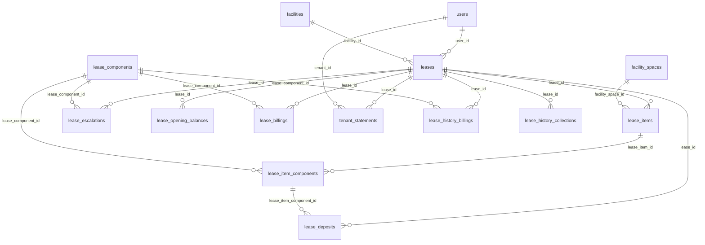

The EPMAS ledger before the cut-over is in `lease_history_billings` and `lease_history_collections`, two **reference-only** tables described at the end of this section. Nothing in the application reads them, and they are never part of a balance.

## leases

**One row per:** tenancy agreement (one tenant, one property, one or more spaces). **Model:** `App\Models\Lease`. **Company-scoped:** yes. **Soft deletes:** no.
**Rows in dev DB:** about 4,140 (2,677 active, 1,465 terminated).

A lease is created by staff, by the import of the old system, or by promoting an accepted offer letter (`loos.promoted_lease_id` points back at the lease it produced). A new lease starts `pending` and goes through an approval chain (rows in `approval_steps` with `approvable_type = 'App\Models\Lease'`, see section 8); approval makes it `active`, rejection makes it `rejected`. An exit notice or a manual termination makes it `terminated`.

**Status** (`status`, DB enum `pending, active, suspended, terminated, rejected`; the PHP enum `LeaseStatus` has the same five values):
- `pending` : created, waiting for approval. Nothing is invoiced; deposits and opening balances keyed in now are held back until approval.
- `active` : live tenancy. The only status the billing cycle invoices.
- `suspended` : paused by staff. Still holds its spaces, still takes one-off manual invoices, not invoiced by the billing cycle.
- `terminated` : ended (by an exit notice or a manual termination). `terminated_at` is set. Still accepts one-off manual invoices (final utilities, repairs).
- `rejected` : refused in approval. Terminal. Never billed.

Live rows are `status = 'active'` for "current tenancies"; use `status IN ('active','suspended')` for "leases that hold a space". An active lease whose `end_at` is in the past is still live (370 such rows in dev): the lease runs on until it is renewed or terminated, and the biller simply stops at `end_at`.

| Column | Type | Points to | Meaning |
|---|---|---|---|
| `id` | bigint | | Primary key |
| `company_id` | bigint, nullable | companies.id | Owning company. Never NULL in dev. |
| `user_id` | bigint | users.id | The tenant. Join to `users.name` for the tenant name. |
| `facility_id` | bigint | facilities.id | The property. |
| `facility_type_id` | bigint, nullable | facility_types.id | Property type the lease was classified under (1 NULL in dev). |
| `currency_id` | bigint, nullable | currencies.id | Currency of the lease amounts (all but one row are currency 1 in dev). |
| `tax_id` | bigint, nullable | taxes.id | Default tax on the lease; the tax that actually applies to a charge is on `lease_item_components.tax_id`. |
| `status` | enum | | See above. |
| `billing_cycle` | enum `biennial, annually, biannual, quarterly, monthly, weekly, daily, hourly` | | How often the lease is invoiced. Dev uses only monthly, quarterly, annually, biannual and biennial. There is no PHP enum for this column; `LeaseApplicationBillingCycle` (monthly, quarterly, biannual, annually) is the narrower list offered to applicants. |
| `start_at` | datetime | | Start of the term. |
| `period_in_years`, `period_in_months` | int | | Length of the term (28 active rows have both at 0). |
| `end_at` | datetime, nullable | | End of the term (7 active rows have NULL = open-ended). Billing stops here; a period the lease ends inside is billed pro rata. |
| `next_due_at` | datetime, nullable | | Start date of the next billing period that has NOT yet been invoiced. The biller invoices the period starting here and then moves it forward one cycle (to the first day of the next month, quarter, year...). NULL on every terminated lease and on 187 active leases (never put on the cycle). |
| `activated_at` | datetime, nullable | | When the lease became active. Only set by the application; NULL on every migrated terminated lease, so do not use it as the start date. |
| `terminated_at` | datetime, nullable | | When the lease was terminated. Set on every terminated row, NULL on every active one. |
| `tenant_exit_notice_id` | bigint, nullable | tenant_exit_notices.id | The open or processed exit notice that covers this lease (set when the notice is created, cleared if it is deleted). |
| `utility_billed_at` | datetime, nullable | | Last utility billing run on the lease (NULL everywhere in dev). |
| `tenant_notified_at` | timestamp, nullable | | When the tenant was emailed that the lease is active. |
| `created_by_id` | bigint, nullable | users.id | Staff member who created it. |
| `old_system_id` | varchar, nullable | | The id in the old EPMAS system (set on 4,139 of 4,142 rows). |

**Joins:**
- `leases.user_id → users.id` : many leases per tenant (one tenant has 1..n leases; 3,082 distinct tenants in dev).
- `leases.facility_id → facilities.id` : many leases per property.
- `leases.currency_id → currencies.id`, `leases.tax_id → taxes.id`, `leases.facility_type_id → facility_types.id`, `leases.created_by_id → users.id`, `leases.company_id → companies.id` : many to one.
- `leases.tenant_exit_notice_id → tenant_exit_notices.id` : many to one (the notice may cover several leases).
- `leases.id ← lease_items.lease_id`, `lease_deposits.lease_id`, `lease_escalations.lease_id`, `lease_billings.lease_id`, `lease_collections.lease_id`, `lease_opening_balances.lease_id`, `tenant_statements.lease_id`, `tenant_exit_notices.lease_id`, `tenant_exit_notice_items.lease_id` : one to many, all with DB constraints.
- `leases.id ← facility_invoices.lease_id`, `facility_credit_notes.lease_id`, `facility_bills.lease_id` (letting fee bills), `loos.promoted_lease_id`, `lease_applications.lease_id` (renewal applications, `is_renewal = 1`), `lease_utility_meter.lease_id` (pivot to `utility_meters`) : one to many, DB constraints; documented in sections 5, 6, 4 and 2.
- `leases.id ← facility_spaces.rent_occupied_by_lease_id` and `facility_spaces.service_charge_occupied_by_lease_id` : the space's current holder (see overview).
- `approval_steps.approvable_type = 'App\Models\Lease'`, `approval_steps.approvable_id = leases.id` (no DB constraint, polymorphic) : the approval chain of a pending lease.

**Gotchas:**
- There is no parent or renewal column on `leases`. A renewal is a new `lease_applications` row with `is_renewal = 1` and `lease_id` = the old lease; when its offer is accepted a new lease is created and `loos.promoted_lease_id` names it. To chain old to new: `lease_applications.lease_id` (old) → `loos.loo_preparation_type = 'App\Models\LeaseApplication'`, `loos.loo_preparation_id` → `loos.promoted_lease_id` (new). Not every lease came through that path (migrated leases have no application).
- `next_due_at` is the next UNBILLED period start, not a payment due date. "Billed up to" is the day before it. Payment due dates are on `facility_invoices.due_at`.
- The app's "monthly rent" and "service charge" totals are sums of `lease_item_components.cost_per_month` over components whose `expense_category_id` equals the company's rent (1) or service charge (2) expense category setting. In dev that is the same set as the `is_rent` / `is_service_charge` flags on `lease_components`.
- The tenant and property of an active lease never change (invoices are filed with the tax authority under them). Only a pending lease can have its tenant or property corrected.
- Dev has no `pending`, `suspended` or `rejected` rows, so the live-row filters above are taken from the code, not observed.

## lease_items

**One row per:** space (unit) a lease occupies. **Model:** `App\Models\LeaseItem`. **Company-scoped:** no (reach the company through the lease). **Soft deletes:** no.
**Rows in dev DB:** about 6,510 on 4,134 leases (483 leases cover more than one space).

Created with the lease (or when a space is added to it). It is the bridge between a lease and `facility_spaces`, and the parent of the charges on that space.

| Column | Type | Points to | Meaning |
|---|---|---|---|
| `id` | bigint | | Primary key |
| `lease_id` | bigint | leases.id | The lease. |
| `facility_space_id` | bigint, nullable | facility_spaces.id | The space. NULL on 43 rows (migrated leases whose unit could not be matched). |
| `old_system_id` | varchar, nullable | | The id in the old EPMAS system. |

**Joins:**
- `lease_items.lease_id → leases.id` : many items per lease.
- `lease_items.facility_space_id → facility_spaces.id` : many items per space over time (11 spaces have two or more active leases in dev, e.g. rent on one lease and service charge on another).
- `lease_items.id ← lease_item_components.lease_item_id` : one to many.

**Gotchas:**
- 8 leases have no items at all and 322 items have no components; a lease with items but no priced component is never invoiced by the cycle.
- The property of a space must agree with `leases.facility_id` by construction, but nothing in the database enforces it.

## lease_components

**One row per:** charge type in the catalogue (Rent, Service Charge, Parking, Signage, Water, Electricity, Deposit, Legal Fees...). **Model:** `App\Models\LeaseComponent`. **Company-scoped:** no (shared by all companies). **Soft deletes:** no.
**Rows in dev DB:** 13.

A settings table. Every charge on a lease, every billing line, every escalation and every deposit points at one of these rows. The flags say what each component means to the application.

**Status** (`status`, DB enum `active, inactive`; the model casts it with the shared PHP enum `Status`, which has many more values, so only `active` and `inactive` are valid here):
- `active` : offered on new leases and invoices.
- `inactive` : hidden from new use, existing lines keep pointing at it.
Live rows are `status = 'active'`; all 13 are active in dev.

| Column | Type | Points to | Meaning |
|---|---|---|---|
| `id` | bigint | | Primary key. Dev ids: 1 Rent, 2 Service Charge, 3 Service, 4 Land Rate, 5 Land Rent, 6 Electricity, 7 Water, 8 Parking, 9 Signage, 10 Promotion Fee, 11 Deposit, 12 Excess Service Charge, 13 Legal Fees. |
| `name` | varchar | | Display name. |
| `status` | enum | | See above. |
| `sort_order` | int | | Display order. |
| `is_autobilled` | tinyint | | 1 = the billing cycle invoices it every period (Rent, Service Charge, Promotion Fee, Deposit, Parking, Signage in dev). 0 = only billed by hand or by utility billing. |
| `is_rent`, `is_service_charge`, `is_parking_fee`, `is_signage_fee` | tinyint | | Role flags; exactly one component carries each in dev. They decide space occupancy and the rent / service charge totals. |
| `is_deposit` | tinyint | | 1 = the Deposit component. Deposit invoices are raised on the lease's line for this component. |
| `is_legal_fees_deposit` | tinyint | | 1 = Legal Fees (billed from the offer letter). |
| `is_a_charge` | tinyint | | 1 = a one-off or pass-through charge (utilities, land rates, excess service charge, legal fees). |
| `is_utility_charge` | tinyint | | 1 = a metered utility (Water, Electricity); utility billing lines point here through `utility_billings.utility_id`. |
| `is_land_fee_charge` | tinyint | | 1 = Land Rate / Land Rent. |
| `holds_cancellation_fee` | tinyint | | Unused in dev (all 0). |
| `expense_category_id` | bigint, nullable | expense_categories.id | Income classification: 1 Rent, 2 Service Charge, 3 Service, 4 for utilities in dev. |
| `tax_id` | bigint, nullable | taxes.id | Default tax for new lines of this component. |
| `hs_code` | varchar, nullable | | Tax authority product code, copied to invoice lines. |
| `default_payment_priority_order`, `default_payment_priority_percentage` | int, decimal(5,2) | | Default order and share used when a receipt is split across components (overridden per property by `lease_components_payment_priorities`). |
| `old_system_id` | varchar, nullable | | The id in the old EPMAS system. |

**Joins:**
- `lease_components.expense_category_id → expense_categories.id`, `lease_components.tax_id → taxes.id` : many to one.
- `lease_components.id ← lease_item_components.lease_component_id`, `lease_billings.lease_component_id`, `lease_escalations.lease_component_id`, `lease_deposits.lease_component_id`, `lease_opening_balances.lease_component_id`, `lease_components_payment_priorities.lease_component_id` : one to many.
- Also referenced from other domains: `facility_invoice_items`, `facility_credit_note_items` (through `lease_item_component_id`), `utility_billings.utility_id`, `utility_meters.utility_id`, `facility_utilities.utility_id`, `facility_contracts.utility_id`, `facility_budget_income_items`, `landlord_default_accounts`, `loo_space_components`, `loo_tags`, `lease_application_*` tables.

**Gotchas:**
- Classify income by the flags or by `expense_category_id`, not by `name`: names can be renamed.
- `is_autobilled` alone does not make a line invoice: the line must also have `cost_per_month > 0`.

## lease_item_components

**One row per:** charge on one space of one lease (the lease's own price for that component on that unit). **Model:** `App\Models\LeaseItemComponent`. **Company-scoped:** no. **Soft deletes:** no.
**Rows in dev DB:** about 11,860 (3,533 Rent, 3,319 Service Charge, 1,993 Parking, 888 Electricity, 626 Deposit, 600 Excess Service Charge, 522 Water, 216 Service, 116 Signage, 51 Promotion Fee).

The priced line of a lease. The billing cycle reads `cost_per_month` from here; escalations rewrite it; invoice and credit note lines point back at it. Rows priced at zero are normal: they exist so that deposits, utilities and opening balances have a line to sit on, and they never reach an invoice from the cycle.

| Column | Type | Points to | Meaning |
|---|---|---|---|
| `id` | bigint | | Primary key |
| `lease_item_id` | bigint | lease_items.id | The space line of the lease. |
| `lease_component_id` | bigint | lease_components.id | Which charge type. One row per (item, component) in dev. |
| `cost_per_sqft` | decimal(50,5) | | Price per square foot per month (informational; `facility_spaces.size` is the area). |
| `cost_per_month` | decimal(50,5) | | Current monthly price. This is what gets invoiced (times the months in the cycle). Zero on 3,212 rows: every Deposit, Water, Electricity, Service and Excess Service Charge line, and a few Rent/Service Charge lines. |
| `tax_id` | bigint, nullable | taxes.id | Tax applied when this line is invoiced (never NULL in dev). |
| `hs_code` | varchar, nullable | | Tax authority product code. |
| `old_system_id` | varchar, nullable | | The id in the old EPMAS system. |

**Joins:**
- `lease_item_components.lease_item_id → lease_items.id` : many per item. To reach the lease: `lease_item_components → lease_items.lease_id`.
- `lease_item_components.lease_component_id → lease_components.id`, `lease_item_components.tax_id → taxes.id` : many to one.
- `lease_item_components.id ← facility_invoice_items.lease_item_component_id`, `facility_credit_note_items.lease_item_component_id`, `facility_invoice_component_receipt_allocations.lease_item_component_id`, `lease_collections.lease_item_component_id`, `lease_deposits.lease_item_component_id` : one to many.

**Gotchas:**
- `cost_per_month` is the price NOW. Escalations overwrite it in place, so there is no price history in this table; past prices can only be read back from `lease_billings` / invoice lines.
- Monthly rent of a lease = `SUM(cost_per_month)` over its Rent lines across all its items; do not take the first line (a multi-unit lease has one Rent line per unit).

## lease_components_payment_priorities

**One row per:** property and component: the order in which a receipt is applied across charge types on that property. **Model:** `App\Models\LeaseComponentsPaymentPriority`. **Company-scoped:** no. **Soft deletes:** no.
**Rows in dev DB:** 0.

When empty, the defaults on `lease_components.default_payment_priority_order` / `default_payment_priority_percentage` apply.

| Column | Type | Points to | Meaning |
|---|---|---|---|
| `id` | bigint | | Primary key |
| `facility_id` | bigint | facilities.id | The property. |
| `lease_component_id` | bigint | lease_components.id | The charge type. |
| `priority` | int | | 1 = paid first. |
| `created_by_id` | bigint, nullable | users.id | Who set it. |

**Joins:** `facility_id → facilities.id`, `lease_component_id → lease_components.id`, `created_by_id → users.id`, all many to one with DB constraints. Connects `facilities` and `lease_components`.

## lease_deposits

**One row per:** deposit amount taken on a lease against one charge type (rent deposit, service charge deposit, water deposit...). **Model:** `App\Models\LeaseDeposit`. **Company-scoped:** no. **Soft deletes:** no.
**Rows in dev DB:** about 3,590 on 2,225 active and 1,362 terminated leases, total about 599 million.

Created by staff when the lease is set up (or when a renewal offer takes a new deposit), or by the migration. On an active lease the row is invoiced at once (one deposit invoice, `billed = 1`, `invoice_id` set); on a pending lease it waits for approval. Processing an exit notice stamps every deposit of the lease as refunded.

| Column | Type | Points to | Meaning |
|---|---|---|---|
| `id` | bigint | | Primary key |
| `lease_id` | bigint | leases.id | The lease. |
| `lease_component_id` | bigint, nullable | lease_components.id | The charge type the deposit is held against. NULL on every migrated row (see gotchas). |
| `lease_item_component_id` | bigint | lease_item_components.id | On rows created by the application: the lease's Deposit line (component 11), i.e. the line the deposit invoice was raised on. On migrated rows: the lease line of the charge the deposit is held against. |
| `amount` | decimal(50,5) | | Deposit amount (currency units). Never 0. |
| `billed` | tinyint | | 1 = a deposit invoice has been raised. All rows are 1 in dev. |
| `invoice_id` | bigint, nullable | facility_invoices.id | The deposit invoice. Set on 1 row in dev; migrated deposits were invoiced inside the opening balances, so the link is NULL. |
| `refunded_at` | timestamp, nullable | | When an exit notice refunded it. NULL = still held. |
| `refunded_by_exit_notice_id` | bigint, nullable | tenant_exit_notices.id | The notice that refunded it. |
| `created_by_id` | bigint, nullable | users.id | Who keyed it in. |
| `old_system_id` | varchar, nullable | | The id in the old EPMAS system. |

**Joins:**
- `lease_deposits.lease_id → leases.id` : many per lease.
- `lease_deposits.lease_component_id → lease_components.id` : many to one (NULL on migrated rows).
- `lease_deposits.lease_item_component_id → lease_item_components.id` : many to one.
- `lease_deposits.invoice_id → facility_invoices.id`, `lease_deposits.refunded_by_exit_notice_id → tenant_exit_notices.id`, `lease_deposits.created_by_id → users.id` : many to one.

**Gotchas:**
- "Held against" is `COALESCE(lease_deposits.lease_component_id, lic.lease_component_id)` where `lic` is the joined `lease_item_components` row. Using `lease_component_id` alone returns NULL for every migrated deposit; using `lease_item_component_id` alone returns "Deposit" for every new one. In dev the fallback gives 2,153 Rent, 1,235 Service Charge, 97 Electricity, 80 Water, 15 Parking, 7 Signage.
- Deposits held = rows with `refunded_at IS NULL AND refunded_by_exit_notice_id IS NULL` (what the app calls `total_deposit_amount`). Filter on lease status too: 1,362 unrefunded deposits sit on terminated leases that ended before the system tracked refunds.
- `billed = 1` with `invoice_id IS NULL` (3,586 rows) means "invoiced in the old system", not "invoice missing".

## lease_escalations

**One row per:** escalation rule on one charge type of a lease (e.g. Rent goes up 10% every 2 years). **Model:** `App\Models\LeaseEscalation`. **Company-scoped:** no. **Soft deletes:** no.
**Rows in dev DB:** about 1,800 on 1,771 leases (1,708 on Rent, 53 Signage, 30 Parking, 9 Service Charge); 1,141 on active leases.

A scheduled job runs daily: every rule whose `next_due` has arrived (and is not past the rule's `end_at` or the lease's `end_at`) multiplies the matching `lease_item_components.cost_per_month` on every unit of the lease by `(1 + rate/100)` and moves `next_due` forward by `period` units of `cycle`. The biller also reads these rules to split a period billed at two prices into one averaged line.

| Column | Type | Points to | Meaning |
|---|---|---|---|
| `id` | bigint | | Primary key |
| `lease_id` | bigint | leases.id | The lease. |
| `lease_component_id` | bigint | lease_components.id | The charge type that escalates. |
| `rate` | decimal(5,2) | | Percentage increase per step (1.00 to 20.00 in dev). |
| `cycle` | enum `days, weeks, months, years` | | Unit of the interval. PHP enum `EscalationCycle` matches. Dev: 1,799 years, 1 months. |
| `period` | int | | Number of `cycle` units between steps (1 to 3 in dev). |
| `next_due` | datetime, nullable | | The date the NEXT step applies. The job compares this with today. Never NULL in dev; 8 rows are overdue (job not run on dev). |
| `start_at` | datetime, nullable | | Legacy copy of `next_due` at the time the rule was saved; nothing reads it any more. Migrated rows hold the original first step date. |
| `end_at` | datetime, nullable | | Stop date: no step applies after it. NULL (all rows in dev) = runs until the lease ends. |
| `created_by_id` | bigint, nullable | users.id | Who created it. |
| `old_system_id` | varchar, nullable | | The id in the old EPMAS system. |

**Joins:**
- `lease_escalations.lease_id → leases.id` : many per lease (usually one).
- `lease_escalations.lease_component_id → lease_components.id` : many to one. There is no link to a specific `lease_item_components` row: the rule applies to every line of that component on the lease.
- `lease_escalations.created_by_id → users.id`.

**Gotchas:**
- A rule is "finished" when `next_due > end_at` or `next_due > leases.end_at`; it is not deleted and `next_due` stops moving. Filter those out when listing upcoming increases.
- Past steps are not recorded anywhere; only the current price and the next date exist.

## lease_opening_balances

**One row per:** balance carried into this system for one lease and one charge type as at a cut-over date. **Model:** `App\Models\LeaseOpeningBalance`. **Company-scoped:** no. **Soft deletes:** yes (`deleted_at`; none deleted in dev).
**Rows in dev DB:** about 8,450, all dated 2026-09-30 (the EPMAS cut-over), on 10 components; 2,748 are negative.

A positive amount is what the tenant owed; the application raises it as an invoice (`invoice_id`). A negative amount is credit the tenant had; it is raised as a credit note (`credit_note_id`). On a pending lease the row waits with both links NULL until approval (1 such row in dev). Those documents then flow into `lease_billings` and `tenant_statements` like any other, so the opening balance is already inside the tenant's statement: do not add it again.

| Column | Type | Points to | Meaning |
|---|---|---|---|
| `id` | bigint | | Primary key |
| `lease_id` | bigint | leases.id | The lease. |
| `lease_component_id` | bigint, nullable | lease_components.id | Charge type the balance belongs to (never NULL in dev). |
| `amount` | decimal(50,5) | | Net amount before tax; sign as above. |
| `billed_amount` | decimal(50,5) | | `amount` plus its tax: the document total actually raised. Equal to `amount` where there is no tax. |
| `opening_balance_at` | timestamp | | The "as at" date; the invoice or credit note is dated here, not on the day it was keyed in. |
| `invoice_id` | bigint, nullable | facility_invoices.id | The invoice raised for a positive balance (5,688 rows). |
| `credit_note_id` | bigint, nullable | facility_credit_notes.id | The credit note raised for a negative balance (2,763 rows). |
| `notes` | text | | Free text. |
| `created_by_id` | bigint, nullable | users.id | Who keyed it in. |
| `deleted_at` | timestamp, nullable | | Soft delete; exclude rows where it is not NULL. |
| `old_system_id` | varchar, nullable | | The id in the old EPMAS system. |

**Joins:**
- `lease_opening_balances.lease_id → leases.id` : many per lease (one per component).
- `lease_opening_balances.lease_component_id → lease_components.id`, `invoice_id → facility_invoices.id`, `credit_note_id → facility_credit_notes.id`, `created_by_id → users.id` : many to one.

**Gotchas:**
- Opening balance of a lease = `SUM(amount)` (net) or `SUM(billed_amount)` (gross); the app's `opening_balance` figure is the net sum.
- The whole pre-2026-09-30 history of the old system is collapsed into these rows. The month-by-month EPMAS ledger behind them is in `lease_history_billings` / `lease_history_collections` (reference only, see the end of this section); never add it to these rows.

## lease_billings

**One row per:** invoice line or credit note line, by charge type, once the document is processed. **Model:** `App\Models\LeaseBilling`. **Company-scoped:** yes. **Soft deletes:** no.
**Rows in dev DB:** about 13,640 (10,874 from invoices, 2,763 from credit notes; 8,451 of them are the opening balance documents dated 2026-09-30, 5,185 are the October 2026 billing run, 1 is a deposit).

This is the "billed" side of the lease account. When an invoice is processed (approved and issued) one row is written per invoice item that sits on a lease line, carrying the item's `amount`, `tax` and `total`; a processed credit note writes the same rows with negative values (`credit_note_id` set). Cancelling an invoice DELETES its rows here (the reversal is recorded in `tenant_statements` instead). Pending and rejected documents have no rows.

What one row is NOT: it is not a schedule. There are no "due but not yet billed" rows; what is due next is `leases.next_due_at`. A row here always means "billed".

| Column | Type | Points to | Meaning |
|---|---|---|---|
| `id` | bigint | | Primary key |
| `company_id` | bigint, nullable | companies.id | Company (never NULL in dev). |
| `lease_id` | bigint | leases.id | The lease. |
| `invoice_id` | bigint, nullable | facility_invoices.id | Source invoice (set on invoice rows). |
| `credit_note_id` | bigint, nullable | facility_credit_notes.id | Source credit note (set on credit note rows; values negative). Exactly one of the two is set. |
| `lease_component_id` | bigint | lease_components.id | Charge type of the line (resolved from the invoice item's lease line). |
| `amount` | decimal(50,5) | | Net amount. |
| `tax` | decimal(50,5) | | Tax amount. |
| `total` | decimal(50,5) | | Gross amount (`amount + tax`). Negative on credit note rows. |
| `transaction_date` | timestamp | | The document's own date (the "as at" date for opening balances, the issue date for a rent run), not the day the row was written. |
| `notes` | text | | `"<document id> - <document notes>"`, e.g. `"217260 - Oct 2026"`; the period billed is in the document notes. |
| `old_system_id` | varchar, nullable | | The id in the old EPMAS system. |

**Joins:**
- `lease_billings.lease_id → leases.id` : many per lease.
- `lease_billings.lease_component_id → lease_components.id` : many to one. Note the asymmetry with `lease_collections`, which reaches the component through `lease_item_components`.
- `lease_billings.invoice_id → facility_invoices.id`, `lease_billings.credit_note_id → facility_credit_notes.id`, `lease_billings.company_id → companies.id` : many to one.

**Gotchas:**
- Total billed on a lease = `SUM(total)` with no status filter (credit notes are already negative, cancelled invoices are already gone). In dev this equals the statement's debits minus credits exactly.
- Utility lines and one-off charges are included; filter by `lease_component_id` to get rent only.
- There is no `status` column; `lease_collections` has one. Do not look for one.

## lease_collections

**One row per:** charge type paid by one receipt allocation against one invoice item. **Model:** `App\Models\LeaseCollection`. **Company-scoped:** yes. **Soft deletes:** no.
**Rows in dev DB:** 7 (dev has almost no receipts).

The "collected" side of the lease account. When a confirmed receipt is allocated to an invoice, the allocated money is split across the invoice's items in payment-priority order and one row is written per item. Amounts are stored in the PROPERTY's reporting currency (`facilities.reporting_currency_id`), converted from the receipt currency.

**Status** (`status`, DB enum `confirmed, cancelled`):
- `confirmed` : counts as collected.
- `cancelled` : the receipt or allocation was reversed. Keep for audit only.
Live rows are `status = 'confirmed'`. There is no `pending` value.

| Column | Type | Points to | Meaning |
|---|---|---|---|
| `id` | bigint | | Primary key |
| `company_id` | bigint, nullable | companies.id | Company. |
| `lease_id` | bigint | leases.id | The lease. |
| `receipt_allocation_id` | bigint | facility_receipt_allocations.id | The allocation of a receipt to an invoice (its `receipt_id` leads to `facility_receipts`). |
| `invoice_item_id` | bigint, nullable | facility_invoice_items.id | The invoice line paid. |
| `lease_item_component_id` | bigint | lease_item_components.id | The lease line paid; its `lease_component_id` gives the charge type. |
| `amount`, `tax`, `total` | decimal(50,5) | | Net, tax and gross collected, in the reporting currency. |
| `currency_id` | bigint, nullable | currencies.id | The reporting currency the amounts are in. |
| `transaction_date` | timestamp | | When the allocation was applied. |
| `status` | enum | | See above. |
| `notes` | varchar | | `"lease collection for invoice_item id <n>"`. |
| `old_system_id` | varchar, nullable | | The id in the old EPMAS system. |

**Joins:**
- `lease_collections.lease_id → leases.id` : many per lease.
- `lease_collections.receipt_allocation_id → facility_receipt_allocations.id` : many per allocation (one per invoice item).
- `lease_collections.lease_item_component_id → lease_item_components.id` : many to one; then `→ lease_components.id` for the charge type.
- `lease_collections.invoice_item_id → facility_invoice_items.id` (no DB constraint), `lease_collections.currency_id → currencies.id`, `lease_collections.company_id → companies.id`.

**Gotchas:**
- Arrears in the application = `SUM(lease_billings.total) - SUM(lease_collections.total)` (the `current_arrears` figure). It ignores unallocated receipt money sitting on the tenant; `tenant_statements` includes it.
- Migrated receipts were not loaded into this table: the old system's payments are netted inside the opening balances.

## tenant_statements

**One row per:** debit or credit posted to a tenant's account by one financial document (invoice, credit note or receipt), per lease. **Model:** `App\Models\TenantStatement`. **Company-scoped:** yes. **Soft deletes:** no.
**Rows in dev DB:** about 8,370 (6,125 invoice rows, 2,239 credit note rows, 5 receipt rows); dates run from 2026-09-30 (cut-over) onward.

This is the tenant ledger and the right source for a tenant balance. Rows are written when a document is processed and again when it is cancelled, so the table is append-only: nothing is updated or deleted when a document is reversed. The document is linked polymorphically: `transaction_type` holds the model class name and `transaction_id` the document's id.

**How the columns are used (from the code, verified on live rows):**

| Event | `transaction_type` | `debit` | `credit` | `status` |
|---|---|---|---|---|
| Invoice processed | `App\Models\FacilityInvoice` | invoice total | 0 | `confirmed` |
| Invoice cancelled | `App\Models\FacilityInvoice` | minus invoice total | 0 | `cancelled` |
| Credit note processed | `App\Models\FacilityCreditNote` | 0 | credit note total (positive) | `confirmed` |
| Credit note cancelled | `App\Models\FacilityCreditNote` | credit note total (positive) | 0 | `cancelled` |
| Receipt confirmed | `App\Models\FacilityReceipt` | 0 | amount allocated to this lease's invoices | `confirmed` |
| Receipt remainder left unallocated | `App\Models\FacilityReceipt` | 0 | the unallocated part (`lease_id` NULL, receipt currency) | `confirmed` |
| Receipt cancelled | `App\Models\FacilityReceipt` | the amount previously credited | 0 | `cancelled` |

Debit = the tenant owes more; credit = the tenant owes less. **Balance owed = `SUM(debit) - SUM(credit)` over ALL rows of the lease, including `status = 'cancelled'` rows**, because a cancelled row is the reversal entry, not a row to ignore. Filtering to `confirmed` only would leave a cancelled invoice counted. Positive = arrears, negative = tenant in credit.

**Status** (`status`, DB enum `confirmed, cancelled`; PHP enum `TenantStatementStatus` matches):
- `confirmed` : a posting from a live document.
- `cancelled` : a reversal posting written when a document was cancelled.
Live rows for a balance: all of them. Live rows for "documents currently in force": `confirmed` rows whose document is not itself cancelled.

| Column | Type | Points to | Meaning |
|---|---|---|---|
| `id` | bigint | | Primary key |
| `company_id` | bigint, nullable | companies.id | Company (never NULL in dev). |
| `tenant_id` | bigint | users.id | The tenant (the lease's `user_id`, or the receipt's paying user). |
| `lease_id` | bigint, nullable | leases.id | The lease. NULL only on unallocated-receipt rows (none in dev). |
| `transaction_type` | varchar | polymorphic: see below | Model class of the source document. |
| `transaction_id` | bigint | polymorphic: see below | Id of the source document. |
| `transaction_at` | timestamp | | Document date for invoices and credit notes (so an opening balance sits on its "as at" date); posting time for receipts and cancellations. |
| `notes` | varchar | | `"INV#<id> - ..."`, `"CN#<id> - ..."`, `"Receipt #<id> - <method> - <reference> - Invoice#0001, ..."`, `"Cancelled Invoice # <id> - ..."`. |
| `debit` | decimal(50,5) | | See table above. Negative on cancelled-invoice rows. |
| `credit` | decimal(50,5) | | See table above. |
| `status` | enum | | See above. |
| `currency_id` | bigint, nullable | currencies.id | Set on receipt rows (the receipt currency). NULL on invoice and credit note rows, whose amounts are in the lease currency. |
| `old_system_id` | varchar, nullable | | The id in the old EPMAS system. |

**Joins:**
- `tenant_statements.tenant_id → users.id` : many per tenant.
- `tenant_statements.lease_id → leases.id` : many per lease.
- Polymorphic `transaction_type` / `transaction_id` (no DB constraint). Values found in the database, with their targets:
  - `App\Models\FacilityInvoice` → `facility_invoices.id` (6,125 rows, all resolve)
  - `App\Models\FacilityCreditNote` → `facility_credit_notes.id` (2,239 rows, all resolve)
  - `App\Models\FacilityReceipt` → `facility_receipts.id` (5 rows, all resolve)
- `tenant_statements.currency_id → currencies.id`, `tenant_statements.company_id → companies.id`.

**Gotchas:**
- The stored string has single backslashes (`App\Models\FacilityInvoice`, 26 characters). In a MySQL literal the backslash must be doubled: `transaction_type = 'App\\Models\\FacilityInvoice'` (see Conventions 0.4). If your client tool strips a level of escaping, `REPLACE(transaction_type, CHAR(92), '/') = 'App/Models/FacilityInvoice'` is an escaping-free exact match.
- One invoice = one row (its total), not one row per line; the per-component split is in `lease_billings`.
- Pending invoices (5 in dev) have no statement row yet; a cancelled invoice has two rows that net to zero.
- Amounts are in the lease currency except receipt rows, which carry `currency_id`. Dev is single-currency.

## tenant_exit_notices

**One row per:** notice that a tenant is leaving, covering one or more of that tenant's leases on a property. **Model:** `App\Models\TenantExitNotice`. **Company-scoped:** yes. **Soft deletes:** no.
**Rows in dev DB:** 3, all `pending-review`.

Raised by staff or by the tenant from the portal. Creating it puts the spaces the lease holds "on notice" and stamps `leases.tenant_exit_notice_id`. It goes through an approval chain (`approval_steps.approvable_type = 'App\Models\TenantExitNotice'`). Processing it terminates each covered lease, optionally raises credit notes for arrears up to the deposit held (`auto_credit_arrears`), marks every `lease_deposits` row of the lease as refunded and posts the un-offset deposit as a landlord expense bill. Damages are shown but never deducted inside the system; the tenant's share is paid out manually.

**Status** (`status`, DB enum `pending-review, completed, rejected`; PHP enum `TenantExitNoticeStatus` matches):
- `pending-review` : in approval; the lease is still active and its spaces are "on notice".
- `completed` : processed; the leases are terminated and deposits marked refunded.
- `rejected` : refused; the spaces go back off notice. Terminal.
Live rows are `status <> 'rejected'`; "open" notices are `pending-review`.

| Column | Type | Points to | Meaning |
|---|---|---|---|
| `id` | bigint | | Primary key |
| `company_id` | bigint, nullable | companies.id | Company. |
| `lease_id` | bigint | leases.id | The first (or only) lease the notice covers. Other leases are in `tenant_exit_notice_items`. |
| `exit_date` | date | | Date the tenant leaves. |
| `deposit_held` | decimal(50,5) | | Total unrefunded deposits on the covered leases at the time the notice was raised (sum of the items when items exist). |
| `arrears` | decimal(50,5) | | Tenant balance at the time; rewritten with the remaining arrears when processed. |
| `repair_damages_cost` | decimal(50,5) | | Cost of damages (informational). |
| `auto_credit_arrears` | tinyint | | 1 = on processing, credit arrears out of the deposit. |
| `reason_for_exit` | text | | Free text. |
| `status` | enum | | See above. |
| `initiated_by_id` | bigint, nullable | users.id | Who raised it (staff or tenant). |
| `created_by_id` | bigint, nullable | users.id | Creator. |
| `supporting_upload_id`, `repairs_cost_quote_upload_id` | bigint, nullable | uploads.id | Attached documents. |
| `old_system_id` | varchar, nullable | | The id in the old EPMAS system. |

**Joins:**
- `tenant_exit_notices.lease_id → leases.id` : many to one.
- `tenant_exit_notices.id ← tenant_exit_notice_items.tenant_exit_notice_id` : one to many (one item per covered lease; a notice raised with a single lease may have no items at all, in which case the notice's own columns are the only line).
- `tenant_exit_notices.id ← leases.tenant_exit_notice_id` and `← lease_deposits.refunded_by_exit_notice_id` : one to many.
- `initiated_by_id → users.id`, `created_by_id → users.id`, `company_id → companies.id`, the two upload columns `→ uploads.id`.

**Gotchas:**
- The tenant is not on the notice: get it from `leases.user_id`.
- Amount refunded to the landlord expense = `deposit_held - arrears credited`, never less the damages. The on-screen "tenant gets" figure (`deposit - arrears - damages`, floored at 0) is informational.

## tenant_exit_notice_items

**One row per:** lease covered by an exit notice. **Model:** `App\Models\TenantExitNoticeItem`. **Company-scoped:** no. **Soft deletes:** no.
**Rows in dev DB:** 0 (the feature is newer than the three dev notices).

| Column | Type | Points to | Meaning |
|---|---|---|---|
| `id` | bigint | | Primary key |
| `tenant_exit_notice_id` | bigint | tenant_exit_notices.id | The notice. Unique with `lease_id`. |
| `lease_id` | bigint | leases.id | The covered lease. |
| `deposit_held`, `arrears`, `repair_damages_cost` | decimal(50,5) | | Per-lease figures; the notice's columns are their totals. |
| `reason_for_exit` | text, nullable | | Per-lease reason. |
| `supporting_upload_id`, `repairs_cost_quote_upload_id` | bigint, nullable | uploads.id | Per-lease documents. |

**Joins:** `tenant_exit_notice_id → tenant_exit_notices.id` (many per notice), `lease_id → leases.id` (many to one), uploads as above. All have DB constraints. Connects `tenant_exit_notices` and `leases`.

**Gotchas:** to list every lease a notice covers use the union of `tenant_exit_notices.lease_id` and its items' `lease_id`, since older notices have no items.

## lease_history_billings

> **Reference only. Never part of a balance.** This table holds the old EPMAS ledger for trend analysis. No screen, report, statement, arrears, ageing, remittance or dashboard figure in the application reads it. Adding it to `lease_billings`, `tenant_statements` or `lease_opening_balances` counts the pre-cut-over money twice.

**One row per:** EPMAS billing row (`tenant_billings`) per non-zero charge on it, plus one cutover reconciliation row per lease and charge type. **Model:** `App\Models\LeaseHistoryBilling` (read-only). **Company-scoped:** yes. **Soft deletes:** no.
**Rows in dev DB:** none until `php artisan history:import-epmas` is run; a dry run on dev computes 165,174 invoice and credit note rows and 6,596 reconciliation rows for 4,139 leases, dated 2018-12-31 to 2026-09-30.

Written only by `history:import-epmas` (`docs/backend/epmas-history.md`), which rebuilds a lease's rows on every run. A lease is covered when it was imported from EPMAS (`leases.old_system_id = 'Tenant:<id>'`; the EPMAS tenant id is the lease id) and was created on or before the cut-over. Leases created later have no rows.

`amount` is the net charge, `tax` its share of the EPMAS row's VAT (spread over the row's vatable charges in proportion to their size; VAT on a row with no vatable charge rides on a Rent row with `amount` 0), `total = amount + tax`. Signs are as in EPMAS: credit notes are negative, and some invoice rows are negative too (EPMAS credit invoices).

**Entry type** (`entry_type`, DB enum `invoice, credit_note, cutover_reconciliation`):
- `invoice` : an EPMAS invoice line.
- `credit_note` : an EPMAS credit note line (negative).
- `cutover_reconciliation` : one row per lease and component, dated 2026-09-30 23:59:59, equal to the live opening balance less what history adds up to (see below). Show it as its own line, never inside "billed".

| Column | Type | Points to | Meaning |
|---|---|---|---|
| `id` | bigint | | Primary key |
| `company_id` | bigint, nullable | companies.id | Company, copied from the lease. |
| `lease_id` | bigint | leases.id | The lease (deleted with it). |
| `facility_id` | bigint | facilities.id | The lease's property, copied so per-property trends need no join. |
| `lease_component_id` | bigint | lease_components.id | Charge type. EPMAS columns map to Rent, Service Charge, Service, Electricity, Water, Parking, Signage, Promotion Fee, Deposit, Excess Service Charge. |
| `entry_type` | enum | | See above. |
| `transaction_date` | timestamp | | The EPMAS ledger date; the cut-over 23:59:59 on reconciliation rows. |
| `reference` | varchar, nullable | | The EPMAS ledger `ref`; `Cutover reconciliation` on reconciliation rows. |
| `document_number` | varchar, nullable | | The EPMAS invoice number or credit note number. |
| `currency_id` | bigint, nullable | currencies.id | The EPMAS document's currency (USD on a handful of rows), else the lease currency. |
| `amount`, `tax`, `total` | decimal(50,5) | | Net, tax and gross; see above. |
| `source_table` | varchar | | `tenant_billings`, or `cutover_reconciliation`. |
| `source_id` | bigint | | The EPMAS `tenant_billings.id`; the lease id on reconciliation rows. Unique with `source_table` and `lease_component_id`. |

**Joins:**
- `lease_history_billings.lease_id → leases.id`, `facility_id → facilities.id`, `lease_component_id → lease_components.id`, `currency_id → currencies.id` : many to one, all with DB constraints.
- There is no link to `facility_invoices` or `facility_credit_notes`: EPMAS documents were never imported as documents.

**The cutover reconciliation and its invariant.** History on its own does not add up to the opening balances: the opening balances were rounded to the cent, counted EPMAS payments that were later cancelled as collected, and spread VAT over the whole balance rather than row by row. The reconciliation row closes that gap, per lease and component, for amount, tax and total:

`reconciliation = opening-balance ledger − (SUM(history billings) − SUM(confirmed history collections))`

where the opening-balance ledger is the live `lease_billings` rows whose `invoice_id` or `credit_note_id` appears in `lease_opening_balances`, and unallocated collections count against Rent. So, for every lease and component, to the fifth decimal:

`SUM(lease_history_billings.total) − SUM(confirmed lease_history_collections.total) = SUM(opening-balance lease_billings.total)`

On dev the history nets to about 868.35 million, the reconciliation to about −8.91 million (−8.56 million of it payments EPMAS marks cancelled) and the two together to 859,441,645.64, the opening-balance ledger exactly. A component can carry a large reconciliation while its lease nets to almost nothing: where EPMAS posted a payment against rent that belonged to service charge, the VAT moves between the two.

**Gotchas:**
- Never sum this table into a balance. For a series that runs from 2018 into the live period, use the worked query "Billed and collected per month from 2018 to today" below: it takes history plus reconciliation, and live data **without** the opening-balance documents (history plus reconciliation already is them). Its running balance equals the live figure at every month from October 2026.
- Filter `entry_type <> 'cutover_reconciliation'` for "billed"; report the reconciliation separately.
- Amounts are in the row's `currency_id`. Dev is almost entirely KES; convert or group by currency when a property bills in USD.

## lease_history_collections

> **Reference only. Never part of a balance.** The same rule as `lease_history_billings`.

**One row per:** EPMAS collection row (`tenant_collections`) per non-zero charge on it, plus one row for its unallocated money. **Model:** `App\Models\LeaseHistoryCollection` (read-only). **Company-scoped:** yes. **Soft deletes:** no.
**Rows in dev DB:** none until the command is run; a dry run on dev computes 186,895 rows, dated 2018-08-15 to 2026-09-30.

The EPMAS payment behind each row supplies the receipt number, mode, channel, payment date, currency and status.

**Status** (`status`, DB enum `confirmed, cancelled`):
- `confirmed` : counts as collected.
- `cancelled` : the EPMAS payment carries `cancelled_at`. EPMAS writes the reversal of a cancelled payment as a negative row on a payment that is also cancelled, so both halves drop out together.
Live rows are `status = 'confirmed'`, the same rule as `lease_collections`.

| Column | Type | Points to | Meaning |
|---|---|---|---|
| `id` | bigint | | Primary key |
| `company_id`, `lease_id`, `facility_id` | bigint | companies / leases / facilities | As in `lease_history_billings`. |
| `lease_component_id` | bigint, nullable | lease_components.id | Charge type paid. **NULL = money the payment left unallocated** (no charge). |
| `entry_type` | enum | | Always `payment`. |
| `status` | enum | | See above. |
| `transaction_date` | timestamp | | The EPMAS ledger date. |
| `paid_at` | timestamp, nullable | | The payment date (`date_paid`, else the payment's own date). |
| `reference` | varchar, nullable | | The EPMAS ledger `ref`. |
| `document_number`, `receipt_number` | varchar, nullable | | The EPMAS receipt number (`rct_no`). |
| `payment_mode`, `payment_channel` | varchar, nullable | | EPMAS `mode` (almost always empty) and `channel` (`m_pesa`, `cheque_dep_slip`, `rtgs`, `cash_dep_slip`, `withholding_vat`, `eft`, `withholding_rental`, ...). |
| `is_withholding` | tinyint | | 1 = the payment settled the account with tax the tenant withheld, not money received: channel or mode `withholding_*` (or EPMAS's empty `withholding` / `withholding_rate`). The counterpart of `payment_methods.is_withholding`; what EPMAS remittances deducted as `withheld`. |
| `currency_id` | bigint, nullable | currencies.id | The payment's currency, else the lease currency. |
| `amount`, `tax`, `total` | decimal(50,5) | | Net, tax and gross collected; VAT spread as in `lease_history_billings`. |
| `source_table`, `source_id` | varchar, bigint | | `tenant_collections` and its id. Unique with `lease_component_id`. |

**Joins:** `lease_id → leases.id`, `facility_id → facilities.id`, `lease_component_id → lease_components.id` (nullable), `currency_id → currencies.id`; no link to `facility_receipts`.

**Gotchas:**
- Count `status = 'confirmed'` only. Unallocated money (NULL component) is collected money; the reconciliation counts it against Rent.
- `is_withholding = 1` (channels `withholding_vat` and `withholding_rental`) settles the account with tax the tenant withheld rather than with money received; exclude those rows when you need cash only (on dev 308.96 million confirmed: about 281.7 million VAT and 27.2 million rental).

## Worked queries

**Every active lease with its tenant, property, spaces, monthly rent and monthly service charge.**

```sql
SELECT l.id AS lease_id,
       l.user_id AS tenant_user_id, u.name AS tenant_name,
       l.facility_id, f.name AS property,
       l.billing_cycle, l.start_at, l.end_at, l.next_due_at,
       (SELECT GROUP_CONCAT(fs.name ORDER BY fs.id SEPARATOR ', ')
          FROM lease_items li
          JOIN facility_spaces fs ON fs.id = li.facility_space_id
         WHERE li.lease_id = l.id) AS spaces,
       COALESCE(SUM(CASE WHEN lc.is_rent = 1 THEN lic.cost_per_month END), 0) AS rent_per_month,
       COALESCE(SUM(CASE WHEN lc.is_service_charge = 1 THEN lic.cost_per_month END), 0) AS service_charge_per_month
FROM leases l
JOIN users u ON u.id = l.user_id
JOIN facilities f ON f.id = l.facility_id
LEFT JOIN lease_items li ON li.lease_id = l.id
LEFT JOIN lease_item_components lic ON lic.lease_item_id = li.id
LEFT JOIN lease_components lc ON lc.id = lic.lease_component_id
WHERE l.status = 'active'
GROUP BY l.id, l.user_id, u.name, l.facility_id, f.name, l.billing_cycle, l.start_at, l.end_at, l.next_due_at
ORDER BY f.name, l.id;
```

Ran on dev: 2,677 rows; rent per month sums to about 204.3 million and service charge to about 56.2 million; 22 active leases have no space.

**Balance owed per lease from the tenant statement (positive = arrears, negative = tenant in credit).**

```sql
SELECT ts.lease_id, ts.tenant_id, u.name AS tenant_name,
       SUM(CASE WHEN ts.transaction_type = 'App\\Models\\FacilityInvoice'    THEN ts.debit - ts.credit ELSE 0 END) AS invoiced,
       SUM(CASE WHEN ts.transaction_type = 'App\\Models\\FacilityCreditNote' THEN ts.credit - ts.debit ELSE 0 END) AS credited,
       SUM(CASE WHEN ts.transaction_type = 'App\\Models\\FacilityReceipt'    THEN ts.credit - ts.debit ELSE 0 END) AS paid,
       SUM(ts.debit) - SUM(ts.credit) AS balance_owed
FROM tenant_statements ts
JOIN users u ON u.id = ts.tenant_id
WHERE ts.lease_id IS NOT NULL
GROUP BY ts.lease_id, ts.tenant_id, u.name
ORDER BY balance_owed DESC;
```

Ran on dev: 3,732 leases, 3,026 in arrears, 528 in credit; the net total (about 1,642.0 million) equals `SUM(lease_billings.total)` minus confirmed `lease_collections.total` to the cent, which is the figure the application shows as current arrears.

**Deposits still held, per property, on active leases.**

```sql
SELECT f.id AS facility_id, f.name AS property,
       COUNT(DISTINCT d.lease_id) AS leases_with_deposits,
       SUM(d.amount) AS deposits_held
FROM lease_deposits d
JOIN leases l ON l.id = d.lease_id
JOIN facilities f ON f.id = l.facility_id
WHERE d.refunded_at IS NULL
  AND d.refunded_by_exit_notice_id IS NULL
  AND l.status = 'active'
GROUP BY f.id, f.name
ORDER BY deposits_held DESC;
```

Ran on dev: 83 properties, 1,286 leases, about 370.1 million held. Add `COALESCE(d.lease_component_id, lic.lease_component_id)` with a join to `lease_item_components lic ON lic.id = d.lease_item_component_id` to split by charge type.

**Rent increases due in the next 12 months on active leases, with the amount they apply to.**

```sql
SELECT e.id AS escalation_id, e.lease_id, f.name AS property, lc.name AS component,
       e.rate AS increase_pct, e.cycle, e.period, e.next_due, e.end_at,
       (SELECT SUM(lic.cost_per_month)
          FROM lease_items li
          JOIN lease_item_components lic ON lic.lease_item_id = li.id
         WHERE li.lease_id = e.lease_id
           AND lic.lease_component_id = e.lease_component_id) AS current_monthly_amount
FROM lease_escalations e
JOIN leases l ON l.id = e.lease_id AND l.status = 'active'
JOIN facilities f ON f.id = l.facility_id
JOIN lease_components lc ON lc.id = e.lease_component_id
WHERE e.next_due < DATE_ADD(CURDATE(), INTERVAL 12 MONTH)
  AND (e.end_at IS NULL OR e.next_due <= e.end_at)
  AND (l.end_at IS NULL OR l.end_at >= e.next_due)
ORDER BY e.next_due, e.lease_id;
```

Ran on dev (2026-10-22): 484 escalations on 473 leases, first due 2026-10-15, last 2027-10-15.

**Billing calendar: active leases whose next period is due and not yet invoiced, with the last period billed.**

```sql
SELECT l.id AS lease_id, f.name AS property, l.billing_cycle, l.next_due_at,
       (SELECT MAX(b.transaction_date) FROM lease_billings b
         WHERE b.lease_id = l.id AND b.invoice_id IS NOT NULL) AS last_billed_on
FROM leases l
JOIN facilities f ON f.id = l.facility_id
WHERE l.status = 'active'
  AND l.next_due_at IS NOT NULL
  AND l.next_due_at <= CURDATE()
  AND (l.end_at IS NULL OR l.end_at > l.next_due_at)
ORDER BY l.next_due_at, l.id;
```

Ran on dev (2026-10-22): 5 leases due now, 3 of them never billed by the cycle. Replace the date test with a month window on `next_due_at` to forecast: November 2026 has 1,199 monthly, 5 quarterly and 2 annual leases falling due.

**Billed and collected per month from 2018 to today: EPMAS history, the cutover reconciliation and live data in one series.**

History (`lease_history_billings`, reconciliation included, and confirmed `lease_history_collections`) plus live `lease_billings` **excluding the opening-balance documents** plus confirmed live `lease_collections`. The opening-balance documents are left out because history plus reconciliation already is them. Use `NOT EXISTS` for that exclusion: `NOT (invoice_id IN (...) OR credit_note_id IN (...))` drops every row, because one of the two columns is always NULL.

```sql
SELECT s.period,
       SUM(s.billed)                                    AS billed,
       SUM(s.reconciliation)                            AS cutover_reconciliation,
       SUM(s.collected)                                 AS collected,
       SUM(SUM(s.billed + s.reconciliation - s.collected))
           OVER (ORDER BY s.period)                     AS running_balance
FROM (
    -- EPMAS history: invoices and credit notes, and the cutover reconciliation on its own line
    SELECT DATE_FORMAT(h.transaction_date, '%Y-%m') AS period,
           CASE WHEN h.entry_type = 'cutover_reconciliation' THEN 0 ELSE h.total END AS billed,
           CASE WHEN h.entry_type = 'cutover_reconciliation' THEN h.total ELSE 0 END AS reconciliation,
           0 AS collected
    FROM lease_history_billings h
    UNION ALL
    -- EPMAS history: confirmed payments only
    SELECT DATE_FORMAT(hc.transaction_date, '%Y-%m'), 0, 0, hc.total
    FROM lease_history_collections hc
    WHERE hc.status = 'confirmed'
    UNION ALL
    -- live billings, without the opening-balance documents (history + reconciliation already is them)
    SELECT DATE_FORMAT(lb.transaction_date, '%Y-%m'), lb.total, 0, 0
    FROM lease_billings lb
    WHERE NOT EXISTS (SELECT 1 FROM lease_opening_balances o WHERE o.invoice_id = lb.invoice_id)
      AND NOT EXISTS (SELECT 1 FROM lease_opening_balances o WHERE o.credit_note_id = lb.credit_note_id)
    UNION ALL
    -- live collections, confirmed only
    SELECT DATE_FORMAT(lc.transaction_date, '%Y-%m'), 0, 0, lc.total
    FROM lease_collections lc
    WHERE lc.status = 'confirmed'
) s
GROUP BY s.period
ORDER BY s.period;
```

Ran on dev (2026-10-23, with the history tables built in a session-only copy): 96 months with activity between 2018-08 and 2026-10, in 4 seconds. The running balance is 859,441,645.64 at 2026-09, the opening-balance ledger to the cent, and 1,578,195,677.36 at 2026-10, exactly `SUM(lease_billings.total)` less confirmed `lease_collections.total` today. September 2026 shows billed 100.66 million, collected 215.15 million and a cutover reconciliation of −8.91 million. Add `h.facility_id` / `lb.lease_id → leases.facility_id` to the inner selects and the `GROUP BY` for a per-property series, and `lease_component_id` (through `lease_item_components` for `lease_collections`) for a per-charge one. Amounts are summed as stored; see each table's currency note before mixing currencies.

# 4. Lease applications and letters of offer (LOO)

This domain is the leasing pipeline that runs before a lease exists. A prospective tenant (a `users` row) applies for space at a property: the application (`lease_applications`) holds the applicant's profile, the property, the term and start date asked for, the billing cycle and how the applicant heard about the property. The spaces requested and the monthly price proposed for each charge on them sit in `lease_application_facility_space` and `lease_application_facility_space_components`; agreed rent increases, uploaded documents and guarantors hang off the application in `lease_application_escalations`, `lease_application_documents` and `applicant_guarantors`. Once staff approve the application, a letter of offer (`loos`) is generated from it and copies the spaces and prices into `loo_spaces` and `loo_space_components`. The letter goes through an approval chain, is sent to the applicant and is answered. When the offer is turned into a lease (the application calls this "promote" or "onboard"), `loos.promoted_lease_id` records the new lease (section 3). The wording of the letter comes from `loo_templates`, with placeholders defined in `loo_tags` and filled per letter in `loo_tag_values`; reviewers' remarks on the wording are in `loo_comments`.

The pipeline in one line: `lease_applications` (`pending` to `approved`) then `loos` (`draft`, `pending_approval`, `approved`, `sent`, `accepted`) then `leases`, joined by `loos.promoted_lease_id = leases.id`. A renewal runs through the same pipeline: the application has `is_renewal = 1` and `lease_id` names the lease being renewed, and the offer has `type = 'renewal'`.

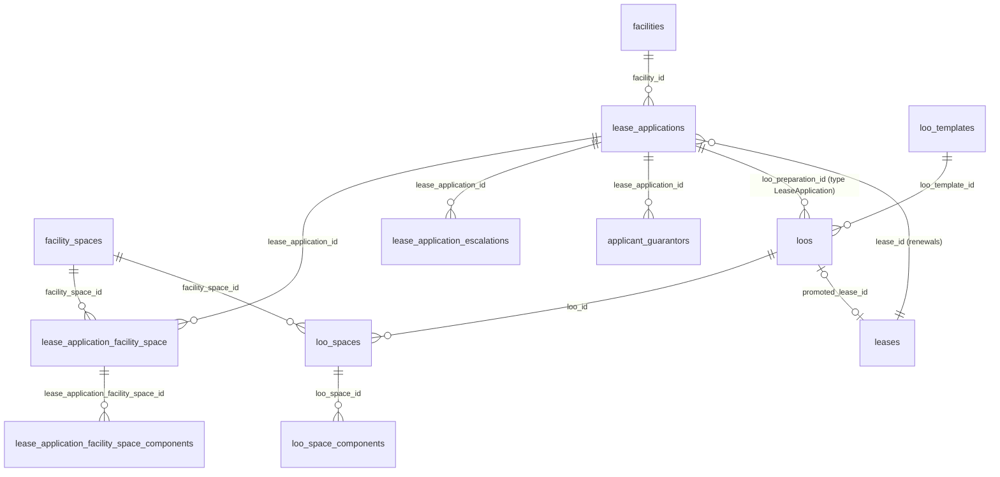

Not drawn: `lease_application_documents`, `lease_application_residential_unit_types` (both `lease_application_id`), `loo_tag_values` and `loo_comments` (both `loo_id`), and `loo_tags` (joined to `loo_tag_values` by key).

## lease_applications

**One row per:** application for space at one property by one applicant (a new tenancy or a renewal). **Model:** `App\Models\LeaseApplication`. **Company-scoped:** yes (`company_id`, nullable in the schema, set on every dev row). **Soft deletes:** no.
**Rows in dev DB:** 163 (99 renewals, 64 new tenancies); 162 imported from EPMAS.

Created when an applicant applies on the tenant portal, when staff start an application and send the applicant a link to complete it, or when staff start a renewal from an existing lease. Staff review it; an approved application is what a letter of offer is generated from.

**Status:**
- `pending` : submitted and waiting for a staff decision. Also covers two special cases: an approved application that an approver sent back to its reviewer (`returned_at` set and not earlier than `reviewed_at`), and an application started by staff that the applicant has not finished yet (`link_status` set and not `submitted`).
- `review` : staff asked the applicant to correct or complete something; waiting on the applicant.
- `approved` : accepted by the reviewer. Only an approved application can have a letter of offer.
- `rejected` : refused. The application is closed.

The DB enum (`pending, approved, review, rejected`) matches the PHP enum `LeaseApplicationStatus`. Dev: 39 `pending`, 1 `review`, 122 `approved`, 1 `rejected`.
Live rows are all rows except `rejected`. Open (undecided) applications are `status IN ('pending', 'review')`. A deleted application is removed physically, together with its spaces, components, escalations, documents and guarantors.

| Column | Type | Points to | Meaning |
|---|---|---|---|
| `id` | bigint | | Primary key. Imported applications keep their EPMAS id. |
| `reference` | varchar(30), unique | | Human reference `LA-<year>-<sequence>`, given to applications created in PropERP. NULL on every dev row. |
| `uuid` | char(36), unique | | Id carried in the applicant's completion link. NULL on every dev row. |
| `company_id` | bigint, nullable | companies.id | Owning company. |
| `user_id` | bigint | users.id | The applicant: the account the lease will be raised for. |
| `facility_id` | bigint, nullable | facilities.id | The property applied for. Set on every dev row. |
| `facility_type_id` | bigint | facility_types.id | Kind of space asked for (dev: id 1 Commercial 74 rows, id 2 Residential 89). Copied onto the lease on promotion. |
| `is_renewal` | tinyint(1) | | 1 = asks to renew an existing lease. |
| `lease_id` | bigint, nullable | leases.id | Renewals only: the lease being renewed. Set exactly when `is_renewal = 1` (99 rows). |
| `status` | enum `pending, approved, review, rejected` | | See Status. |
| `application_submitted_at` | timestamp, nullable | | When the applicant submitted. For EPMAS imports, the original EPMAS creation time. NULL while a staff-started application waits for the applicant. |
| `reviewed_at` | timestamp, nullable | | When the latest staff decision (approve, reject, send to review) was taken. Overwritten by each later decision. |
| `reviewed_by_id` | bigint, nullable | users.id | Staff member who took the latest decision. |
| `comments` | text | | Reviewer's comments on the decision. |
| `returned_at` | timestamp, nullable | | When an approved application was last sent back to its reviewer (status returns to `pending`). Kept as history after the next decision. Set on 2 dev rows. |
| `returned_by_id` | bigint, nullable | users.id | Who sent it back. `return_reason` holds the reason. |
| `initiated_by_id` | bigint, nullable | users.id | Staff member who started the application for the applicant (link flow). NULL otherwise. |
| `created_by_id` | bigint, nullable | users.id | Who created the row. |
| `proposed_start_date` | date, nullable | | Tenancy start date asked for. Set on every dev row (2023-07-01 to 2027-10-01). |
| `proposed_period_in_years`, `proposed_period_in_months` | int, nullable | | Term asked for: years plus months. Months is NULL on 41 rows (read as 0). The offer's own term overrides it. |
| `fit_out_period_months` | int, nullable | | Fit-out period asked for, in months. |
| `billing_cycle` | enum `monthly, quarterly, biannual, annually` | | How often the tenant will be invoiced; becomes the lease's billing cycle on promotion. Dev: 115 monthly, 46 quarterly, 1 annually, 1 NULL. |
| `space_size` | int, nullable | | Size asked for, as typed by the applicant. Not the size of the spaces allocated. |
| `city_id` | bigint | cities.id | City of the request. `region` is free text. |
| `occupants`, `parking_required`, `generator_required`, `preferred_facilities` | int, tinyint(1), tinyint(1), json | | Request details. Both flags default to 1, so a 1 is not necessarily an answer. `preferred_facilities` is NULL on every dev row. |
| `applicant_type` | enum `personal, business` | | Individual or organisation (dev: 104 personal, 59 business). |
| `applicant_name`, `trading_name` | varchar | | Applicant's legal name and trading name. Personal data. |
| `applicant_contact_email`, `applicant_contact_phone`, `applicant_physical_address`, `applicant_postal_address`, `applicant_postal_code` | varchar | | Contact details. Personal data. |
| `applicant_registered_country_id` | bigint, nullable | countries.id | Country of registration or nationality. |
| `registration_type` | enum `national_id, business_license, passport` | | Kind of identity document; `registration_number` holds its number (personal data). |
| `tax_pin`, `applicant_tax_pin` | varchar | | The applicant's tax PIN, stored twice with the same value on every dev row (9 are empty strings). Personal data. |
| `bank_branch_id` | bigint, nullable | bank_branches.id | The applicant's own bank, with `bank_account_name` and `bank_account_number`. Not the landlord's collection account. Empty in dev. |
| `date_of_birth`, `gender`, `marital_status`, `children_count`, `occupation`, `position`, `citizenship`, `current_residence` | various | | Individual applicant profile (KYC). `gender` is `male, female, other`; `marital_status` is `single, married, divorced, widowed, other`. Sparse: `gender` is set on 39 rows. Personal data. |
| `industry`, `nature_of_business`, `years_in_operation`, `staff_count`, `intended_use` | various | | Business applicant profile. `industry` is set on 144 rows. |
| `previous_landlord_name`, `previous_landlord_address`, `previous_landlord_city`, `previous_landlord_email`, `previous_landlord_phone`, `previous_landlord_contact_person`, `previous_tenancy_period`, `reason_for_moving` | varchar, text | | Reference from the applicant's current or previous landlord. Personal data. |
| `referral_source` | enum `staff, agent, social_media, website, billboard, other` | | How the applicant found the property. Dev: 150 staff, 7 agent, 4 other, 1 social_media, 1 NULL. |
| `referrer_name`, `referrer_email`, `referral_notes` | varchar, text | | Who referred the applicant. Personal data. |
| `vetted` | tinyint(1) | | 1 once automatic vetting has run. 1 on every dev row. |
| `income_to_rent_ratio_score` | decimal(8,2), nullable | | Income-to-rent score from the financial statement, with `income_to_rent_ratio_score_reason`. The weak/fair/strong band is computed by the application, not stored. NULL on every dev row. |
| `frc_check_status` | enum `flagged, safe`, nullable | | Result of the sanctions screening. NULL = not screened (162 rows). |
| `signed_agreement_upload_id` | bigint, nullable | uploads.id | Signed offer file; copied from the offer's signature when the offer is promoted. NULL in dev. |
| `link_status` | varchar(20), nullable | | Staff-started applications only: `sent`, `opened`, `submitted`, `expired`, `revoked`. NULL = the application was not started through a link (every dev row). |
| `link_version`, `link_sent_at`, `link_reminded_at`, `link_opened_at`, `link_expires_at`, `link_revoked_at`, `declaration_accepted_at` | int, timestamps | | Life of the completion link. `link_version` goes up by one with each new link; older links stop working. |
| `upload_mode`, `combined_scan_status`, `combined_scan_result` | varchar, varchar, json | | How the applicant uploaded documents through the link: `individual` files or one `combined` scan, and the state of splitting that scan (`processing`, `done`, `failed`). |
| `old_system_id` | varchar | | The id in the old EPMAS system (`LooApplication:<id>`). |

**Joins:**
- `lease_applications.user_id → users.id` : many applications per user (up to 7 in dev).
- `lease_applications.facility_id → facilities.id` : many to one.
- `lease_applications.lease_id → leases.id` : renewals only, many to one (99 renewal applications on 98 leases; in dev the renewed lease always has the same `user_id` and `facility_id` as the application).
- `lease_applications.facility_type_id → facility_types.id`, `city_id → cities.id`, `applicant_registered_country_id → countries.id`, `bank_branch_id → bank_branches.id`, `signed_agreement_upload_id → uploads.id`.
- `lease_applications.reviewed_by_id`, `returned_by_id`, `initiated_by_id`, `created_by_id → users.id`.
- Children (one to many on `lease_application_id`): `lease_application_facility_space`, `lease_application_residential_unit_types`, `lease_application_escalations`, `lease_application_documents`, `applicant_guarantors`.
- `loos.loo_preparation_type = 'App\\Models\\LeaseApplication' AND loos.loo_preparation_id = lease_applications.id` : zero or more offers per application, at most one of them live at a time (no DB constraint).
- Polymorphic references elsewhere (no DB constraint): `pending_tasks.taskable_type = 'App\\Models\\LeaseApplication'` (the review and "generate LOO" tasks, section 8) and `uploads.owner_type = 'App\\Models\\LeaseApplication'` (section 9).

**Gotchas:**
- Every offer in dev was generated from an approved application. 3 of the 122 approved applications have no offer yet.
- An application has no rent total column. Its proposed monthly rent is the sum of `lease_application_facility_space_components.amount`.
- `reviewed_at` holds only the latest decision. An application approved, returned and approved again shows the second date; the history is in the activity log (section 8).
- "Currently returned to its reviewer" is `status = 'pending' AND returned_at IS NOT NULL AND (reviewed_at IS NULL OR returned_at >= reviewed_at)`.
- Unlike most imported records (see Conventions), imported applications keep their original EPMAS dates: `created_at` equals `application_submitted_at` on every dev row, and the earliest is 2026-06-30.
- While an application is `pending` or `review`, each vacant space it requests is shown as `under consideration` in `facility_spaces.status` (section 2). A renewal application requests the spaces the tenant already occupies, so those spaces stay occupied.
- Most text columns hold personal data. Report on counts, never on the values.

## lease_application_facility_space

**One row per:** space requested on (allocated to) one application. **Model:** `App\Models\LeaseApplicationFacilitySpace`. **Company-scoped:** no. **Soft deletes:** no.
**Rows in dev DB:** 175 on 154 applications (up to 9 spaces on one application; 9 applications have none).

Written when the applicant picks spaces, when a residential request is converted into real spaces at submission, or when staff allocate spaces. Copied into `loo_spaces` when the offer is generated.

| Column | Type | Points to | Meaning |
|---|---|---|---|
| `id` | bigint | | Primary key; the parent of the component rows. |
| `lease_application_id` | bigint | lease_applications.id | The application. |
| `facility_space_id` | bigint | facility_spaces.id | The space requested. Unique per application. |

**Joins:**
- `lease_application_facility_space.lease_application_id → lease_applications.id` : many to one.
- `lease_application_facility_space.facility_space_id → facility_spaces.id` : many to one. The property comes from the space's floor (section 2), or from `lease_applications.facility_id`.
- `lease_application_facility_space_components.lease_application_facility_space_id → lease_application_facility_space.id` : one to many.

**Gotchas:**
- The table name is singular (`..._space`), unlike its component table.
- A row is a request, not occupancy. The same space can sit on several applications (9 spaces in dev), for example competing applicants, or a renewal next to the original application.

## lease_application_facility_space_components

**One row per:** charge type priced on one requested space (for example Rent on space X). **Model:** `App\Models\LeaseApplicationFacilitySpaceComponent`. **Company-scoped:** no. **Soft deletes:** no.
**Rows in dev DB:** 304 (171 Rent, 133 Service Charge).

The price proposed for the space. It is copied unchanged into `loo_space_components` when the offer is generated.

| Column | Type | Points to | Meaning |
|---|---|---|---|
| `id` | bigint | | Primary key. |
| `lease_application_facility_space_id` | bigint | lease_application_facility_space.id | The requested space. |
| `lease_component_id` | bigint | lease_components.id | The charge type (Rent, Service Charge, ...). Unique per requested space. |
| `cost_per_space_unit` | decimal(50,5) | | Rate per unit of the space's size (usually per square foot) per month, net of tax. |
| `amount` | decimal(50,5) | | Monthly amount for this charge on this space, net of tax. The figure to sum. |
| `tax_id` | bigint, nullable | taxes.id | The tax that applies to this charge. For reference only: `amount` does not include it. Set on every dev row. |

**Joins:**
- `lease_application_facility_space_components.lease_application_facility_space_id → lease_application_facility_space.id` : many to one.
- `lease_application_facility_space_components.lease_component_id → lease_components.id` (section 3) and `tax_id → taxes.id` (section 9).

**Gotchas:**
- `amount` is per month whatever the billing cycle.
- `amount` is not always `cost_per_space_unit × facility_spaces.size` (it is on 177 of 304 rows; imported rates are rounded). Use `amount`.
- 4 requested spaces have no component rows yet (no price proposed).

## lease_application_residential_unit_types

**One row per:** residential unit type requested on an application, with a quantity (for example two 2-bedroom units). **Model:** none of its own (read through `App\Models\LeaseApplication`). **Company-scoped:** no. **Soft deletes:** no.
**Rows in dev DB:** 0.

A residential applicant can ask for a number of units of a type rather than for named spaces. When the application is submitted the request is converted into real spaces in `lease_application_facility_space`, so analyse that table instead.

| Column | Type | Points to | Meaning |
|---|---|---|---|
| `id` | bigint | | Primary key. |
| `lease_application_id` | bigint | lease_applications.id | The application. |
| `facility_residential_unit_id` | bigint | facility_residential_units.id | The unit type requested (section 2). Unique per application. |
| `quantity` | int | | Number of units of that type. |

**Joins:**
- `lease_application_residential_unit_types.lease_application_id → lease_applications.id` : many to one.
- `lease_application_residential_unit_types.facility_residential_unit_id → facility_residential_units.id` : many to one.

## lease_application_escalations

**One row per:** rent increase rule for one charge type on an application (for example Rent rises 10% every 2 years). **Model:** `App\Models\LeaseApplicationEscalation`. **Company-scoped:** no. **Soft deletes:** no.
**Rows in dev DB:** 61 on 61 applications, all on Rent and all yearly (2-yearly 10% on 32, 2-yearly 15% on 20, yearly 5% on 5, yearly 10% on 2, 2-yearly 20% on 2).

Written by staff to price the offer: the offer's rent schedule (`loos.rent_breakdown`) is built from these rules. When the offer is promoted they are copied into `lease_escalations` (section 3), which has the same columns. Nothing applies them on a timer while they are on the application.

| Column | Type | Points to | Meaning |
|---|---|---|---|
| `id` | bigint | | Primary key. |
| `lease_application_id` | bigint | lease_applications.id | The application. |
| `lease_component_id` | bigint | lease_components.id | The charge that escalates. |
| `rate` | decimal(5,2) | | Percentage increase per step (10.00 = 10%). |
| `cycle` | enum `days, weeks, months, years` | | Unit of the interval. PHP enum `EscalationCycle` matches. |
| `period` | int | | Number of `cycle` units between steps. |
| `start_at` | date | | The date of the FIRST increase, not the tenancy start. |
| `end_at` | datetime, nullable | | No increase after this date. NULL (every dev row) = until the lease ends. |
| `next_due` | date, nullable | | Same as `start_at`; exists so the row copies straight onto `lease_escalations`. |

**Joins:**
- `lease_application_escalations.lease_application_id → lease_applications.id` : many to one (one per charge type in dev).
- `lease_application_escalations.lease_component_id → lease_components.id` : many to one.

## lease_application_documents

**One row per:** document the applicant uploaded for an application (identity, tax PIN, financial statement and so on). Guarantors' documents are columns on `applicant_guarantors`, not rows here. **Model:** `App\Models\LeaseApplicationDocument`. **Company-scoped:** no. **Soft deletes:** no.
**Rows in dev DB:** 137 on 133 applications.

**Status:**
- `pending` : uploaded, not checked yet.
- `verified` : passed the check (`verified_at` set).
- `failed` : failed the check; `reason` says why.

The DB enum matches the PHP enum `DocumentVerificationStatus`. Every dev row is `pending`. Live rows are all rows; filter on `status` only when you report on verification.

| Column | Type | Points to | Meaning |
|---|---|---|---|
| `id` | bigint | | Primary key. |
| `lease_application_id` | bigint | lease_applications.id | The application. |
| `upload_id` | bigint | uploads.id | The stored file (section 9). |
| `document_type` | varchar(50) | | One of `id`, `tax_pin`, `tcc` (tax compliance certificate), `vat_exemption`, `financial_statement`, `cr12` (company register extract), `business_permit`, `director_id`, `guarantor_form`, `combined` (one scan holding several documents), `other`. Dev: 131 `other` (attachments imported from EPMAS), 1 or 2 of five other types. |
| `status` | enum `pending, verified, failed` | | See Status. |
| `reason` | text | | Why the check failed. |
| `verification_result` | json | | Raw output of the automatic check. |
| `verified_at` | timestamp, nullable | | When it was verified. |

**Joins:**
- `lease_application_documents.lease_application_id → lease_applications.id` : many to one.
- `lease_application_documents.upload_id → uploads.id` : one to one.

**Gotchas:**
- `document_type` is a plain varchar; there is no unique key on (application, type), although dev has at most one row per type per application.

## applicant_guarantors

**One row per:** guarantor named on an application. **Model:** `App\Models\ApplicantGuarantor`. **Company-scoped:** no. **Soft deletes:** no.
**Rows in dev DB:** 71 on 45 applications (at most 2 per application); 70 imported from EPMAS.

The guarantors are printed on the letter of offer. Their documents are held in fixed columns, each with its own check status.

| Column | Type | Points to | Meaning |
|---|---|---|---|
| `id` | bigint | | Primary key. |
| `lease_application_id` | bigint | lease_applications.id | The application. |
| `name`, `email_address`, `phone_number`, `postal_address`, `city` | varchar | | Guarantor's details. Personal data. |
| `registration_type` | enum `national_id, business_license, passport`, nullable | | Kind of identity document; `registration_number` holds its number (personal data). Every dev row is `national_id`. |
| `id_upload_id`, `tax_pin_upload_id`, `financial_statement_upload_id`, `guarantor_form_upload_id`, `registration_upload_id` | bigint, nullable | uploads.id | The guarantor's documents. Set on at most 3 dev rows. |
| `id_status`, `tax_pin_status` | enum `pending, verified, failed`, nullable | | Check result of the ID and tax PIN documents, with `id_reason` and `tax_pin_reason`. NULL = no document. |
| `frc_check_status` | enum `flagged, safe`, nullable | | Sanctions screening result. NULL = not screened. |
| `old_system_id` | varchar | | The id in the old EPMAS system. |

**Joins:**
- `applicant_guarantors.lease_application_id → lease_applications.id` : many to one.
- Each `*_upload_id → uploads.id`.

## loos

**One row per:** letter of offer. **Model:** `App\Models\Loo`. **Company-scoped:** yes. **Soft deletes:** yes.
**Rows in dev DB:** 120 (1 soft-deleted); 115 imported from EPMAS, which keep their EPMAS id as `id`.

Generated by staff from an approved application (or, for a renewal or an addendum, possibly straight from a lease). Generation copies the property, the term, the start date, the requested spaces and their prices, and the template text. The offer is edited as a draft, submitted to an approval chain (`approval_steps`, section 8), sent to the applicant, answered, and finally promoted into a lease.

**Status:**
- `draft` : generated and being prepared; not yet submitted for approval.
- `pending_approval` : submitted and waiting in its approval chain.
- `approved` : the approval chain is complete; not yet sent.
- `sent` : delivered to the applicant (`sent_at`). Offers that EPMAS had fully approved were imported as `sent`.
- `accepted` : the applicant accepted and signed (`responded_at`, `signature_upload_id`).
- `declined` : the applicant declined (`responded_at`, `decline_reason`).
- `expired` : defined, but nothing in the application sets it today.
- `rejected` : rejected in the approval chain. Terminal; a corrected offer is generated as a new row.
- `withdrawn` : taken back by staff after approval or sending (`withdrawn_at`, `withdrawal_reason`).

The DB enum matches the PHP enum `LooStatus`; `rejected` (2026-09-28) and `withdrawn` (2026-10-05) were added to the DB enum by later migrations, so older copies of the schema lack them. Dev: 102 `sent`, 12 `pending_approval`, 6 `draft` (one of them soft-deleted); no other value occurs.
Live rows are `deleted_at IS NULL AND status NOT IN ('declined', 'expired', 'rejected', 'withdrawn')`. An application has at most one live offer at a time. Whether an offer became a lease is `promoted_lease_id IS NOT NULL`, not a status.

| Column | Type | Points to | Meaning |
|---|---|---|---|
| `id` | bigint | | Primary key. |
| `company_id` | bigint | companies.id | Owning company. |
| `loo_preparation_type` | varchar | polymorphic: see below | What the offer was prepared from. |
| `loo_preparation_id` | bigint | polymorphic: see below | Id of that record. |
| `facility_id` | bigint, nullable | facilities.id | The property. Copied from the application at generation (equal on every dev row). |
| `loo_template_id` | bigint, nullable | loo_templates.id | Template the text was copied from. NULL on imported offers (115 rows). |
| `type` | enum `addendum, renewal, new lease` | | `new lease` (with a space) for a new tenancy, `renewal` for a renewal application, `addendum` to amend a lease. Dev: 48 `new lease`, 72 `renewal`. |
| `status` | enum | | See Status. |
| `our_ref` | varchar | | Printed reference `{company initials}/{property initials}/{MM YYYY}/{loo id}/{generated_by_id}`. |
| `start_date` | date, nullable | | Tenancy start the offer states. The lease starts on this date when promoted (unless staff give another). Set on every dev row. |
| `lease_term_years`, `lease_term_months` | int, nullable | | Term offered: years plus months (months NULL on 34 rows, read as 0). Overrides the application's term. |
| `generated_by_id` | bigint, nullable | users.id | Staff member who generated (authored) the offer. |
| `sent_at` | timestamp, nullable | | Latest time the offer was sent. Set on every `sent` row. |
| `sent_to` | varchar | | Email address it was sent to. Personal data. |
| `sent_by_id` | bigint, nullable | users.id | Who sent it. |
| `document_upload_id` | bigint, nullable | uploads.id | The PDF that was sent. NULL on 101 of 102 `sent` rows (EPMAS imports have no PDF). |
| `responded_at` | timestamp, nullable | | When the acceptance or decline was recorded. NULL on every dev row. |
| `signed_by_id` | bigint, nullable | users.id | Who recorded the answer (the tenant on the portal, or a staff member). `signatory_name` holds the actual signatory. |
| `signature_upload_id` | bigint, nullable | uploads.id | The signed copy. |
| `decline_reason` | text | | Why the applicant declined. |
| `withdrawn_at`, `withdrawn_by_id`, `withdrawal_reason` | timestamp, bigint, text | users.id (`withdrawn_by_id`) | Withdrawal details. |
| `promoted_lease_id` | bigint, nullable | leases.id | The lease raised from this offer. Set on 2 dev rows. |
| `promoted_at` | timestamp, nullable | | When the lease was raised. |
| `monthly_service_charge`, `quarterly_service_charge`, `annual_service_charge` | decimal(50,5) | | Service charge offered, net of tax. Quarterly and annual are normally 3 and 12 times monthly, but are stored separately and can be hand-edited (3 rows differ). |
| `rent_security_deposit`, `service_charge_security_deposit` | decimal(50,5) | | Deposits asked for, net of tax: `rent_deposit_months` times the last period's monthly rent or service charge. |
| `utility_security_deposit` | decimal(50,5) | | Utility deposit, typed by staff. |
| `deposit_held` | decimal(50,5) | | Renewals: the deposit the renewed lease already holds (non-zero on 47 rows). |
| `rent_deposit_months`, `parking_security_deposit_months` | int | | Months of rent taken as deposit (1 to 3 in dev), and of parking. |
| `rent_breakdown` | json | | The rent schedule printed on the offer. See Gotchas. |
| `has_vat` | tinyint(1) | | 1 = tax is added on top of the net figures. |
| `apply_fitout_period_service_charge`, `rent_and_service_charge_distinct` | tinyint(1) | | Wording switches for the letter. |
| `signatory_type` | enum `landlord, trustees` | | Who signs for the landlord; `trustees_count` and `has_landlord_signature` go with it. |
| `has_lawyer` | tinyint(1) | | "Has legal fees": 1 = the offer carries legal fees and goes to the internal lawyer. 1 on 111 rows. |
| `assigned_lawyer_id`, `submitted_to_lawyer_by_id` | bigint, nullable | users.id | The lawyer the offer was handed to, and by whom; `submitted_to_lawyer_at` is when. Set on 1 dev row. |
| `legal_fees`, `stamp_duty_fee`, `disbursement_fee`, `other_legal_fees` | decimal(50,5), nullable | | The lawyer's fee note. Total legal fees = the sum of the four (NULL = 0). `legal_fees` is above zero on 47 rows. |
| `legal_fee_notes`, `legal_fee_updated_at` | text, timestamp | | Notes on the fee note and when it was last recorded. |
| `fee_note_file_id` | bigint, nullable | uploads.id | The fee note document. |
| `legal_fee_recorder_id` | bigint, nullable | users.id | Who recorded the fee note. |
| `legal_fee_invoice_id` | bigint, nullable | facility_invoices.id | The invoice the legal fees were billed on (section 5). NULL on every dev row. |
| `offer_content`, `agreement_content` | longtext | | Letter text (HTML) with `{{tag}}` placeholders. `agreement_content` is filled on 7 rows. |
| `quarterly_rent_due_dates`, `rent_due_day_of_month`, `late_payment_grace_days`, `redecoration_notice_days`, `pet_license_revocation_notice_days`, `termination_notice_months`, `termination_notice_rent_in_lieu_months`, `landlord_execution_deadline_days`, `tenant_execution_deadline_days` | varchar or int | | Clause values printed in the letter. Several are text (for example `rent_due_day_of_month` = `5th`). |
| `deleted_at` | timestamp, nullable | | Soft delete. Set when a draft is deleted or the offer is "rebased" (thrown away so the application can be re-approved or re-offered). |
| `old_system_id` | varchar | | The id in the old EPMAS system (`Loo:<id>`). |

**Joins:**
- Polymorphic `loo_preparation_type` / `loo_preparation_id` (no DB constraint):
  - `'App\\Models\\LeaseApplication'` → `lease_applications.id` : every dev row (120).
  - `'App\\Models\\Lease'` → `leases.id` : a renewal or addendum drafted straight from a lease. Supported, none in dev.
- `loos.promoted_lease_id → leases.id` : zero or one lease per offer. `leases` has no column pointing back; always join from `loos`.
- The lease a renewal offer renews: `lease_applications.lease_id` when prepared from an application, `loo_preparation_id` when prepared from a lease.
- `loos.facility_id → facilities.id`; `loos.loo_template_id → loo_templates.id`; `loos.company_id → companies.id`.
- `loos.generated_by_id`, `sent_by_id`, `signed_by_id`, `withdrawn_by_id`, `assigned_lawyer_id`, `submitted_to_lawyer_by_id`, `legal_fee_recorder_id → users.id`.
- `loos.document_upload_id`, `signature_upload_id`, `fee_note_file_id → uploads.id`; `loos.legal_fee_invoice_id → facility_invoices.id`.
- Children (one to many on `loo_id`): `loo_spaces`, `loo_tag_values`, `loo_comments`.
- Approval chain: `approval_steps.approvable_type = 'App\\Models\\Loo' AND approval_steps.approvable_id = loos.id` (section 8; 342 steps on 114 offers in dev).

**Gotchas:**
- Promotion does not change the status: an onboarded offer stays `sent` or `accepted`. An offer can be promoted from `sent`, before the applicant answers, so a lease can exist for an offer that is still `sent` (both promoted dev offers are `sent`).
- Only `new lease` offers can be promoted today. A `renewal` offer stops at `sent` or `accepted`; the renewed lease simply continues and the offer's new terms are not written to it through any column. All 68 sent renewal offers in dev are in that state.
- `sent_at` on imported offers is the EPMAS send date. An offer can be sent again, and `sent_at` then holds the latest send.
- A soft-deleted offer keeps its child rows (`loo_spaces`, `loo_space_components`, `loo_tag_values`). Always reach the children through `loos` with `deleted_at IS NULL`.
- Rent is not a column. The monthly figures by charge are in `loo_space_components.amount` (net of tax). `rent_breakdown` is a JSON array with one object per rent period: `period`, `label`, `starts_at`, `ends_at`, `months`, `monthly`, `quarterly`, `annual`, `net`, `tax`, `total`, and `components` (`lease_component_id`, `name`, `monthly_net`, `monthly_tax`, `monthly_gross`). Period figures include tax and cover only the escalating charges (in practice Rent), so `JSON_EXTRACT(rent_breakdown, '$[0].monthly')` is the first period's monthly rent including tax. Up to 6 periods in dev; set on 118 rows.
- Money columns hold amounts in currency units and are net of tax; `has_vat` says whether tax is added.
- Legal fees are billed without tax on the promoted lease once that lease is active, and `legal_fee_invoice_id` is then set. None billed in dev.
- 3 spaces are on more than one live offer in dev. Count offers, not spaces, when you measure the pipeline.

## loo_spaces

**One row per:** space offered under one letter of offer. **Model:** `App\Models\LooSpace`. **Company-scoped:** no. **Soft deletes:** no.
**Rows in dev DB:** 137 on 119 offers (up to 9 per offer); 1 belongs to the soft-deleted offer.

Copied from `lease_application_facility_space` at generation (every dev row matches a requested space); staff can add or remove spaces while the offer is a draft. On promotion each row becomes a `lease_items` row of the new lease.

| Column | Type | Points to | Meaning |
|---|---|---|---|
| `id` | bigint | | Primary key; the parent of the component rows. |
| `loo_id` | bigint | loos.id | The offer. |
| `facility_space_id` | bigint | facility_spaces.id | The space offered. Unique per offer. Parking is offered as a space flagged `is_parking` (none in dev). |

**Joins:**
- `loo_spaces.loo_id → loos.id` : many to one.
- `loo_spaces.facility_space_id → facility_spaces.id` : many to one.
- `loo_space_components.loo_space_id → loo_spaces.id` : one to many.

## loo_space_components

**One row per:** charge type priced on one offered space. **Model:** `App\Models\LooSpaceComponent`. **Company-scoped:** no. **Soft deletes:** no.
**Rows in dev DB:** 248 (135 Rent, 113 Service Charge).

The same columns as `lease_application_facility_space_components`, copied from it at generation and editable while the offer is a draft. On promotion each row becomes a `lease_item_components` row, where `cost_per_space_unit` is renamed `cost_per_sqft` and `amount` is renamed `cost_per_month`.

| Column | Type | Points to | Meaning |
|---|---|---|---|
| `id` | bigint | | Primary key. |
| `loo_space_id` | bigint | loo_spaces.id | The offered space. |
| `lease_component_id` | bigint | lease_components.id | The charge type. Unique per offered space. Use `lease_components.is_rent` and `is_service_charge` to classify. |
| `cost_per_space_unit` | decimal(50,5) | | Rate per unit of size per month, net of tax. |
| `amount` | decimal(50,5) | | Monthly amount offered for this charge on this space, net of tax. The figure to sum. |
| `tax_id` | bigint, nullable | taxes.id | Tax that applies; not included in `amount`. |

**Joins:**
- `loo_space_components.loo_space_id → loo_spaces.id` : many to one.
- `loo_space_components.lease_component_id → lease_components.id`; `tax_id → taxes.id`.

**Gotchas:**
- As on the application, `amount` equals `cost_per_space_unit × facility_spaces.size` only on some rows (139 of 248). Use `amount`.
- 2 live offers have no priced components (one has a space with no price, one has no space).

## loo_templates

**One row per:** letter of offer template. **Model:** `App\Models\LooTemplate`. **Company-scoped:** yes. **Soft deletes:** yes.
**Rows in dev DB:** 36, all imported from EPMAS, all active, none marked default, none restricted to particular properties.

A template supplies the letter text. Generation copies it into the offer, so editing a template later does not change offers already generated.

| Column | Type | Points to | Meaning |
|---|---|---|---|
| `id` | bigint | | Primary key. |
| `company_id` | bigint | companies.id | Owning company. |
| `name` | varchar | | Template name. |
| `facility_ids` | json, nullable | | Array of `facilities.id` the template may be used for. NULL = every property (every dev row). |
| `facility_type_id` | bigint, nullable | facility_types.id | Kind of space it is for. NULL = any (dev: 16 for type 1, 20 for type 2). |
| `offer_content`, `agreement_content` | longtext | | Template text (HTML) with `{{tag}}` placeholders. |
| `is_default` | tinyint(1) | | Default for its property and space type. |
| `is_active` | tinyint(1) | | 0 = cannot be used for new offers. |
| `deleted_at` | timestamp, nullable | | Soft delete. |
| `old_system_id` | varchar | | The id in the old EPMAS system. |

**Joins:**
- `loos.loo_template_id → loo_templates.id` : one template, many offers (only 5 offers in dev name one).
- `loo_templates.facility_type_id → facility_types.id`.
- `facility_ids` to `facilities` has no DB constraint: `JSON_CONTAINS(t.facility_ids, CAST(f.id AS JSON))`.

## loo_tags

**One row per:** placeholder that can appear in letter text as `{{key}}`. **Model:** `App\Models\LooTag`. **Company-scoped:** no (one registry for every company). **Soft deletes:** no.
**Rows in dev DB:** 141.

The dictionary of placeholders the letter editor offers. Analysts can ignore this table and `loo_tag_values` unless they need the text of a letter; the figures that matter for analysis are in structured columns of `loos`, `loo_space_components` and `lease_applications`.

| Column | Type | Points to | Meaning |
|---|---|---|---|
| `id` | bigint | | Primary key. |
| `key` | varchar, unique | | The placeholder name, written `{{key}}` in the text. This, not `id`, is what `loo_tag_values` refers to. |
| `label`, `description` | varchar, text | | What the tag prints. |
| `category` | enum `header, parties, property, lease_terms, financials, legal, execution, banking, system, approval` | | Grouping in the editor. Dev: 71 financials, 20 lease_terms, 13 parties, 9 banking, 7 property, 7 legal, 7 execution, 4 system, 2 header, 1 approval. Matches the PHP enum `LooTagCategory`. |
| `maps_to` | varchar, nullable | | Where the value is read from for an offer prepared from an application, for example `'lease_application.applicant_name'`. |
| `lease_maps_to` | varchar, nullable | | The same for an offer prepared from a lease. NULL = same as `maps_to`. |
| `default_format` | varchar, nullable | | How the value is printed: `currency`, `html`, `list`, `yes_no`, or a date pattern such as `jS F Y`. |
| `is_computed` | tinyint(1) | | Display hint only. |
| `lease_component_id` | bigint, nullable | lease_components.id | Set on the 48 tags generated per charge type (for example the service charge figures). |

**Joins:**
- `loo_tag_values.tag_key → loo_tags.key` : one tag, many values (no DB constraint; text match).
- `loo_tags.lease_component_id → lease_components.id`.

## loo_tag_values

**One row per:** placeholder resolved for one letter of offer, that is the text printed in place of `{{key}}`. **Model:** `App\Models\LooTagValue`. **Company-scoped:** no. **Soft deletes:** no.
**Rows in dev DB:** 10,901 on 120 offers (82 to 141 per offer).

Kept up to date while the offer is editable (`draft` or `pending_approval`): any change to the offer or its application re-resolves them. After that they stay as printed.

| Column | Type | Points to | Meaning |
|---|---|---|---|
| `id` | bigint | | Primary key. |
| `loo_id` | bigint | loos.id | The offer. |
| `tag_key` | varchar | loo_tags.key | The placeholder. Unique per offer. |
| `resolved_value` | longtext, nullable | | The printed text: formatted currency, dates written out, or an HTML table. NULL = could not be resolved (2,355 rows). |
| `is_overridden` | tinyint(1) | | 1 = typed by staff instead of computed (4 rows). |

**Joins:**
- `loo_tag_values.loo_id → loos.id` : many to one.
- `loo_tag_values.tag_key → loo_tags.key` : many to one (no DB constraint).

**Gotchas:**
- Values are print strings, not numbers; do not aggregate them.
- 140 rows belong to the soft-deleted offer.

## loo_comments

**One row per:** remark or reply made by a reviewer on the text of a letter of offer. **Model:** `App\Models\LooComment`. **Company-scoped:** yes. **Soft deletes:** yes.
**Rows in dev DB:** 9 on 2 offers (2 soft-deleted), all thread roots on `offer_content`.

Raised by people in the offer's approval chain against a highlighted passage, answered in threads, and marked resolved.

| Column | Type | Points to | Meaning |
|---|---|---|---|
| `id` | bigint | | Primary key. |
| `company_id` | bigint | companies.id | Owning company. |
| `loo_id` | bigint | loos.id | The offer. |
| `attempt` | int | | Approval attempt the thread belongs to (matches `approval_steps.attempt`). |
| `approval_step_id` | bigint, nullable | approval_steps.id | The approval step the author was acting on. |
| `parent_id` | bigint, nullable | loo_comments.id | The comment replied to. NULL = start of a thread. |
| `root_id` | bigint, nullable | loo_comments.id | The comment that started the thread. NULL on the starting comment itself. |
| `depth` | int | | 0 for a thread start, 1 for a reply to it, and so on. |
| `user_id` | bigint | users.id | Author. |
| `body` | text | | The remark. |
| `comment_in` | enum `offer_content, agreement_content`, nullable | | Which text it is about. |
| `highlighted_content`, `highlight_context` | text, json | | The quoted passage and its position. |
| `resolved_at`, `resolved_by_id` | timestamp, bigint | users.id (`resolved_by_id`) | When and by whom the thread was settled. |
| `deleted_at` | timestamp, nullable | | Soft delete. |

**Joins:**
- `loo_comments.loo_id → loos.id` : many to one.
- `loo_comments.parent_id → loo_comments.id` and `root_id → loo_comments.id` : self-references.
- `loo_comments.approval_step_id → approval_steps.id`; `user_id`, `resolved_by_id → users.id`.

Live rows are `deleted_at IS NULL`; an open remark is `parent_id IS NULL AND resolved_at IS NULL`.

## Worked queries

**Pipeline funnel per property: how many applications are in each status, and how many live offers at each stage?**

```sql
SELECT
    f.id                               AS facility_id,
    f.name                             AS property,
    COALESCE(a.applications, 0)        AS applications,
    COALESCE(a.app_pending, 0)         AS app_pending,
    COALESCE(a.app_review, 0)          AS app_review,
    COALESCE(a.app_approved, 0)        AS app_approved,
    COALESCE(a.app_rejected, 0)        AS app_rejected,
    COALESCE(a.app_renewals, 0)        AS app_renewals,
    COALESCE(o.loos, 0)                AS loos,
    COALESCE(o.loo_drafting, 0)        AS loo_drafting,
    COALESCE(o.loo_approved, 0)        AS loo_approved,
    COALESCE(o.loo_sent, 0)            AS loo_sent,
    COALESCE(o.loo_accepted, 0)        AS loo_accepted,
    COALESCE(o.loo_closed, 0)          AS loo_closed,
    COALESCE(o.loo_promoted, 0)        AS loo_promoted
FROM facilities f
LEFT JOIN (
    SELECT facility_id,
           COUNT(*)                 AS applications,
           SUM(status = 'pending')  AS app_pending,
           SUM(status = 'review')   AS app_review,
           SUM(status = 'approved') AS app_approved,
           SUM(status = 'rejected') AS app_rejected,
           SUM(is_renewal = 1)      AS app_renewals
    FROM lease_applications
    GROUP BY facility_id
) a ON a.facility_id = f.id
LEFT JOIN (
    SELECT facility_id,
           COUNT(*)                                                       AS loos,
           SUM(status IN ('draft', 'pending_approval'))                   AS loo_drafting,
           SUM(status = 'approved')                                       AS loo_approved,
           SUM(status = 'sent')                                           AS loo_sent,
           SUM(status = 'accepted')                                       AS loo_accepted,
           SUM(status IN ('declined', 'expired', 'rejected', 'withdrawn')) AS loo_closed,
           SUM(promoted_lease_id IS NOT NULL)                             AS loo_promoted
    FROM loos
    WHERE deleted_at IS NULL
    GROUP BY facility_id
) o ON o.facility_id = f.id
WHERE a.facility_id IS NOT NULL
   OR o.facility_id IS NOT NULL
ORDER BY applications DESC, property;
```

Returned 41 properties on dev. Totals: 163 applications (39 pending, 1 review, 122 approved, 1 rejected; 99 renewals) and 119 offers (17 draft or pending approval, 102 sent, 2 promoted).

**How long does it take from application to approval, to offer, to sending, to acceptance and to a lease?** One row per offer type, in days (fractional), excluding deleted, rejected and withdrawn offers.

```sql
SELECT
    t.loo_type,
    COUNT(*)                                         AS loos,
    ROUND(AVG(t.days_submit_to_review), 1)           AS avg_days_to_approval,
    ROUND(AVG(t.days_review_to_loo), 1)              AS avg_days_approval_to_loo,
    COUNT(t.days_loo_to_sent)                        AS loos_sent,
    ROUND(AVG(t.days_submit_to_sent), 1)             AS avg_days_application_to_sent,
    COUNT(t.days_submit_to_accepted)                 AS loos_accepted,
    ROUND(AVG(t.days_submit_to_accepted), 1)         AS avg_days_application_to_accepted,
    COUNT(t.days_submit_to_lease)                    AS loos_promoted,
    ROUND(AVG(t.days_submit_to_lease), 1)            AS avg_days_application_to_lease
FROM (
    SELECT
        l.id   AS loo_id,
        l.type AS loo_type,
        TIMESTAMPDIFF(HOUR, la.application_submitted_at, la.reviewed_at) / 24 AS days_submit_to_review,
        TIMESTAMPDIFF(HOUR, la.reviewed_at, l.created_at) / 24               AS days_review_to_loo,
        TIMESTAMPDIFF(HOUR, l.created_at, l.sent_at) / 24                    AS days_loo_to_sent,
        TIMESTAMPDIFF(HOUR, la.application_submitted_at, l.sent_at) / 24     AS days_submit_to_sent,
        CASE WHEN l.status = 'accepted'
             THEN TIMESTAMPDIFF(HOUR, la.application_submitted_at, l.responded_at) / 24
        END                                                                  AS days_submit_to_accepted,
        TIMESTAMPDIFF(HOUR, la.application_submitted_at, l.promoted_at) / 24 AS days_submit_to_lease
    FROM loos l
    JOIN lease_applications la
      ON la.id = l.loo_preparation_id
     AND l.loo_preparation_type = 'App\\Models\\LeaseApplication'
    WHERE l.deleted_at IS NULL
      AND l.status NOT IN ('rejected', 'withdrawn')
) t
GROUP BY t.loo_type
ORDER BY t.loo_type;
```

Returned 2 rows on dev. Renewal: 72 offers, 6.7 days to approval, 1.5 days from approval to offer, 15.1 days from application to sending. New lease: 47 offers, 1.4 days to approval, 3.0 days to offer, 10.9 days to sending, and 17.4 days to a lease for the 2 promoted. No offer has been accepted in dev yet, so the acceptance columns are 0 and NULL. `reviewed_at` is the latest decision, so a returned and re-approved application measures to its second approval.

**Which offers that reached the applicant have become leases, and which have not yet?**

```sql
SELECT
    l.type                                   AS loo_type,
    l.status                                 AS loo_status,
    CASE
        WHEN l.promoted_lease_id IS NOT NULL THEN 'lease raised from this offer'
        WHEN l.type = 'new lease'            THEN 'no lease yet: awaiting onboarding'
        ELSE 'renewal/addendum: the existing lease continues'
    END                                      AS outcome,
    ls.status                                AS lease_status,
    COUNT(*)                                 AS loos,
    MIN(DATE(l.sent_at))                     AS first_sent,
    MAX(DATE(l.sent_at))                     AS last_sent,
    ROUND(AVG(DATEDIFF(CURDATE(), l.sent_at)), 0) AS avg_days_since_sent
FROM loos l
LEFT JOIN lease_applications la
       ON la.id = l.loo_preparation_id
      AND l.loo_preparation_type = 'App\\Models\\LeaseApplication'
LEFT JOIN leases ls
       ON ls.id = CASE
                    WHEN l.promoted_lease_id IS NOT NULL THEN l.promoted_lease_id
                    WHEN l.loo_preparation_type = 'App\\Models\\Lease' THEN l.loo_preparation_id
                    ELSE la.lease_id
                  END
WHERE l.deleted_at IS NULL
  AND l.status IN ('sent', 'accepted')
GROUP BY l.type, l.status, outcome, ls.status
ORDER BY l.type, l.status, outcome;
```

Returned 3 rows on dev: 68 renewal offers `sent` whose renewed lease is `active`; 2 new-lease offers promoted into `active` leases; 32 new-lease offers `sent` with no lease yet (sent between 2026-07-14 and 2026-10-05, on average 46 days ago). For renewals, `lease_status` is the status of the lease being renewed, not of a new lease.

**What monthly rent and service charge does each live offer propose?**

```sql
SELECT
    l.id                                                        AS loo_id,
    l.our_ref,
    l.facility_id,
    l.type                                                      AS loo_type,
    l.status                                                    AS loo_status,
    l.start_date,
    COALESCE(l.lease_term_years, 0) * 12
      + COALESCE(l.lease_term_months, 0)                        AS term_months,
    COUNT(DISTINCT s.facility_space_id)                         AS spaces,
    SUM(CASE WHEN lc.is_rent = 1 THEN c.amount ELSE 0 END)           AS monthly_rent_net,
    SUM(CASE WHEN lc.is_service_charge = 1 THEN c.amount ELSE 0 END) AS monthly_service_charge_net,
    SUM(c.amount)                                               AS monthly_total_net
FROM loos l
JOIN loo_spaces s            ON s.loo_id = l.id
JOIN loo_space_components c  ON c.loo_space_id = s.id
JOIN lease_components lc     ON lc.id = c.lease_component_id
WHERE l.deleted_at IS NULL
  AND l.status NOT IN ('declined', 'expired', 'rejected', 'withdrawn')
GROUP BY l.id, l.our_ref, l.facility_id, l.type, l.status, l.start_date, term_months
ORDER BY l.facility_id, l.id;
```

Returned 117 of the 119 live offers on dev (the other 2 have no priced components). Together they propose about 13.84 million of rent and 3.84 million of service charge per month, net of tax (17.68 million in all).

# 5. Tenant invoices, receipts, credit notes and bank accounts

This domain is the tenant side of the ledger: what a tenant was billed, what they paid, what they were credited, and which bank account the money landed in. Every invoice and credit note hangs off one lease (`facility_invoices.lease_id`, `facility_credit_notes.lease_id`); the property, the tenant and the currency of a document are all reached through that lease (`leases.facility_id`, `leases.user_id`, `leases.currency_id`). A receipt is one payment received at one property from one tenant (`facility_receipts.facility_id`, `facility_receipts.paying_user_id`); it is split over invoices by `facility_receipt_allocations`, and each allocation is further split over the invoice's lease components by `facility_invoice_component_receipt_allocations`. A credit note reduces what a tenant owes; `facility_credit_note_applications` records which invoice each credit note paid and how much. The invoice header carries running totals (`paid`, `balance`) that both receipts and credit notes move, and its `status` is derived from that balance. On the bank side, `bank_accounts` (owned by the company itself or by a landlord, supplier or tenant user) sit under `bank_branches` and `banks`; `bank_account_transactions` is the cashbook, one line per money movement on an account, which the reconciliation tables match against uploaded bank statements. Landlord remittances, payment vouchers and the lease-level mirror tables (`lease_billings`, `lease_collections`, `tenant_statements`) belong to section 3 and are only named here as join targets.

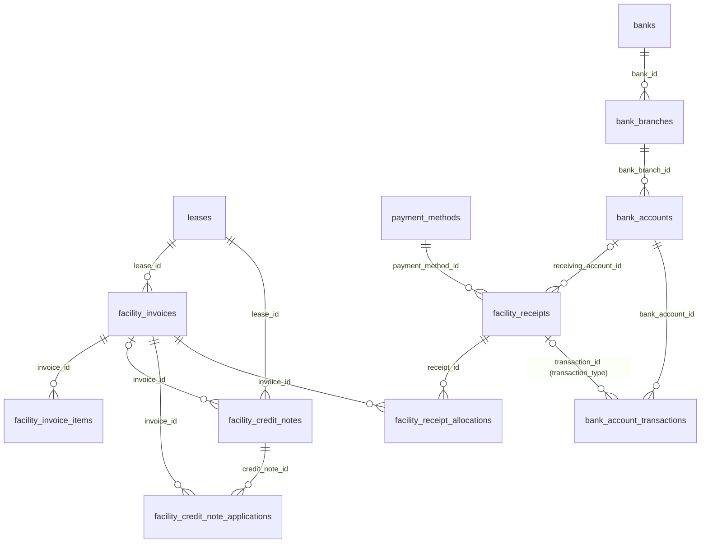

## facility_invoices

**One row per:** invoice raised to a tenant on one lease. **Model:** `App\Models\FacilityInvoice`. **Company-scoped:** yes. **Soft deletes:** no.
**Rows in dev DB:** about 6,100.

An invoice is raised by the automatic biller for a billing period ("Oct 2026", "Oct - Dec 2026"), by staff by hand, by the meter-reading utility billing run, by a lease's deposit or opening balance, or as a re-bill of a cancelled signed credit note. It may pass through an approval chain first (`pending`); once issued it is mirrored into `lease_billings` (one row per line) and `tenant_statements` (one debit line), and its `paid` / `balance` move as receipts and credit notes are applied.

**Status:**
- `pending` : awaiting approval. Nothing is posted: no statement line, no billing rows, not printable, not on the tenant portal. May be edited or deleted.
- `unpaid` : issued, nothing paid against it yet (`balance = total`).
- `partially paid` : issued, `0 < balance < total`.
- `paid` : `balance <= 0`. This includes overpaid invoices (negative balance) and invoices wiped out entirely by a credit note (see `reversal_credit_note_id`).
- `cancelled` : withdrawn after it was issued. Its billing rows are deleted and a reversing statement line is written; the row keeps its `total`.
- `rejected` : refused in approval. It was never issued; it is terminal and can only be deleted.

Live rows are `status IN ('unpaid', 'partially paid', 'paid')`. Those three are the invoices that exist as revenue; for net billed revenue also subtract the live credit notes (or exclude invoices whose `reversal_credit_note_id` is set, which were reversed in full). The status is recomputed from the balance every time money moves: `balance <= 0` gives `paid`, `0 < balance < total` gives `partially paid`, otherwise `unpaid`.

| Column | Type | Points to | Meaning |
|---|---|---|---|
| `id` | bigint | | Primary key. The invoice number shown to users is this id (INV#217062). |
| `public_token` | varchar(64) | | Random token for the tenant's public invoice page. Not a key to anything. |
| `company_id` | bigint, nullable | companies.id | Owning company (always set in dev). |
| `lease_id` | bigint | leases.id | The lease billed. Property, tenant and currency come from the lease. |
| `due_at` | timestamp | | Payment due date. Drives ageing and payment reminders. Not moved by a backdate. |
| `transaction_at` | datetime, nullable | | The ledger date of a backdated invoice (opening balances dated "as at 30 Sep 2026"). NULL means the invoice belongs on the day it was raised. Use `COALESCE(transaction_at, created_at)` as the invoice date. |
| `notes` | varchar(191) | | The period or description: "Oct 2026", "Opening balance as at 30 Sep 2026 - Rent". |
| `amount` | decimal(50,5) | | Net of tax, sum of the lines' `amount`, in the lease currency. |
| `tax` | decimal(50,5) | | Tax, sum of the lines' `tax`. |
| `total` | decimal(50,5) | | `amount + tax`. Verified exact on every row. |
| `paid` | decimal(50,5) | | Everything applied so far: confirmed receipt allocations plus credit notes applied, in the lease currency. |
| `balance` | decimal(50,5) | | `total - paid`. Negative means overpaid (13 rows in dev). |
| `status` | enum | | See above. |
| `is_credit` | tinyint | | Legacy flag, 0 on every row in dev. Ignore. |
| `created_by_id` | bigint, nullable | users.id | Staff member who raised it. NULL on invoices raised by the automatic biller and other jobs (about 2,200 in dev). |
| `supporting_upload_id` | bigint, nullable | uploads.id | Optional backing document for a hand-raised invoice. |
| `utility_billing_id` | bigint, nullable | utility_billings.id | The meter-reading billing run that raised it (none in dev). |
| `reversal_credit_note_id` | bigint, nullable | facility_credit_notes.id | Set when a credit note wiped out the whole invoice. The invoice then reads `paid` although nothing was paid. |
| `reissued_from_credit_note_id` | bigint, nullable | facility_credit_notes.id | Set on an invoice that re-bills a cancelled, already ETR-signed credit note. |
| `cu_invoice_number` | varchar, nullable | | The control unit (CU) number the fiscal device (ETR) returned. Non-empty means the invoice is signed with KRA. |
| `cu_serial_number` | varchar, nullable | | Serial of the fiscal device that signed it. |
| `cu_invoice_verify_url` | varchar, nullable | | KRA verification URL (the QR code on the PDF). |
| `cu_reference_number` | varchar, nullable | | Unused on invoices in dev (on credit notes it is the CU number of the invoice reversed). |
| `etr_signed_at` | timestamp, nullable | | When the signing step ran. The CU number, not this stamp, is the evidence of signing. |
| `etr_error` | text, nullable | | Last signing error. With no CU number, a non-empty error means "failed", empty means "not signed yet". |
| `cu_validation_status` | enum | | KRA iTax check of the CU number after signing: `pending` (not checked yet), `passed`, `failed`, `skipped` (no CU number to check). All but one row are `pending` in dev. |
| `cu_validation_failure_reason` | text, nullable | | Why the check failed. |
| `disputed_at`, `dispute_details`, `disputed_by`, `dispute_ticket_id` | | users.id, facility_tickets.id | A tenant dispute raises a ticket; these record it. NULL when never disputed. |
| `emailed_at` | timestamp, nullable | | When the "invoice issued" email went out (once). |
| `last_reminded_at` | timestamp, nullable | | Last overdue payment reminder sent. |
| `old_system_id` | varchar, nullable | | The id in the old EPMAS system. |

**Joins:**
- `facility_invoices.lease_id → leases.id` : many invoices per lease. Property = `leases.facility_id`, tenant = `leases.user_id`, currency = `leases.currency_id` (KES on all but one lease in dev).
- `facility_invoices.company_id → companies.id` : many to one.
- `facility_invoice_items.invoice_id → facility_invoices.id` : one invoice has one or more lines (no invoice without lines in dev).
- `facility_receipt_allocations.invoice_id → facility_invoices.id` : receipts applied to the invoice.
- `facility_credit_note_applications.invoice_id → facility_invoices.id` : credit notes applied to the invoice.
- `facility_credit_notes.invoice_id → facility_invoices.id` : credit notes raised against (or first drawn down by) the invoice.
- `facility_invoices.reversal_credit_note_id → facility_credit_notes.id` and `facility_invoices.reissued_from_credit_note_id → facility_credit_notes.id` : zero or one each.
- `facility_invoices.utility_billing_id → utility_billings.id`, `supporting_upload_id → uploads.id`, `created_by_id → users.id`, `disputed_by → users.id`, `dispute_ticket_id → facility_tickets.id`.
- Pointed to by: `lease_billings.invoice_id` (one row per line per component, the reporting mirror), `lease_deposits.invoice_id`, `lease_opening_balances.invoice_id`, `loos.legal_fee_invoice_id`, and `tenant_statements.transaction_id` where `tenant_statements.transaction_type = 'App\Models\FacilityInvoice'` (polymorphic, no DB constraint).

**Gotchas:**
- `paid` is not cash. In dev, invoices carry 138.1 million of `paid`, of which only 100,000 came from receipts; the rest is credit notes (opening balances migrated from EPMAS). Measure cash collected from `facility_receipt_allocations`, never from `facility_invoices.paid`.
- `paid` with a negative `balance` is an overpayment waiting to be carried to the tenant's next invoice. `paid` with `reversal_credit_note_id` set is a reversal, not a payment. In dev `reversal_credit_note_id` is NULL on every row even though hundreds of migrated credit notes credit their invoice in full, so detect full credits through `facility_credit_note_applications` or `facility_credit_notes.invoice_id` instead.
- Held balances: a receipt or credit note still `pending` posts nothing, so `balance` does not show it, but it "holds" its amount and the tenant portal shows `available = balance - holds`. To compute the hold: pending rows of `facility_receipt_allocations` whose receipt is also `pending` (amount in the receipt currency), plus `ABS(total)` of `facility_credit_notes` with `status = 'pending'` and this `invoice_id`. Since 2026-10-21 receipts may exceed the available balance (the excess overpays the invoice); only user-raised credit notes are refused by the hold.
- Dates: `created_at` is the day the invoice was raised; `transaction_at` is filled only on backdated invoices (3,934 opening-balance invoices in dev, all `2026-09-30`); `due_at` is the payment deadline. Period reports should use `COALESCE(transaction_at, created_at)`.
- A `cancelled` invoice keeps its `total`, `paid` and `balance` as they stood; do not sum them. A `pending` invoice holds nothing and is not on the tenant's statement.
- `public_token` is random and unique; it is not a foreign key.
- Money is in the lease currency (`leases.currency_id`), stored in currency units at five decimals.

## facility_invoice_items

**One row per:** line on an invoice, billing one lease component on one leased space. **Model:** `App\Models\FacilityInvoiceItem`. **Company-scoped:** no (scope through the invoice). **Soft deletes:** no.
**Rows in dev DB:** about 10,900.

Each line bills one `lease_item_components` row, which is the pairing of a leased space (`lease_items`) with a catalogue component (`lease_components`: Rent, Service Charge, Parking, Electricity, Water, Deposit...). Utility lines raised from meter readings carry the two readings they span.

| Column | Type | Points to | Meaning |
|---|---|---|---|
| `id` | bigint | | Primary key. |
| `invoice_id` | bigint | facility_invoices.id | Parent invoice. |
| `lease_item_component_id` | bigint, nullable | lease_item_components.id | The lease line billed. Set on every row in dev. The catalogue component is `lease_item_components.lease_component_id`; the space is `lease_item_components.lease_item_id → lease_items.facility_space_id`. |
| `notes` | varchar, nullable | | Line description (period, or "Water - Meter WM-001: Prev: 1600 Curr: 2100 Cons: 500"). |
| `quantity` | decimal(15,3) | | Months, units consumed, or a prorated fraction of a period (1.867). Default 1. |
| `cost` | decimal(50,5) | | Unit price (monthly rent, rate per unit). |
| `amount` | decimal(50,5) | | `cost * quantity`, net of tax. Verified exact in dev. |
| `tax_id` | bigint, nullable | taxes.id | Tax applied (dev: 1 = 0% Z, 2 = 16% S). `taxes.value` is a fraction (0.16), not a percent. |
| `tax` | decimal(50,5) | | Tax amount. |
| `total` | decimal(50,5) | | `amount + tax`. Lines sum to the invoice `total` on every invoice in dev. |
| `paid` | decimal(50,5) | | Receipt money applied to this line (see gotchas). |
| `balance` | decimal(50,5) | | `total - paid`, floored at zero. |
| `is_utility_bill` | tinyint | | 1 on lines raised by the meter-reading utility billing run (none in dev). |
| `previous_utility_meter_reading_id`, `current_utility_meter_reading_id` | bigint, nullable | utility_meter_readings.id | The readings a utility line spans. NULL on the first bill of a meter and on non-utility lines. |
| `old_system_id` | varchar, nullable | | The id in the old EPMAS system. |

**Joins:**
- `facility_invoice_items.invoice_id → facility_invoices.id` : many lines per invoice.
- `facility_invoice_items.lease_item_component_id → lease_item_components.id` : many lines per lease component over time. No orphans in dev.
- `facility_invoice_items.tax_id → taxes.id`.
- `facility_invoice_items.previous_utility_meter_reading_id → utility_meter_readings.id`, `current_utility_meter_reading_id → utility_meter_readings.id`.
- Pointed to by `lease_collections.invoice_item_id` (no DB constraint listed; the per-component collection rows written when a receipt is applied).

**Gotchas:**
- There is no `lease_component_id` column on this table. To group lines by component (Rent, Service Charge...) join `lease_item_components` and then `lease_components`.
- Line-level `paid` and `balance` move only when a receipt is applied; credit notes move the invoice header but never the lines. So in dev 10,840 of 10,882 lines still show a balance while the header says otherwise. Use the header's `paid` / `balance` for amounts owed; use line `paid` only to see how receipt money was spread.
- Unit prices are stored at five decimals and prorated quantities at three; a line's `cost * quantity` may differ by a cent from a two-decimal recalculation.

## facility_receipts

**One row per:** payment received from a tenant at one property. **Model:** `App\Models\FacilityReceipt`. **Company-scoped:** yes. **Soft deletes:** no.
**Rows in dev DB:** 6 (the migrated data holds receipts as opening balances, not as receipt rows).

A receipt records the money (`amount`, in `currency_id`), who paid (`paying_user_id`), how (`payment_method_id`, `transaction_number`), into which account (`receiving_account_id`) and how it was spread over invoices (`facility_receipt_allocations`). It may wait for approval (`pending`); once `confirmed` its allocations are applied to the invoices, a credit line goes to `tenant_statements`, per-component rows go to `lease_collections` and a debit line goes to the cashbook `bank_account_transactions`.

**Status:**
- `pending` : recorded, awaiting approval. Nothing is posted; its allocations hold their amounts on the invoices. May be edited or deleted.
- `confirmed` : posted. The only status whose money counts.
- `cancelled` : reversed. Its allocations were removed and the invoices put back; a reversing debit line sits on the statement.
- `rejected` : refused in approval, never posted. Terminal; can only be deleted.

Live rows are `status = 'confirmed'`. A receipt that was already remitted to the landlord cannot be plainly cancelled: it stays `confirmed`, gets `is_reversed = 1` and `reversal_receipt_id` pointing at a negative mirror receipt (same fields, `amount` negated, `transaction_number` suffixed `-CANCEL`). Summing every confirmed receipt therefore nets such a pair to zero; to list only real payments add `AND is_reversed = 0 AND amount > 0`.

| Column | Type | Points to | Meaning |
|---|---|---|---|
| `id` | bigint | | Primary key, the receipt number (RCP#168299). |
| `public_token` | varchar(64) | | Random token for the public receipt page. |
| `company_id` | bigint, nullable | companies.id | Owning company. |
| `facility_id` | bigint | facilities.id | The property the payment is for. Every invoice allocated must belong to a lease on this property. |
| `paying_user_id` | bigint | users.id | The tenant who paid (equals `leases.user_id` of the allocated invoices in dev). |
| `receiving_user_id` | bigint | users.id | The staff member who recorded the receipt. |
| `receiving_account_id` | bigint, nullable | bank_accounts.id | Bank account the money went to. Required unless the payment method says otherwise (`payment_methods.require_bank_account = 0`, the withholding methods). |
| `payment_method_id` | bigint | payment_methods.id | Cheque, cash, M-Pesa, EFT, RTGS, VAT withholding, rental withholding. |
| `transaction_number` | varchar | | The payer's reference: M-Pesa code, cheque number, transfer reference. |
| `transaction_date` | timestamp | | Date of the payment as entered. Used for currency conversion and copied to the cashbook line. |
| `currency_id` | bigint, default 1 | currencies.id | Currency of `amount` (1 = KES). |
| `amount` | decimal(50,5) | | Money received, in the receipt currency. Negative only on a reversal mirror receipt. |
| `allocated` | decimal(50,5) | | Sum applied to invoices, in the receipt currency. 0 while pending. |
| `balance` | decimal(50,5) | | `amount - allocated`: money not yet applied to any invoice. Equals `amount` while pending. |
| `status` | enum | | See above. |
| `is_reversed` | tinyint | | 1 when a remitted receipt was cancelled through a mirror receipt. |
| `reversal_receipt_id` | bigint, nullable | facility_receipts.id | The negative mirror receipt that reverses this one. |
| `pop_message`, `pop_upload_id` | text / bigint | uploads.id | Proof of payment: an SMS text and/or an uploaded slip, as the payment method demands (`payment_methods.proof_of_payment_type`). |
| `disputed_at`, `dispute_details`, `disputed_by`, `dispute_ticket_id` | | users.id, facility_tickets.id | Tenant dispute, as on invoices. |
| `created_by_id` | bigint, nullable | users.id | Creator. |
| `emailed_at` | timestamp, nullable | | When the receipt email went to the payer. |
| `old_system_id` | varchar, nullable | | The id in the old EPMAS system. |

**Joins:**
- `facility_receipts.facility_id → facilities.id` : many receipts per property.
- `facility_receipts.paying_user_id → users.id`, `receiving_user_id → users.id`, `created_by_id → users.id`, `disputed_by → users.id`.
- `facility_receipts.receiving_account_id → bank_accounts.id` : the collection account (all six dev receipts went to one company account, type `system`).
- `facility_receipts.payment_method_id → payment_methods.id`, `currency_id → currencies.id`, `pop_upload_id → uploads.id`, `dispute_ticket_id → facility_tickets.id`.
- `facility_receipts.reversal_receipt_id → facility_receipts.id` : self join to the mirror receipt.
- `facility_receipt_allocations.receipt_id → facility_receipts.id` : one receipt, one or more invoice allocations.
- `facility_receipt_remittance.receipt_id → facility_receipts.id` : pivot to the landlord remittance that paid this receipt out (section 6).
- `bank_account_transactions.transaction_id = facility_receipts.id` with `transaction_type = 'App\Models\FacilityReceipt'` (polymorphic, no DB constraint) : the cashbook debit of a confirmed receipt.
- `tenant_statements.transaction_id = facility_receipts.id` with `transaction_type = 'App\Models\FacilityReceipt'` (polymorphic, no DB constraint).

**Gotchas:**
- The tenant is on the receipt (`paying_user_id`) but the lease is not; reach the lease through the allocations' invoices.
- "Change date" on a receipt moves `created_at` (and the statement, collection and cashbook dates) but leaves `transaction_date` alone. `transaction_date` is the payment date typed in; `created_at` is where the receipt sits in the books. Collections reports in the app use `lease_collections.transaction_date`, which follows `created_at`.
- `amount`, `allocated` and `balance` are in the receipt currency; allocations and invoice balances are in the lease currency. Both are KES in dev, so they agree, but do not assume it.
- Cancelling a pending receipt deletes the row outright; cancelling a confirmed non-remitted receipt keeps the row as `cancelled` and deletes its cashbook line (unless a cheque cancellation fee was charged, in which case the cashbook line stays). No negating cashbook line is ever written.
- `balance > 0` on a confirmed receipt is money paid but not applied to any invoice; it has no lease collections and so cannot be remitted. A console command moves such money onto open invoices.
- `paying_user_id`, `transaction_number` and proof-of-payment columns identify real people and payments; aggregate them, do not export them.

## facility_receipt_allocations

**One row per:** slice of one receipt applied to one invoice. **Model:** `App\Models\FacilityReceiptAllocation`. **Company-scoped:** no (scope through the receipt). **Soft deletes:** no.
**Rows in dev DB:** 8.

Written when the receipt is recorded (status `pending`, amount in the receipt currency) and applied when the receipt is processed (status `confirmed`, amount converted to the lease currency, `currency_id` set). When an invoice is overpaid and a later invoice on the same lease is issued, the overpaid part is moved: the old allocation is reduced (or cancelled if nothing is left) and a new confirmed row is written on the new invoice with `carried_from_invoice_id` / `carried_from_allocation_id` filled in.

**Status:**
- `pending` : not yet applied. If the receipt is also `pending` this row holds its amount on the invoice. Rows of a `rejected` receipt also stay `pending` and hold nothing.
- `confirmed` : applied to the invoice; its amount is inside `facility_invoices.paid`.
- `cancelled` : removed, or fully carried forward to another invoice.

Live rows are `facility_receipt_allocations.status = 'confirmed'` joined to a receipt with `status = 'confirmed'`.

| Column | Type | Points to | Meaning |
|---|---|---|---|
| `id` | bigint | | Primary key. |
| `receipt_id` | bigint | facility_receipts.id | The receipt. |
| `invoice_id` | bigint | facility_invoices.id | The invoice paid. |
| `amount` | decimal(50,5) | | Amount applied. Receipt currency while pending, lease currency once confirmed. Negative on the mirror allocations of a reversed remitted receipt. |
| `currency_id` | bigint, nullable | currencies.id | Currency of `amount`. NULL while pending (all three pending rows in dev), the lease currency once confirmed. |
| `status` | enum | | See above. |
| `carried_from_invoice_id` | bigint, nullable | facility_invoices.id | The invoice this money overpaid before it was moved here. |
| `carried_from_allocation_id` | bigint, nullable | facility_receipt_allocations.id | The allocation it was taken from. |

**Joins:**
- `facility_receipt_allocations.receipt_id → facility_receipts.id` : many per receipt.
- `facility_receipt_allocations.invoice_id → facility_invoices.id` : many per invoice (an invoice may be paid by several receipts).
- `facility_receipt_allocations.carried_from_invoice_id → facility_invoices.id` and `carried_from_allocation_id → facility_receipt_allocations.id` : zero or one each; self join for the carry-forward chain.
- `facility_receipt_allocations.currency_id → currencies.id`.
- `facility_invoice_component_receipt_allocations.receipt_allocation_id → facility_receipt_allocations.id` : the per-component split.
- Pointed to by `lease_collections.receipt_allocation_id` : the per-component collection rows in the property's reporting currency (section on leases).

**Gotchas:**
- Both the allocation's status and the receipt's status matter. A `pending` allocation on a `rejected` receipt is dead; a `pending` allocation on a `pending` receipt is a hold.
- A carried-forward pair (source reduced, new row with `carried_from_*`) belongs to the same `receipt_id`, so the receipt's allocations still sum to its `allocated`.
- `SUM(amount)` of confirmed allocations on an invoice equals the receipt part of `facility_invoices.paid`; the rest of `paid` is credit notes.

## facility_invoice_component_receipt_allocations

**One row per:** lease component share of one receipt allocation. **Model:** `App\Models\FacilityInvoiceComponentReceiptAllocation`. **Company-scoped:** no. **Soft deletes:** no.
**Rows in dev DB:** 13.

When a receipt is allocated to an invoice the amount is spread across the invoice's lines by the property's allocation rule (proportional, by configured percentages, or in priority order). This table stores that spread per lease component, in the lease currency, net (`amount`) and tax (`tax`). It is written when the receipt is recorded (so it exists for pending receipts too) and rewritten when the receipt is processed.

| Column | Type | Points to | Meaning |
|---|---|---|---|
| `id` | bigint | | Primary key. |
| `receipt_allocation_id` | bigint | facility_receipt_allocations.id | The allocation split. |
| `lease_item_component_id` | bigint | lease_item_components.id | The lease line (space + component) receiving this share. |
| `amount` | decimal(50,5) | | Net share. 0 when the payment method is tax-only (VAT withholding). |
| `tax` | decimal(50,5) | | Tax share. |
| `total` | decimal(50,5) | | `amount + tax`. Rows of one allocation sum to the allocation amount. |

**Joins:**
- `facility_invoice_component_receipt_allocations.receipt_allocation_id → facility_receipt_allocations.id` : many per allocation (one per invoice line).
- `facility_invoice_component_receipt_allocations.lease_item_component_id → lease_item_components.id`, then `lease_item_components.lease_component_id → lease_components.id` for the component name.

**Gotchas:**
- No status column: the row is live only if its allocation and receipt are confirmed.
- It mirrors `lease_collections` (which is in the property's reporting currency and exists only for confirmed receipts); the figures agree when both currencies are KES.
- Negative rows exist for the mirror allocations of a reversed remitted receipt.

## facility_receipt_remittance

**One row per:** receipt included in one landlord remittance. **Model:** `App\Models\FacilityReceiptRemittance` (pivot). **Company-scoped:** no. **Soft deletes:** yes (`deleted_at`).
**Rows in dev DB:** 0.

Pivot between `facility_receipts` and `facility_remittances` (section 6). A receipt that appears here has been paid out to the landlord: it can no longer be backdated, and cancelling it produces a mirror receipt instead of a plain cancellation.

| Column | Type | Points to | Meaning |
|---|---|---|---|
| `id` | bigint | | Primary key. |
| `remittance_id` | bigint | facility_remittances.id | The remittance. |
| `receipt_id` | bigint | facility_receipts.id | The receipt remitted. |
| `deleted_at` | timestamp, nullable | | Soft delete; live rows have `deleted_at IS NULL`. |

**Joins:** `facility_receipt_remittance.receipt_id → facility_receipts.id` and `facility_receipt_remittance.remittance_id → facility_remittances.id`; many to many.

**Gotchas:** empty in dev, so untested against data. Remittances select `lease_collections`, not receipts, for their figures; this pivot only records membership.

## facility_credit_notes

**One row per:** credit note issued to a tenant on one lease. **Model:** `App\Models\FacilityCreditNote`. **Company-scoped:** yes. **Soft deletes:** no.
**Rows in dev DB:** about 2,240 (all of them EPMAS opening balances dated 30 Sep 2026: deposits held, excess service charge, prepaid rent).

A credit note reduces what the tenant owes. Raised against an invoice (`invoice_id` set) it is spent on that invoice the moment it is approved. Raised open (`invoice_id` NULL) it rests `unapplied` and is drawn down, oldest first, by each new invoice on the lease; the first invoice that draws on it is written into `invoice_id`. Reversing a signed invoice creates a full-value credit note that mirrors the invoice lines. Every figure on a credit note is stored negative.

**Status:**
- `pending` : awaiting approval; posts nothing but holds `ABS(total)` on its invoice.
- `unapplied` : approved, no invoice yet, full value available (`balance = total`).
- `partially applied` : some value drawn down (`0 < ABS(balance) < ABS(total)`).
- `applied` : fully spent (`balance = 0`).
- `cancelled` : withdrawn. An unsigned one has its applications reversed; a signed one (KRA holds it) keeps everything and is re-billed through a new invoice (`facility_invoices.reissued_from_credit_note_id`).
- `rejected` : refused in approval, never applied, terminal.

Live rows are `status IN ('unapplied', 'partially applied', 'applied')`. Credit still spendable is `status IN ('unapplied', 'partially applied') AND balance <> 0`.

| Column | Type | Points to | Meaning |
|---|---|---|---|
| `id` | bigint | | Primary key, the credit note number (CN#211137). |
| `public_token` | varchar(64) | | Random token for the public page. |
| `company_id` | bigint, nullable | companies.id | Owning company. |
| `lease_id` | bigint | leases.id | The lease credited. |
| `invoice_id` | bigint, nullable | facility_invoices.id | The invoice it was raised against, or the first invoice that drew it down. NULL on every `unapplied` note in dev (829). |
| `due_at` | timestamp | | A required date on the document (all `2026-10-01` in dev). Not a deadline in any process. |
| `transaction_at` | datetime, nullable | | Ledger date of a backdated note (all `2026-09-30` in dev). NULL means the day raised. Use `COALESCE(transaction_at, created_at)`. |
| `notes` | varchar(191) | | Description ("Opening balance as at 30 Sep 2026 - Deposit", "Reversal for INV#..."). |
| `amount`, `tax`, `total` | decimal(50,5) | | Net, tax and gross, all stored NEGATIVE (2,233 negative, 6 zero in dev). Value of the credit is `ABS(total)`. |
| `paid` | decimal(50,5) | | Credit spent so far, negative. |
| `balance` | decimal(50,5) | | Credit remaining, negative. `ABS(balance)` is what a future invoice can still draw. |
| `status` | enum | | See above. |
| `supporting_upload_id` | bigint, nullable | uploads.id | The document the note was raised on (required from staff, fixed once approved). |
| `cu_reference_number` | varchar, nullable | | CU number of the invoice being credited, for the fiscal device. |
| `cu_invoice_number`, `cu_serial_number`, `cu_credit_note_verify_url`, `etr_signed_at`, `etr_error`, `cu_validation_status`, `cu_validation_failure_reason` | | | ETR signing and KRA validation, exactly as on `facility_invoices` (none signed in dev). |
| `disputed_at`, `dispute_details`, `disputed_by`, `dispute_ticket_id` | | users.id, facility_tickets.id | Tenant dispute. |
| `created_by_id` | bigint, nullable | users.id | Creator. |
| `emailed_at` | timestamp, nullable | | When the credit note email went out. |
| `old_system_id` | varchar, nullable | | The id in the old EPMAS system. |

**Joins:**
- `facility_credit_notes.lease_id → leases.id` : many per lease.
- `facility_credit_notes.invoice_id → facility_invoices.id` : zero or one invoice; 116 invoices in dev carry more than one credit note.
- `facility_credit_note_items.credit_note_id → facility_credit_notes.id` : one or more lines.
- `facility_credit_note_applications.credit_note_id → facility_credit_notes.id` : every invoice it paid (see that table for coverage).
- `facility_invoices.reversal_credit_note_id → facility_credit_notes.id` : the invoice this note reversed in full. `facility_invoices.reissued_from_credit_note_id → facility_credit_notes.id` : the invoice that re-billed this cancelled signed note.
- `facility_credit_notes.company_id → companies.id`, `supporting_upload_id → uploads.id`, `created_by_id → users.id`, `disputed_by → users.id`, `dispute_ticket_id → facility_tickets.id`.
- Pointed to by `lease_billings.credit_note_id` (negative billing rows per component), `lease_opening_balances.credit_note_id` (the opening balance that created it) and `tenant_statements.transaction_id` with `transaction_type = 'App\Models\FacilityCreditNote'` (polymorphic, no DB constraint).

**Gotchas:**
- Negative storage: `SUM(total)` of live credit notes is a negative number. Use `ABS()` or `-SUM()` when reporting credit issued.
- `invoice_id` names only one invoice; a partially applied open note may have paid several. The full picture is `facility_credit_note_applications`, with the coverage caveat there.
- A note whose `ABS(total)` equals its invoice's `total` reverses it, and the invoice reads `paid`. Reversal notes created inside the app set `facility_invoices.reversal_credit_note_id`; the migrated ones did not.
- A `pending` note on a paid invoice applies in full on approval and pushes the invoice negative; the excess carries to the next invoice.

## facility_credit_note_items

**One row per:** line on a credit note. **Model:** `App\Models\FacilityCreditNoteItem`. **Company-scoped:** no. **Soft deletes:** no.
**Rows in dev DB:** about 2,760.

Same shape as an invoice line, stored negative, and without line-level paid/balance.

| Column | Type | Points to | Meaning |
|---|---|---|---|
| `id` | bigint | | Primary key. |
| `credit_note_id` | bigint | facility_credit_notes.id | Parent note. |
| `lease_item_component_id` | bigint, nullable | lease_item_components.id | The lease line credited (set on every row in dev). |
| `notes` | varchar, nullable | | Line description. |
| `quantity` | decimal(10,3) | | Quantity (default 1). |
| `cost` | decimal(50,5) | | Unit value, negative. |
| `amount`, `tax`, `total` | decimal(50,5) | | Net, tax, gross, negative (2,757 negative, 6 zero). |
| `tax_id` | bigint, nullable | taxes.id | Tax applied. |
| `old_system_id` | varchar, nullable | | The id in the old EPMAS system. |

**Joins:** `facility_credit_note_items.credit_note_id → facility_credit_notes.id` (many per note); `lease_item_component_id → lease_item_components.id`; `tax_id → taxes.id`.

**Gotchas:** there is no `lease_component_id` column; reach the component name through `lease_item_components.lease_component_id`.

## facility_credit_note_applications

**One row per:** application of one credit note to one invoice. **Model:** `App\Models\FacilityCreditNoteApplication`. **Company-scoped:** no. **Soft deletes:** no.
**Rows in dev DB:** 910.

Added on 2026-10-21 as the audit trail of credit money: one row each time a note is spent on an invoice (on approval against its own invoice, on every draw-down by a later invoice, and for the unspent part moved to a re-issued invoice). `amount` is positive, in the invoice (lease) currency. Rows backfilled for credit already applied before the table existed carry `applied_at = NULL`.

| Column | Type | Points to | Meaning |
|---|---|---|---|
| `id` | bigint | | Primary key. |
| `credit_note_id` | bigint | facility_credit_notes.id | The note spent. |
| `invoice_id` | bigint | facility_invoices.id | The invoice it paid. |
| `amount` | decimal(50,5) | | Positive amount applied, lease currency. |
| `applied_at` | timestamp, nullable | | When applied. NULL on every backfilled row (all 910 in dev). |
| `company_id` | bigint, nullable | companies.id | Owning company (always set). |

**Joins:**
- `facility_credit_note_applications.credit_note_id → facility_credit_notes.id` : one note, many applications.
- `facility_credit_note_applications.invoice_id → facility_invoices.id` : one invoice, many applications (825 distinct invoices in dev).
- `facility_credit_note_applications.company_id → companies.id`.

**Gotchas:**
- Coverage is incomplete for migrated data. In dev 910 rows cover 63.85 million, while `facility_credit_notes.paid` totals 138.03 million: 500 spent opening-balance notes (447 `applied`, 53 `partially applied`) have no application row. For those, fall back to `facility_credit_notes.invoice_id` with `ABS(facility_credit_notes.paid)`. Worked query 4 shows the join; add the fallback with a `NOT EXISTS` on this table if you need the full picture.
- Cancelling an unsigned credit note deletes its application rows (after reversing them on the invoices), so the table shows the current state, not history.
- No status column; filter through the credit note's status.

## payment_methods

**One row per:** way a tenant can pay. **Model:** `App\Models\PaymentMethod`. **Company-scoped:** no (one global list). **Soft deletes:** no.
**Rows in dev DB:** 7.

Dev rows: 1 Cheque Deposit Slip (`CHEQUE`), 2 Cash Deposit Slip (`CASH`), 3 Mpesa (`MPESA`), 4 ETF (`ETF`, the seeded spelling of EFT), 5 RTGS (`RTGS`), 6 VAT Withholding (`VAT_WITHHOLDING`), 7 Rental Withholding (`RENTAL_WITHHOLDING`). Payment vouchers and settlements (section 6) use the same list.

**Status:** `active` / `inactive`. Live rows are `status = 'active'` (all 7 in dev).

| Column | Type | Points to | Meaning |
|---|---|---|---|
| `id` | bigint | | Primary key. |
| `name`, `code` | varchar | | Display name and short code. |
| `description` | text, nullable | | Free text. |
| `transaction_number_regex` | varchar, nullable | | Pattern the receipt's `transaction_number` must match. |
| `has_cancellation_fee` | tinyint | | 1 when cancelling a receipt of this method may charge a fee (cheques). The fee amount is per bank account in `bank_account_payment_methods.cancellation_fee`; the fee is invoiced to the tenant on the lease of the cancelled receipt. |
| `pay_tax_only` | tinyint | | 1 when a receipt of this method settles only the tax part of each component (VAT Withholding); its component split has `amount = 0`. |
| `require_bank_account` | tinyint | | 1 when a receipt must name a `receiving_account_id`. 0 for the two withholding methods. |
| `is_withholding` | tinyint | | Withholding flag. 0 on every row in dev, including the two withholding methods; do not rely on it. |
| `proof_of_payment_type` | enum | | What proof a receipt must carry: `none`, `message` (SMS text), `document` (uploaded slip), `both`, `either`. |
| `status` | enum | | `active` / `inactive`. |

**Joins:** pointed to by `facility_receipts.payment_method_id`, `bank_account_transactions.payment_method_id`, `facility_payment_vouchers.payment_method_id`, `facility_settlements.payment_method_id`, and the pivot `bank_account_payment_methods.payment_method_id`.

## banks

**One row per:** bank. **Model:** `App\Models\Bank`. **Company-scoped:** no. **Soft deletes:** no.
**Rows in dev DB:** 51.

Reference list of banks (imported from EPMAS). `settlement_template` names the bank-file layout used when exporting a settlement to this bank; `paybill_number` is the bank's M-Pesa paybill.

**Status:** `active` / `inactive` (50 active, 1 inactive).

| Column | Type | Points to | Meaning |
|---|---|---|---|
| `id` | bigint | | Primary key. |
| `name`, `code` | varchar | | Bank name and clearing code (e.g. `03`). |
| `swift_code` | varchar, nullable | | SWIFT/BIC. |
| `paybill_number` | varchar, nullable | | M-Pesa paybill (7 banks). |
| `settlement_template` | varchar, nullable | | Settlement export layout key; NULL means the default layout (2 banks set). |
| `info` | json, nullable | | Extra details (empty in dev). |
| `status` | enum | | `active` / `inactive`. |

**Joins:** `bank_branches.bank_id → banks.id` (one bank, many branches).

## bank_branches

**One row per:** branch of a bank. **Model:** `App\Models\BankBranch`. **Company-scoped:** no. **Soft deletes:** no.
**Rows in dev DB:** about 1,350.

| Column | Type | Points to | Meaning |
|---|---|---|---|
| `id` | bigint | | Primary key. |
| `bank_id` | bigint | banks.id | The bank. |
| `name`, `code` | varchar | | Branch name and code (unique per bank in dev). |
| `status` | enum | | `active` / `inactive` (1 inactive). |

**Joins:** `bank_branches.bank_id → banks.id`; pointed to by `bank_accounts.bank_branch_id` and `lease_applications.bank_branch_id` (the applicant's bank, section 4).

## bank_accounts

**One row per:** bank account known to the system, either the company's own or one belonging to a user. **Model:** `App\Models\BankAccount`. **Company-scoped:** yes. **Soft deletes:** yes (`deleted_at`, none deleted in dev).
**Rows in dev DB:** 782.

`type` says whose account it is. `system` (73 in dev): the company's own account, used to receive tenant payments and to pay vouchers; `user_id` and `user_group_id` are NULL. `user` (709): an account of a person or organisation the company pays or collects from; `user_id` names the user and `user_group_id` the capacity in which they hold it (`user_groups.title`: 4 = `vendor`, 653 accounts; 6 = `landlord`, 56 accounts; a tenant's account would carry 2 = `tenant`, none in dev). `company_id` is set on every row of both types. A property is linked to its collection and expense accounts through `facility_bank_accounts` (below).

**Status:** `active` / `inactive`. Live rows are `status = 'active' AND deleted_at IS NULL` (all 782 in dev).

| Column | Type | Points to | Meaning |
|---|---|---|---|
| `id` | bigint | | Primary key. |
| `company_id` | bigint, nullable | companies.id | Owning company (set on every row). |
| `type` | enum | | `system` (company's own) or `user` (a user's account). Immutable after creation. |
| `user_id` | bigint, nullable | users.id | Account holder when `type = 'user'`. 59 users hold more than one account. |
| `user_group_id` | bigint, nullable | user_groups.id | Capacity of the holder: `vendor`, `landlord` or `tenant`. |
| `bank_branch_id` | bigint | bank_branches.id | Branch, which gives the bank. |
| `account_name`, `account_number` | varchar | | Holder name and account number as at the bank (personal data: aggregate, never export). `account_number` is unique across the table in the app's validation. |
| `alias` | varchar, nullable | | Nickname staff use (520 set). |
| `currency_id` | bigint, nullable | currencies.id | Account currency (all KES in dev). Cashbook lines are kept in this currency. |
| `status` | enum | | `active` / `inactive`. |
| `created_by_id` | bigint, nullable | users.id | Creator. |
| `deleted_at` | timestamp, nullable | | Soft delete. |
| `old_system_id` | varchar, nullable | | The id in the old EPMAS system. |

**Joins:**
- `bank_accounts.bank_branch_id → bank_branches.id`, then `bank_branches.bank_id → banks.id`.
- `bank_accounts.user_id → users.id`, `bank_accounts.user_group_id → user_groups.id`, `bank_accounts.company_id → companies.id`, `created_by_id → users.id`, `currency_id → currencies.id`.
- `bank_account_payment_methods.bank_account_id → bank_accounts.id` : payment methods accepted on the account, with their cancellation fee.
- `bank_account_transactions.bank_account_id → bank_accounts.id` : the cashbook.
- `bank_reconciliation_reports.bank_account_id → bank_accounts.id`, `bank_statement_line_classifications.bank_account_id → bank_accounts.id`.
- `facility_receipts.receiving_account_id → bank_accounts.id` : account a tenant paid into.
- `facility_bank_accounts.bank_account_id → bank_accounts.id` : property to account, with a purpose.
- Pointed to from sections 2 and 6: `facilities.default_collection_bank_account_id` (NULL on all 101 properties in dev; `facility_bank_accounts` is what is used), `facility_payment_vouchers.debit_bank_account_id` / `credit_bank_account_id`, `facility_payouts.credit_bank_account_id`, `facility_settlements.debit_bank_account_id`, `landlord_default_accounts.bank_account_id`.

**Gotchas:**
- "Whose account" is `type` plus `user_group_id`, not `company_id`: a landlord's account has `company_id` set just like the company's own account.
- A user with both landlord and vendor roles may have accounts under each group.

## bank_account_payment_methods

**One row per:** payment method accepted on one bank account. **Model:** `App\Models\BankAccountPaymentMethod` (pivot). **Company-scoped:** no. **Soft deletes:** no.
**Rows in dev DB:** 0.

Pivot between `bank_accounts` and `payment_methods`, unique on the pair. `cancellation_fee` is the fee charged to the tenant when a receipt of that method into that account is cancelled (cheques that bounce).

| Column | Type | Points to | Meaning |
|---|---|---|---|
| `id` | bigint | | Primary key. |
| `bank_account_id` | bigint | bank_accounts.id | The account. |
| `payment_method_id` | bigint | payment_methods.id | The method accepted. |
| `cancellation_fee` | decimal(50,5), nullable | | Fee charged on cancellation. |
| `notes` | text, nullable | | Free text. |

**Joins:** `bank_account_payment_methods.bank_account_id → bank_accounts.id`; `bank_account_payment_methods.payment_method_id → payment_methods.id`.

`facility_bank_accounts` (which account a property collects into and pays from) is documented in section 2. It is the only link from a property to its collection account: `facilities.default_collection_bank_account_id` is NULL on every property.

## bank_account_transactions

**One row per:** money movement on a bank account (the cashbook). **Model:** `App\Models\BankAccountTransaction`. **Company-scoped:** no (scope through the account). **Soft deletes:** no.
**Rows in dev DB:** 5 (all receipt debits).

From the bank account's point of view: `debit` is money in, `credit` is money out. A confirmed receipt writes one debit line against its receiving account; a released payment voucher (section 6) writes one credit line against the paying account; a bank-side line booked from a statement during reconciliation (charges, interest) has no originating document. Each line carries the property and the counterparty so the cashbook can be grouped without parsing `notes`.

| Column | Type | Points to | Meaning |
|---|---|---|---|
| `id` | bigint | | Primary key. |
| `bank_account_id` | bigint | bank_accounts.id | The account. |
| `transaction_type`, `transaction_id` | varchar / bigint, nullable | polymorphic: see below | The document that produced the line. |
| `facility_id` | bigint, nullable | facilities.id | Property. NULL for bank-side lines and for vouchers that settle several properties. |
| `payee_id` | bigint, nullable | users.id | Counterparty: the tenant paying (receipts) or the user paid (vouchers). |
| `payment_method_id` | bigint, nullable | payment_methods.id | Method of the receipt or voucher. |
| `refference_number` | varchar, nullable | | (sic) The payer's or voucher's transaction reference. |
| `notes` | text | | Human label, e.g. "Receipt#168299 - 06 Oct, 2026 - ...". Contains names; do not export. |
| `transaction_at` | timestamp | | Receipt `transaction_date`, voucher paid date, or the statement line date. |
| `debit` | decimal(50,5) | | Money in, in the account currency. |
| `credit` | decimal(50,5) | | Money out. |
| `currency_id` | bigint, nullable | currencies.id | The bank account's currency. |
| `reconciliation_status` | enum | | `pending` (not matched to a statement line), `matched`, `ignored`. |
| `reconciled_at` | timestamp, nullable | | When matched. |
| `bank_entry` | json, nullable | | The statement line it was matched to. |
| `reconciliation_classification` | varchar, nullable | | Why an unmatched cashbook line differs from the bank: `uncredited_receipts`, `cheques_received_not_banked`, `cash_received_not_banked`, `erroneous_receipt`, `duplicated_receipt`, `banked_in_other_bank`, `receipt_transposition_error`, `post_dated_cheque_early`, `unrecognised_receipt`, `long_outstanding_receipt`, `receipts_from_prior_periods`, `unpresented_payments`, `cheques_not_released`, `erroneous_payment`, `duplicated_payment`, `misposted_payment_wrong_bank`, `payment_transposition_error`, `stale_cheque`, `cancelled_cheque_not_reversed`, `contra_entry`, `unrecognised_payment`, `long_outstanding_payment`. |
| `reconciliation_classification_notes` | text, nullable | | Reconciler's remark. |
| `old_system_id` | varchar, nullable | | The id in the old EPMAS system. |

**Joins:**
- `bank_account_transactions.bank_account_id → bank_accounts.id` : many lines per account.
- Polymorphic `transaction_type` / `transaction_id` (no DB constraint): `'App\Models\FacilityReceipt'` → `facility_receipts.id` (all 5 dev rows), `'App\Models\FacilityPaymentVoucher'` → `facility_payment_vouchers.id` (section 6), NULL for statement-booked lines.
- `bank_account_transactions.facility_id → facilities.id`, `payee_id → users.id`, `payment_method_id → payment_methods.id`, `currency_id → currencies.id`.

**Gotchas:**
- Cancelling a confirmed, non-remitted receipt deletes its cashbook line (kept only when a cancellation fee was charged). Reversing a remitted receipt keeps the original line and writes no negating line, so the cashbook can overstate money in for reversed receipts.
- The column is spelled `refference_number`.
- `reconciliation_classification` is only meaningful while `reconciliation_status = 'pending'`.

## bank_reconciliation_reports

**One row per:** saved reconciliation report for one uploaded bank statement and one layout. **Model:** `App\Models\BankReconciliationReport`. **Company-scoped:** yes. **Soft deletes:** yes.
**Rows in dev DB:** 0.

A reconciliation compares an uploaded statement with the cashbook of one account. Saving it stores a snapshot keyed by the statement's token and the layout (`report_type`); saving again replaces the earlier snapshot for that pair.

| Column | Type | Points to | Meaning |
|---|---|---|---|
| `id` | bigint | | Primary key. |
| `company_id` | bigint, nullable | companies.id | Company of the account. |
| `bank_account_id` | bigint | bank_accounts.id | The account reconciled. |
| `statement_token` | varchar(64) | | Token of the uploaded statement. Unique with `report_type`. |
| `report_type` | varchar(32) | | Layout: `full_account` (default) or `credits_only`. |
| `title` | varchar, nullable | | Report title. |
| `period_start`, `period_end` | date, nullable | | Statement period. |
| `bank_balance` | decimal(50,5), nullable | | Statement closing balance. |
| `reconciling_difference` | decimal(50,5) | | Unexplained difference after the workings. |
| `difference_status` | varchar(16), nullable | | `balanced` (difference under half a cent), `variance`, or `incomplete`. |
| `statement`, `report` | json | | The extracted statement and the report rows, as saved (never recomputed). |
| `created_by_id` | bigint, nullable | users.id | Who saved it. |
| `deleted_at` | timestamp, nullable | | Soft delete. |

**Joins:** `bank_reconciliation_reports.bank_account_id → bank_accounts.id`; `created_by_id → users.id`. `company_id` has no DB constraint listed.

## bank_statement_line_classifications

**One row per:** classified bank-statement line that has no cashbook row behind it, per account. **Model:** `App\Models\BankStatementLineClassification`. **Company-scoped:** no. **Soft deletes:** no.
**Rows in dev DB:** 0.

When a statement line cannot be matched (a bank charge, interest, an external transfer) the reconciler classifies it; the row is keyed by the account and a signature of the line so the classification survives re-uploading the same statement.

| Column | Type | Points to | Meaning |
|---|---|---|---|
| `id` | bigint | | Primary key. |
| `bank_account_id` | bigint | bank_accounts.id | The account. |
| `signature` | varchar | | Hash of the statement line. Unique with `bank_account_id`. |
| `classification` | varchar | | One of: `direct_credit_customer_receipt`, `interest_received`, `bank_refund_fee_reversal`, `loan_drawdown`, `inter_account_transfer_in`, `fx_gain`, `bank_error_credit`, `external_transaction` (an external credit), `unidentified_credit`, `unrecognised_credit`, `bank_charge`, `excise_duty`, `interest_charged`, `direct_debit_standing_order`, `loan_repayment`, `dishonoured_cheque`, `dishonour_charge`, `card_merchant_commission`, `inter_account_transfer_out`, `fx_loss`, `garnishee_court_order`, `bank_error_debit`, `external_transaction_debit`, `unrecognised_debit`. |
| `notes` | text, nullable | | Reconciler's remark. |
| `bank_entry` | json | | The statement line itself. |

**Joins:** `bank_statement_line_classifications.bank_account_id → bank_accounts.id`.

## Worked queries

**1. Invoiced (with tax) versus cash collected, per property per month.** Invoice date is `COALESCE(transaction_at, created_at)`; collections are confirmed receipt allocations dated by the receipt's `transaction_date`.

```sql
SELECT f.id AS facility_id, f.name AS property, m.month,
       ROUND(SUM(m.invoiced), 2) AS invoiced,
       ROUND(SUM(m.tax), 2)      AS tax,
       ROUND(SUM(m.collected), 2) AS collected
FROM (
    SELECT l.facility_id,
           DATE_FORMAT(COALESCE(i.transaction_at, i.created_at), '%Y-%m') AS month,
           i.total AS invoiced, i.tax AS tax, 0 AS collected
    FROM facility_invoices i
    JOIN leases l ON l.id = i.lease_id
    WHERE i.status IN ('unpaid', 'partially paid', 'paid')
      AND i.reversal_credit_note_id IS NULL
    UNION ALL
    SELECT l.facility_id,
           DATE_FORMAT(r.transaction_date, '%Y-%m') AS month,
           0, 0, a.amount
    FROM facility_receipt_allocations a
    JOIN facility_receipts r ON r.id = a.receipt_id
    JOIN facility_invoices i ON i.id = a.invoice_id
    JOIN leases l ON l.id = i.lease_id
    WHERE a.status = 'confirmed' AND r.status = 'confirmed'
) m
JOIN facilities f ON f.id = m.facility_id
GROUP BY f.id, f.name, m.month
ORDER BY f.id, m.month;
```

Returned 180 property-month rows on dev; for property 157 in 2026-10: invoiced 62,294,573.62, tax 8,592,354.98, collected 100,000.00 (the only property with receipts).

**2. Aged receivables: outstanding balance per lease, bucketed by days past `due_at`.** Same buckets the invoice PDF uses (current, 1-30, 31-60, 61-90, over 90).

```sql
SELECT l.id AS lease_id, l.facility_id, l.user_id AS tenant_user_id,
       ROUND(SUM(i.balance), 2) AS outstanding,
       ROUND(SUM(CASE WHEN DATEDIFF(CURDATE(), i.due_at) <= 0 THEN i.balance ELSE 0 END), 2) AS not_yet_due,
       ROUND(SUM(CASE WHEN DATEDIFF(CURDATE(), i.due_at) BETWEEN 1 AND 30 THEN i.balance ELSE 0 END), 2) AS d1_30,
       ROUND(SUM(CASE WHEN DATEDIFF(CURDATE(), i.due_at) BETWEEN 31 AND 60 THEN i.balance ELSE 0 END), 2) AS d31_60,
       ROUND(SUM(CASE WHEN DATEDIFF(CURDATE(), i.due_at) BETWEEN 61 AND 90 THEN i.balance ELSE 0 END), 2) AS d61_90,
       ROUND(SUM(CASE WHEN DATEDIFF(CURDATE(), i.due_at) > 90 THEN i.balance ELSE 0 END), 2) AS over_90
FROM facility_invoices i
JOIN leases l ON l.id = i.lease_id
WHERE i.status IN ('unpaid', 'partially paid')
  AND i.balance > 0
GROUP BY l.id, l.facility_id, l.user_id
ORDER BY outstanding DESC;
```

Returned 3,341 leases with 1,700,946,559.82 outstanding in total on dev (run on 2026-10-22); everything fell in the 1-30 bucket because every dev invoice is due between 1 and 21 Oct 2026. Overpayments (negative balances) are excluded by `balance > 0`; subtract spendable credit notes (`facility_credit_notes` with `status IN ('unapplied','partially applied')`, `ABS(balance)`) per lease if you want net exposure.

**3. Receipt allocation detail: which invoices each receipt paid.** Includes pending receipts so their holds are visible; drop `'pending'` for cash only.

```sql
SELECT r.id AS receipt_id, r.status AS receipt_status, r.transaction_date,
       pm.code AS payment_method, r.facility_id,
       r.amount AS receipt_amount, r.allocated, r.balance AS unallocated,
       a.id AS allocation_id, a.status AS allocation_status,
       a.invoice_id, i.notes AS invoice_notes, i.lease_id,
       a.amount AS allocated_to_invoice, a.carried_from_invoice_id,
       i.total AS invoice_total, i.paid AS invoice_paid,
       i.balance AS invoice_balance, i.status AS invoice_status
FROM facility_receipts r
JOIN payment_methods pm ON pm.id = r.payment_method_id
JOIN facility_receipt_allocations a ON a.receipt_id = r.id
JOIN facility_invoices i ON i.id = a.invoice_id
WHERE r.status IN ('confirmed', 'pending')
ORDER BY r.id, a.id;
```

Returned 8 rows on dev: five confirmed allocations (receipts 168299 to 168303, 100,000 over two invoices, one of them now overpaid by 7,360) and three pending allocations of receipt 168304 holding 20,000 across three invoices.

**4. Credit notes applied per invoice.** One row per application; `is_full_reversal` flags a note that wiped out its invoice.

```sql
SELECT i.id AS invoice_id, i.lease_id, i.notes AS invoice_notes, i.total AS invoice_total,
       cn.id AS credit_note_id, cn.status AS credit_note_status,
       ABS(cn.total) AS credit_note_value,
       app.amount AS applied_to_invoice, app.applied_at,
       ((i.reversal_credit_note_id = cn.id) IS TRUE) AS is_full_reversal
FROM facility_credit_note_applications app
JOIN facility_credit_notes cn ON cn.id = app.credit_note_id
JOIN facility_invoices i ON i.id = app.invoice_id
WHERE cn.status <> 'cancelled'
ORDER BY i.id, cn.id;
```

Returned 910 rows over 825 invoices, 63,854,268.53 applied in total, `applied_at` NULL on every row (all backfilled). The 500 migrated notes with no application row are reached with `facility_credit_notes.invoice_id` and `ABS(paid)` where `NOT EXISTS (SELECT 1 FROM facility_credit_note_applications x WHERE x.credit_note_id = cn.id)`.

# 6. Supplier contracts, bills, expenses, remittances and landlord payouts

This domain is the money that flows out of a property. A supplier (a `users` row in the `vendor` user group) holds a contract with a property (`facility_contracts`) and raises bills against it (`facility_bills`), or bills ad hoc or from a purchase order. A bill is `pending` until the supplier's invoice is posted; posting turns it into an expense of the property (`facility_expenses`), credits the supplier's payables ledger (`facility_vendor_statements`) and freezes the withholding tax deducted from it (`facility_bill_withholdings`). Every bill and expense is classified by its own `expense_category_id`, `expense_type_id` and `expense_sub_type_id` (the tree `expense_categories` to `facility_expense_types` to `facility_expense_sub_types`, with approved suppliers per sub-type in `facility_expense_sub_type_vendors`). At the end of a period the managing company nets the property's collections against its expenses and its own management fee in a remittance to the landlord (`facility_remittances`). Suppliers and landlords are paid through payment vouchers (`facility_payment_vouchers` and their items), which are batched into bank settlements (`facility_settlements`). Budgets (`facility_budgets`) compare budgeted income and expense per property and period with what was collected and spent. Three groups of tables are legacy and empty: payouts, ledgers, and (in the dev database only) everything from expenses onward, because the migration imported bills but not the expense, remittance or payment history. That EPMAS history is kept **for reference only** in `facility_history_expenses` and `facility_history_remittances`, described at the end of this section's tables; nothing in the application but the reports built for it reads them.

One fact shapes every query here: the managing company is itself a supplier. The `settings` row `default_vendor` (user 188 in dev) is the "system vendor" that bills the property for management fees, letting fees, salaries and wages, deposit refunds and recoveries from the landlord. 2,651 of the 3,365 bills in dev belong to it. Exclude it when you want third-party supplier spend.

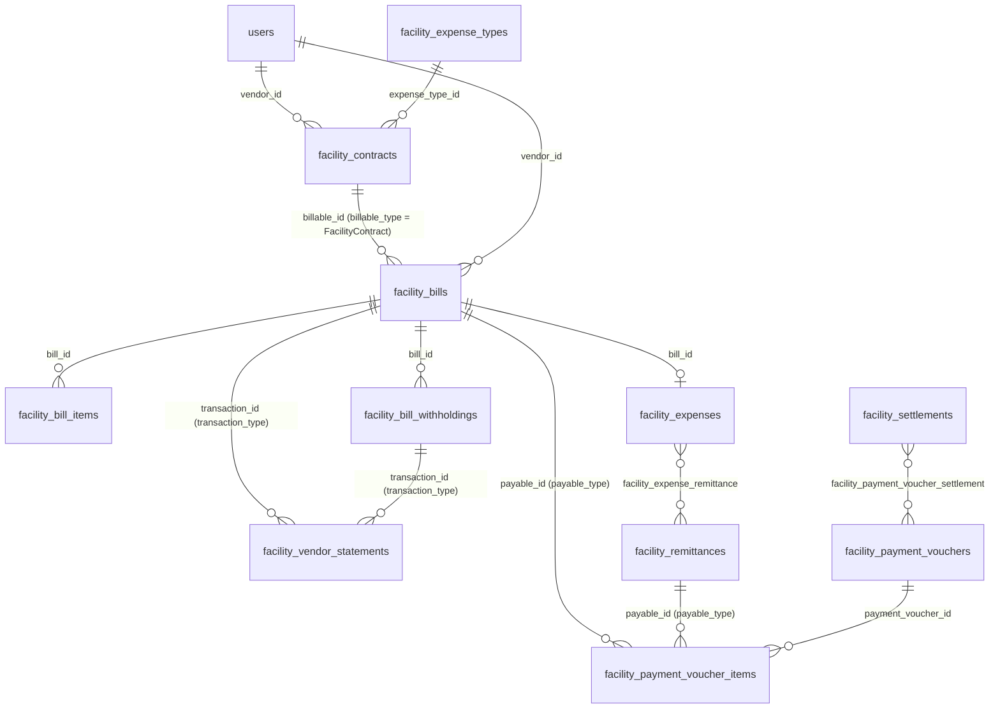

Polymorphic `*_type` columns in this domain hold the PHP class name with single backslashes (`App\Models\FacilityContract`). In a MySQL string literal each backslash must be doubled: `WHERE billable_type = 'App\\Models\\FacilityContract'`. The mysql command line prints the stored value with doubled backslashes too; the stored value has one. See Conventions.

## facility_contracts

**One row per:** supplier contract with one property. **Model:** `App\Models\FacilityContract`. **Company-scoped:** yes. **Soft deletes:** yes. **Rows in dev DB:** 557.

A contract says which supplier provides which expense type to which property, for how much, how often it is billed, and for what period. Contracts are created from the supplier module, by the property set-up routine that auto-creates the "Management Fee Service Contract", "Letting Fee Service Contract", "Re-Letting Fee Service Contract" and "Salaries and Wages Service Contract" with the system vendor, by the utility sync (one variable contract per utility), and by the EPMAS import. Fixed contracts with a `next_billing_at` are billed automatically by the scheduler (`contracts:generate-bills`) which raises a `pending` contract bill and moves `next_billing_at` forward.

**Status:**
- `pending` : created through the API and awaiting approval; not yet live.
- `active` : approved and running. The only live status.
- `suspended` : paused by staff.
- `expired` : past its end date. Nothing sets this automatically: an `active` contract whose `end_at` has passed stays `active` in the database and is only reported as expired by the app (97 such rows in dev).
- `inactive` : switched off by staff.
- `rejected` : approval was refused; terminal.
- `terminated` : ended early by staff; terminal.

Live rows are `deleted_at IS NULL AND status = 'active'`; add `AND (end_at IS NULL OR end_at >= CURDATE())` to drop contracts that have run out. Dev holds only `active` (515) and `terminated` (42).

| Column | Type | Points to | Meaning |
|---|---|---|---|
| id | bigint | | Primary key |
| company_id | bigint | companies.id | Owning company (never NULL in dev) |
| title | text | | Derived "<expense type> Service Contract at <property>" when nobody typed one; the sync finds the statutory contracts by this title |
| vendor_id | bigint | users.id | The supplier. Verified: every bill vendor is in user group `vendor` |
| facility_id | bigint | facilities.id | The property |
| utility_id | bigint | lease_components.id | For utility contracts, the utility component (electricity, water) whose consumption is bought; 48 rows |
| currency_id | bigint | currencies.id | Contract currency |
| expense_category_id | bigint | expense_categories.id | The contract's own category (rent / service charge / service); set on every row |
| expense_type_id | bigint | facility_expense_types.id | Expense type (set on every row) |
| expense_sub_type_id | bigint | facility_expense_sub_types.id | Sub-type; NULL on 433 rows |
| asset_id | bigint | | Not used (NULL on every row); belongs to a module this guide does not cover |
| agreement_upload_id | bigint | uploads.id | Signed agreement file; unused in dev |
| has_tax | tinyint | | 1 = VAT applies at `tax_id` (82 rows are 0) |
| tax_id | bigint | taxes.id | VAT rate, a fraction (see section 9) |
| withholding_tax_ids | json | withholding_taxes.id (list) | Withholding taxes deducted from every bill under the contract, e.g. `[1, 2, 3]`; mirrored one-for-one by `facility_contract_withholdings` |
| start_at | datetime | | Start (set on every row) |
| period_in_days | int | | Contract length in days (0 to 5,432 in dev) |
| end_at | datetime | | End; NULL = open-ended (246 active rows) |
| type | enum | | `fixed` = a set `amount` per billing cycle, eligible for automatic billing; `variable` = amount varies per bill (utilities), billed manually |
| amount | decimal(50,5) | | Amount per billing cycle for fixed contracts, in currency units |
| billing_cycle | varchar | | Frequency unit. The code expects `hourly`/`daily`/`weekly`/`monthly`/`quarterly`/`biannual`/`annually`/`biennial`, but every imported row holds `months` (4 rows NULL): read the frequency as `billing_period` months |
| billing_period | int | | Multiplier of the cycle: 1, 3, 4, 6 or 12 in dev |
| service_cycle, service_period | varchar, int | | Planned service-visit frequency; unused in dev |
| last_service_at, next_service_at | datetime | | Service-visit dates; unused in dev |
| next_billing_at | datetime | | When the next automatic bill is due (165 rows); advanced by one cycle each time a bill is generated |
| creator_id | bigint | users.id | Older creator column (553 rows) |
| created_by_id | bigint | users.id | Creator (all rows); prefer this one |
| approver_id | bigint | users.id | Approver; empty in dev |
| status | enum | | See above |
| deleted_at | timestamp | | Soft delete |
| old_system_id | varchar | | The id in the old EPMAS system |

**Joins:**
- `facility_contracts.vendor_id → users.id`, many contracts per supplier. Suppliers are users attached to `user_groups.title = 'vendor'` (id 4) through `user_user_group`.
- `facility_contracts.facility_id → facilities.id`, many contracts per property.
- `facility_contracts.expense_category_id / expense_type_id / expense_sub_type_id → expense_categories.id / facility_expense_types.id / facility_expense_sub_types.id`.
- `facility_contracts.utility_id → lease_components.id`; `tax_id → taxes.id`; `currency_id → currencies.id`; `agreement_upload_id → uploads.id`.
- `facility_contracts.id ← facility_contract_withholdings.contract_id`, one row per withholding tax.
- `facility_contracts.id ← facility_bills.billable_id WHERE billable_type = 'App\\Models\\FacilityContract'`, many bills per contract (no DB constraint; 369 contracts carry 2,833 bills in dev, up to 102 each, and the bill's vendor, property, expense type and currency always equal the contract's).
- `facility_contracts.id ← facility_vendor_statements.facility_contract_id`, the ledger lines of bills under the contract.

**Gotchas:**
- The system vendor (`settings.key = 'default_vendor'`, value 188 in dev) holds 293 of the 557 contracts: 101 active management fee, 73 letting fee, 54 salaries and wages, 35 security deposit refund, 10 recoveries from landlord, and so on. They are the company's own charges to the landlord, not third-party supply. Filter `vendor_id <> 188` (or join the settings row) for supplier analysis.
- `expired` is a reporting status, not a stored one; compute it from `end_at`.
- `withholding_tax_ids` is a JSON list; use `facility_contract_withholdings` for joins.
- The budget code does not recognise `billing_cycle = 'months'` and treats such a contract as one occurrence per period.

## facility_contract_withholdings

**One row per:** withholding tax attached to a contract. **Model:** `App\Models\FacilityContractWithholding`. **Company-scoped:** no. **Soft deletes:** no. **Rows in dev DB:** 300.

The relational form of `facility_contracts.withholding_tax_ids`. Bills raised under the contract inherit these taxes unless the bill names its own.

**Status:** `active` : applies; `inactive` : switched off. All 300 dev rows are `active`. Live rows are `status = 'active'`.

| Column | Type | Points to | Meaning |
|---|---|---|---|
| id | bigint | | Primary key |
| contract_id | bigint | facility_contracts.id | The contract |
| withholding_tax_id | bigint | withholding_taxes.id | The withholding tax (section 9) |
| status | enum | | See above |
| old_system_id | varchar | | The id in the old EPMAS system |

**Joins:** `contract_id → facility_contracts.id` (many per contract); `withholding_tax_id → withholding_taxes.id`.

## facility_bills

**One row per:** bill a supplier raises against a property, including the company's own fee bills, credit notes, liability bills to the tax authority, and the reversal rows written when a posted bill is cancelled. **Model:** `App\Models\FacilityBill`. **Company-scoped:** yes. **Soft deletes:** yes. **Rows in dev DB:** 3,365.

A bill starts `pending` (raised from a contract, a purchase order, or by hand). Posting the supplier's invoice (`PostBillToExpensesAction`) stamps `expense_posted_at`, sets the status to `unpaid`, creates one `facility_expenses` row with `bill_id`, moves its withholdings from `pending` to `unpaid`, and writes one credit line on the supplier statement for `total`. Payment vouchers raise `paid`; `balance = total - paid` and the status follows: `paid = 0` is `unpaid`, `paid >= total` is `paid`, anything between is `partially-paid`. Withholding tax is not subtracted from `balance`; the amount actually payable to the supplier is `balance` minus the open balances in `facility_bill_withholdings`.

**Status:**
- `pending` : raised, invoice not yet posted; no expense, no statement line. 142 rows in dev.
- `unpaid` : posted, nothing paid. 3,189 rows.
- `partially-paid` : some payment applied. 34 rows.
- `paid` : fully paid. None in dev.
- `cancelled` : void. If the bill had been posted and either partially paid or already remitted to the landlord, a reversal copy with negative amounts is also written (see gotchas). None in dev.

Live rows for spend are `deleted_at IS NULL AND status NOT IN ('pending', 'cancelled')`; for open payables add `AND balance <> 0`.

| Column | Type | Points to | Meaning |
|---|---|---|---|
| id | bigint | | Primary key |
| company_id | bigint | companies.id | Owning company (never NULL in dev) |
| billable_type, billable_id | varchar, bigint | polymorphic: see below | The document the bill was raised from |
| lease_id | bigint | leases.id | On letting and re-letting fee bills, the lease that was let (0 in dev) |
| merged_into_bill_id | bigint | facility_bills.id | Set, with `merged_at`, on a pending bill that was merged into a bigger bill; the row is then soft-deleted |
| vendor_id | bigint | users.id | The supplier (141 distinct in dev, all in user group `vendor`) |
| facility_id | bigint | facilities.id | The property (95 distinct) |
| currency_id | bigint | currencies.id | Bill currency |
| expense_category_id | bigint | expense_categories.id | The bill's own category; copied to the expense |
| expense_type_id | bigint | facility_expense_types.id | Expense type (set on every row) |
| expense_sub_type_id | bigint | facility_expense_sub_types.id | Sub-type (NULL on 3,150 rows) |
| type | enum | | `lpo` = from a purchase order (532); `contract` = under a contract (2,833); `liability` = a bill to the statutory vendor that settles withholding tax deducted from other bills; `credit-note` = a negative bill against another bill; `other` = ad hoc. Only `lpo` and `contract` exist in dev |
| fee_type | enum | | `management-fee`, `letting-fee`, `re-letting-fee`: stamped by the current code on the company's own fee bills (vendor = system vendor). NULL on every dev row, including the 1,311 imported management fee bills |
| customer_invoice_id | bigint | customer_invoices.id | The invoice the company issued to the landlord for this fee bill (0 in dev) |
| notes | text | | Description; management fee bills read "Management Fee - Mon YYYY", reversal rows "Cancelled FacilityBill#<id>" |
| invoice_number | varchar | | The supplier's invoice number (for a fee bill sent to QuickBooks, the QuickBooks DocNumber) |
| invoice_date | timestamp | | Supplier's invoice date; set on 3,222 rows; also the statement line date |
| invoice_upload_id | bigint | uploads.id | The invoice file (none in dev) |
| tax_invoice_number | varchar | | The ETR control-unit (CU) number on the supplier's tax invoice |
| invoice_uploaded_at | timestamp | | When the file was attached |
| expense_posted_at | timestamp | | Accounting date of the posting; equals `facility_expenses.transaction_at`; this is the date "Change Date" moves |
| posted_at | timestamp | | Audit stamp of the posting; never moved |
| invoice_validation_status | enum | | AI check of the uploaded invoice document against the bill: `pending`, `passed`, `failed`, `skipped`; NULL before posting (all NULL in dev) |
| invoice_validation_failure_reason | text | | Why the check failed |
| cu_validation_status | enum | | Check of the CU number: same values; `pending` on every dev row |
| cu_validation_failure_reason | text | | Why it failed |
| invoice_rejected_at, invoice_rejected_by_id, invoice_rejection_reason | timestamp, bigint, text | users.id | The last time staff rejected the supplier's submitted invoice (the bill stays `pending`, the invoice columns are cleared). They survive a resubmission, so they mean "last rejected", not "currently rejected". None in dev |
| tax_regime | varchar | | Free text, NULL in dev |
| tax_type | enum | | How tax was captured: `none`, `rate` (computed from `taxes.value`), `fixed` (typed amount). All `fixed` in dev |
| withholding_tax_ids | json | withholding_taxes.id (list) | Withholding taxes applied; mirrored by `facility_bill_withholdings` (986 bills) |
| amount | decimal(50,5) | | Before tax |
| tax | decimal(50,5) | | VAT |
| total | decimal(50,5) | | `amount + tax` (verified on all rows) |
| paid | decimal(50,5) | | Paid through vouchers; only 219,837 in dev |
| balance | decimal(50,5) | | `total - paid` (verified on all rows) |
| status | enum | | See above |
| deleted_at | timestamp | | Soft delete (merged child bills) |
| created_by_id | bigint | users.id | Creator |
| old_system_id | varchar | | The id in the old EPMAS system |

**Joins:**
- `facility_bills.billable_type / billable_id`, polymorphic, no DB constraint. Values in the database: `App\Models\FacilityContract` (2,833 rows, points to `facility_contracts.id`) and NULL (532 purchase-order bills imported without their link). The current code also writes `App\Models\FacilityProcurementLpo` (purchase-order bills, `facility_procurement_lpos.id`), `App\Models\FacilityBill` (credit notes, the bill being credited) and `App\Models\WithholdingTax` (liability bills, the tax being remitted).
- `facility_bills.vendor_id → users.id`; `facility_id → facilities.id`; `lease_id → leases.id`; `customer_invoice_id → customer_invoices.id`; `merged_into_bill_id → facility_bills.id`; `invoice_upload_id → uploads.id`; expense classification columns as on contracts.
- `facility_bills.id ← facility_bill_items.bill_id` (every bill has at least one item); `← facility_bill_withholdings.bill_id`; `← facility_expenses.bill_id` (one expense per posted bill); `← facility_vendor_statements.transaction_id WHERE transaction_type = 'App\\Models\\FacilityBill'` (exactly one line per posted bill); `← facility_payment_voucher_items.payable_id WHERE payable_type = 'App\\Models\\FacilityBill'`.
- Sections 9 and 2 point here: `customer_invoice_items.bill_id`, `utility_billings.bill_id`.

**Gotchas:**
- The system vendor: 2,651 of 3,365 bills have `vendor_id = 188`. They are management fees (1,311), letting and re-letting fees (509), salaries and wages (677), security deposit refunds (40), recoveries from landlord (13), direct payments to landlord (18) and a few others. `fee_type` does not identify them in dev; `vendor_id` plus `expense_type_id` does.
- Cancelling a posted bill that was partially paid or already in a remittance does not just flip the status: a second row is inserted, a copy of the bill with `amount`, `tax`, `total`, `paid` and `balance` negated, status `unpaid` and the same `type` and `billable`. Sum amounts rather than counting rows, and treat `amount < 0` rows (reversals and credit notes) as reductions.
- Merged bills: the child rows are soft-deleted with `merged_into_bill_id`; the surviving bill's items point back at them (`facility_bill_items.billable_type = 'App\\Models\\FacilityBill'`). Counting with `deleted_at IS NULL` avoids double counting.
- `expense_posted_at` and `invoice_date` are independent: the posting date may be moved (backdated) and can fall before the invoice date.
- `balance` ignores withholding. Net payable = `balance - SUM(facility_bill_withholdings.balance)`.
- Dev data stops at `invoice_date` 2026-09-30 and has no paid or cancelled bills.

## facility_bill_items

**One row per:** line on a bill. **Model:** `App\Models\FacilityBillItem`. **Company-scoped:** no. **Soft deletes:** no. **Rows in dev DB:** 3,392.

Lines are typed in with the bill or built from the contract amount; a bill entered as a single amount plus tax is stored as one synthetic line. Line totals add up to the bill (one rounding mismatch of a few cents in dev).

| Column | Type | Points to | Meaning |
|---|---|---|---|
| id | bigint | | Primary key |
| bill_id | bigint | facility_bills.id | The bill |
| title, notes | text | | Line description |
| tax_id | bigint | taxes.id | VAT rate on the line (set on every dev row, including zero-rated) |
| quantity | decimal(10,3) | | Quantity (always 1 in dev) |
| cost | decimal(50,5) | | Unit cost |
| amount | decimal(50,5) | | `quantity * cost` |
| tax | decimal(50,5) | | VAT on the line |
| total | decimal(50,5) | | `amount + tax` |
| billable_type, billable_id | varchar, bigint | polymorphic: see below | What the line stands for |
| old_system_id | varchar | | The id in the old EPMAS system |

**Joins:** `bill_id → facility_bills.id` (many per bill); `tax_id → taxes.id`. `billable_type / billable_id` (no DB constraint) is NULL on every dev row; the current code writes `App\Models\FacilityBill` on a merged bill (the child bill the line absorbed) and `App\Models\FacilityBillWithholding` on a liability bill (the withholding the line settles).

**Gotchas:** credit notes and reversal rows have negative `cost`, `amount` and `total`.

## facility_bill_withholdings

**One row per:** withholding tax deducted from one bill. **Model:** `App\Models\FacilityBillWithholding`. **Company-scoped:** no. **Soft deletes:** no. **Rows in dev DB:** 1,349 (on 986 bills).

Written when the bill is created, from the bill's own `withholding_tax_ids` or, when empty, the contract's, restricted to the taxes the property's landlord is registered to withhold (`users.withholds`) and skipped entirely for suppliers with `users.is_withholding_exempt = 1`. `amount` is the base (per `withholding_taxes.calculated_on`) times `withholding_taxes.value`, subject to the tax's minimum and cap. The money is kept back from the supplier and later paid to the authority through a liability bill, which raises `paid` here.

**Status:** same five values as bills.
- `pending` : the bill is not yet posted (53).
- `unpaid` : withheld, not yet paid to the authority (1,257).
- `partially-paid` : part settled through a liability bill.
- `paid` : settled in full (39; each has a matching debit line on the supplier statement).
- `cancelled` : the bill was cancelled.

Live rows are `status <> 'cancelled'`; amounts still owed to the authority are `status IN ('unpaid', 'partially-paid')`.

| Column | Type | Points to | Meaning |
|---|---|---|---|
| id | bigint | | Primary key |
| bill_id | bigint | facility_bills.id | The bill |
| withholding_tax_id | bigint | withholding_taxes.id | The tax (section 9) |
| amount | decimal(50,5) | | Withheld from the supplier |
| paid | decimal(50,5) | | Paid to the authority |
| balance | decimal(50,5) | | `amount - paid` |
| remitted | decimal(50,5) | | Not written by the current code; 0 everywhere |
| status | enum | | See above |
| old_system_id | varchar | | The id in the old EPMAS system |

**Joins:** `bill_id → facility_bills.id` (0 to 3 per bill); `withholding_tax_id → withholding_taxes.id`; `facility_bill_withholdings.id ← facility_vendor_statements.transaction_id WHERE transaction_type = 'App\\Models\\FacilityBillWithholding'` (the debit written when it is settled); `← facility_bill_items.billable_id` on liability bills.

**Gotchas:** use the stored `amount`; do not recompute it. For taxes 2 and 3 it equals `facility_bills.amount * value` exactly, but for tax 1 (VAT withholding 2%, defined as calculated on the amount after tax) 953 of 976 imported rows equal the pre-tax amount times 2%.

## facility_vendor_statements

**One row per:** movement on a supplier's payables account. **Model:** `App\Models\FacilityVendorStatement`. **Company-scoped:** no. **Soft deletes:** no. **Rows in dev DB:** 3,262.

A credit raises what the company owes the supplier; a debit lowers it. Posting a bill writes a credit of the bill total (date = invoice date); a credit note writes a negative credit; cancelling a bill that had been remitted writes a negative credit; settling a withholding through a liability bill writes a debit of the amount settled; releasing a payment voucher writes one debit per supplier and contract for the amount paid. There is no stored running balance: the balance owed is `SUM(credit - debit)`, ordered by `transaction_at, id` for a running figure. Lines of a bill that is cancelled before any money moved are deleted outright, as are the lines of a cancelled voucher.

| Column | Type | Points to | Meaning |
|---|---|---|---|
| id | bigint | | Primary key |
| vendor_id | bigint | users.id | The supplier |
| facility_contract_id | bigint | facility_contracts.id | The contract the bill belongs to (NULL on 509 lines of purchase-order bills) |
| facility_id | bigint | facilities.id | The property |
| transaction_type, transaction_id | varchar, bigint | polymorphic: see below | The document that caused the line |
| notes | text | | "Bill#<id> - INV#<number> - <bill notes>", "PV#<id> - Payment for ...", "... Withholding 5% ..." |
| transaction_at | timestamp | | Statement date (the bill's invoice date for postings, otherwise the time of the event) |
| debit | decimal(50,5) | | Reduces the amount owed |
| credit | decimal(50,5) | | Increases the amount owed (negative for credit notes and reversals) |
| old_system_id | varchar | | The id in the old EPMAS system |

**Joins:** `transaction_type / transaction_id` (no DB constraint): `App\Models\FacilityBill` (3,223 lines, one per posted bill, `credit = facility_bills.total`), `App\Models\FacilityBillWithholding` (39 lines, `debit = facility_bill_withholdings.paid`), and `App\Models\FacilityPaymentVoucher` written on release (none in dev). `vendor_id → users.id`; `facility_contract_id → facility_contracts.id`; `facility_id → facilities.id`.

**Gotchas:** not company-scoped; scope through `facility_id` or the supplier. Dev has almost no payment history, so balances equal nearly everything ever billed.

## expense_categories

**One row per:** top-level expense category of a company. **Model:** `App\Models\ExpenseCategory`. **Company-scoped:** yes. **Soft deletes:** yes. **Rows in dev DB:** 4 (Rent, Service Charge, Service, Utilities).

The root of the classification tree. Which category plays the rent, service-charge or service role is not a column: it is a per-company `settings` row (`key` = `rent_expense_category_id`, `service_charge_expense_category_id`, `service_expense_category_id`; values 1, 2, 3 in dev). Bills, expenses, contracts, purchase orders and lease components each carry their own `expense_category_id`; the category on an expense type is only a default.

| Column | Type | Points to | Meaning |
|---|---|---|---|
| id | bigint | | Primary key |
| company_id | bigint | companies.id | Owning company |
| name | varchar | | Category name |
| description | text | | |
| deleted_at | timestamp | | Soft delete |

**Joins:** `expense_categories.id ← facility_expense_types.expense_category_id`, `← facility_bills.expense_category_id`, `← facility_expenses.expense_category_id`, `← facility_contracts.expense_category_id`, `← lease_components.expense_category_id`, `← facility_procurement_requests / facility_procurement_lpos.expense_category_id`, `← facility_management_contracts.management_fee_expense_category_id`. Role lookup: `settings.company_id = expense_categories.company_id AND settings.key = 'rent_expense_category_id' AND settings.value = CAST(expense_categories.id AS CHAR)`.

**Gotchas:** never classify an expense as rent or service charge through its expense type; one type (Repairs and Maintenance) carries expenses of several categories.

## facility_expense_types

**One row per:** expense type of a company. **Model:** `App\Models\FacilityExpenseType`. **Company-scoped:** yes. **Soft deletes:** yes. **Rows in dev DB:** 31.

| Column | Type | Points to | Meaning |
|---|---|---|---|
| id | bigint | | Primary key |
| company_id | bigint | companies.id | Owning company |
| expense_category_id | bigint | expense_categories.id | Default category for records of this type |
| name | varchar | | e.g. Management Fees (28, the `default_management_fee_expense_type` setting), Letting & Re-Letting Fees (14), Repairs & Maintenance (18) |
| description | text | | |
| is_procurable | tinyint | | 1 = purchase requests may be raised for it (all but Service Charge) |
| can_have_default_vendor, can_have_preferred_vendor | tinyint | | Whether sub-types may name default / preferred suppliers |
| created_by_id | bigint | users.id | Creator |
| deleted_at | timestamp | | Soft delete |
| old_system_id | varchar | | The id in the old EPMAS system |

**Joins:** `expense_category_id → expense_categories.id`; `facility_expense_types.id ← facility_expense_sub_types.expense_type_id`, `← facility_contracts / facility_bills / facility_expenses / facility_budget_expense_items.expense_type_id`, and from sections 10 and 7 `facility_inventory_categories`, `facility_ticket_categories`, `facility_procurement_requests`, `facility_procurement_lpos`.

## facility_expense_sub_types

**One row per:** sub-type under an expense type. **Model:** `App\Models\FacilityExpenseSubType`. **Company-scoped:** yes. **Soft deletes:** yes. **Rows in dev DB:** 77.

| Column | Type | Points to | Meaning |
|---|---|---|---|
| id | bigint | | Primary key |
| company_id | bigint | companies.id | Owning company |
| expense_type_id | bigint | facility_expense_types.id | Parent type |
| name | varchar | | Sub-type name |
| description | text | | |
| is_procurable | tinyint | | As on the type |
| can_have_default_vendor, can_have_preferred_vendor | tinyint | | As on the type |
| default_vendor_id | bigint | users.id | Company-wide default supplier for the sub-type; a property-level default in `facility_expense_sub_type_vendors.is_default_in_facility_id` wins over it. None set in dev |
| created_by_id | bigint | users.id | Creator |
| deleted_at | timestamp | | Soft delete |
| old_system_id | varchar | | The id in the old EPMAS system |

**Joins:** `expense_type_id → facility_expense_types.id`; `default_vendor_id → users.id`; `facility_expense_sub_types.id ← facility_expense_sub_type_vendors.expense_sub_type_id`, `← facility_contracts / facility_bills / facility_expenses.expense_sub_type_id`, and from sections 10 and 7 `facility_inventory_categories`, `facility_ticket_categories`, procurement tables.

## facility_expense_sub_type_vendors

**One row per:** supplier approved for one sub-type (no duplicate pairs in dev). **Model:** `App\Models\FacilityExpenseSubTypeVendor`. **Company-scoped:** no. **Soft deletes:** no. **Rows in dev DB:** 880 (across 77 sub-types).

The supplier register: which suppliers may be invited to quote for which sub-category, on which properties, and which one is the default per property.

| Column | Type | Points to | Meaning |
|---|---|---|---|
| id | bigint | | Primary key |
| vendor_id | bigint | users.id | The supplier |
| expense_sub_type_id | bigint | facility_expense_sub_types.id | The sub-type |
| is_prequalified | tinyint | | 1 = prequalified to quote (699); 0 = listed only (181) |
| deactivated_on_termination | tinyint | | 1 = switched off because the supplier was terminated; cleared on re-activation (0 everywhere in dev) |
| is_default_in_facility_id | bigint | facilities.id | The property on which this supplier is the default for the sub-type (the "default supplier first" RFQ stage); none set in dev |
| facilities | json | facilities.id (list) | Properties the supplier serves for this sub-type, e.g. `[1, 9, 10, ...]` |
| auto_assign_new_properties | tinyint | | 1 = newly created properties are appended to `facilities` automatically (784 rows) |

**Joins:** `vendor_id → users.id`; `expense_sub_type_id → facility_expense_sub_types.id`; `is_default_in_facility_id → facilities.id`. Connects suppliers to sub-types (a pivot with attributes). Live rows are `is_prequalified = 1 AND deactivated_on_termination = 0`.

**Gotchas:** `facilities` is a JSON array of ids; to join to `facilities` use `JSON_CONTAINS(v.facilities, CAST(f.id AS JSON))`.

## facility_expenses

**One row per:** expense booked against a property. **Model:** `App\Models\FacilityExpense`. **Company-scoped:** yes. **Soft deletes:** yes. **Rows in dev DB:** 0.

In the live application every posted bill creates one expense (`bill_id` set, amounts converted into the property's reporting currency, `transaction_at` = posting time, status `unpaid`); staff may also book an expense directly (`bill_id` NULL). Expenses, not bills, are what a remittance deducts from the landlord and what budgets measure. The dev import created bills but not their expenses, so this table is empty even though 3,223 bills are posted.

**Status:** `pending`, `unpaid`, `partially-paid`, `paid`, `cancelled`, derived exactly as on bills from `paid` against `total`; a bill payment updates both. Live rows are `deleted_at IS NULL AND status NOT IN ('pending', 'cancelled')`, which is also the remittance's filter.

| Column | Type | Points to | Meaning |
|---|---|---|---|
| id | bigint | | Primary key |
| company_id | bigint | companies.id | Owning company |
| vendor_id | bigint | users.id | The supplier |
| facility_id | bigint | facilities.id | The property |
| created_by_id | bigint | users.id | Creator |
| bill_id | bigint | facility_bills.id | Source bill; NULL for a manual expense |
| transaction_at | timestamp | | Accounting date; the remittance and budget period test; moved by "Change Date" together with `facility_bills.expense_posted_at` |
| expense_category_id | bigint | expense_categories.id | The expense's own category; decides rent / service charge / service and whether a management contract deducts it (`facility_management_contracts.deductible_expenses`) |
| expense_type_id | bigint | facility_expense_types.id | Type |
| expense_sub_type_id | bigint | facility_expense_sub_types.id | Sub-type |
| invoice_number | varchar | | Supplier invoice number (NOT NULL) |
| invoice_upload_id | bigint | uploads.id | Invoice file |
| tax_invoice_number | varchar | | CU number |
| currency_id | bigint | currencies.id | Reporting currency of the property when the bill was in another currency, else the bill currency |
| tax_id | bigint | taxes.id | VAT rate of a manual expense |
| amount, tax, total | decimal(50,5) | | Before tax, VAT, total |
| paid, balance | decimal(50,5) | | Paid and `total - paid` |
| status | enum | | See above |
| deleted_at | timestamp | | Soft delete |
| old_system_id | varchar | | The id in the old EPMAS system |

**Joins:** `bill_id → facility_bills.id` (one per bill); `vendor_id → users.id`; `facility_id → facilities.id`; classification and currency columns as above; `facility_expenses.id ← facility_expense_remittance.expense_id` (the remittance it was deducted in).

**Gotchas:** a manual expense computes VAT as `amount * taxes.value / 100`, treating the fractional rate as a percentage (known bug, left as is); expenses created from bills carry the bill's tax. Budgets use `amount` (before tax).

## facility_expense_remittance

**One row per:** expense deducted in a remittance. **Model:** `App\Models\FacilityExpenseRemittance` (pivot). **Company-scoped:** no. **Soft deletes:** yes (column exists; rows are removed outright when a remittance is cancelled or rejected). **Rows in dev DB:** 0.

| Column | Type | Points to | Meaning |
|---|---|---|---|
| id | bigint | | Primary key |
| remittance_id | bigint | facility_remittances.id | The remittance |
| expense_id | bigint | facility_expenses.id | The expense |
| deleted_at | timestamp | | Soft delete |

**Joins:** connects `facility_expenses` and `facility_remittances`; an expense appears in at most one live remittance. A remitted expense can no longer be backdated or its bill cancelled without a reversal.

## facility_remittances

**One row per:** statement of what the managing company owes a landlord for one property and one period. **Model:** `App\Models\FacilityRemittance`. **Company-scoped:** yes. **Soft deletes:** yes. **Rows in dev DB:** 0.

Created by staff for a property and a `period_from` to `period_to`. The computation (`ComputeRemittableAmountService`) takes the confirmed lease collections of the period not yet in any remittance (receipts, section 5), keeps those whose lease component is in the management contract's `remittable_components`, deducts the management fee (contract rate on the fee base, plus VAT when the company has VAT), deducts the property's live expenses of the period (status not `pending`/`cancelled`, not yet remitted, limited to `deductible_expenses` categories when the contract lists any) and deducts advance remittances already made for the period. The management fee itself is raised at that moment as a contract bill to the system vendor (`fee_type = 'management-fee'`, expense type = `default_management_fee_expense_type`, notes "Management Fee - Mon YYYY"), posted at once with invoice number "MF-<timestamp>" so that its expense is attached, and invoiced to the landlord as a customer invoice. An older unremitted collection or expense blocks the period; a non-advance remittance may not overlap another live one for the property. The receipts go into `facility_receipt_remittance` (section 5) and the expenses into `facility_expense_remittance`.

**Status:**
- `pending` : created, awaiting approval (when approvals are configured).
- `unpaid` : approved; the landlord is owed `remittable_amount`; the advice is emailed. This is the normal open state (a remittance is created straight into it when no approval chain exists).
- `paid` : a payment voucher item for it was applied.
- `cancelled` : cancelled while pending or unpaid; receipts and expenses are detached and the management fee expense cancelled.
- `rejected` : approval refused; allocations released; terminal.

Live rows are `deleted_at IS NULL AND status IN ('unpaid', 'paid')`.

| Column | Type | Points to | Meaning |
|---|---|---|---|
| id | bigint | | Primary key |
| public_token | varchar(64) | | Token of the public advice page |
| company_id | bigint | companies.id | Owning company |
| landlord_id | bigint | users.id | The landlord (`facilities.landlord_id` at creation) |
| facility_id | bigint | facilities.id | The property |
| notes | varchar | | "Remittance for <property> for Period <from> - <to>" or "Advance Remittance ..." |
| period_from, period_to | timestamp | | The period covered |
| is_advance | tinyint | | 1 = money advanced before the period closes: no receipts or expenses attached, no management fee bill, `remittable_amount` typed in, deducted from the later regular remittance of the period. Not allowed when the landlord holds the collection account |
| currency_id | bigint | currencies.id | Property currency, else reporting currency, else company default |
| total_income | decimal(50,5) | | All confirmed collections of the period (before the remittable-component filter) |
| total_expenses | decimal(50,5) | | Deducted expenses plus the management fee expense (with VAT) |
| remittable_amount | decimal(50,5) | | Remittable collections minus management fee minus expenses minus earlier advances; 0 when `facility_management_contracts.collection_account_holder = 'landlord'` |
| created_by_id | bigint | users.id | Creator |
| status | enum | | See above |
| emailed_at | timestamp | | First "remittance issued" email |
| deleted_at | timestamp | | Soft delete |
| old_system_id | varchar | | The id in the old EPMAS system |

**Joins:** `landlord_id → users.id`; `facility_id → facilities.id`; `currency_id → currencies.id`; `facility_remittances.id ← facility_receipt_remittance.remittance_id` (section 5) and `← facility_expense_remittance.remittance_id`; `← facility_payment_voucher_items.payable_id WHERE payable_type = 'App\\Models\\FacilityRemittance'` (the voucher that paid it); management fee configuration in `facility_management_contracts.facility_id` (section 2).

**Gotchas:** `total_income - total_expenses` is not `remittable_amount`: non-remittable components and advances sit between them. Advance remittances carry no receipts or expenses, so joining through the pivots undercounts them.

## facility_payment_vouchers

**One row per:** payment instruction to one payee. **Model:** `App\Models\FacilityPaymentVoucher`. **Company-scoped:** yes. **Soft deletes:** yes. **Rows in dev DB:** 0.

A voucher pays bills (to a supplier) or a remittance (to a landlord); its items say what is paid. The amounts are applied to the bills and remittance when the voucher is created, while it is still `pending`: `facility_bills.paid` rises and the remittance turns `paid`. Releasing the voucher (directly, or by putting it in a settlement) marks it `paid`, records a bank account transaction and writes the debit lines on the supplier statement. Only a pending voucher can be cancelled, which reverts the applied amounts.

**Status:** `pending` : created, money applied to the documents but not yet released; `paid` : released (`released_at`, `paid_at`, `releasing_user_id`); `cancelled` : reverted. Live rows are `deleted_at IS NULL AND status <> 'cancelled'`; cash that has actually left is `status = 'paid'`.

| Column | Type | Points to | Meaning |
|---|---|---|---|
| id | bigint | | Primary key |
| public_token | varchar(64) | | Token of the public advice page |
| company_id | bigint | companies.id | Owning company |
| payable_user_id | bigint | users.id | The payee |
| payable_as | enum | | `vendor`, `landlord`, `tenant`, `other`: the role the payee is paid in |
| payment_method_id | bigint | payment_methods.id | EFT, RTGS, cheque ... |
| created_by_id | bigint | users.id | Creator |
| credit_bank_account_id | bigint | bank_accounts.id | The payee's account (`bank_accounts.user_id` = payee, `type = 'user'`) |
| debit_bank_account_id | bigint | bank_accounts.id | The account the money leaves |
| notes | varchar | | |
| currency_id | bigint | currencies.id | Voucher currency |
| amount | decimal(50,5) | | Sum of the items |
| releasing_user_id | bigint | users.id | Who released it |
| released_at, paid_at | timestamp | | Release time (both set together) |
| transaction_number | varchar | | Cheque or transfer reference (cheque numbers increment per voucher in a bulk run) |
| payment_advice_number | varchar | | Bank advice reference |
| payment_advice_upload_id | bigint | uploads.id | Advice file |
| status | enum | | See above |
| emailed_at | timestamp | | First "payment voucher issued" email |
| deleted_at | timestamp | | Soft delete |
| old_system_id | varchar | | The id in the old EPMAS system |

**Joins:** `payable_user_id / created_by_id / releasing_user_id → users.id`; `credit_bank_account_id / debit_bank_account_id → bank_accounts.id`; `payment_method_id → payment_methods.id`; `facility_payment_vouchers.id ← facility_payment_voucher_items.payment_voucher_id`; `← facility_payment_voucher_settlement.payment_voucher_id`; `← facility_vendor_statements.transaction_id WHERE transaction_type = 'App\\Models\\FacilityPaymentVoucher'`; `← bank_account_transactions.transaction_id` (polymorphic, section 5).

**Gotchas:** a `pending` voucher already shows as paid on its bills; count cash out by voucher status, not by `facility_bills.paid`.

## facility_payment_voucher_items

**One row per:** document paid by a voucher. **Model:** `App\Models\FacilityPaymentVoucherItem`. **Company-scoped:** no. **Soft deletes:** yes. **Rows in dev DB:** 0.

| Column | Type | Points to | Meaning |
|---|---|---|---|
| id | bigint | | Primary key |
| payment_voucher_id | bigint | facility_payment_vouchers.id | The voucher |
| payable_type, payable_id | varchar, bigint | polymorphic: see below | The document paid |
| notes | varchar | | |
| transaction_at | timestamp | | The bill's invoice date (or the document's creation date) |
| currency_id | bigint | currencies.id | Voucher currency |
| amount | decimal(50,5) | | Paid against the document, in voucher currency (converted into the bill's currency when applied) |
| deleted_at | timestamp | | Soft delete |
| old_system_id | varchar | | The id in the old EPMAS system |

**Joins:** `payable_type / payable_id` (no DB constraint) is `App\Models\FacilityBill` (`facility_bills.id`) or `App\Models\FacilityRemittance` (`facility_remittances.id`); `payment_voucher_id → facility_payment_vouchers.id`.

## facility_payment_voucher_settlement

**One row per:** voucher included in a settlement. **Model:** `App\Models\FacilityPaymentVoucherSettlement` (pivot). **Company-scoped:** no. **Soft deletes:** yes. **Rows in dev DB:** 0.

| Column | Type | Points to | Meaning |
|---|---|---|---|
| id | bigint | | Primary key |
| settlement_id | bigint | facility_settlements.id | The settlement |
| payment_voucher_id | bigint | facility_payment_vouchers.id | The voucher |
| deleted_at | timestamp | | Soft delete |

**Joins:** connects `facility_settlements` and `facility_payment_vouchers`.

## facility_settlements

**One row per:** batch of vouchers sent to the bank as one payment file. **Model:** `App\Models\FacilitySettlement`. **Company-scoped:** yes. **Soft deletes:** yes. **Rows in dev DB:** 0.

Creating a settlement releases every voucher in it (they become `paid`). The bulk bill settlement screen builds one voucher per supplier (capped at each bill's balance minus open withholding) and one settlement for the run. The export file follows the debit account's bank and the payment method's layout.

**Status:** `pending` : vouchers released, file produced, bank confirmation not yet recorded; `settled` : bank advice number and file recorded; `cancelled`. Live rows are `deleted_at IS NULL AND status <> 'cancelled'`.

| Column | Type | Points to | Meaning |
|---|---|---|---|
| id | bigint | | Primary key |
| company_id | bigint | companies.id | Owning company |
| debit_bank_account_id | bigint | bank_accounts.id | Account the batch is paid from |
| payment_method_id | bigint | payment_methods.id | EFT, RTGS ... (nullable; required since 2026-09-27) |
| payment_advice_number | varchar | | Bank's confirmation reference |
| payment_advice_upload_id | bigint | uploads.id | Bank's confirmation file |
| status | enum | | See above |
| created_by_id | bigint | users.id | Creator |
| deleted_at | timestamp | | Soft delete |
| old_system_id | varchar | | The id in the old EPMAS system |

**Joins:** `facility_settlements.id ← facility_payment_voucher_settlement.settlement_id`; `debit_bank_account_id → bank_accounts.id`; `payment_method_id → payment_methods.id`.

## facility_payouts

**One row per:** payout to a recipient (legacy). **Model:** `App\Models\FacilityPayout`. **Company-scoped:** yes. **Soft deletes:** yes. **Rows in dev DB:** 0.

Nothing in the current application writes this table; the supplier portal only lists a supplier's payouts. Payment vouchers and settlements replaced it. Documented for completeness.

**Status:** `pending`, `approved` (`approver_id`, `approved_at`), `settled`, `cancelled`. Live rows would be `deleted_at IS NULL AND status <> 'cancelled'`.

| Column | Type | Points to | Meaning |
|---|---|---|---|
| id | bigint | | Primary key |
| company_id | bigint | companies.id | Owning company |
| recipient_id | bigint | users.id | Payee |
| credit_bank_account_id | bigint | bank_accounts.id | Payee's account |
| notes | varchar | | |
| currency_id | bigint | currencies.id | Currency |
| total | decimal(50,5) | | Sum of items |
| transaction_code | varchar | | Bank reference |
| bank_payment_advice_upload_id | bigint | uploads.id | Advice file |
| approver_id, approved_at | bigint, timestamp | users.id | Approval |
| status | enum | | See above |
| deleted_at | timestamp | | Soft delete |
| old_system_id | varchar | | The id in the old EPMAS system |

**Joins:** `recipient_id / approver_id → users.id`; `facility_payouts.id ← facility_payout_items.payout_id`.

## facility_payout_items

**One row per:** document paid by a payout (legacy). **Model:** `App\Models\FacilityPayoutItem`. **Company-scoped:** no. **Soft deletes:** no. **Rows in dev DB:** 0.

| Column | Type | Points to | Meaning |
|---|---|---|---|
| id | bigint | | Primary key |
| payout_id | bigint | facility_payouts.id | The payout |
| payable_type, payable_id | varchar, bigint | polymorphic | The model recognises `App\Models\FacilityBill` only |
| notes | varchar | | |
| amount | decimal(50,5) | | Paid |
| old_system_id | varchar | | The id in the old EPMAS system |

**Joins:** `payout_id → facility_payouts.id`; `payable_id → facility_bills.id` when `payable_type = 'App\\Models\\FacilityBill'` (no DB constraint).

## facility_ledgers

**One row per:** named ledger (legacy). **Model:** `App\Models\FacilityLedger`. **Company-scoped:** yes. **Soft deletes:** yes. **Rows in dev DB:** 0.

No action, service or controller in the current code reads or writes ledgers; the supplier statement, tenant statement and bank account transactions are the live ledgers.

**Status:** `active`, `inactive`.

| Column | Type | Points to | Meaning |
|---|---|---|---|
| id | bigint | | Primary key |
| company_id | bigint | companies.id | Owning company |
| type | enum | | `system` or `user` |
| user_group_id | bigint | user_groups.id | Group the ledger belongs to |
| user_id | bigint | users.id | User the ledger belongs to |
| name | varchar | | |
| status | enum | | See above |
| deleted_at | timestamp | | Soft delete |
| old_system_id | varchar | | The id in the old EPMAS system |

**Joins:** `user_group_id → user_groups.id`; `user_id → users.id`; `facility_ledgers.id ← facility_ledger_items.ledger_id`.

## facility_ledger_items

**One row per:** ledger entry (legacy). **Model:** `App\Models\FacilityLedgerItem`. **Company-scoped:** no. **Soft deletes:** no. **Rows in dev DB:** 0.

| Column | Type | Points to | Meaning |
|---|---|---|---|
| id | bigint | | Primary key |
| ledger_id | bigint | facility_ledgers.id | The ledger |
| accountable | varchar | | Free text label of what the entry is for; not a foreign key |
| notes | varchar | | |
| credit, debit | decimal(50,5) | | Movement |
| old_system_id | varchar | | The id in the old EPMAS system |

**Joins:** `ledger_id → facility_ledgers.id`.

## facility_budgets

**One row per:** property and budget period. **Model:** `App\Models\FacilityBudget`. **Company-scoped:** no (scope through `facilities.company_id`). **Soft deletes:** yes. **Rows in dev DB:** 0.

Generated by the app (`GenerateFacilityBudgetAction`, scheduled): income lines are estimated from the property's lease components and residential unit types, expense lines from its history, with active fixed contracts as a floor per expense type (a line is raised to the contracted spend, never lowered). A monitor (`MonitorFacilityBudgetAction`) refreshes the actuals: income from `lease_collections` in the period, apportioned per lease component; expense from `facility_expenses.amount` (before tax, status not cancelled, `transaction_at` in the period) per expense type. Each figure is compared with the budget prorated for the elapsed part of the period, with a tolerance from the setting `budget_at_risk_threshold_percent` (10 by default).

**Status:**
- `status`: `ok`, or `at-risk` when the expense side is `over` or the income side is `under` (a notification goes to the billing staff when it first turns at-risk).
- `income_budget_status` and `expense_budget_status` (and `budget_status` on the item tables): `ok` within the tolerance, `over` = actual above prorated budget plus tolerance, `under` = actual below prorated budget minus tolerance. Over is good for income and bad for expense.

Live rows are `deleted_at IS NULL`; the current budget of a property is the one whose period contains today (`period_start <= CURDATE() AND period_end >= CURDATE()`, latest `period_start` first).

| Column | Type | Points to | Meaning |
|---|---|---|---|
| id | bigint | | Primary key |
| facility_id | bigint | facilities.id | The property |
| income_budget, income_actual | decimal(50,5) | | Sum of income lines budgeted / collected |
| income_budget_status | enum | | See above |
| expense_budget, expense_actual | decimal(50,5) | | Sum of expense lines budgeted / spent |
| expense_budget_status | enum | | See above |
| currency_id | bigint | currencies.id | Currency |
| period_start, period_end | date | | The budget period |
| status | enum | | See above |
| deleted_at | timestamp | | Soft delete |
| old_system_id | varchar | | The id in the old EPMAS system |

**Joins:** `facility_id → facilities.id` (many budgets per property over time); `facility_budgets.id ← facility_budget_income_items.facility_budget_id`, `← facility_budget_expense_items.facility_budget_id`.

## facility_budget_income_items

**One row per:** income line of a budget: one lease component, optionally per residential unit type. **Model:** `App\Models\FacilityBudgetIncomeItem`. **Company-scoped:** no. **Soft deletes:** yes. **Rows in dev DB:** 0.

| Column | Type | Points to | Meaning |
|---|---|---|---|
| id | bigint | | Primary key |
| facility_budget_id | bigint | facility_budgets.id | The budget |
| facility_type_id | bigint | facility_types.id | The property's type at generation |
| facility_residential_unit_id | bigint | facility_residential_units.id | Unit type the line is for; NULL for a property-wide line |
| lease_component_id | bigint | lease_components.id | Rent, service charge, parking ... |
| budgeted_amount, actual_amount | decimal(50,5) | | Budget and collections apportioned to the line |
| budget_status | enum | | `ok`, `over`, `under` |
| deleted_at | timestamp | | Soft delete |
| old_system_id | varchar | | The id in the old EPMAS system |

**Joins:** `facility_budget_id → facility_budgets.id`; `facility_type_id → facility_types.id`; `facility_residential_unit_id → facility_residential_units.id`; `lease_component_id → lease_components.id`.

## facility_budget_expense_items

**One row per:** expense line of a budget, one per expense type. **Model:** `App\Models\FacilityBudgetExpenseItem`. **Company-scoped:** no. **Soft deletes:** yes. **Rows in dev DB:** 0.

| Column | Type | Points to | Meaning |
|---|---|---|---|
| id | bigint | | Primary key |
| facility_budget_id | bigint | facility_budgets.id | The budget |
| expense_type_id | bigint | facility_expense_types.id | The expense type (nullable) |
| budgeted_amount | decimal(50,5) | | Budget; at least the spend committed by active fixed contracts of that type in the period, VAT included |
| actual_amount | decimal(50,5) | | `facility_expenses.amount` of that type in the period |
| budget_status | enum | | `ok`, `over`, `under` |
| deleted_at | timestamp | | Soft delete |
| old_system_id | varchar | | The id in the old EPMAS system |

**Joins:** `facility_budget_id → facility_budgets.id`; `expense_type_id → facility_expense_types.id`.

## facility_history_expenses

> **Reference only. Never part of a balance.** The EPMAS property expense ledger before the cut-over. No remittance, budget, statement or existing report reads it; adding it to `facility_expenses` counts nothing twice only because the two never overlap in time (history up to 30 Sep 2026, live expenses from 1 Oct 2026) and the importer skips any EPMAS bill that has a live expense.

**One row per:** EPMAS `property_expenses` row (one posted supplier bill) per non-zero category column. **Model:** `App\Models\FacilityHistoryExpense` (read-only). **Company-scoped:** yes. **Soft deletes:** no.
**Rows in dev DB:** none until `php artisan history:import-epmas` is run; a run computes 28,649 rows for 98 properties, dated 2018-12 to 2026-09-30, totalling 4,054,175,579.88 (Service Charge 3,087.6 million, Rent 751.9 million, Service 214.7 million).

Written only by `history:import-epmas` (`docs/backend/epmas-history.md`), which rebuilds a property's rows on every run. A property is covered when its EPMAS property became a facility (or a block of one); 70 retired EPMAS properties (14,064 rows, 1,289.6 million) did not and are left out. Every row is in KES on dev.

`amount` is the EPMAS category column, `tax` the VAT (`billed − amount`, to the 4 decimals EPMAS's generated `billed` keeps), `total = amount + tax`. Signs as in EPMAS: credit bills are negative. `SUM(total)` equals `SUM(property_expenses.billed)` of the covered properties to the fifth decimal.

| Column | Type | Points to | Meaning |
|---|---|---|---|
| `id` | bigint | | Primary key |
| `company_id` | bigint, nullable | companies.id | Company, copied from the facility. |
| `facility_id` | bigint | facilities.id | The property (EPMAS property, or block, resolved to its facility). |
| `vendor_id` | bigint, nullable | users.id (no constraint) | The supplier, when the EPMAS supplier was imported as a user; NULL on 1,012 rows. |
| `bill_id` | bigint, nullable | EPMAS `bills.id` (no constraint) | The EPMAS bill. The same id in `facility_bills` only for the bills still owed at the cut-over; most were never imported. |
| `expense_type_id` | bigint, nullable | facility_expense_types.id | From the bill's EPMAS contract (ids kept by the migration). NULL on the 49 rows whose bill EPMAS no longer has. |
| `expense_sub_type_id` | bigint, nullable | facility_expense_sub_types.id | From the contract; NULL for purchase-order bills. |
| `expense_category_id` | bigint | expense_categories.id | Rent (1), Service Charge (2) or Service (3), from the EPMAS column (`rent`, `service_charge`, `services`/`service`). It is the side of the landlord's account EPMAS charged, the bill's own category, **not** the expense type's category. |
| `transaction_date` | timestamp | | The EPMAS ledger date (posting date). |
| `reference` | varchar, nullable | | The EPMAS ledger `ref`. |
| `document_number` | varchar, nullable | | The supplier's invoice number, else the EPMAS bill number. |
| `notes` | varchar, nullable | | The EPMAS ledger note (usually the expense type's name). |
| `currency_id` | bigint, nullable | currencies.id | The bill's currency, else the property's reporting currency. |
| `amount`, `tax`, `total` | decimal(50,5) | | Net, VAT, gross; see above. |
| `source_table`, `source_id` | varchar, bigint | | `property_expenses` and its id. Unique with `expense_category_id`. |

**Joins:** `facility_id → facilities.id`, `expense_type_id → facility_expense_types.id`, `expense_sub_type_id → facility_expense_sub_types.id`, `expense_category_id → expense_categories.id`, `currency_id → currencies.id` (DB constraints); `vendor_id → users.id` and `bill_id` without constraints. No link to `facility_expenses` or `facility_remittances`.

**Gotchas:**
- Classify by `expense_category_id`, never through `facility_expense_types.expense_category_id`: a Letting Fees (rent-type) bill is often charged to service charge and the other way round.
- The ledger is kept as EPMAS has it: 582 rows (117.4 million) belong to bills EPMAS later cancelled, and 36 bills were posted to the ledger more than once. EPMAS deducted them as they stand; exclude them only if you have the EPMAS `bills` table to hand.
- For a series that crosses the cut-over use this table up to 2026-09-30 23:59:59 and live `facility_expenses` (status not `pending`/`cancelled`, not deleted) after it, as the worked query below does.

## facility_history_remittances

> **Reference only. Never part of a balance.** The EPMAS landlord remittances before the cut-over. The same rule as `facility_history_expenses`.

**One row per:** EPMAS `remittances` row that is not cancelled: a property's regular remittance for a month, or an advance paid before the month closed. **Model:** `App\Models\FacilityHistoryRemittance` (read-only). **Company-scoped:** yes. **Soft deletes:** no.
**Rows in dev DB:** none until the command is run; a run computes 5,489 rows for 101 properties (2,828 submitted and 2,479 pending regular remittances, 181 submitted advances and 1 pending), periods from 2019 to 2026-09-30.

**Status** (`status`, EPMAS's text, lower-cased):
- `submitted` : approved and paid to the landlord. The only status that counts.
- `pending` : a draft EPMAS opened for the month and never submitted; its figures are often stale.
EPMAS `cancelled` remittances are not copied. Live rows are `status = 'submitted'`.

| Column | Type | Points to | Meaning |
|---|---|---|---|
| `id` | bigint | | Primary key |
| `company_id` | bigint, nullable | companies.id | Company, copied from the facility. |
| `facility_id` | bigint | facilities.id | The property. |
| `is_advance` | tinyint | | 1 = an advance: `period_from` = `period_to` = the moment it was paid, no collections or expenses. |
| `status` | varchar | | See above. |
| `period_from`, `period_to` | timestamp | | The month covered (an advance: the moment it was paid). |
| `processed_at` | timestamp, nullable | | When it was submitted. |
| `collected`, `expenses`, `withheld` | decimal(50,5) | | As in EPMAS: the period's collections, the expenses deducted (the management fee bill included) and the tax tenants withheld. |
| `remittable_amount` | decimal(50,5) | | What the landlord was paid: EPMAS `amount`, = `collected − expenses − withheld − advances deducted` on a submitted regular remittance; the amount advanced on an advance. The counterpart of `facility_remittances.remittable_amount`. |
| `currency_id` | bigint, nullable | currencies.id | The EPMAS property's currency, else the property's reporting currency. |
| `reference` | varchar, nullable | | On an advance, the EPMAS id of the regular remittance it was deducted on; else NULL. |
| `source_table`, `source_id` | varchar, bigint | | `remittances` and its EPMAS id; unique together. |

**Joins:** `facility_id → facilities.id`, `currency_id → currencies.id`. No receipts or expenses are linked: EPMAS's own links were not imported.

**Gotchas:**
- Money paid to a landlord is `SUM(remittable_amount) WHERE status = 'submitted'`, regular and advance together: a regular remittance's amount is already net of the advances deducted on it (3,580.8 million on dev, 449.9 million of it advances).
- `collected − expenses − withheld` is not `remittable_amount` when advances were paid in the month.

## Worked queries

**Third-party supplier bills per property per month, with withholding deducted and the net payable to suppliers (company's own fee bills excluded).**

```sql
SELECT b.facility_id,
       f.name AS property,
       DATE_FORMAT(b.invoice_date, '%Y-%m') AS invoice_month,
       COUNT(*) AS bills,
       SUM(b.amount) AS amount_before_tax,
       SUM(b.tax) AS tax,
       SUM(b.total) AS total,
       SUM(COALESCE(w.withheld, 0)) AS withholding,
       SUM(b.total) - SUM(COALESCE(w.withheld, 0)) AS net_payable,
       SUM(b.paid) AS paid,
       SUM(b.balance) AS unpaid_balance
FROM facility_bills b
JOIN facilities f ON f.id = b.facility_id
LEFT JOIN (
    SELECT bill_id, SUM(amount) AS withheld
    FROM facility_bill_withholdings
    WHERE status <> 'cancelled'
    GROUP BY bill_id
) w ON w.bill_id = b.id
LEFT JOIN settings sv ON sv.company_id = b.company_id AND sv.`key` = 'default_vendor'
WHERE b.deleted_at IS NULL
  AND b.status NOT IN ('pending', 'cancelled')
  AND b.fee_type IS NULL
  AND NOT (b.vendor_id <=> CAST(sv.value AS UNSIGNED))
GROUP BY b.facility_id, f.name, DATE_FORMAT(b.invoice_date, '%Y-%m')
ORDER BY invoice_month DESC, property;
```

Returned 241 property-months covering 617 bills: total 115,077,810.97, withholding 766,053.06, net payable 114,311,757.90. Dropping the system-vendor exclusion gives 1,495 rows and 3,223 bills.

**Balance owed to each supplier from the supplier statement, with a running balance per line.**

```sql
SELECT s.vendor_id,
       u.name AS supplier,
       COUNT(*) AS statement_lines,
       SUM(s.credit) AS billed,
       SUM(s.debit) AS paid_or_withheld,
       SUM(s.credit - s.debit) AS balance_owed_to_supplier,
       MAX(s.transaction_at) AS last_movement_at
FROM facility_vendor_statements s
JOIN users u ON u.id = s.vendor_id
GROUP BY s.vendor_id, u.name
ORDER BY balance_owed_to_supplier DESC;
```

Returned 129 suppliers owed 350,649,682.03 in total (dev has almost no payment history). For the line-by-line statement with a running balance, as the app prints it:

```sql
SELECT s.id, s.vendor_id, s.facility_id, s.transaction_at,
       s.transaction_type, s.transaction_id, s.notes, s.debit, s.credit,
       SUM(s.credit - s.debit) OVER (PARTITION BY s.vendor_id ORDER BY s.transaction_at, s.id) AS running_balance
FROM facility_vendor_statements s
ORDER BY s.vendor_id, s.transaction_at, s.id;
```

Returned 3,262 lines (MySQL 8.0.31, window functions available).

**Active supplier contracts that expire in the next 90 days.**

```sql
SELECT c.id AS contract_id,
       c.facility_id, f.name AS property,
       c.vendor_id, c.title,
       et.name AS expense_type,
       c.type, c.amount, c.currency_id,
       c.billing_cycle, c.billing_period,
       c.start_at, c.end_at,
       DATEDIFF(c.end_at, CURDATE()) AS days_to_expiry
FROM facility_contracts c
JOIN facilities f ON f.id = c.facility_id
LEFT JOIN facility_expense_types et ON et.id = c.expense_type_id
WHERE c.deleted_at IS NULL
  AND c.status = 'active'
  AND c.end_at BETWEEN NOW() AND DATE_ADD(NOW(), INTERVAL 90 DAY)
ORDER BY c.end_at;
```

Returned 15 contracts, 10 to 78 days from expiry on 2026-10-22. Change the `BETWEEN` to `c.end_at < NOW()` to list the 97 active contracts already past their end date.

**The expense classification tree with approved supplier counts, active contracts and posted bills per expense type.**

```sql
SELECT ec.id AS category_id, ec.name AS category,
       et.id AS expense_type_id, et.name AS expense_type, et.is_procurable,
       COUNT(DISTINCT st.id) AS sub_types,
       COUNT(DISTINCT v.vendor_id) AS approved_suppliers,
       COUNT(DISTINCT CASE WHEN v.is_prequalified = 1 THEN v.vendor_id END) AS prequalified_suppliers,
       (SELECT COUNT(*) FROM facility_contracts c
         WHERE c.expense_type_id = et.id AND c.status = 'active' AND c.deleted_at IS NULL) AS active_contracts,
       (SELECT COUNT(*) FROM facility_bills b
         WHERE b.expense_type_id = et.id AND b.deleted_at IS NULL
           AND b.status NOT IN ('pending', 'cancelled')) AS posted_bills
FROM expense_categories ec
JOIN facility_expense_types et ON et.expense_category_id = ec.id AND et.deleted_at IS NULL
LEFT JOIN facility_expense_sub_types st ON st.expense_type_id = et.id AND st.deleted_at IS NULL
LEFT JOIN facility_expense_sub_type_vendors v ON v.expense_sub_type_id = st.id
WHERE ec.deleted_at IS NULL
GROUP BY ec.id, ec.name, et.id, et.name, et.is_procurable
ORDER BY ec.name, et.name;
```

Returned 31 rows (one per expense type, under Rent and Service Charge; Service and Utilities have no types yet). Example: Repairs & Maintenance has 16 sub-types, 94 approved suppliers (86 prequalified), 15 active contracts and 160 posted bills; Management Fees has 1 supplier (the system vendor), 101 active contracts and 1,308 posted bills.

**Expenses per property, month and category from 2018 to today: EPMAS history up to the cut-over, live expenses after it.**

History (`facility_history_expenses`) up to 2026-09-30 23:59:59 plus live `facility_expenses` after it, posted (status not `pending` or `cancelled`) and not deleted, which is the rule remittances and the Income & Expenditure report use. The two never overlap: live expenses start on 1 Oct 2026, and the importer leaves out any EPMAS bill that has a live expense.

```sql
SELECT s.facility_id, f.name AS property, s.period, ec.name AS category,
       SUM(s.history)          AS history_expenses,
       SUM(s.live)             AS live_expenses,
       SUM(s.history + s.live) AS expenses
FROM (
    -- EPMAS history, up to the cutover (end of 30 Sep 2026)
    SELECT h.facility_id, DATE_FORMAT(h.transaction_date, '%Y-%m') AS period,
           h.expense_category_id, h.total AS history, 0 AS live
    FROM facility_history_expenses h
    WHERE h.transaction_date <= '2026-09-30 23:59:59'
    UNION ALL
    -- live expenses after the cutover: posted (not pending or cancelled), not deleted
    SELECT e.facility_id, DATE_FORMAT(e.transaction_at, '%Y-%m'),
           e.expense_category_id, 0, e.total
    FROM facility_expenses e
    WHERE e.deleted_at IS NULL
      AND e.status NOT IN ('pending', 'cancelled')
      AND e.transaction_at > '2026-09-30 23:59:59'
) s
JOIN facilities f ON f.id = s.facility_id
LEFT JOIN expense_categories ec ON ec.id = s.expense_category_id
GROUP BY s.facility_id, f.name, s.period, ec.name
ORDER BY f.name, s.period, ec.name;
```

Ran (2026-10-23) on a copy of dev with the history tables built: 6,417 rows for 98 properties, 2018-12 to 2026-10, in under a second. History sums to 4,054,175,579.88 (`SUM(property_expenses.billed)` of the covered properties, exactly), live to 21,357,344.09 (97 expenses, all October 2026). August 2026 shows 64.36 million of history, September 60.37 million, October 21.36 million live. Drop `ec.name` from the select and `GROUP BY` for a per-property total, or `s.facility_id`/`f.name` for a portfolio one. History is in each row's `currency_id` and live expenses in the property's reporting currency; every row on dev is KES, so convert or group by currency before mixing elsewhere.


# 7. Procurement: requests, quotes, purchase orders and the purchase catalogue

Procurement starts with a **procurement request** raised on one property: either a `work` request (a job to be done, quoted by suppliers) or a `purchase` request (catalogue items with quantities, priced from the purchase catalogue). The request carries a chain of **approval steps** copied from the company's step template group; one step is marked `handle_procurement` and is the one that sources the job. For a work request that step invites suppliers to quote (`procurement_request_vendors`), the suppliers submit **bids** with line items, the system recommends the cheapest live bid and the step confirms or overrides it. For a purchase request the same step is shown **price options**, one per (item, supplier) pair in the per-supplier, per-property **price list**, and picks one. When the last step approves, an **LPO** (local purchase order) with its items is generated for the winning supplier and the request moves to `lpo`. An LPO can also be raised by hand with no request behind it (`is_direct = 1`); such an LPO goes through the generic approval chain (section on approvals) instead of request steps. A delivered LPO raises a supplier bill (`facility_bills.billable_type = App\Models\FacilityProcurementLpo`, documented in the finance section). The purchase catalogue (`facility_purchase_items`, `facility_purchase_item_prices`) and the unit-of-measure list (`stock_keeping_units`) are reference data shared with inventory (section 10).

**Who the supplier is.** Everywhere in this domain the supplier is a row of `users`, and the column is called `vendor_id` (`facility_procurement_lpos.vendor_id`, `facility_procurement_request_bids.vendor_id`, `procurement_request_vendors.vendor_id`, `facility_purchase_item_prices.vendor_id`, `facility_procurement_request_purchase_item_option_items.vendor_id`, `facility_procurement_request_items.selected_vendor_id`, and `default_vendor_id` / `preferred_vendor_id` on the request). A supplier's prequalification per expense sub type lives in `facility_expense_sub_type_vendors` (`vendor_id`, `expense_sub_type_id`, `is_prequalified`), and `users.has_vat` decides whether tax is kept on the LPO raised for that supplier. A supplier's own staff (technicians) are rows of `vendor_users`.

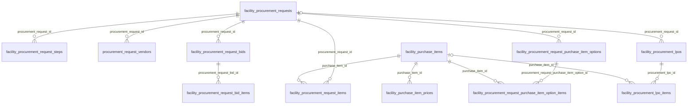

Not drawn: `procurement_request_step_template_groups` / `procurement_request_step_templates` (the workflow definition the steps are copied from), `stock_keeping_units` / `stock_keeping_unit_types` (units of measure), and `users` (the supplier on every `vendor_id`).

## facility_procurement_requests

**One row per:** procurement request raised on one property, either a job to be quoted (`type = work`) or a list of catalogue items to buy (`type = purchase`). **Model:** `App\Models\FacilityProcurementRequest`. **Company-scoped:** yes. **Soft deletes:** yes.
**Rows in dev DB:** 67 (all imported from EPMAS, all created in 2026-09).

A row is created when staff raise a request; its steps are copied from the template group at the same moment and the first step is dispatched. The request's status follows the chain: it is `new` until the first step acts, `request` while the approval steps run, `order` while suppliers are quoting, `quotes-review` while the quotes are evaluated, and `lpo` once the LPO is generated.

**Status:** (DB enum: `new`, `request`, `quotes-review`, `order`, `lpo`, `completed`, `rejected`; the PHP enum has no `completed`)
- `new` : created, the first step has not acted yet.
- `request` : moving through the approval steps. A request that was rebased (sent out for a new round of quotes) also comes back here.
- `order` : work request sent out to suppliers, waiting for quotes (its procurement step is `waiting-quotes`). Also the holding state when the deadline passed with too few quotes (`quotes_shortfall_at` set).
- `quotes-review` : quotes opened for evaluation (its procurement step is `quotes-review`).
- `lpo` : the last step approved and an LPO was generated; this is the successful end state.
- `rejected` : a step rejected it; terminal.
- `completed` : exists only in the database enum. The application never writes it; 0 rows.
Live rows are `deleted_at IS NULL`. The open pipeline is `status IN ('new','request','order','quotes-review')`; `lpo` is done, `rejected` is dead.

Observed in dev: work requests `new` 5, `request` 14, `order` 26, `quotes-review` 7; purchase requests `request` 15.

| Column | Type | Points to | Meaning |
|---|---|---|---|
| id | bigint | | Primary key |
| company_id | bigint, nullable | companies.id | Owning company (never null in dev) |
| title | varchar | | Request title |
| description | text | | What is needed, free text |
| type | enum work, purchase | | `work` = job to be quoted by suppliers; `purchase` = catalogue items |
| priority | enum high, normal, low | | Default `normal` |
| ticket_id | bigint, nullable | facility_tickets.id | Maintenance ticket the request was raised from (0 set in dev) |
| facility_id | bigint | facilities.id | The property |
| asset_id | bigint, nullable | | Not used (NULL on every row); belongs to a module this guide does not cover |
| expense_type_id | bigint | facility_expense_types.id | Expense type (category of spend) |
| expense_sub_type_id | bigint | facility_expense_sub_types.id | Expense sub type; decides which suppliers are prequalified and whether a default supplier exists |
| expense_category_id | bigint, nullable | expense_categories.id | Accounting category; set by a step with `select_expense_category` (always set in dev) |
| require_site_visit | tinyint | | 1 = suppliers must visit before quoting |
| site_visit_instructions | text | | Instructions for that visit |
| is_emergency | tinyint | | 1 = emergency; goes to the default supplier alone |
| context_information | text | | Extra context for suppliers |
| context_file | bigint, nullable | uploads.id | Attached file (note the column name has no `_id`) |
| deadline | timestamp, nullable | | Quote deadline of the current round (work requests). Cleared by a rebase; 33 of 67 set in dev |
| quote_round | int | | Round of quotes, starts at 1; +1 on every rebase (all 1 in dev) |
| is_preliminary | tinyint | | 1 while only the default supplier has been asked (first round, non-emergency); all 0 in dev |
| preliminary_until | timestamp, nullable | | End of the default supplier's exclusive window; equals `deadline` during that stage |
| quotes_shortfall_at | timestamp, nullable | | Set when the deadline passed with fewer than the required quotes (setting, default 3); the request is held in `order` for the officer (26 set in dev) |
| rebased_at | timestamp, nullable | | Last rebase (none in dev) |
| rebased_by_id | bigint, nullable | users.id | Who rebased |
| rebase_reason | text | | Why |
| default_vendor_id | bigint, nullable | users.id | Supplier asked first because it is the sub type's or property's default supplier |
| preferred_vendor_id | bigint, nullable | users.id | Supplier a step chose to invite (`select_preferred_vendor`); 5 set in dev |
| is_sent_to_all_vendors | tinyint | | Legacy flag; the code only ever writes 0 |
| allow_edits | tinyint | | 1 while the creator may still edit (new, or sent back by the first step) |
| status | enum | | See above |
| created_by_id | bigint, nullable | users.id | Who raised the request |
| deleted_at | timestamp, nullable | | Soft delete |
| old_system_id | varchar | | The id in the old EPMAS system |

**Joins:**
- `facility_procurement_requests.facility_id → facilities.id`: many requests per property.
- `facility_procurement_requests.expense_type_id → facility_expense_types.id`, `.expense_sub_type_id → facility_expense_sub_types.id`, `.expense_category_id → expense_categories.id`.
- `facility_procurement_requests.ticket_id → facility_tickets.id` (one request per ticket at most; `facility_tickets.procurement_request_id` points the other way as well).
- `facility_procurement_requests.created_by_id`, `.rebased_by_id`, `.default_vendor_id`, `.preferred_vendor_id → users.id`.
- `facility_procurement_requests.context_file → uploads.id`.
- Children, all on `procurement_request_id`: `facility_procurement_request_items`, `facility_procurement_request_steps`, `procurement_request_vendors`, `facility_procurement_request_bids`, `facility_procurement_request_purchase_item_options`, `facility_procurement_lpos`, and (another domain) `facility_site_visit_reports`.

**Gotchas:**
- The request has no money columns. The value of a purchase request is `SUM(total)` of its items; the value of a work request is its winning bid; the committed value is the LPO.
- `type` decides which child tables are used: work requests have invitations, bids and bid items but no request items (0 in dev); purchase requests have request items and options but no bids.
- A request keeps one row through every round of quotes. The round history is on `quote_round`, `rebased_at` and on the bids' `round` / `status = shelved`.
- The `completed` enum value is dead; do not wait for it.

## facility_procurement_request_items

**One row per:** catalogue purchase item requested on a purchase request, with its quantity (unique per request and item). **Model:** `App\Models\FacilityProcurementRequestItem`. **Company-scoped:** no (scope through the request). **Soft deletes:** no.
**Rows in dev DB:** 15 (all on the 15 purchase requests).

Written with the request. Only purchase requests have rows; a work request describes the job in `description`.

| Column | Type | Points to | Meaning |
|---|---|---|---|
| id | bigint | | Primary key |
| procurement_request_id | bigint | facility_procurement_requests.id | The request |
| purchase_item_id | bigint | facility_purchase_items.id | Catalogue item |
| selected_vendor_id | bigint, nullable | users.id | Supplier chosen for this line (never set in dev; the chosen supplier is on the selected option instead) |
| quantity | decimal(10,3) | | Quantity requested |
| price | decimal(50,5) | | Unit price snapshot at request time |
| amount | decimal(50,5) | | quantity x price |
| vat | decimal(50,5) | | Tax amount |
| total | decimal(50,5) | | amount + vat |
| old_system_id | varchar | | The id in the old EPMAS system |

**Joins:**
- `facility_procurement_request_items.procurement_request_id → facility_procurement_requests.id`: many items per request.
- `facility_procurement_request_items.purchase_item_id → facility_purchase_items.id`: one catalogue item per line.
- `facility_procurement_request_items.selected_vendor_id → users.id`.

**Gotchas:** the money columns are snapshots taken when the request was written; the price actually ordered is on the option item and then the LPO item.

## facility_procurement_request_steps

**One row per:** approval step of one request, copied from the template group when the request was created (7 per request in dev). **Model:** `App\Models\FacilityProcurementRequestStep`. **Company-scoped:** yes. **Soft deletes:** no.
**Rows in dev DB:** 469.

Steps run in `id` order within a request (there is no order column). The step being waited on has `is_current = 1`. The flags copied from the template say what the step does besides approving: `select_preferred_vendor`, `select_expense_category`, `set_deadline`, `handle_procurement` (the sourcing step) and `signs_document_signature` (its approver signs the printed LPO).

**Status:** (a plain varchar, not a database enum; PHP enum values below)
- `pending` : not acted yet. With `is_current = 1` it is the step the request is waiting on.
- `approved` : the actor approved; the chain moved on.
- `review` : the actor sent the request back for changes (to the previous step, or to the creator when it is the first step).
- `rejected` : the actor rejected; the request becomes `rejected`. 0 rows in dev.
- `waiting-quotes` : only on the `handle_procurement` step of a work request: suppliers have been invited and the request is `order`.
- `quotes-review` : the same step once the quotes are open for evaluation; the request is `quotes-review`.
Live rows are all rows; the current position of a request is the one row with `is_current = 1` (62 of 67 dev requests; the other 5 were sent back to their creator by the first step and have none until resubmitted).

Observed in dev: `pending` 322, `approved` 108, `review` 6, `waiting-quotes` 26, `quotes-review` 7.

| Column | Type | Points to | Meaning |
|---|---|---|---|
| id | bigint | | Primary key; also the step order within the request |
| company_id | bigint, nullable | companies.id | Owning company |
| procurement_request_id | bigint | facility_procurement_requests.id | The request |
| title | varchar | | Step name, copied from the template (in dev the role name, e.g. Procurement Officer) |
| description | varchar | | Step description |
| role_id | bigint | roles.id | Role whose holders act on the step |
| select_preferred_vendor | tinyint | | Step may name a preferred supplier |
| select_expense_category | tinyint | | Step sets `expense_category_id` on the request |
| set_deadline | tinyint | | Step sets the quote deadline |
| handle_procurement | tinyint | | The sourcing step: invites suppliers / picks the quote or option (one per request) |
| signs_document_signature | tinyint | | Approver of this step signs the printed LPO (snapshot of the template; all 0 in dev) |
| actors_ids | json | users.id (list) | Users who may act, resolved on the request's property when the step was dispatched |
| prompted_at | timestamp, nullable | | When the step was dispatched to its actors |
| actor_id | bigint, nullable | users.id | Who acted |
| status | varchar | | See above |
| comment | varchar, nullable | | Actor's comment |
| reviewed_at | timestamp, nullable | | When the actor acted |
| is_current | tinyint | | 1 = the step the request waits on |
| is_first | tinyint | | 1 = first step of the chain |
| is_last | tinyint | | 1 = last step; approving it generates the LPO |
| workflow_group_id | bigint, nullable | procurement_request_step_template_groups.id | Template group the step came from (snapshot) |
| workflow_group_label | varchar, nullable | | That group's title at the time |
| old_system_id | varchar | | The id in the old EPMAS system |

**Joins:**
- `facility_procurement_request_steps.procurement_request_id → facility_procurement_requests.id`: many steps per request.
- `facility_procurement_request_steps.role_id → roles.id`: one role per step (every dev row matches a role).
- `facility_procurement_request_steps.actor_id → users.id`: the user who acted.
- `facility_procurement_request_steps.workflow_group_id → procurement_request_step_template_groups.id` (no DB constraint; a snapshot, and `workflow_group_label` keeps the title even if the group is renamed).
- `actors_ids` is a JSON list of `users.id`; use `JSON_CONTAINS(actors_ids, CAST(:user_id AS JSON))`.

**Gotchas:**
- A step can be reset to `pending` with `actor_id` kept or cleared: a rebase clears the procurement step's `actor_id`, `reviewed_at` and `comment`; a step reset after a send-back keeps nothing current. Do not treat `actor_id IS NOT NULL` as "approved"; use `status`.
- `pending` with `is_current = 0` is simply "not reached yet" (322 rows, 29 current).
- The procurement step moves `pending` to `waiting-quotes` to `quotes-review` to `approved` on a work request; on a purchase request it goes straight from `pending` to `approved` (it picks a price option).
- The signature rule: only `approved` steps with `signs_document_signature = 1` sign the printed LPO; the creator never signs. In dev no template is marked, so no LPO carries workflow signatures yet.

## procurement_request_step_template_groups

**One row per:** named workflow (a group of step templates) of a company. **Model:** `App\Models\ProcurementRequestStepTemplateGroup`. **Company-scoped:** yes. **Soft deletes:** no.
**Rows in dev DB:** 1 (the row-count file says 0; the exact count is 1, titled "Default Group", `is_default = 1`).

When a request is created the group whose `facilities` JSON lists the request's property is used, else the `is_default` group; its templates become the request's steps.

| Column | Type | Points to | Meaning |
|---|---|---|---|
| id | bigint | | Primary key |
| company_id | bigint, nullable | companies.id | Owning company |
| title | varchar | | Group name |
| description | varchar, nullable | | |
| is_default | tinyint | | 1 = used for properties no other group lists |
| facilities | json | facilities.id (list) | Properties this group applies to (empty list in dev) |
| created_by_id | bigint, nullable | users.id | Creator |
| old_system_id | varchar | | The id in the old EPMAS system |

**Joins:**
- `procurement_request_step_templates.procurement_request_step_template_group_id → procurement_request_step_template_groups.id`: many templates per group.
- `facility_procurement_request_steps.workflow_group_id → procurement_request_step_template_groups.id` (no DB constraint).

## procurement_request_step_templates

**One row per:** step in a template group, in `order`. **Model:** `App\Models\ProcurementRequestStepTemplate`. **Company-scoped:** yes. **Soft deletes:** no.
**Rows in dev DB:** 7 (orders 0 to 6: Property Manager; Senior Property Manager with `select_preferred_vendor`; Procurement Officer with `handle_procurement` and `set_deadline`; Head of Procurement; Senior Property Manager; Finance Manager; Executive Signatory).

Changing a template only affects requests created afterwards; existing requests keep their copied steps.

| Column | Type | Points to | Meaning |
|---|---|---|---|
| id | bigint | | Primary key |
| company_id | bigint, nullable | companies.id | Owning company |
| procurement_request_step_template_group_id | bigint | procurement_request_step_template_groups.id | The group |
| title | varchar | | Step name |
| description | text | | |
| role_id | bigint | roles.id | Acting role |
| select_preferred_vendor | tinyint | | Flags copied onto each request step (meanings as on the steps table) |
| select_expense_category | tinyint | | |
| set_deadline | tinyint | | |
| handle_procurement | tinyint | | |
| signs_document_signature | tinyint | | |
| order | int, nullable | | Position in the chain (reserved word: quote it as `` `order` ``) |
| created_by_id | bigint, nullable | users.id | Creator |
| old_system_id | varchar | | The id in the old EPMAS system |

**Joins:**
- `procurement_request_step_templates.procurement_request_step_template_group_id → procurement_request_step_template_groups.id`.
- `procurement_request_step_templates.role_id → roles.id`; `.created_by_id → users.id`.
- There is no link from a request step back to its template; match on `workflow_group_id` plus `title` and `role_id` if you need it.

## procurement_request_vendors

**One row per:** supplier invited to quote on a work request (unique per request and supplier; the same row is re-used when the supplier is asked again in a later round). **Model:** `App\Models\ProcurementRequestVendor`. **Company-scoped:** no. **Soft deletes:** no.
**Rows in dev DB:** 238 (100 distinct suppliers; all round 1; 236 plain invitations and 2 preferred suppliers; no declines, cancellations or reminders).

Rows are written when the procurement step approves a work request: either the default supplier alone (preliminary stage, `is_default = 1`), the step's preferred supplier (`is_preferred = 1`), or a batch of prequalified suppliers picked round-robin (fewest invitations first). This is the supplier's response record: `invited_at`, then `quoted_at`, `declined_at` or `cancelled_at`.

| Column | Type | Points to | Meaning |
|---|---|---|---|
| id | bigint | | Primary key |
| procurement_request_id | bigint | facility_procurement_requests.id | The request |
| vendor_id | bigint | users.id | The supplier |
| is_default | tinyint | | 1 = invited as the sub type's / property's default supplier |
| is_preferred | tinyint | | 1 = invited because a step chose it |
| round | int | | Quote round the invitation belongs to (moves to the latest round when re-opened) |
| is_carried_over | tinyint | | 1 = a previous round's bidder asked again after a rebase |
| invited_at | timestamp, nullable | | When invited (set on every row) |
| cancelled_at | timestamp, nullable | | Invitation cancelled (set on every open invitation by a rebase) |
| quoted_at | timestamp, nullable | | When the supplier's bid was created by the application |
| declined_at | timestamp, nullable | | Supplier declined from the portal |
| decline_reason | text | | Why |
| reminder_count | int | | Reminders sent before the deadline |
| last_reminded_at | timestamp, nullable | | Last reminder |
| technician_id | bigint, nullable | vendor_users.id | Supplier staff member assigned to the job |

**Joins:**
- `procurement_request_vendors.procurement_request_id → facility_procurement_requests.id`: many invitations per request.
- `procurement_request_vendors.vendor_id → users.id`: the supplier.
- `procurement_request_vendors.technician_id → vendor_users.id`: the supplier's technician (a `vendor_users` row, not a `users` row).
- A supplier's bid is found by joining `facility_procurement_request_bids` on both `procurement_request_id` and `vendor_id` (every dev bid has a matching invitation).

**Gotchas:**
- An **open** invitation is `cancelled_at IS NULL AND declined_at IS NULL`. A cancelled supplier can still view the request but not quote.
- `quoted_at` is NULL on every dev row even though 41 bids exist: the imported bids bypassed the stamp. Derive "responded" by joining the bids table, as in the worked query below.
- One row per supplier per request, so a supplier invited in rounds 1 and 2 has one row showing `round = 2`; the earlier round is only visible on the shelved bid.

## facility_procurement_request_bids

**One row per:** quote a supplier submitted on a work request in one round (one per supplier per request per round). **Model:** `App\Models\FacilityProcurementRequestBid`. **Company-scoped:** yes. **Soft deletes:** yes.
**Rows in dev DB:** 41 (29 `bid`, 12 `recommended` of which 7 are the system's pick; all round 1; none deleted).

Created from the supplier portal (or by staff on the supplier's behalf, `user_id`). When the deadline passes with enough quotes, or the officer opens them early, the system flags the cheapest live quote as its pick and sets it `recommended`; the procurement step may move `recommended` to another quote. When the last step approves, the LPO is generated from the recommended quote and every other live quote becomes `rejected`.

**Status:** (DB enum = PHP enum: `bid`, `recommended`, `selected`, `rejected`, `shelved`)
- `bid` : submitted and still competing.
- `recommended` : the quote the procurement step stands behind (at most one per request). The LPO is generated from it.
- `selected` : defined as "chosen winner", but no current code path writes it and 0 rows exist; treat `recommended` on a request in status `lpo` as the winner.
- `rejected` : lost to the winning quote when the LPO was generated (`rejection_reason` set), or rejected by a step.
- `shelved` : set aside by a rebase (`shelved_at`, `shelved_reason`); history, never evaluated again.
Live rows are `deleted_at IS NULL AND status <> 'shelved'`; the quotes still competing are `status IN ('bid','recommended')`.

| Column | Type | Points to | Meaning |
|---|---|---|---|
| id | bigint | | Primary key |
| company_id | bigint, nullable | companies.id | Owning company |
| procurement_request_id | bigint | facility_procurement_requests.id | The request |
| vendor_id | bigint | users.id | The supplier quoting |
| user_id | bigint, nullable | users.id | The login that entered the quote |
| delivery_at | timestamp | | Promised delivery / completion date |
| notes | text | | |
| upload_id | bigint, nullable | uploads.id | The quotation document |
| currency_id | bigint, nullable | currencies.id | Currency of the amounts |
| amount | decimal(50,5) | | Sum of line amounts before discount and tax |
| discount_type | enum fixed, percentage, none | | How `discount_value` is read |
| discount_value | decimal(10,2) | | The discount as entered |
| discount_amount | decimal(50,5) | | Discount in money |
| amount_after_discount | decimal(50,5) | | amount - discount_amount |
| tax | decimal(50,5) | | Tax in money |
| total | decimal(50,5) | | amount_after_discount + tax |
| status | enum | | See above |
| round | int | | Quote round the bid belongs to |
| is_computer_recommended | tinyint | | 1 = the system's own pick for the round. Permanent; never changed by a person |
| rejection_reason | text | | Set when rejected |
| shelved_at | timestamp, nullable | | Set by a rebase |
| shelved_reason | text | | The rebase reason |
| deleted_at | timestamp, nullable | | Soft delete |
| old_system_id | varchar | | The id in the old EPMAS system |

**Joins:**
- `facility_procurement_request_bids.procurement_request_id → facility_procurement_requests.id`: many bids per request.
- `facility_procurement_request_bids.vendor_id → users.id`: the supplier; `.user_id → users.id`: who typed it.
- `facility_procurement_request_bids.upload_id → uploads.id`; `.currency_id → currencies.id`.
- `facility_procurement_request_bid_items.procurement_request_bid_id → facility_procurement_request_bids.id`: the lines.

**Gotchas:**
- `is_computer_recommended` (the system's pick) and `status = recommended` (the current pick) are two different facts. Do not derive one from the other: 5 dev bids are `recommended` without the flag.
- Header money columns are denormalised copies of the line sums; 1 of 41 dev bids differs from its lines by more than 0.01. Use the header for reporting the quote as submitted.
- The default-supplier auto-accept threshold compares `amount` (before discount and tax), not `total`.
- An LPO generated from a work request copies the bid's money columns but zeroes `tax` when the supplier has `users.has_vat = 0`, so an LPO total can be lower than its bid total.

## facility_procurement_request_bid_items

**One row per:** line of a quote. **Model:** `App\Models\FacilityProcurementRequestBidItem`. **Company-scoped:** no. **Soft deletes:** no.
**Rows in dev DB:** 231 (on all 41 bids).

| Column | Type | Points to | Meaning |
|---|---|---|---|
| id | bigint | | Primary key |
| procurement_request_bid_id | bigint | facility_procurement_request_bids.id | The quote |
| type | enum service, product | | Kind of line (all `product` in dev) |
| purchase_item_id | bigint, nullable | facility_purchase_items.id | Catalogue item, when the supplier picked one (NULL on all 231 dev rows) |
| title | text | | Line description as the supplier wrote it |
| notes | text | | |
| tax_id | bigint, nullable | taxes.id | Tax rate applied |
| quantity | decimal(10,3) | | |
| stock_keeping_unit_id | bigint, nullable | stock_keeping_units.id | Unit of measure (NULL on 230 of 231 dev rows) |
| cost | decimal(50,5) | | Unit cost |
| amount | decimal(50,5) | | quantity x cost |
| discount_type | enum fixed, percentage, none | | |
| discount_value | decimal(10,2) | | |
| discount_amount | decimal(50,5) | | |
| amount_after_discount | decimal(50,5) | | |
| tax | decimal(50,5) | | |
| total | decimal(50,5) | | |
| old_system_id | varchar | | The id in the old EPMAS system |

**Joins:**
- `facility_procurement_request_bid_items.procurement_request_bid_id → facility_procurement_request_bids.id`: many lines per quote.
- `facility_procurement_request_bid_items.purchase_item_id → facility_purchase_items.id` (nullable); `.tax_id → taxes.id`; `.stock_keeping_unit_id → stock_keeping_units.id`.

**Gotchas:** work-request quotes are free-text lines; there is no link from a bid line to a request item. Compare quotes at header level, or by `title` text.

## facility_procurement_request_purchase_item_options

**One row per:** price option offered to the procurement step of a purchase request: one option per (requested item, supplier) pair that has a row in the price list at the request's property (or, when the item has no price at that property, at any property). **Model:** `App\Models\FacilityProcurementRequestPurchaseItemOption`. **Company-scoped:** no. **Soft deletes:** no.
**Rows in dev DB:** 0 (the 15 pending purchase requests have not had their procurement step opened yet; options are built on the first fetch of that step).

While the procurement step is current and `pending` the options are reconciled with the price list on every fetch and on every price change: existing pairs keep their id and get the current price, missing pairs are added, pairs whose price row is gone are hard-deleted. The system flags the cheapest option as its pick (ties broken by the supplier with the fewest purchase LPOs in that expense sub type), and the step confirms or picks another with `is_selected`. The LPO is generated from the selected option.

| Column | Type | Points to | Meaning |
|---|---|---|---|
| id | bigint | | Primary key |
| procurement_request_id | bigint | facility_procurement_requests.id | The purchase request |
| title | varchar | | The supplier's name as it was when the option was built |
| type | enum split, combined | | The code only writes `combined` |
| is_computer_recommended | tinyint | | The system's pick; recomputed only while nothing is selected, never changed by a person |
| is_selected | tinyint | | The procurement step's choice (one per request) |
| total | decimal(50,5) | | Sum of the option items' `amount` (before tax) |
| old_system_id | varchar | | The id in the old EPMAS system |

**Joins:**
- `facility_procurement_request_purchase_item_options.procurement_request_id → facility_procurement_requests.id`: many options per request.
- `facility_procurement_request_purchase_item_option_items.procurement_request_purchase_item_option_id → facility_procurement_request_purchase_item_options.id`: the option's lines (exactly one when built by the reconcile).

**Gotchas:** options are working data, not history. Once the request reaches `lpo`, the LPO and its items are the record of what was ordered; the options may be rebuilt or deleted after that.

## facility_procurement_request_purchase_item_option_items

**One row per:** (purchase item, supplier) line inside an option, with the quantity from the request and the unit price from the price list. **Model:** `App\Models\FacilityProcurementRequestPurchaseItemOptionItem`. **Company-scoped:** no. **Soft deletes:** no.
**Rows in dev DB:** 0.

| Column | Type | Points to | Meaning |
|---|---|---|---|
| id | bigint | | Primary key |
| procurement_request_purchase_item_option_id | bigint | facility_procurement_request_purchase_item_options.id | The option |
| purchase_item_id | bigint | facility_purchase_items.id | Catalogue item |
| vendor_id | bigint | users.id | The supplier whose price this is |
| currency_id | bigint, nullable | currencies.id | Currency (copied from the purchase item) |
| quantity | decimal(10,3) | | From the request item |
| price | decimal(50,5) | | Unit price from `facility_purchase_item_prices.price` |
| amount | decimal(50,5) | | quantity x price |
| old_system_id | varchar | | The id in the old EPMAS system |

**Joins:**
- `facility_procurement_request_purchase_item_option_items.procurement_request_purchase_item_option_id → facility_procurement_request_purchase_item_options.id`.
- `facility_procurement_request_purchase_item_option_items.purchase_item_id → facility_purchase_items.id`; `.vendor_id → users.id`; `.currency_id → currencies.id`.

**Gotchas:** there is no property column; the property is the request's `facility_id`. The price is a copy, not a link, to the price-list row.

## facility_procurement_lpos

**One row per:** local purchase order issued to one supplier: either generated from a procurement request (`procurement_request_id` set, `is_direct = 0`) or raised by hand with no request (`is_direct = 1`). **Model:** `App\Models\FacilityProcurementLpo`. **Company-scoped:** yes. **Soft deletes:** yes.
**Rows in dev DB:** 116 (all direct, all `lpo`, all imported from EPMAS, all in currency 1; none links to a request).

A workflow LPO is created `lpo` when the request's last step approves, and copies `type`, `title`, `facility_id`, `expense_type_id` and `expense_sub_type_id` from the request so the LPO can be read on its own. A direct LPO is raised as `lpo` and demoted to `pending` only if the generic approval chain forms for it (those steps are in `approval_steps` with `approvable_type = App\Models\FacilityProcurementLpo`, section 8; 0 rows in dev). Closing the LPO as delivered raises the supplier bill.

**Status:** (DB enum = PHP enum: `pending`, `lpo`, `delivered`, `cancelled`, `rejected`; DB default `lpo`)
- `pending` : direct LPO waiting for its approval chain; not yet sent to the supplier, not printable.
- `lpo` : issued to the supplier; the open order.
- `delivered` : closed as delivered (`delivered_at`, `document_number`, ratings); a bill exists for it.
- `cancelled` : cancelled after issue (`cancelled_at`, `cancelled_by_id`, `cancellation_reason`); only an `lpo` or `delivered` order can be cancelled, and a delivered one only while its bill is pending or cancelled. Prints with a CANCELLED watermark.
- `rejected` : direct LPO rejected by its approval chain; terminal.
Live rows are `deleted_at IS NULL AND status IN ('lpo','delivered')`; committed spend is the same set.

| Column | Type | Points to | Meaning |
|---|---|---|---|
| id | bigint | | Primary key; also the LPO number shown to the supplier until `document_number` is set |
| public_token | varchar(64), unique | | Token of the public LPO page link (set on every row) |
| company_id | bigint, nullable | companies.id | Owning company |
| procurement_request_id | bigint, nullable | facility_procurement_requests.id | The request it was generated from; NULL on direct LPOs |
| is_direct | tinyint | | 1 = raised by hand, no request |
| type | enum work, purchase | | Kind of order (copied from the request, or entered) |
| title | varchar | | |
| facility_id | bigint | facilities.id | The property |
| expense_type_id | bigint | facility_expense_types.id | |
| expense_sub_type_id | bigint | facility_expense_sub_types.id | |
| expense_category_id | bigint, nullable | expense_categories.id | Accounting category (from the request, else the expense type's default) |
| vendor_id | bigint | users.id | The supplier |
| currency_id | bigint, nullable | currencies.id | Currency of the amounts |
| delivery_at | timestamp | | Expected delivery date |
| notes | text | | |
| amount | decimal(50,5) | | Sum of lines before discount and tax |
| discount_amount | decimal(50,5) | | |
| amount_after_discount | decimal(50,5) | | |
| tax | decimal(50,5) | | Tax in money; 0 when the supplier has no VAT |
| total | decimal(50,5) | | Order value including tax |
| status | enum | | See above |
| approver_id | bigint, nullable | users.id | Final approver (never set in dev) |
| assigned_technician_id | bigint, nullable | users.id | Technician assigned on a direct LPO |
| delivered_at | timestamp, nullable | | Delivery date entered at close |
| document_number | varchar, nullable | | Reference typed in when the LPO is closed as delivered (4 dev rows) |
| document_upload_id | bigint, nullable | uploads.id | The closing document (delivery note / job card) |
| winning_bid_upload_id | bigint, nullable | uploads.id | On a direct LPO, the winning quotation it was raised from |
| work_advice | text | | Close-out notes |
| quality_rating, speed_rating, communication_rating | tinyint, nullable | | Supplier scores entered at close |
| rating | decimal(5,1), nullable | | Mean of the three scores |
| comments | text | | |
| closed_at | timestamp, nullable | | Close date entered at close |
| cancelled_at | timestamp, nullable | | When cancelled |
| cancelled_by_id | bigint, nullable | users.id | Who cancelled |
| cancellation_reason | text | | Required on cancel |
| created_by_id | bigint, nullable | users.id | Who raised it |
| withholding_tax_ids | json | withholding_taxes.id (list) | Withholding taxes the bill will carry: the landlord's `users.withholds` for a workflow LPO, chosen by hand on a direct one (2 dev rows) |
| emailed_at | timestamp, nullable | | First "LPO issued" email to the supplier |
| deleted_at | timestamp, nullable | | Soft delete |
| old_system_id | varchar | | The id in the old EPMAS system |

**Joins:**
- `facility_procurement_lpos.procurement_request_id → facility_procurement_requests.id`: at most one LPO per request (the generator refuses a second).
- `facility_procurement_lpos.facility_id → facilities.id`; `.expense_type_id → facility_expense_types.id`; `.expense_sub_type_id → facility_expense_sub_types.id`; `.expense_category_id → expense_categories.id`.
- `facility_procurement_lpos.vendor_id → users.id`: the supplier (every dev row matches a user, and every dev supplier is prequalified in `facility_expense_sub_type_vendors`).
- `facility_procurement_lpos.created_by_id`, `.approver_id`, `.assigned_technician_id`, `.cancelled_by_id → users.id`.
- `facility_procurement_lpos.currency_id → currencies.id`; `.document_upload_id`, `.winning_bid_upload_id → uploads.id`.
- `facility_procurement_lpo_items.procurement_lpo_id → facility_procurement_lpos.id`: the lines.
- Polymorphic, other domains: the bill is `facility_bills.billable_type = 'App\Models\FacilityProcurementLpo' AND facility_bills.billable_id = facility_procurement_lpos.id` (0 rows in dev: the 532 imported bills of `facility_bills.type = 'lpo'` have a NULL `billable_type`); a direct LPO's approval chain is `approval_steps.approvable_type = 'App\Models\FacilityProcurementLpo'`.

**Gotchas:**
- Header money columns equal the sum of the lines (0 mismatches in dev); one dev LPO (id 6988) has no lines at all, so prefer the header for totals.
- `tax` is zeroed and `total = amount_after_discount` when the supplier has `users.has_vat = 0`, whatever the quote said.
- `pending` and `rejected` exist only for direct LPOs. `cancelled` rows keep their money columns; exclude them from spend.
- `document_number` is not the LPO number; the LPO number is `id`.
- `withholding_tax_ids` is a JSON list, not a foreign key: `JSON_CONTAINS(withholding_tax_ids, CAST(:id AS JSON))`.

## facility_procurement_lpo_items

**One row per:** line of an LPO. **Model:** `App\Models\FacilityProcurementLpoItem`. **Company-scoped:** no. **Soft deletes:** no.
**Rows in dev DB:** 294 (1 to 18 per LPO).

Work LPO lines are copies of the winning bid's lines; purchase LPO lines come from the selected option (one per catalogue item, `title` = the item name); direct LPO lines are typed in.

| Column | Type | Points to | Meaning |
|---|---|---|---|
| id | bigint | | Primary key |
| procurement_lpo_id | bigint | facility_procurement_lpos.id | The LPO |
| purchase_item_id | bigint, nullable | facility_purchase_items.id | Catalogue item (NULL on 249 of 294 dev rows) |
| type | enum service, product | | Kind of line |
| title | text | | Line description |
| notes | text | | |
| tax_id | bigint, nullable | taxes.id | Tax rate (a 0% rate when the supplier has no VAT) |
| quantity | decimal(10,3) | | |
| stock_keeping_unit_id | bigint, nullable | stock_keeping_units.id | Unit of measure (NULL on all dev rows) |
| cost | decimal(50,5) | | Unit cost |
| amount | decimal(50,5) | | quantity x cost |
| discount_amount | decimal(50,5) | | |
| amount_after_discount | decimal(50,5) | | |
| tax | decimal(50,5) | | |
| total | decimal(50,5) | | |
| is_delivered | tinyint | | Per-line delivery flag (all 0 in dev) |
| rating | tinyint, nullable | | Per-line score at close |
| comments | text | | |
| old_system_id | varchar | | The id in the old EPMAS system |

**Joins:**
- `facility_procurement_lpo_items.procurement_lpo_id → facility_procurement_lpos.id`: many lines per LPO.
- `facility_procurement_lpo_items.purchase_item_id → facility_purchase_items.id` (nullable); `.tax_id → taxes.id`; `.stock_keeping_unit_id → stock_keeping_units.id`.

**Gotchas:** filter the parent LPO's `deleted_at` and `status` yourself; the lines carry neither.

## facility_purchase_items

**One row per:** catalogue item (product or service) a company can request, with its reference price and the list of suppliers who price it. **Model:** `App\Models\FacilityPurchaseItem`. **Company-scoped:** yes. **Soft deletes:** no (a `deleted_at` column exists but the application never sets it; 0 rows).
**Rows in dev DB:** 99 (98 products, 1 service; all `active`, all `updated`).

**Status:** (DB enum `active`, `inactive`; the PHP side uses the shared `Status` enum, of which only these two values occur)
- `active` : requestable.
- `inactive` : hidden from new requests.
Live rows are `status = 'active'`.

**Price update status** (`price_update_status`, DB enum = PHP enum `updated`, `outdated`): a regulated item (`is_regulated = 1`) whose `next_update_due` has passed is flagged `outdated` by a scheduled job, and outdated regulated items block new requests until their price is confirmed.

| Column | Type | Points to | Meaning |
|---|---|---|---|
| id | bigint | | Primary key |
| company_id | bigint, nullable | companies.id | Owning company |
| type | enum service, product | | |
| inventory_category_id | bigint, nullable | facility_inventory_categories.id | Inventory category (section 10) |
| name | varchar | | Item name |
| stock_keeping_unit_id | bigint, nullable | stock_keeping_units.id | Unit of measure (NULL on 95 of 99 dev rows) |
| tax_id | bigint, nullable | taxes.id | Tax rate used on purchase LPO lines |
| is_regulated | tinyint | | 1 = price-controlled: supplier prices may not exceed `base_price` and must be re-confirmed every cycle (1 in dev) |
| auto_fetch_price_service | varchar, nullable | | Name of an external price feed, if any (none in dev) |
| price_update_cycle | varchar | | How often a regulated price is re-confirmed (`monthly` everywhere in dev) |
| next_update_due | date, nullable | | Next confirmation date |
| price_update_status | enum | | See above |
| currency_id | bigint, nullable | currencies.id | Currency of `base_price` and of the option lines |
| base_price | decimal(50,5) | | Reference price; a change is written to every supplier price row of the item |
| vendors | json | users.id (list) | Suppliers who price this item (each has rows in the price list) |
| status | enum | | See above |
| created_by_id | bigint, nullable | users.id | Creator |
| old_system_id | varchar | | The id in the old EPMAS system |

**Joins:**
- `facility_purchase_items.inventory_category_id → facility_inventory_categories.id` (section 10).
- `facility_purchase_items.stock_keeping_unit_id → stock_keeping_units.id`; `.tax_id → taxes.id`; `.currency_id → currencies.id`; `.created_by_id → users.id`.
- `facility_purchase_item_prices.purchase_item_id → facility_purchase_items.id`: the per-supplier, per-property prices.
- Referenced by `facility_procurement_request_items`, `facility_procurement_request_purchase_item_option_items`, `facility_procurement_request_bid_items`, `facility_procurement_lpo_items` (all on `purchase_item_id`), and outside this domain by `facility_inventories.purchase_item_id` (section 10) and `facility_site_visit_report_items.purchase_item_id`.

**Gotchas:**
- `base_price` is the reference, not what is paid; the price list row is what an option and an LPO line use.
- `vendors` is a JSON list, not a pivot: `JSON_CONTAINS(vendors, CAST(:vendor_id AS JSON))`. The price list has the same pairs in relational form, so prefer joining that.
- Ignore `deleted_at` here; it is never set.

## facility_purchase_item_prices

**One row per:** (purchase item, supplier, property) price; unique on those three columns. **Model:** `App\Models\FacilityPurchaseItemPrice`. **Company-scoped:** yes. **Soft deletes:** no.
**Rows in dev DB:** 16,715 (91 items, 77 suppliers, 101 properties; 164 rows have price 0).

This is the current price list. There is no history table: a price change updates the row in place (`updated_at` moves). Rows are written when suppliers are attached to an item and when a base price cascades; a purchase request's options are built from the rows at the request's property, falling back to any property when the item has no price there.

| Column | Type | Points to | Meaning |
|---|---|---|---|
| id | bigint | | Primary key |
| company_id | bigint, nullable | companies.id | Owning company (NULL on 101 dev rows awaiting a restamp) |
| purchase_item_id | bigint | facility_purchase_items.id | Catalogue item |
| vendor_id | bigint | users.id | The supplier |
| facility_id | bigint | facilities.id | The property the price applies to |
| currency_id | bigint, nullable | currencies.id | Currency (NULL on the same 101 rows) |
| price | decimal(50,5) | | Unit price |
| old_system_id | varchar | | The id in the old EPMAS system |

**Joins:**
- `facility_purchase_item_prices.purchase_item_id → facility_purchase_items.id`: many prices per item (every dev row matches an item).
- `facility_purchase_item_prices.vendor_id → users.id`: the supplier (every dev row matches a user).
- `facility_purchase_item_prices.facility_id → facilities.id`; `.currency_id → currencies.id`.

**Gotchas:**
- Exclude `price = 0` when looking for the cheapest supplier; those rows are placeholders.
- 101 rows have `company_id` NULL; scope by the item's `company_id` rather than the price row's.
- A regulated item's supplier price can never be above the item's `base_price`; any base-price change rewrites every supplier row, so "updated_at" on a price row is not proof that the supplier re-quoted.

## stock_keeping_units

**One row per:** unit of measure (square metre, kilowatt-hour, kilogram, ...). **Model:** `App\Models\StockKeepingUnit`. **Company-scoped:** no (shared list). **Soft deletes:** yes.
**Rows in dev DB:** 99 (none deleted).

Despite the name this is not a product SKU list; it is the unit list used by purchase items, quote and LPO lines, and (other domains) property floor areas, utility meters and inventory.

| Column | Type | Points to | Meaning |
|---|---|---|---|
| id | bigint | | Primary key |
| name | varchar | | Unit name, e.g. Square Meter |
| symbol | varchar | | Printed symbol, e.g. m² |
| key | varchar | | Upper-case code, e.g. SQUARE_METER (reserved word: quote it as `` `key` ``) |
| stock_keeping_unit_type | varchar | | Category as text: area, distance, temperature, pressure, humidity, speed, volume, capacity, energy, power, mass, force, frequency, electric_current, voltage, illuminance, sound, vibration |
| deleted_at | timestamp, nullable | | Soft delete |

**Joins:**
- Referenced on `stock_keeping_unit_id` by `facility_purchase_items`, `facility_procurement_request_bid_items`, `facility_procurement_lpo_items`, and outside this domain by `facility_inventories`, `facility_site_visit_report_items`, `utilities`; as `reading_unit_id` by `utility_meters` and `facility_utilities`; as `space_unit_id` by `facilities`.
- `stock_keeping_units.stock_keeping_unit_type` is intended to match `stock_keeping_unit_types.id` but there is no DB constraint, the model relation is commented out, and the types table is empty; treat the column as a plain label.

## stock_keeping_unit_types

**One row per:** unit category, keyed by a text id. **Model:** `App\Models\StockKeepingUnitType`. **Company-scoped:** no. **Soft deletes:** no.
**Rows in dev DB:** 0.

| Column | Type | Points to | Meaning |
|---|---|---|---|
| id | varchar | | Text key, meant to equal `stock_keeping_units.stock_keeping_unit_type` |
| name | varchar | | Display name |

**Joins:** none enforced. The category values live as text on `stock_keeping_units`; this table is empty in dev and can be ignored.

## Worked queries

**1. Procurement requests per property per month, by type and status, with the value of LPOs generated from them.**

```sql
SELECT r.facility_id,
       DATE_FORMAT(r.created_at, '%Y-%m') AS month,
       r.type,
       r.status,
       COUNT(*)                        AS requests,
       COALESCE(SUM(l.lpo_total), 0)   AS lpo_value
FROM facility_procurement_requests r
LEFT JOIN (
    SELECT procurement_request_id, SUM(total) AS lpo_total
    FROM facility_procurement_lpos
    WHERE deleted_at IS NULL
      AND status IN ('lpo', 'delivered')
    GROUP BY procurement_request_id
) l ON l.procurement_request_id = r.id
WHERE r.deleted_at IS NULL
GROUP BY r.facility_id, month, r.type, r.status
ORDER BY r.facility_id, month, r.type, r.status;
```

Returned 38 rows on the dev DB, all for month 2026-09; `lpo_value` is 0 everywhere because no dev LPO is linked to a request (all 116 are direct). Direct LPOs are counted per property with `facility_procurement_lpos.facility_id` instead.

**2. Supplier quote response rate: invitations, open invitations, declines, cancellations, quotes submitted, recommended and selected.**

```sql
SELECT v.vendor_id,
       COUNT(*)                                                   AS invitations,
       SUM(v.cancelled_at IS NULL AND v.declined_at IS NULL)      AS open_invitations,
       SUM(v.declined_at IS NOT NULL)                             AS declined,
       SUM(v.cancelled_at IS NOT NULL)                            AS cancelled,
       SUM(b.bids IS NOT NULL)                                    AS responded,
       SUM(COALESCE(b.recommended, 0) > 0)                        AS recommended,
       SUM(COALESCE(b.selected, 0) > 0)                           AS selected,
       ROUND(100 * SUM(b.bids IS NOT NULL) / COUNT(*), 1)         AS response_pct
FROM procurement_request_vendors v
LEFT JOIN (
    SELECT procurement_request_id, vendor_id,
           COUNT(*)                    AS bids,
           SUM(status = 'recommended') AS recommended,
           SUM(status = 'selected')    AS selected
    FROM facility_procurement_request_bids
    WHERE deleted_at IS NULL
      AND status <> 'shelved'
    GROUP BY procurement_request_id, vendor_id
) b ON b.procurement_request_id = v.procurement_request_id
   AND b.vendor_id = v.vendor_id
GROUP BY v.vendor_id
ORDER BY invitations DESC, responded DESC;
```

Returned 100 suppliers on the dev DB: 238 invitations, 22 suppliers responded to 41 of them, the most-invited supplier answered 19 of 27 (70.4%), none `selected`. It joins the bids rather than reading `quoted_at`, which is NULL on every imported row.

**3. LPO value per supplier (open and delivered orders only).**

```sql
SELECT l.vendor_id,
       l.currency_id,
       COUNT(*)                             AS lpos,
       SUM(l.status = 'delivered')          AS delivered,
       SUM(l.is_direct)                     AS direct_lpos,
       ROUND(SUM(l.amount_after_discount), 2) AS net_before_tax,
       ROUND(SUM(l.tax), 2)                 AS tax,
       ROUND(SUM(l.total), 2)               AS total
FROM facility_procurement_lpos l
WHERE l.deleted_at IS NULL
  AND l.status IN ('lpo', 'delivered')
GROUP BY l.vendor_id, l.currency_id
ORDER BY total DESC;
```

Returned 32 suppliers on the dev DB, 116 LPOs worth 13,707,155.42 in total (currency 1); the largest supplier has 2 LPOs worth 4,671,335.59, the busiest has 31.

**4. Current price list: the cheapest supplier per purchase item and property, and how many suppliers price it there.**

```sql
SELECT purchase_item_id, item_name, item_type, price_update_status,
       facility_id, vendor_id AS cheapest_vendor_id, price AS cheapest_price,
       currency_id, suppliers_quoting
FROM (
    SELECT p.purchase_item_id, i.name AS item_name, i.type AS item_type, i.price_update_status,
           p.facility_id, p.vendor_id, p.price, p.currency_id,
           COUNT(*)     OVER (PARTITION BY p.purchase_item_id, p.facility_id) AS suppliers_quoting,
           ROW_NUMBER() OVER (PARTITION BY p.purchase_item_id, p.facility_id
                              ORDER BY p.price ASC, p.updated_at DESC, p.vendor_id ASC) AS rn
    FROM facility_purchase_item_prices p
    JOIN facility_purchase_items i ON i.id = p.purchase_item_id
    WHERE i.status = 'active'
      AND p.price > 0
) ranked
WHERE rn = 1
ORDER BY purchase_item_id, facility_id;
```

Returned 5,067 rows on the dev DB (one per item and property pair with a non-zero price); item 1, for example, is priced by 24 suppliers at each property. Needs MySQL 8 (window functions; the dev server is 8.0.31).

# 8. Approvals, pending tasks, responsibility transfers, notifications and the activity log

This section covers the workflow and audit tables that sit beside every business document. Documents that need sign-off (letters of offer, leases, tenant invoices, receipts, credit notes, exit notices, supplier contracts, purchase orders, remittances) go through an **approval chain**: an `approval_templates` row per document type defines the steps (`approval_template_steps`, one role per step), and when a document is raised the applicable steps are copied into `approval_steps`, one row per step, linked back to the document through the polymorphic pair `approvable_type` / `approvable_id`. Whoever must act next gets a row in `pending_tasks`, the to-do list behind each user's inbox; lease applications, procurement requests and a few other features raise tasks there too. A staff member can hand their properties, roles and open work to a colleague through a **responsibility transfer** (`responsibility_transfers`, with `responsibility_transfer_items` recording access granted and `responsibility_transfer_handovers` recording work moved). Messages to people are recorded twice: `notifications` holds the in-app copy and `message_deliveries` logs every email, SMS and WhatsApp message handed to a provider. `alerts` holds dated dashboard warnings. Finally `activity_log` is the audit trail: one row for every create, update or delete of any record, with who did it and the before and after values. Procurement requests have their own step table (`facility_procurement_request_steps`, section 7) and do not use `approval_steps`.

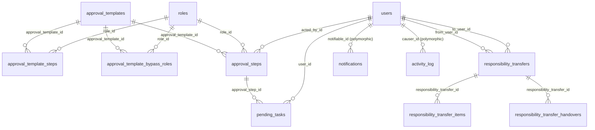

Not drawn: `approval_steps.approvable_type/approvable_id` (to the document), `pending_tasks.taskable_type/taskable_id`, `notifications.subject_type/subject_id`, `activity_log.subject_type/subject_id`, `message_deliveries` and `alerts`. Their targets are listed under each table.

## approval_templates

**One row per:** approval workflow definition for one document type in one company. **Model:** `App\Models\ApprovalTemplate`. **Company-scoped:** yes. **Soft deletes:** yes.
**Rows in dev DB:** 8 (one per document type, all company 1, all active, none deleted).

A template says which document type it governs (`model_type`) and holds the ordered steps. When a document of that type is created, the application copies the template's applicable steps into `approval_steps`. Editing a template affects only documents raised afterwards.

| Column | Type | Points to | Meaning |
|---|---|---|---|
| `id` | bigint | | Primary key. |
| `company_id` | bigint | companies.id | Owning company. |
| `name` | varchar | | Display name, e.g. "Letter of Offer Approval Template". |
| `model_type` | varchar | | Class name of the documents the template governs (same strings as `approval_steps.approvable_type`, see that table). |
| `always_requires_approval` | tinyint | | 1 = every document goes through the chain. 0 = a submitter holding one of the template's bypass roles skips the chain. 1 on all 8 dev rows. |
| `post_approval_event` | varchar, nullable | | Internal name of the application event fired when a chain is fully approved (e.g. `App\Events\LeaseApprovedEvent`). Not useful for analysis. |
| `is_active` | tinyint | | 0 = the template is switched off: documents of that type are approved immediately, with no chain. |
| `deleted_at` | timestamp, nullable | | Soft delete. A deleted template is never used. |
| `created_by_id` | bigint, nullable | users.id | Who created the template. |
| `old_system_id` | varchar, nullable | | The id in the old EPMAS system (7 of 8 rows; the lease template was created in PropERP). |

**Joins:**
- `approval_templates.company_id → companies.id` : many to one.
- `approval_templates.created_by_id → users.id` : many to one.
- `approval_templates.id ← approval_template_steps.approval_template_id` : one to many (the steps).
- `approval_templates.id ← approval_template_bypass_roles.approval_template_id` : one to many (pivot to `roles`).
- `approval_templates.id ← approval_steps.approval_template_id` : one to many (every step of every chain started from it).

**Gotchas:**
- Templates in dev cover `App\Models\FacilityCreditNote`, `FacilityInvoice`, `TenantExitNotice`, `FacilityReceipt`, `FacilityContract`, `FacilityProcurementLpo`, `Lease` and `Loo`. `App\Models\FacilityRemittance` can be approved through a chain but has no template, so remittances are approved on creation.
- There is no unique key on (`company_id`, `model_type`). The application uses the active, non-deleted template for the type; dev has exactly one per type.

## approval_template_steps

**One row per:** step of a template. **Model:** `App\Models\ApprovalTemplateStep`. **Company-scoped:** yes. **Soft deletes:** no.
**Rows in dev DB:** 26.

Each step names the role whose holders sign it. The chains configured in dev are:

| Template (`model_type`) | Steps in order (role names from `roles.name`) |
|---|---|
| `FacilityInvoice`, `FacilityCreditNote`, `TenantExitNotice` | Property Manager → Senior Property Manager → Finance Billables → Finance Manager |
| `FacilityContract` | Property Manager → Senior Property Manager → Finance Payable → Finance Manager |
| `FacilityProcurementLpo` | Property Manager → Senior Property Manager → Procurement Manager → Finance Manager → Executive Signatory |
| `FacilityReceipt` | Finance Accounts Receivable |
| `Lease` | System Admin |
| `Loo` | Senior Property Manager → Director → Executive Signatory (only when `monthly_rent` is 500,000 or more) |

| Column | Type | Points to | Meaning |
|---|---|---|---|
| `id` | bigint | | Primary key. Not stable: see Gotchas. |
| `company_id` | bigint | companies.id | Owning company. |
| `approval_template_id` | bigint | approval_templates.id | The template. |
| `step_order` | int | | Position in the chain, 1 first. Unique within a template. |
| `role_id` | bigint | roles.id | The role that acts on this step. |
| `conditions` | json, nullable | | When the step applies, e.g. `{"mode": "require", "match": "all", "rules": [{"field": "monthly_rent", "value": 500000, "operator": "greater_than_or_equal"}]}`. `mode` is `require` (the step applies only if the rules match) or `bypass` (the step is skipped if they match); `match` is `all` or `any`; operators are `equals`, `not_equals`, `greater_than`, `greater_than_or_equal`, `less_than`, `less_than_or_equal`, `in`, `not_in`; `field` is a column of the document. NULL = always applies. Only the letter of offer step 3 has conditions in dev. |
| `allowed_to_edit` | tinyint | | 1 = whoever acts on this step may also edit the document while it waits on them. 0 everywhere in dev. |
| `editable_fields` | json, nullable | | Which document fields that edit right covers: a list of `{"field": ..., "is_material": ...}` objects (older rows hold bare field names). NULL, `[]` or `["*"]` means every field. |
| `is_checkpoint` | tinyint | | 1 = when a later step sends the document back for changes, the chain returns to this step instead of to the document's creator. 0 everywhere in dev. |
| `signs_document_signature` | tinyint | | 1 = the person who approves this step signs the printed document (letter of offer signatures, purchase order signatories). 0 everywhere in dev. |
| `old_system_id` | varchar, nullable | | The id in the old EPMAS system. |

**Joins:**
- `approval_template_steps.approval_template_id → approval_templates.id` : many to one.
- `approval_template_steps.role_id → roles.id` : many to one.
- To match a running chain to its template: `approval_steps.approval_template_id = approval_template_steps.approval_template_id AND approval_steps.step_order = approval_template_steps.step_order` (no DB constraint, and the template may have changed since the chain started).

**Gotchas:**
- Saving a template deletes and recreates all its steps, so template step ids change on every edit and nothing stores them. Running chains are unaffected because `approval_steps` holds its own copy of the role and flags.
- Conditions are evaluated once, when the chain starts, against the document as it was then. A step that does not apply leaves no row in `approval_steps`.

## approval_template_bypass_roles

**One row per:** role allowed to skip a template's chain. Pivot between `approval_templates` and `roles`. **Model:** `App\Models\ApprovalTemplateBypassRole`. **Company-scoped:** no. **Soft deletes:** no.
**Rows in dev DB:** 0.

When the person raising a document holds one of these roles and the template's `always_requires_approval` is 0, the document is approved at once and no `approval_steps` rows are written.

| Column | Type | Points to | Meaning |
|---|---|---|---|
| `id` | bigint | | Primary key. |
| `approval_template_id` | bigint | approval_templates.id | The template. |
| `role_id` | bigint | roles.id | The role that bypasses it. Unique per template. |

**Joins:**
- `approval_template_bypass_roles.approval_template_id → approval_templates.id` and `approval_template_bypass_roles.role_id → roles.id` : many to one each; the table connects `approval_templates` to `roles` many to many.

## approval_steps

**One row per:** step of one approval run (attempt) on one document. Unique on (`approvable_type`, `approvable_id`, `attempt`, `step_order`). **Model:** `App\Models\ApprovalStep`. **Company-scoped:** yes. **Soft deletes:** no.
**Rows in dev DB:** 384 (342 on 114 letters of offer, 20 on 5 invoices, 12 on 3 exit notices, 6 on 6 receipts, 4 on 4 leases).

How a chain runs. When a document is created the application looks up the active template for its type. If there is none, if it is inactive, if the submitter holds a bypass role, or if no step applies, the document is set straight to its approved status and gets no rows here. Otherwise every applicable step is written at once with status `pending`, an empty `actors` list and no `prompted_at`, and the document gets its "in approval" status. The first step is then **prompted**: the people who may act are written into `actors`, `prompted_at` is stamped, and each of them gets a `pending_tasks` row. When one of them approves, the step records `acted_by_id` and `acted_at` and the next step is prompted. When the last step (`is_last = 1`) is approved, the document moves to its approved status.

| `approvable_type` | Document table | Chains in dev | Document status while in approval | Status set when approved | Status set when rejected |
|---|---|---|---|---|---|
| `App\Models\Loo` | loos | 114 | `pending_approval` | `approved` | `rejected` |
| `App\Models\FacilityInvoice` | facility_invoices | 5 | `pending` | `unpaid` | `rejected` |
| `App\Models\TenantExitNotice` | tenant_exit_notices | 3 | `pending-review` | `completed` | `rejected` |
| `App\Models\FacilityReceipt` | facility_receipts | 6 | `pending` | `confirmed` | `rejected` |
| `App\Models\Lease` | leases | 4 | `pending` | `active` | `rejected` |
| `App\Models\FacilityCreditNote` | facility_credit_notes | 0 | `pending` | `applied` or `unapplied` (set by the processing that follows approval) | `rejected` |
| `App\Models\FacilityContract` | facility_contracts | 0 | `pending` | `active` | `rejected` |
| `App\Models\FacilityProcurementLpo` | facility_procurement_lpos | 0 | `pending` | `lpo` | `rejected` |
| `App\Models\FacilityRemittance` | facility_remittances | 0 | `pending` | `unpaid` | `rejected` |

Later business events move the document on from its approved status (in dev the 102 letters of offer whose chain is fully approved are all `sent` by now, and the other 12 are still `pending_approval`), so the document's own `status` column is the authority on where it stands; `approval_steps` explains how it got there.

**Status** (`status`, DB enum `pending, approved, review, rejected`; the PHP enum `ApprovalStepStatus` has the same four values):
- `pending` : not answered. Either the current step, waiting on its actors (`prompted_at` set, `actors` filled), or a later step the chain has not reached (`prompted_at` NULL, `actors` = `[]`).
- `approved` : signed off by `acted_by_id` at `acted_at`.
- `review` : `acted_by_id` sent the document back for changes; `comment` says why. If an earlier step has `is_checkpoint = 1`, the chain goes back to that checkpoint and this step stays `review` until the chain reaches it again. Otherwise the document goes back to its creator and submitter (who get a "Changes requested" task); when they edit it, every step up to and including this one is reset to `pending` and the chain restarts from step 1 in the same attempt. The document keeps its "in approval" status throughout.
- `rejected` : `acted_by_id` rejected the document; `comment` says why. Rejection ends the chain: every other open step of the attempt is also set to `rejected`, and the document goes to its own `rejected` status, which is final (it is never resubmitted).

Live rows are the latest attempt of each document (`attempt` = the highest attempt for that `approvable_type`, `approvable_id`). The step a chain is standing on is the lowest `step_order` of that attempt whose status is `pending` or `review`; "waiting on somebody" is `status = 'pending' AND prompted_at IS NOT NULL` (21 steps in dev, one of them on a deleted lease, see Gotchas). A document's chain is rejected if any step is `rejected`, approved if every step is `approved`, and otherwise still running (returned for changes when its current step is `review`; 1 invoice in dev).

| Column | Type | Points to | Meaning |
|---|---|---|---|
| `id` | bigint | | Primary key. |
| `company_id` | bigint | companies.id | Owning company. |
| `approval_template_id` | bigint | approval_templates.id | Template the chain was copied from. |
| `approvable_type` | varchar | polymorphic: see below | Class of the document being approved (table above). |
| `approvable_id` | bigint | polymorphic: see below | `id` of the document in its table. |
| `attempt` | int | | Run number of the chain on this document, 1 for the first. A second attempt could be opened after a rejection before rejection became final (2026-09-28); 1 on every dev row. |
| `step_order` | int | | Position in the chain, copied from the template. Can have gaps when a template step's conditions excluded it. |
| `role_id` | bigint | roles.id | Role the step is addressed to. |
| `actors` | json | users.id (array) | JSON array of the user ids asked to act, e.g. `[68]`. Any one of them may act. Filled when the step is prompted, `[]` before. The people are those named for the role on the document's property (`facility_role`), else holders of the role allocated to the property (`facility_user`), or a colleague covering through a responsibility transfer. |
| `prompted_at` | timestamp, nullable | | When the chain reached the step and its actors were asked. |
| `status` | enum | | See Status above. |
| `initiated_by_id` | bigint, nullable | users.id | Who submitted the document into approval. Same on every step of the chain. |
| `acted_by_id` | bigint, nullable | users.id | Who approved, sent back or rejected the step. |
| `acted_at` | timestamp, nullable | | When they did. |
| `comment` | text, nullable | | Reason given when sending back or rejecting (required for both, cleared on approval). Free text. |
| `is_last` | tinyint | | 1 on the final step of the chain (exactly one per chain). |
| `is_checkpoint` | tinyint | | Copied from the template step (meaning there). |
| `signs_document_signature` | tinyint | | Copied from the template step: the approver's signature is printed on the document. |
| `allowed_to_edit`, `editable_fields` | tinyint, json | | Copied from the template step: the actor's right to edit the document while it waits on them. |

**Joins:**
- `approval_steps.approvable_id → <document table>.id`, choosing the table by `approvable_type` (polymorphic, no DB constraint). Types found in dev: `App\Models\Loo` → `loos`, `App\Models\FacilityInvoice` → `facility_invoices`, `App\Models\TenantExitNotice` → `tenant_exit_notices`, `App\Models\FacilityReceipt` → `facility_receipts`, `App\Models\Lease` → `leases`. Many steps to one document. Every dev row resolves to an existing document except one lease step (see Gotchas), so inner-join to the document table.
- `approval_steps.approval_template_id → approval_templates.id`, `role_id → roles.id`, `initiated_by_id → users.id`, `acted_by_id → users.id`, `company_id → companies.id` : many to one, all with DB constraints.
- `approval_steps.actors` → `users.id` : one step to many users, through the JSON array (no DB constraint). Explode it with `JSON_TABLE`:

```sql
SELECT s.id AS approval_step_id, a.user_id AS asked_user_id
FROM approval_steps s
CROSS JOIN JSON_TABLE(s.actors, '$[*]' COLUMNS (user_id BIGINT PATH '$')) AS a;
```

  Ran on dev: 351 rows. On every answered step `acted_by_id` is one of the `actors` (319 of 319).
- `approval_steps.id ← pending_tasks.approval_step_id` : one to many (one task per actor while the step is open; DB constraint).
- `approval_steps.id ← loo_comments.approval_step_id` : comments made on a letter of offer at a given step (DB constraint; section 4).

**Turnaround analysis.** Use `prompted_at` and `acted_at`, never `created_at`:
- time on a step = `acted_at - prompted_at` (for the open current step, `NOW() - prompted_at`);
- hand-off delay = next step's `prompted_at` minus this step's `acted_at` (zero for chains run in PropERP, where the next step is prompted in the same transaction; a few hours on chains imported from EPMAS);
- whole chain = last step's `acted_at` minus first step's `prompted_at`, for chains whose steps are all `approved`.

```sql
SELECT s.approvable_type, s.step_order, r.name AS role,
       COUNT(*) AS steps_answered,
       ROUND(AVG(TIMESTAMPDIFF(MINUTE, s.prompted_at, s.acted_at)) / 60, 1) AS avg_hours_on_step,
       ROUND(AVG(TIMESTAMPDIFF(MINUTE, prev.acted_at, s.prompted_at)) / 60, 1) AS avg_handoff_hours
FROM approval_steps s
JOIN roles r ON r.id = s.role_id
LEFT JOIN approval_steps prev
       ON prev.approvable_type = s.approvable_type
      AND prev.approvable_id = s.approvable_id
      AND prev.attempt = s.attempt
      AND prev.step_order = (SELECT MAX(x.step_order) FROM approval_steps x
                              WHERE x.approvable_type = s.approvable_type
                                AND x.approvable_id = s.approvable_id
                                AND x.attempt = s.attempt
                                AND x.step_order < s.step_order)
WHERE s.status IN ('approved', 'rejected', 'review')
  AND s.prompted_at IS NOT NULL
GROUP BY s.approvable_type, s.step_order, r.name
ORDER BY s.approvable_type, s.step_order;
```

Ran on dev: 6 rows. Letters of offer average 49.1 hours at Senior Property Manager (104 steps), 14.3 hours at Director (103) and 83.2 hours at Executive Signatory (102), with hand-offs of 3.1 and 5.2 hours; receipts are approved within minutes.

**Gotchas:**
- A row holds only the latest round of a step. Sending a document back resets the steps it passes over (status back to `pending`, and `acted_by_id`, `acted_at`, `comment`, `actors` and `prompted_at` cleared), and the chain runs again in the same attempt. Earlier answers survive only in `activity_log` (`subject_type = 'App\Models\ApprovalStep'`, `event = 'updated'`, values in `properties`).
- The rejection cascade writes the rejecter's `acted_by_id` and the same `acted_at` onto every later open step, without a comment and usually without `prompted_at`. The step that was really rejected is the lowest `step_order` with status `rejected` (the one with a `comment`). Do not count the cascaded rows as rejections by their roles. There are no rejected steps in dev.
- `created_at` is when the chain started (all steps are written together), not when a step was reached. The 114 letter-of-offer chains were imported from EPMAS on 2026-10-04 and 2026-10-05: their `created_at` is the import date while `prompted_at` and `acted_at` carry the original dates back to July 2026 (309 of 342 steps were answered before their `created_at`).
- A document with no rows was not necessarily approved without scrutiny: there may be no active template for its type, the submitter may hold a bypass role, it may predate approvals (imported), or its steps may have been deleted. Deleting an invoice, credit note, receipt, exit notice, purchase order or remittance deletes its steps, and the `loos:reset-to-draft` command deleted the chains of letters of offer it reset. In dev 5 of the 119 live letters of offer have no chain.
- The reverse also happens. Deleting a lease (a hard delete) leaves its steps behind, still `pending`, while its tasks are removed: in dev the single step of deleted lease 8185 is such an orphan (4 actors, no tasks). Soft-deleting a letter of offer or a supplier contract keeps its steps too. Inner-join to the document table and add its `deleted_at IS NULL` filter where it has one.
- An open, prompted step with `actors = []` can be acted on by nobody; a nightly job (02:40) re-addresses open steps to whoever currently holds the role on the property. `actors` and the `pending_tasks` rows are rewritten when that happens.
- `acted_by_id` can be a colleague standing in through a responsibility transfer rather than the usual role holder.

## pending_tasks

**One row per:** open to-do item for one user. The same item raised for three people is three rows. **Model:** `App\Models\PendingTask`. **Company-scoped:** yes. **Soft deletes:** no.
**Rows in dev DB:** 161 (27 users, 96 distinct items).

A task is raised by the feature that needs someone to act and is **deleted** as soon as the item is dealt with. There are no completion or "done" columns: the table is a snapshot of what is open now, not a history.

| `taskable_type` | What the task asks | Who gets it | Cleared when | Rows in dev |
|---|---|---|---|---|
| `App\Models\ApprovalStep` | "Approval required" on a document; or "Changes requested" when a document was sent back | each actor of the current step; the creator and submitter for a send-back | the step is answered, the document is resubmitted, or the chain ends | 21 (on 21 steps: 12 letters of offer, 5 invoices, 3 exit notices, 1 receipt) |
| `App\Models\LeaseApplication` | review a lease application; generate its letter of offer | every holder of the responsible property roles | the application is reviewed / the offer is generated | 107 (on 42 applications) |
| `App\Models\FacilityProcurementRequest` | chase missing quotes ("Only n of 3 quotes received"); select a quote | procurement staff | quotes arrive / a quote is selected | 33 |
| `App\Models\Loo` | the lawyer reviews a letter of offer and records the legal fee note | the lawyer | the note is recorded | 0 |
| `App\Models\FacilityProcurementLpo` | the supplier uploads the signed jobcard for a purchase order | the supplier (vendor portal) | the jobcard is uploaded | 0 |
| `App\Models\CustomerInvoice` | verify a customer invoice | each verifier | the invoice is verified, merged, cancelled or deleted | 0 |

| Column | Type | Points to | Meaning |
|---|---|---|---|
| `id` | bigint | | Primary key. |
| `company_id` | bigint | companies.id | Owning company. |
| `user_id` | bigint | users.id | The person the task is for. |
| `user_group_id` | bigint, nullable | user_groups.id | Portal the task shows in: 3 = staff app, 4 = vendor portal, 2 = tenant portal. 3 on every dev row. |
| `facility_id` | bigint, nullable | facilities.id | Property the task is about, derived from the item (for approval tasks, from the document). Set on every dev row. |
| `domain` | varchar, nullable | | Area of the staff app: `access-management`, `property-management`, `facility-management`, `project-management` (PHP enum `Domain`; no DB enum). NULL on tasks outside the staff portal. `property-management` on every dev row. |
| `taskable_type` | varchar | polymorphic: see below | Class of the item (table above). |
| `taskable_id` | bigint | polymorphic: see below | `id` of the item. |
| `approval_step_id` | bigint, nullable | approval_steps.id | Set on approval tasks (equal to `taskable_id` there), NULL on all others. |
| `title` | varchar | | Short text shown in the inbox. Contains names of people and properties. |
| `description` | text, nullable | | Longer text (for a send-back, the reviewer's comment). |
| `due_at` | timestamp, nullable | | Deadline. Only set on supplier jobcard tasks (the purchase order's delivery date); NULL on every dev row. |
| `created_at` | timestamp | | When the task was (last) raised. |

**Joins:**
- `pending_tasks.user_id → users.id`, `user_group_id → user_groups.id`, `facility_id → facilities.id`, `approval_step_id → approval_steps.id`, `company_id → companies.id` : many to one, all with DB constraints.
- `pending_tasks.taskable_id → <table>.id` by `taskable_type` (polymorphic, no DB constraint): `App\Models\ApprovalStep` → `approval_steps`, `App\Models\LeaseApplication` → `lease_applications`, `App\Models\FacilityProcurementRequest` → `facility_procurement_requests` (the three types in dev; every row resolves, and `facility_id` matches the item's own `facility_id` in every case). In code also `App\Models\Loo` → `loos`, `App\Models\FacilityProcurementLpo` → `facility_procurement_lpos`, `App\Models\CustomerInvoice` → `customer_invoices`.
- To reach the document behind an approval task: `pending_tasks.approval_step_id → approval_steps.id`, then `approval_steps.approvable_type/approvable_id`.

**Gotchas:**
- Count items, not rows, when asking "how much work is open": `COUNT(DISTINCT taskable_type, taskable_id)`. Lease application tasks go to every holder of the responsible role (107 rows for 42 applications).
- There is no history of finished tasks. The activity log does not fill the gap: the approval engine deletes tasks with a single bulk statement that writes no audit row (325 task creations are logged in dev but only 34 deletions, while 161 tasks are still open). Measure approval turnaround from `approval_steps.prompted_at` and `acted_at` instead.
- `created_at` is reset when a task is re-raised: a step being prompted again, or the nightly re-addressing job (02:40) moving the task to different people. A task's age is therefore "since last raised".
- `approval_steps.actors` is the authority on who is asked for an approval; tasks are its working copy. They can disagree: the open step left behind by deleted lease 8185 has 4 actors and no tasks.
- The unique key (`user_id`, `approval_step_id`) allows one approval task per person per step. Non-approval tasks have `approval_step_id` NULL and are not constrained.

## responsibility_transfers

**One row per:** offer by one staff member (`from_user_id`) to hand some of their properties and roles to a colleague (`to_user_id`), either for a period or permanently. **Model:** `App\Models\ResponsibilityTransfer`. **Company-scoped:** yes. **Soft deletes:** no.
**Rows in dev DB:** 1 (a temporary offer, withdrawn 13 seconds after it was made).

Used for leave cover and for staff handovers. The recipient must be in the same company and department. When the recipient accepts, they are given access to the offered properties and roles (`responsibility_transfer_items`), and open work is moved or shared (`responsibility_transfer_handovers`): document ownership, open approval steps and procurement steps, and pending tasks. While a transfer is in force, new approval steps on those properties for those roles are routed to the recipient.

**Status** (`status`, varchar; PHP enum `ResponsibilityTransferStatus`):
- `pending` : offered, waiting for the recipient's answer. Nothing has been granted.
- `active` : a temporary transfer accepted (`accepted_at`); the recipient covers until `timestamp_to` or until reclaimed.
- `accepted` : older name for the in-force state. Current code writes `active` instead; treat the two alike.
- `completed` : a permanent transfer accepted (`accepted_at`). Final: the transferer has lost the properties, nothing is reversed.
- `declined` : the recipient refused (`declined_at`).
- `withdrawn` : the transferer cancelled before an answer (`withdrawn_at`).
- `reclaimed` : the transferer took a temporary transfer back early (`reclaimed_at`); all grants reversed.
- `returned` : a temporary transfer ended automatically at `timestamp_to` (`returned_at`, set by an hourly job); all grants reversed.
- `expired` : a temporary offer nobody answered before `timestamp_to` (the time is stored in `returned_at`).

Live rows: "cover in force now" is `status IN ('active','accepted')`; "still open" adds `pending`; completed handovers are `status = 'completed'`.

| Column | Type | Points to | Meaning |
|---|---|---|---|
| `id` | bigint | | Primary key. |
| `company_id` | bigint | companies.id | Owning company. |
| `from_user_id` | bigint | users.id | The transferer. |
| `to_user_id` | bigint | users.id | The recipient. |
| `new_roles` | json, nullable | roles.id (array) | JSON array of the role ids offered, e.g. `[1]`. |
| `new_facilities` | json, nullable | facilities.id (array) | JSON array of the property ids offered. |
| `is_permanent` | tinyint | | 1 = permanent handover, 0 = temporary cover. |
| `timestamp_to` | timestamp, nullable | | End of a temporary transfer (also the deadline to answer the offer). NULL on permanent ones. |
| `include_pending_tasks` | tinyint | | 1 = the recipient replaces the transferer on open approval steps and takes their open tasks; 0 = the recipient is added alongside. Permanent transfers always replace. |
| `accepted_at`, `declined_at`, `reclaimed_at`, `withdrawn_at`, `returned_at` | timestamp, nullable | | When the matching status was reached (see Status). |

**Joins:**
- `responsibility_transfers.from_user_id → users.id`, `to_user_id → users.id`, `company_id → companies.id` : many to one (DB constraints).
- `responsibility_transfers.id ← responsibility_transfer_items.responsibility_transfer_id` and `← responsibility_transfer_handovers.responsibility_transfer_id` : one to many.
- `new_roles` → `roles.id` and `new_facilities` → `facilities.id` through the JSON arrays (no DB constraint): `CROSS JOIN JSON_TABLE(t.new_facilities, '$[*]' COLUMNS (facility_id BIGINT PATH '$'))`.
- `notifications.subject_type = 'App\Models\ResponsibilityTransfer'`, `subject_id = responsibility_transfers.id` : the offer, withdrawal, acceptance and similar messages.

**Gotchas:**
- One person may have several open transfers, but their properties may not overlap.
- Permanent transfers accepted before 2026-10-13 were converted to `completed` without the later clean-up, so their transferers may still appear in `facility_user` for those properties.

## responsibility_transfer_items

**One row per:** access grant an accepted transfer actually made (only access the recipient did not already have). **Model:** `App\Models\ResponsibilityTransferItem`. **Company-scoped:** no. **Soft deletes:** no.
**Rows in dev DB:** 0.

**Grant type** (`grant_type`, varchar; PHP enum `ResponsibilityTransferGrantType`):
- `facility_user` : the recipient was allocated to the property (a new `facility_user` row). Reversal removes it.
- `facility_role_created` : the recipient was named for a property role (a new `facility_role` row). Reversal deletes it.
- `facility_role_reassigned` : an existing `facility_role` row was switched from `previous_user_id` to the recipient (permanent transfers only). Reversal puts `previous_user_id` back.

Live rows are `reversed_at IS NULL` (grants still in place).

| Column | Type | Points to | Meaning |
|---|---|---|---|
| `id` | bigint | | Primary key. |
| `responsibility_transfer_id` | bigint | responsibility_transfers.id | The transfer. |
| `grant_type` | varchar | | See above. |
| `facility_id` | bigint | facilities.id | The property. |
| `role_id` | bigint, nullable | roles.id | The role, for `facility_role_*` grants. |
| `facility_role_id` | bigint, nullable | facility_role.id | The property-role row created or reassigned. |
| `user_id` | bigint | users.id | The recipient. |
| `previous_user_id` | bigint, nullable | users.id | The holder displaced by a reassignment. |
| `reversed_at` | timestamp, nullable | | When the grant was undone (reclaim or return). |

**Joins:**
- `responsibility_transfer_items.responsibility_transfer_id → responsibility_transfers.id`, `facility_id → facilities.id`, `role_id → roles.id`, `facility_role_id → facility_role.id`, `user_id → users.id`, `previous_user_id → users.id` : many to one, all with DB constraints.

## responsibility_transfer_handovers

**One row per:** piece of open work an accepted transfer moved to the recipient (the handover ledger). **Model:** `App\Models\ResponsibilityTransferHandover`. **Company-scoped:** no. **Soft deletes:** no.
**Rows in dev DB:** 0.

**Kind** (`kind`, varchar; PHP enum `ResponsibilityTransferHandoverKind`), with what `subject_type` holds and what `previous_values` and `new_values` contain:
- `creator` : a document's creator switched to the recipient. Subject: the document (any approvable type, or `App\Models\FacilityProcurementRequest`). Values `{"column": ..., "user_id": ...}` (the column is `created_by_id`, or `generated_by_id` on a letter of offer).
- `approval_step_actors` : an open approval step's `actors` rewritten. Subject: `App\Models\ApprovalStep`. Values `{"actors": [...]}`.
- `procurement_step_actors` : an open procurement step's actors rewritten. Subject: `App\Models\FacilityProcurementRequestStep`. Values `{"actors_ids": [...]}`.
- `pending_task` : a task moved to the recipient. Subject: the task's item (its `taskable`). Values `{"user_id", "title", "approval_step_id", "pending_task_id"}`.
- `facility_user_removed` : the transferer's own allocation to the property removed (permanent only, never reversed). Subject: `App\Models\Facility`. `previous_values` `{"user_id": ...}`, `new_values` NULL.
- `role_assigned` : a company-wide role given to the recipient (permanent only, never reversed). Subject: `App\Models\Role`. `previous_values` NULL, `new_values` `{"user_id": ...}`.

Live rows are `reversed_at IS NULL`.

| Column | Type | Points to | Meaning |
|---|---|---|---|
| `id` | bigint | | Primary key. |
| `responsibility_transfer_id` | bigint | responsibility_transfers.id | The transfer. |
| `kind` | varchar | | See above. |
| `subject_type` | varchar | polymorphic: see above | Class of the record touched. |
| `subject_id` | bigint | polymorphic: see above | Its `id`. |
| `previous_values` | json, nullable | | What it was before. |
| `new_values` | json, nullable | | What it became. |
| `reversed_at` | timestamp, nullable | | When it was restored by a reclaim or return. |

**Joins:**
- `responsibility_transfer_handovers.responsibility_transfer_id → responsibility_transfers.id` : many to one (DB constraint).
- `subject_id → <table>.id` by `subject_type` (polymorphic, no DB constraint).

## notifications

**One row per:** in-app notification to one recipient. **Model:** none of the application's own; this is the framework's standard notifications table (class `Illuminate\Notifications\DatabaseNotification`). **Company-scoped:** no (see `company_id`). **Soft deletes:** no.
**Rows in dev DB:** 29.

Every message the application sends has an in-app copy here; whether it also goes out by email, SMS or WhatsApp depends on the notification type, and those copies are logged in `message_deliveries`.

| Column | Type | Points to | Meaning |
|---|---|---|---|
| `id` | char(36) | | Primary key, a UUID string (not an integer). |
| `type` | varchar | | Notification class, e.g. `App\Notifications\Approvals\ApprovalChangesRequestedNotification`. The part after the last backslash is a readable name. 10 types in dev. |
| `notifiable_type` | varchar | polymorphic: see below | Class of the recipient. `App\Models\User` on every dev row. |
| `notifiable_id` | bigint | polymorphic: see below | The recipient's id. |
| `company_id` | bigint, nullable | companies.id | Company the notification is filed under. NULL = personal: it follows the person into every company they work in. |
| `user_group_id` | bigint, nullable | user_groups.id | Portal of the recipient: 2 = tenant, 3 = staff, 4 = vendor. |
| `domain` | varchar, nullable | | Area of the staff app (values as on `pending_tasks.domain`). NULL for tenants and suppliers. |
| `data` | text | | JSON payload. Every type has `title`, `message`, `resource_type` (class name without namespace, e.g. `Loo`), `resource_id` and `resource_url` (link in the web app, fixed at send time); each type adds its own keys (for example `facility_name`, `reference`, `approvable_type`, `approvable_id`). |
| `read_at` | timestamp, nullable | | When the recipient opened it. NULL = unread. |
| `subject_type` | varchar, nullable | polymorphic: see below | Class of the record the notification is about. |
| `subject_id` | bigint, nullable | polymorphic: see below | Its `id`. |
| `created_at` | timestamp | | When it was sent. |

**Joins:**
- `notifications.notifiable_id → users.id` when `notifiable_type = 'App\Models\User'` (no DB constraint; all 29 dev rows resolve).
- `notifications.subject_id → <table>.id` by `subject_type` (no DB constraint). Types in dev: `App\Models\FacilityProcurementRequest`, `App\Models\LeaseApplication`, `App\Models\FacilityReceipt`, `App\Models\FacilityInvoice`, `App\Models\Loo`, `App\Models\Lease`, `App\Models\ResponsibilityTransfer`.
- `notifications.company_id → companies.id`, `user_group_id → user_groups.id` : many to one (DB constraints).

**Gotchas:**
- `data` is a `text` column, not `json`, but it always holds valid JSON, so `JSON_EXTRACT(data, '$.title')` works.
- One event produces one row per recipient, and repeated events produce repeated rows: in dev one user received 5 identical rows in the same second (one per document replaced on an application). Count events with `DISTINCT type, subject_type, subject_id, created_at` when you need events rather than deliveries.
- Rows are deleted when the record they are about is deleted, and when `loos:reset-to-draft` reset a letter of offer. Otherwise they are kept, read or not.
- `data` holds names (applicant, transferer, recipient). Treat it as personal data.
- There is no column linking a notification to its `message_deliveries` rows.

## message_deliveries

**One row per:** one email, SMS or WhatsApp message handed to a provider (one row per recipient per channel). **Model:** `App\Models\MessageDelivery`. **Company-scoped:** no (`company_id` is set explicitly, NULL = sent on the platform's own account for a personal message). **Soft deletes:** no.
**Rows in dev DB:** 51 (27 email, 15 SMS, 9 WhatsApp, from 2026-10-03).

**Status** (`status`, DB enum `sent, delivered, read, undelivered, failed`; the PHP enum `MessageDeliveryStatus` has the same five values):
- `sent` : the provider accepted the message (or, with the `log` driver, it was written to the application log).
- `delivered`, `read`, `undelivered` : reserved for delivery receipts from the providers. That feedback is not built yet, so these values never occur today.
- `failed` : the provider refused it or the call errored; `error` says why. Only SMS and WhatsApp write this value.

Real sends are `driver <> 'log'`.

| Column | Type | Points to | Meaning |
|---|---|---|---|
| `id` | bigint | | Primary key. |
| `company_id` | bigint, nullable | companies.id | Company whose message it was. NULL on 19 dev rows (one-time PINs, password reset codes, approval codes and one welcome email). |
| `channel` | enum `email, sms, whatsapp` | | Channel (PHP enum `MessagingChannel`, same values). |
| `driver` | varchar | | Provider integration used: email `resend`, `smtp` or `log`; SMS `africas_talking` or `log`; WhatsApp `meta_cloud` or `log`. `log` means nothing left the server. |
| `credential_source` | enum `company, platform, fallback` | | Whose account was used: `company` = the company's own provider account (`company_messaging_channels`, section 1); `platform` = the platform's account; `fallback` = no account configured, so the `log` driver was used. PHP enum `MessagingCredentialSource`, same values. |
| `recipient` | varchar | | Email address or phone number. Personal data. |
| `provider_message_id` | varchar, nullable | | The provider's id for the message. NULL on every dev row. |
| `status` | enum | | See above. |
| `error` | text, nullable | | Provider error for `failed` rows. |
| `notification_type` | varchar, nullable | | Notification class that produced the message (same strings as `notifications.type`). |
| `notifiable_type` | varchar, nullable | polymorphic: see below | Recipient class, `App\Models\User`, or NULL when the message went to an address with no account (test messages, applicants). |
| `notifiable_id` | bigint, nullable | polymorphic: see below | Recipient id. |
| `subject_type` | varchar, nullable | polymorphic: see below | Record the message was about, when the notification names one (e.g. `App\Models\LeaseApplication` for an applicant's link). NULL on every dev row. |
| `subject_id` | bigint, nullable | polymorphic: see below | Its id. |
| `sent_at` | timestamp, nullable | | When it was handed over. |
| `status_updated_at` | timestamp, nullable | | When `status` last changed (equals `sent_at` today). |

**Joins:**
- `message_deliveries.company_id → companies.id` : many to one (DB constraint).
- `message_deliveries.notifiable_id → users.id` when `notifiable_type = 'App\Models\User'` (no DB constraint).
- `message_deliveries.subject_id → <table>.id` by `subject_type` (no DB constraint).
- To the in-app copy (no key): same `notification_type` = `notifications.type`, same recipient id, `created_at` within a few seconds.

**Gotchas:**
- In dev every SMS and WhatsApp row used the `log` driver: nothing was actually sent. Always split or filter on `driver`.
- An email row is written only after the mail server accepts the message. A failed email leaves no row here (it fails as a background job), so the email success rate is 100 % by construction. Use it as a volume measure.
- Text messages are opt-in per notification type: only one-time PINs, password reset codes, approval codes, purchase orders issued, quote reminders to suppliers, returned lease applications and "meter readings ready for billing" send SMS or WhatsApp. Approvals and workflow messages are in-app only.
- This table is not written to `activity_log`.

## alerts

**One row per:** dated warning shown on one user's dashboard. **Model:** `App\Models\Alert`. **Company-scoped:** yes. **Soft deletes:** no.
**Rows in dev DB:** 0.

The only producer today is the monthly "Meter readings outstanding" check (2nd of each month), which alerts the designated reader of each property utility with meters lacking a reading. Alerts whose `active_until` has passed are deleted nightly (01:15), so the table only ever holds current alerts.

| Column | Type | Points to | Meaning |
|---|---|---|---|
| `id` | bigint | | Primary key. |
| `company_id` | bigint | companies.id | Owning company. |
| `user_id` | bigint | users.id | Who sees it. |
| `user_group_id` | bigint, nullable | user_groups.id | Portal (3 = staff). |
| `title` | varchar | | Short text. |
| `notes` | text, nullable | | Detail (count of meters, utility, property, month). |
| `active_until` | timestamp, nullable | | Shown until this time (end of the month for meter alerts). NULL = no end. |
| `priority` | enum `high, normal, low` | | PHP enum `Priority`, same values. Meter alerts are `high`. |
| `domain` | varchar, nullable | | Area of the staff app (values as on `pending_tasks.domain`). |
| `alertable_type` | varchar, nullable | polymorphic: see below | Record the alert is about: `App\Models\FacilityUtility` for meter alerts. |
| `alertable_id` | bigint, nullable | polymorphic: see below | Its id. |

**Joins:**
- `alerts.user_id → users.id`, `user_group_id → user_groups.id`, `company_id → companies.id` : many to one (DB constraints).
- `alerts.alertable_id → facility_utilities.id` when `alertable_type = 'App\Models\FacilityUtility'` (no DB constraint).

Live rows are `active_until IS NULL OR active_until > NOW()`.

## activity_log

**One row per:** one create, update or delete of one record, made through the application. **Model:** none of the application's own; this is the standard table of the Spatie activity log package (class `Spatie\Activitylog\Models\Activity`). **Company-scoped:** no (`company_id` is a plain nullable column). **Soft deletes:** no.
**Rows in dev DB:** 230,791 (about 148 MB of data and 92 MB of indexes), covering 94 record types.

Every application model writes here whenever one of its rows is created, changed or deleted, so this is the place to answer "who changed what, and when". Only the columns that changed are recorded, with their old and new values.

| Column | Type | Points to | Meaning |
|---|---|---|---|
| `id` | bigint | | Primary key; increases with time. |
| `log_name` | varchar, nullable | | Short label of the record type, e.g. `lease`, `invoice` (= `FacilityInvoice`), `receipt` (= `FacilityReceipt`), `bill` (= `FacilityBill`), `property` (= `Facility`), `approval-step`, `pending-task`. Filter on `subject_type` instead: it is exact and indexed. |
| `description` | text | | Readable sentence, e.g. "Updated Lease: tenant exit notice set to 4". Can contain names and amounts. |
| `subject_type` | varchar, nullable | polymorphic: see below | Class of the record changed. |
| `subject_id` | bigint, nullable | polymorphic: see below | Its `id`. |
| `event` | varchar, nullable | | `created`, `updated` or `deleted` (161,042 / 69,182 / 567 in dev). |
| `causer_type` | varchar, nullable | polymorphic: see below | `App\Models\User`, or NULL. |
| `causer_id` | bigint, nullable | users.id | Who made the change. NULL = the system (scheduled jobs, console commands, data loads). Background jobs carry the user who started them. 15 distinct users in dev. |
| `properties` | json, nullable | | The change. `created`: `{"attributes": {column: value, ...}}`. `updated`: `{"old": {changed columns before}, "attributes": {the same columns after}}`. `deleted`: `{"old": {column: value, ...}}`. Passwords, tokens, `created_at`, `updated_at` and `deleted_at` are never included. |
| `resource_url` | varchar, nullable | | Relative path of the page in the web app where the change can be seen; a child record (an invoice line, say) points to its parent's page. NULL on 165,868 rows (types with no page). |
| `batch_uuid` | char(36), nullable | | Groups activities of one batch. NULL on every dev row. |
| `company_id` | bigint, nullable | | Company of the record, where it could be worked out. No DB constraint. |
| `subject_label` | text, nullable | | Name of the record at the time of the change (e.g. "Invoice INV-0012", or a person's name). |
| `created_at` | timestamp | | When the change happened. |

**Joins:**
- `activity_log.subject_id → <table>.id` by `subject_type` (polymorphic, no DB constraint), e.g. `App\Models\Lease` → `leases`, `App\Models\FacilityInvoice` → `facility_invoices`, `App\Models\ApprovalStep` → `approval_steps`. Section 11.2 maps every class to its table.
- `activity_log.causer_id → users.id` when `causer_type = 'App\Models\User'` (no DB constraint; all 202,354 user-caused rows resolve).

**Gotchas:**
- Size. In dev 97 % of the rows (223,961) come from the initial data load on 2026-10-01. Do not import the table wholesale into Power BI or Tableau: filter on `subject_type` and `created_at` (indexed together, as is `subject_type, subject_id, created_at`) and use incremental refresh on `created_at` or `id`. Exclude the load date when you want user activity.
- Changes made by one SQL statement over many rows write no activity rows. That includes the rejection cascade over later approval steps, the approval engine clearing pending tasks, and deleting a document's approval steps. Edits to individual records are complete; mass operations are not.
- Not logged at all: `message_deliveries`, `user_auth_activities`, API tokens and the sanctions screening tables.
- `company_id` is NULL on 41.8 % of rows (mostly child records saved by data loads and console commands). Get the company from the subject's own table when you need it.
- `subject_id` is NULL on 4,074 rows: the `App\Models\UserUserGroup` pivot has no id of its own.
- Use `JSON_KEYS(properties, '$.attributes')` (or `'$.old'` for deletes) to list the changed columns and `JSON_EXTRACT(properties, '$.old.status')` to read one value; worked query 3 turns each change into one row per column.
- Creating some records fires a follow-up `updated` row within the same second (for example a property), so do not read every `created` + `updated` pair as two separate actions.

## Worked queries

**What did the approval chain of every letter of offer look like: step order, role, who acted, when, and how long each step took?**

```sql
SELECT s.approvable_id AS loo_id,
       l.status AS loo_status,
       s.attempt,
       s.step_order,
       r.name AS role,
       s.status AS step_status,
       s.is_last,
       JSON_LENGTH(s.actors) AS people_asked,
       s.initiated_by_id,
       s.acted_by_id,
       u.name AS acted_by,
       s.prompted_at,
       s.acted_at,
       ROUND(TIMESTAMPDIFF(MINUTE, s.prompted_at, COALESCE(s.acted_at, NOW())) / 60, 1) AS hours_on_step
FROM approval_steps s
JOIN loos l ON l.id = s.approvable_id AND l.deleted_at IS NULL
JOIN roles r ON r.id = s.role_id
LEFT JOIN users u ON u.id = s.acted_by_id
WHERE s.approvable_type = 'App\\Models\\Loo'
  AND s.attempt = (SELECT MAX(x.attempt) FROM approval_steps x
                    WHERE x.approvable_type = s.approvable_type
                      AND x.approvable_id = s.approvable_id)
ORDER BY s.approvable_id, s.step_order;
```

Ran on dev: 342 rows for 114 letters of offer (309 approved steps, 33 pending, of which 12 are current and 21 not yet reached; `hours_on_step` is NULL for the unreached ones and counts up to now for the current ones). Change the type string and the joined table to see any other document type.

**How many open tasks does each person have, per property, and how old are they?**

```sql
SELECT t.user_id,
       u.name AS assignee,
       t.user_group_id,
       t.facility_id,
       f.name AS property,
       COUNT(*) AS open_tasks,
       SUM(t.taskable_type = 'App\\Models\\ApprovalStep') AS approval_tasks,
       SUM(t.taskable_type = 'App\\Models\\LeaseApplication') AS lease_application_tasks,
       SUM(t.taskable_type = 'App\\Models\\FacilityProcurementRequest') AS procurement_tasks,
       SUM(t.taskable_type NOT IN ('App\\Models\\ApprovalStep',
                                   'App\\Models\\LeaseApplication',
                                   'App\\Models\\FacilityProcurementRequest')) AS other_tasks,
       SUM(t.due_at IS NOT NULL AND t.due_at < NOW()) AS overdue,
       MIN(t.created_at) AS oldest_raised_at,
       ROUND(AVG(TIMESTAMPDIFF(HOUR, t.created_at, NOW())) / 24, 1) AS avg_age_days
FROM pending_tasks t
JOIN users u ON u.id = t.user_id
LEFT JOIN facilities f ON f.id = t.facility_id
GROUP BY t.user_id, u.name, t.user_group_id, t.facility_id, f.name
ORDER BY open_tasks DESC, t.user_id, t.facility_id;
```

Ran on dev: 69 rows covering 161 tasks for 27 people on 35 properties (21 approval, 107 lease application and 33 procurement tasks, none overdue). Every row of `pending_tasks` is open by definition, so no status filter is needed. Drop `t.facility_id, f.name` from the SELECT and GROUP BY for a per-person total, or `t.user_id, u.name` for a per-property total (and switch to `COUNT(DISTINCT t.taskable_type, t.taskable_id)` there, so an item asked of several people counts once).

**Which lease fields were changed or deleted in the last 30 days, by whom, from what to what?**

```sql
SELECT a.id AS activity_id,
       a.created_at AS changed_at,
       a.subject_id AS lease_id,
       a.event,
       a.causer_id,
       u.name AS changed_by,
       k.field,
       JSON_UNQUOTE(JSON_EXTRACT(a.properties, CONCAT('$.old."', k.field, '"'))) AS old_value,
       JSON_UNQUOTE(JSON_EXTRACT(a.properties, CONCAT('$.attributes."', k.field, '"'))) AS new_value
FROM activity_log a
CROSS JOIN JSON_TABLE(
       JSON_KEYS(COALESCE(JSON_EXTRACT(a.properties, '$.attributes'),
                          JSON_EXTRACT(a.properties, '$.old'))),
       '$[*]' COLUMNS (field VARCHAR(64) PATH '$')) AS k
LEFT JOIN users u ON u.id = a.causer_id AND a.causer_type = 'App\\Models\\User'
WHERE a.subject_type = 'App\\Models\\Lease'
  AND a.event IN ('updated', 'deleted')
  AND a.created_at >= NOW() - INTERVAL 30 DAY
ORDER BY a.created_at DESC, a.id, k.field;
```

Ran on dev (2026-10-22): 2,221 rows, one per changed column, from 2,199 activities (2,198 updates and 1 deletion). 2,190 rows are `next_due_at` changes with no causer, made by the data load on 2026-10-01; the remaining 31 were made by 2 staff users. Add `'created'` to the event list to include new leases (about 87,000 more rows in dev because of the load). `changed_by` is NULL for system changes.

**What share of messages reached the provider, per channel?**

```sql
SELECT channel,
       COUNT(*) AS messages,
       SUM(driver = 'log') AS written_to_log_only,
       SUM(driver <> 'log') AS handed_to_provider,
       SUM(driver <> 'log' AND status IN ('sent', 'delivered', 'read')) AS accepted,
       SUM(driver <> 'log' AND status IN ('delivered', 'read')) AS confirmed_delivered,
       SUM(driver <> 'log' AND status IN ('undelivered', 'failed')) AS failed,
       ROUND(100 * SUM(driver <> 'log' AND status IN ('sent', 'delivered', 'read'))
                 / NULLIF(SUM(driver <> 'log'), 0), 1) AS success_rate_pct
FROM message_deliveries
WHERE sent_at >= '2026-10-01'
GROUP BY channel
ORDER BY channel;
```

Ran on dev: 3 rows. Email 27 messages, all handed to the provider and accepted (100.0 %); SMS 15 and WhatsApp 9, all written to the log only, so their success rate is NULL. `confirmed_delivered` stays 0 until provider delivery receipts are built, and email failures are never recorded (see the table's gotchas), so read the email rate as an upper bound.

# 9. Reference data, settings, uploads, document templates and integrations

This section collects the tables the rest of the database leans on. Lookups first: `countries` and `cities` (addresses of properties and lease applicants), `currencies` with their exchange-rate history and the log of every currency conversion the system performed, `taxes` (VAT rates) and `withholding_taxes`, and `expense_categories`, the four-row top of the income and expense classification. Then `settings`, a per-company key/value store whose rows decide things analysts need, such as which expense category counts as "rent" and which supplier is the managing company itself. `uploads` is the single file register behind every attached document, and `document_templates` holds the printable layouts. Two integrations close the section: the managing company's own customers and the invoices it raises to them for management and letting fees (`customers`, `customer_invoices`, `customer_invoice_items`), sent to QuickBooks Online through `quickbooks_connections` and signed on the KRA ETR; and the Financial Reporting Centre (FRC) sanctions screening tables (`frc_*`), which check every person in the system against the UN and Kenyan sanctions lists. The customer invoice and FRC tables are empty in the dev database; their entries are written from the schema and the application code.

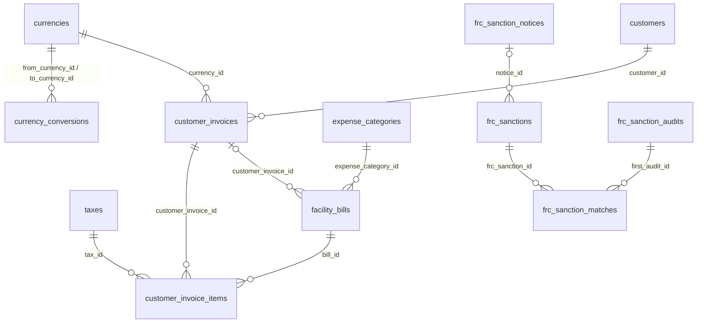

Polymorphic `*_type` columns here (`uploads.owner_type`, `currency_conversions.convertible_type`) hold the PHP class name with single backslashes, for example `App\Models\Lease`; in a MySQL string literal write `'App\\Models\\Lease'`. The one exception is `frc_sanction_matches.subject_type`, which holds a short word, not a class name. See Conventions.

## countries

**One row per:** country. **Model:** `App\Models\Country`. **Company-scoped:** no. **Soft deletes:** no. **Rows in dev DB:** 2.

A seeded lookup. Dev holds Kenya (`id` 1, code `KE`) and Tanzania (`id` 2, code `TZ`), both `active`.

| Column | Type | Points to | Meaning |
|---|---|---|---|
| id | bigint | | Primary key |
| name | varchar(100) | | Country name |
| code | varchar(5) | | ISO two-letter code (`KE`, `TZ`) |
| continent_id | varchar(5) | | Continent code as text (`AF`); not a foreign key, there is no continents table |
| phone_code | varchar(10) | | International dialling code without `+` (`254`) |
| status | enum('active','inactive') | | `active` countries are offered in pick lists |

**Joins:**
- `cities.country_id → countries.id`, one country to many cities.
- `facilities.country_id`, `users.country_id`, `company_offices.country_id`, `lease_applications.applicant_registered_country_id → countries.id`, many to one. All have DB constraints.

**Gotchas:** in dev every property has a country, but no `users` row has one (`users.country_id` and `users.city_id` are NULL on all 3,988 users).

## cities

**One row per:** city or town. **Model:** `App\Models\City`. **Company-scoped:** no. **Soft deletes:** no. **Rows in dev DB:** 404 (110 Kenyan, 294 Tanzanian).

| Column | Type | Points to | Meaning |
|---|---|---|---|
| id | bigint | | Primary key |
| name | varchar(100) | | City name |
| country_id | bigint | countries.id | Country |
| lat, lng | varchar(20) | | Latitude and longitude, stored as text; cast before mapping |

**Joins:**
- `cities.country_id → countries.id`, many to one (DB constraint).
- `facilities.city_id`, `users.city_id`, `company_offices.city_id`, `lease_applications.city_id → cities.id`, many to one (DB constraints).

**Gotchas:** city names are not unique (396 distinct names over 404 rows), so join on `id`, never on `name`. In dev every property's city lies in the property's own country.

## currencies

**One row per:** currency. **Model:** `App\Models\Currency`. **Company-scoped:** no. **Soft deletes:** no. **Rows in dev DB:** 2.

Dev holds `KES` (Kenya Shilling, `id` 1) and `USD` (US Dollar, `id` 2). The base currency is the one named by the `settings` key `default_currency` (KES in dev). A nightly job (`currencies:sync-rates`, 02:05) refreshes `rate` from Open Exchange Rates and snapshots the day's rate into `currency_rate_histories`.

| Column | Type | Points to | Meaning |
|---|---|---|---|
| id | bigint | | Primary key |
| code | varchar(5) | | ISO code (`KES`, `USD`) |
| name | varchar(50) | | Currency name |
| rate | decimal(20,10) | | Value of one unit of this currency in the base currency (so KES = 1, and USD would be about 129 once synced). Multiply an amount by `rate` to express it in base currency |
| rate_synced_at | timestamp | | When `rate` was last refreshed; NULL = never synced |
| rate_source | varchar | | Provider that supplied `rate` (`openexchangerates` or `manual`) |

**Joins:** almost every money table carries a `currency_id → currencies.id` (leases, tenant invoices and receipts, bills, payment vouchers, remittances, bank accounts, LPOs and others), and `facilities.reporting_currency_id → currencies.id` names each property's reporting currency. All have DB constraints.

**Gotchas:**
- In dev both rates are `1.0000000000` and `rate_synced_at` is NULL: rates have never been synced, so USD and KES convert one to one. Do not use `currencies.rate` for analysis of dev data.
- There is no symbol column.
- Usage in dev: 4,141 leases are in KES and 1 in USD; every property reports in KES; every bill is in KES.

## currency_rate_histories

**One row per:** currency per day for which a rate was synced. **Model:** `App\Models\CurrencyRateHistory`. **Company-scoped:** no. **Soft deletes:** no. **Rows in dev DB:** 0.

Back-dated conversions use the most recent history row on or before the transaction date, falling back to `currencies.rate` when none exists.

| Column | Type | Points to | Meaning |
|---|---|---|---|
| id | bigint | | Primary key |
| currency_id | bigint | currencies.id | The currency the rate is for |
| base_currency_id | bigint | currencies.id | The base currency at the time of the sync |
| rate | decimal(20,10) | | Value of one unit of `currency_id` in `base_currency_id` on `rate_date` |
| rate_date | date | | Day the rate applies to; unique together with `currency_id` |
| source | varchar | | Provider name |
| synced_at | timestamp | | When the row was written |

**Joins:** `currency_id → currencies.id` and `base_currency_id → currencies.id`, many to one (DB constraints).

**Gotchas:** to convert at a date, pick the row with the greatest `rate_date <= your date` for each currency, not an exact-date match: weekends and failed syncs leave gaps.

## currency_conversions

**One row per:** one currency conversion the application actually performed and posted (an audit log). **Model:** `App\Models\CurrencyConversion`. **Company-scoped:** yes (`company_id` nullable). **Soft deletes:** no. **Rows in dev DB:** 0.

A row is written only when the two currencies differ; same-currency figures and on-screen previews are never logged. Cancellations read this table to reverse the exact converted figure instead of re-converting at a new rate.

| Column | Type | Points to | Meaning |
|---|---|---|---|
| id | bigint | | Primary key |
| company_id | bigint | companies.id | Company of the converted record; NULL when the record had none |
| from_currency_id | bigint | currencies.id | Currency of `original_amount` (the source document's currency) |
| to_currency_id | bigint | currencies.id | Currency of `converted_amount` (the target: bill, lease, bank account or reporting currency) |
| original_amount | decimal(50,5) | | Amount before conversion, in `from_currency_id` |
| converted_amount | decimal(50,5) | | Amount after conversion, in `to_currency_id`, rounded to 5 decimals |
| from_rate, to_rate | decimal(20,10) | | Each currency's value in base currency used at the time |
| effective_rate | decimal(20,10) | | `from_rate / to_rate`; `converted_amount = original_amount * effective_rate` |
| rate_date | date | | Date whose rate was used (the transaction date) |
| convertible_type, convertible_id | varchar, bigint | polymorphic: see below | The record the conversion belongs to |
| context | varchar | | What the conversion was for (see below) |
| old_system_id | varchar | | The id in the old EPMAS system |

**Joins:**
- `from_currency_id`, `to_currency_id → currencies.id`, `company_id → companies.id`, many to one (DB constraints).
- `convertible_type` / `convertible_id` (no DB constraint). The code writes these pairs of type and `context`:
  - `App\Models\FacilityBill` → `facility_bills`, context `bill:expense` (bill total into the property's reporting currency when the bill is posted to expenses).
  - `App\Models\FacilityExpense` → `facility_expenses`, context `bill-payment:expense` (a bill payment into the expense's currency).
  - `App\Models\FacilityPaymentVoucher` → `facility_payment_vouchers`, contexts `voucher:item` (voucher currency into the bill's currency) and `voucher:cashbook` (into the paying bank account's currency).
  - `App\Models\FacilityReceipt` → `facility_receipts`, contexts `receipt:allocation` (receipt currency into the lease currency) and `receipt:cashbook` (into the receiving bank account's currency).
  - `App\Models\FacilityReceiptAllocation` → `facility_receipt_allocations`, contexts `receipt:allocation` and `collection:reporting` (lease currency into the property's reporting currency).

**Gotchas:** the table is empty in dev because no cross-currency transaction has been posted (and the stored rates are all 1). The documents themselves already store the converted figures in their own columns; use this table to audit which rate was applied, not as a source of totals.

## taxes

**One row per:** VAT rate. **Model:** `App\Models\Tax`. **Company-scoped:** no. **Soft deletes:** no (the table has no `deleted_at`). **Rows in dev DB:** 4.

| id | name | value | is_default |
|---|---|---|---|
| 1 | 0% Z (zero rated) | 0.00 | 0 |
| 2 | 16% S (standard VAT) | 0.16 | 1 |
| 3 | 8% Petrol (reduced VAT) | 0.08 | 0 |
| 4 | 0% Exempt | 0.00 | 0 |

| Column | Type | Points to | Meaning |
|---|---|---|---|
| id | bigint | | Primary key |
| name | varchar | | Rate name as printed |
| description | text | | Free text |
| value | decimal(10,2) | | The rate as a **fraction**: `0.16` means 16 %. Tax = net amount × `value` |
| hs_code | varchar(20) | | Harmonised System code sent to the ETR device; NULL on all dev rows |
| is_default | tinyint | | 1 = the rate pre-selected on new records (16 % in dev). The `settings` key `default_tax` also names a default |
| is_discount_deductible | tinyint | | 1 = on supplier quotes and direct LPOs, tax is charged on the amount after discount; 0 = on the amount before discount. 1 on every dev row |

**Joins:** `taxes.id` is referenced by `tax_id` on `leases`, `lease_components`, `lease_item_components`, `facility_invoice_items`, `facility_credit_note_items`, `facility_bill_items`, `facility_contracts`, `facility_expenses`, `facility_purchase_items`, `facility_procurement_lpo_items`, `facility_procurement_request_bid_items`, `utility_billings`, `loo_space_components`, `lease_application_facility_space_components` and `customer_invoice_items`, all many to one with DB constraints.

**Gotchas:**
- `value` is a fraction, never a percentage. Multiply by 100 for display. Two rows have `value` 0 (1 zero rated, 4 exempt); group by `id`, not by `value`, when you need to tell them apart.
- `value` has only 2 decimals, so a rate such as 2.5 % cannot be stored.
- Usage in dev: 2,733 leases at 16 %, 1,406 at 0 % zero rated, 3 with no tax.

## withholding_taxes

**One row per:** withholding tax rate deducted from supplier bills. **Model:** `App\Models\WithholdingTax`. **Company-scoped:** no. **Soft deletes:** yes. **Rows in dev DB:** 4.

When a bill is raised, each withholding tax it carries produces one `facility_bill_withholdings` row (section 6) whose `amount` = base × `value`, where the base is chosen by `calculated_on`, subject to `withhold_when`, `minimum_amount` and `cap_amount`.

| id | name | value | calculated_on | withhold_when | minimum_amount |
|---|---|---|---|---|---|
| 1 | VAT 2% | 0.02 | amount_after_tax | when_has_tax | 0 |
| 2 | Prof 5% | 0.05 | amount_before_tax | always | 24,000 |
| 3 | Labor 3% | 0.03 | amount_before_tax | always | 0 |
| 4 | Rental 10% | 0.10 | amount_before_tax | always | 0 |

| Column | Type | Points to | Meaning |
|---|---|---|---|
| id | bigint | | Primary key |
| name | varchar | | Name as printed |
| description | text | | Free text |
| value | decimal(10,2) | | The rate as a **fraction**, like `taxes.value`: `0.05` = 5 % |
| minimum_amount | decimal(50,5) | | Threshold on the base: below it nothing is withheld. 0 = no threshold |
| cap_amount | decimal(50,5) | | Maximum amount withheld per bill. 0 = no cap |
| calculated_on | enum('amount_before_tax','only_taxable_amount','amount_after_tax','tax_amount') | | Which bill figure the rate applies to: net amount, only the taxable lines, gross amount, or the VAT amount |
| withhold_when | enum('always','when_has_tax','when_no_tax') | | `when_has_tax` applies only to bills that carry VAT; `when_no_tax` only to bills without VAT |
| deleted_at | timestamp | | Soft delete |

**Joins:**
- `facility_bill_withholdings.withholding_tax_id → withholding_taxes.id` and `facility_contract_withholdings.withholding_tax_id → withholding_taxes.id`, many to one (DB constraints).
- `facility_bills.withholding_tax_ids`, `facility_contracts.withholding_tax_ids` and `facility_procurement_lpos.withholding_tax_ids` are JSON arrays of `withholding_taxes.id` (no DB constraint). Prefer the `facility_bill_withholdings` rows, which carry the computed amounts.

**Gotchas:** the computed withholding is stored on `facility_bill_withholdings.amount`; never recompute it from `value`, because thresholds and caps apply. In dev 976 live bill withholdings use VAT 2 %, 273 Prof 5 %, 100 Labor 3 % and none Rental 10 %.

`expense_categories` (the four roots of the expense classification tree, and the per-company settings that say which one is rent, service charge and service) is documented in section 6. Section 9 only notes that the role settings `rent_expense_category_id`, `service_charge_expense_category_id` and `service_expense_category_id` hold an `expense_categories.id` as text.

## settings

**One row per:** company per setting key. **Model:** `App\Models\Setting`. **Company-scoped:** yes. **Soft deletes:** no. **Rows in dev DB:** 54 (all company 1).

A key/value store edited from the settings screens. Every company gets its rows when it is created. Many values are ids of rows in other tables, stored as text.

| Column | Type | Points to | Meaning |
|---|---|---|---|
| id | bigint | | Primary key |
| company_id | bigint | companies.id | Owning company |
| key | varchar | | Setting name, the column to filter on (see the list below). `key` is a reserved word: quote it as `` `key` `` |
| value | varchar(191) | depends on key | The value, always text. For `select` settings it is usually the id of a row in another table; NULL or empty = not set |
| type | varchar | | `select`, `text` or `number`: how the screen edits it |
| name, description | text | | Human label and help text |
| module, group | json | | Screen grouping, e.g. `["pm","finance"]`; ignore for analysis |
| options | json | | Where the screen loads choices from, or a fixed list such as `{"yes":"Yes","no":"No"}` |
| dependency_key, dependency_value | varchar | | The setting only applies when the setting `dependency_key` has `dependency_value` |

**Keys that matter to analysts** (target table of the value in brackets):
- Classification: `rent_expense_category_id`, `service_charge_expense_category_id`, `service_expense_category_id` (expense_categories.id). Dev: 1, 2, 3.
- The company itself: `default_vendor` (users.id): the "system vendor" that bills properties for management, letting and re-letting fees, salaries and deposit refunds, and whose fee bills become customer invoices. `deafult_tax_merchant` (users.id; the key really is misspelt): the vendor under which withholding tax and VAT liability bills are raised. `default_utility_vendor` (users.id).
- Defaults: `default_currency` (currencies.id, the base currency for exchange rates), `default_tax` (taxes.id).
- Expense types used for system bills: `default_management_fee_expense_type`, `default_letting_fee_expense_type`, `default_repairs_expense_type`, `default_deposit_refund_expense_type`, `default_salaries_and_wages_expense_type` (facility_expense_types.id).
- Party groups: `landlord_user_group_id`, `tenant_user_group_id`, `vendor_user_group_id` (user_groups.id); NULL in dev.
- Responsible staff: `default_account_receivables_staff`, `default_account_payables_staff` (verifies management fee customer invoices), `default_account_billing_staff`, `frc_flag_notifiable_staff` (receives FRC match alerts). The value is a **`company_users.id`**, not a `users.id`; join through `company_users.user_id`.
- Lease application roles: `lease_application_reviewer_role_id` (reviews applications), `loo_generation_role_id` (prepares letters of offer and verifies letting fee customer invoices), `internal_counsel_role_id` (the company lawyer) (roles.id).
- Legal fees: `legal_fees_lease_component_id` (lease_components.id: the component a letter of offer's legal fee is invoiced under), `legal_fee_collection_account_id` (bank_accounts.id). Also `default_receipt_cancellation_lease_component_id` (lease_components.id).
- Invoice reminders and printing: `invoice_reminders_enabled` (`yes`/`no`), `invoice_reminder_template_id`, `payment_voucher_advice_template_id`, `remittance_advice_template_id` (document_templates.id; NULL = the property's default template).
- QuickBooks: `quickbooks_item_management_fee`, `quickbooks_item_letting_fee`, `quickbooks_item_re_letting_fee`, `quickbooks_tax_code_vat`, `quickbooks_tax_code_zero` hold ids **inside QuickBooks**, not in this database; `quickbooks_cu_custom_field` is the name of the QuickBooks custom field that receives the ETR CU number (default `Cu Invoice Number`); `quickbooks_invoice_terms_days` (number, 30 in dev) sets a customer invoice's `due_date` = `invoice_date` + this many days.
- Others: `paybill_number` (text), procurement (`rfq_default_deadline_days`, `rfq_prioritize_default_vendor`, `rfq_default_vendor_exclusive_window_hours`, `rfq_default_vendor_auto_accept_max_amount`, `emergency_rfq_auto_send_enabled`, `emergency_rfq_send_after_hours`, `min_quotes_for_evaluation`, `rfq_vendor_batch_size`) and budgeting (`facility_budget_cycle`, `residential_units_income_estimate` and `commercial_units_income_estimate` as occupancy percentages, `expenditure_budget_derivative*`, `budget_at_risk_threshold_percent`).

No setting holds a secret; QuickBooks tokens live in `quickbooks_connections`.

**Joins:** `settings.company_id → companies.id` (DB constraint). Joins from `value` have no DB constraint and need a cast: `ON target.id = CAST(NULLIF(s.value, '') AS UNSIGNED) AND s.company_id = <company>`.

**Gotchas:**
- Always filter on `company_id` as well as `key`: in a multi-company database each company has its own row for every key. There is no unique index on (`company_id`, `key`).
- `value` is text even for numbers and ids. Yes/no settings store the words `yes` and `no`.

## uploads

**One row per:** stored file. **Model:** `App\Models\Upload`. **Company-scoped:** no. **Soft deletes:** yes. **Rows in dev DB:** 13,265 (about 17 GB in total).

Every attached document, photo or generated PDF is one row here. A record reaches its files in one of two ways: the upload names its owner through `owner_type` / `owner_id` (most files: lease documents, bill scans, contract files), or the record holds the upload's id in a `*_upload_id` column (a receipt's proof of payment, a letter of offer's PDF, a meter reading photo). Some files are linked both ways.

| Column | Type | Points to | Meaning |
|---|---|---|---|
| id | bigint | | Primary key |
| uuid | char(36) | | Random public identifier, set on every row |
| owner_type, owner_id | varchar, bigint | polymorphic: see below | The record the file belongs to; both NULL when the file is not attached to anything |
| title | varchar | | Display title |
| description | text | | Free text |
| source_url | varchar | | Path of the file inside its storage disk (e.g. `uploads/...`), not a web link |
| disk | varchar(32) | | Storage disk the file was written to (`s3`, `local`); NULL on files imported from EPMAS, which live on the default disk |
| thumbnail_url | varchar | | Thumbnail path; NULL on every dev row |
| file_name | varchar | | Original file name |
| type | varchar(255) | | File type as recorded by the writer: a mix of short types (`pdf`, `jpg`), the word `Document` (imported rows) and MIME types (`application/pdf`). Use `extension` instead |
| extension | varchar(10) | | File extension: `pdf` on 13,112 rows, then `jpg`, `png`, `bin`, `zip`, `webp` |
| size | bigint | | File size in bytes |
| user_id | bigint | users.id | Who uploaded it |
| deleted_to_url | varchar | | Where the file was moved when the upload was deleted |
| deleted_at | timestamp | | Soft delete |
| old_system_id | varchar | | The id in the old EPMAS system (13,219 rows) |

**Joins:**
- `uploads.user_id → users.id`, many to one (DB constraint).
- `owner_type` / `owner_id` (no DB constraint). Values in dev, with file counts: `App\Models\Lease` → `leases` (10,314), `App\Models\FacilityBill` → `facility_bills` (2,079), `App\Models\FacilityContract` → `facility_contracts` (455), `App\Models\LeaseApplication` → `lease_applications` (161), `App\Models\Facility` → `facilities` (130), `App\Models\FacilityProcurementRequestBid` → `facility_procurement_request_bids` (41), `App\Models\FacilityProcurementRequest` → `facility_procurement_requests` (39), `App\Models\Loo` → `loos` (1), NULL (21). The application can also write `App\Models\FacilityManagementContract`, `App\Models\FacilityProcurementLpo`, `App\Models\FacilityTicket` (dispute attachments) and `App\Models\User` (landlord documents).
- Columns that hold an upload id, all `→ uploads.id` with DB constraints: `facility_bills.invoice_upload_id`, `facility_contracts.agreement_upload_id`, `facilities.contract_upload_id`, `facility_management_contracts.contract_upload_id`, `facility_receipts.pop_upload_id`, `facility_invoices.supporting_upload_id`, `facility_credit_notes.supporting_upload_id`, `facility_expenses.invoice_upload_id`, `facility_payment_vouchers.payment_advice_upload_id`, `facility_settlements.payment_advice_upload_id`, `facility_payouts.bank_payment_advice_upload_id`, `facility_procurement_lpos.document_upload_id` and `winning_bid_upload_id`, `facility_procurement_request_bids.upload_id`, `facility_procurement_requests.context_file`, `loos.document_upload_id`, `signature_upload_id` and `fee_note_file_id`, `lease_applications.signed_agreement_upload_id`, `lease_application_documents.upload_id`, the five `applicant_guarantors.*_upload_id` columns, `tenant_exit_notices` and `tenant_exit_notice_items` (`supporting_upload_id`, `repairs_cost_quote_upload_id`), `utility_billings.bill_upload_id`, `utility_meter_readings.reading_image_id`, `utility_meters.last_reading_image_id`, `companies` (three document columns), `frc_sanction_notices.upload_id` and `vendor_users.attachment_id`.

**Gotchas:**
- To list a record's files, check both routes. In dev, bill scans are attached only through `owner_type = 'App\\Models\\FacilityBill'`; `facility_bills.invoice_upload_id` is NULL on every bill. Conversely, 6 of the 137 lease application documents point to an upload that has no owner.
- `created_at` on imported rows is the original EPMAS upload date (from 2019), so counting by month gives the true history.
- Files cannot be opened from the database: `source_url` is a storage path, served only through the application.

## document_templates

**One row per:** printable layout for one document type. **Model:** `App\Models\DocumentTemplate`. **Company-scoped:** yes. **Soft deletes:** yes. **Rows in dev DB:** 8.

The designer-built layouts used to print documents as PDF. A template applies to every property of the company (`facility_ids` NULL) or only to the listed ones. Documents do not store which template printed them: the template is chosen at print time (the property's default, or the one a setting names).

`document_type` values (one default template each in dev): `facility_invoice` (tenant invoice), `facility_receipt`, `facility_credit_note`, `facility_lpo`, `facility_payment_voucher`, `facility_remittance` (remittance advice), `facility_settlement`, `customer_invoice`.

| Column | Type | Points to | Meaning |
|---|---|---|---|
| id | bigint | | Primary key |
| name | varchar | | Template name |
| document_type | varchar | | Document the template prints (values above) |
| company_id | bigint | companies.id | Owning company |
| facility_ids | json | facilities.id (list) | Properties the template is limited to; NULL = all properties |
| created_by | bigint | users.id | Creator |
| is_default | tinyint | | 1 = the company's default for this `document_type`; the application keeps one default per type |
| is_active | tinyint | | 0 = switched off |
| page_setup, layout | json | | Page size and margins; the layout definition. Not analytical |
| schema_version | int | | Version of the layout format |
| deleted_at | timestamp | | Soft delete |
| old_system_id | varchar | | The id in the old EPMAS system (NULL on all dev rows) |

**Joins:** `company_id → companies.id`, `created_by → users.id` (DB constraints). The settings `invoice_reminder_template_id`, `payment_voucher_advice_template_id` and `remittance_advice_template_id` hold a `document_templates.id`.

**Gotchas:** live templates are `deleted_at IS NULL AND is_active = 1`. Note the creator column is `created_by`, without the usual `_id`.

## customers

**One row per:** party the managing company bills from its own books, per company. Today every customer is a landlord. **Model:** `App\Models\Customer`. **Company-scoped:** yes. **Soft deletes:** no. **Rows in dev DB:** 48.

Created with each landlord (and backfilled for every existing property owner). It is the customer record of the company's own finance, and carries the link to the matching customer in the company's QuickBooks Online.

| Column | Type | Points to | Meaning |
|---|---|---|---|
| id | bigint | | Primary key |
| company_id | bigint | companies.id | The managing company (the seller) |
| user_id | bigint | users.id | The landlord. Unique together with `company_id` |
| qbo_customer_id | varchar | | The customer's id in QuickBooks; NULL until a sync succeeds |
| qbo_display_name | varchar | | The customer's display name in QuickBooks |
| qbo_matched_by | varchar(20) | | How the QuickBooks customer was found: `pin` (KRA PIN), `email`, `created` (none found, so created), `linked` (repointed by hand or from EPMAS) |
| qbo_synced_at | timestamp | | Last successful sync |
| qbo_last_error | text | | Why the last sync failed; NULL = no error |

**Joins:**
- `customers.user_id → users.id`, `customers.company_id → companies.id`, many to one (DB constraints).
- `customer_invoices.customer_id → customers.id`, one customer to many invoices.
- To reach the landlord's properties: `facilities.landlord_id = customers.user_id` (verified: all 48 dev customers own at least one property, and all 48 property owners are customers).

**Gotchas:** `qbo_matched_by` is a plain varchar, not a DB enum. In dev only 1 customer is linked to QuickBooks (a sandbox company).

## customer_invoices

**One row per:** invoice the managing company raises to a landlord for its own fees. **Model:** `App\Models\CustomerInvoice`. **Company-scoped:** yes. **Soft deletes:** yes. **Rows in dev DB:** 0.

When a bill from the company's system vendor (the `default_vendor` setting) is raised against a property for a management fee (at remittance), a letting fee or a re-letting fee (when a lease is billed its first charges), the system creates one customer invoice with one line for that bill. Invoices of the same customer and currency can be merged before they go to QuickBooks. The invoice is then verified by staff, sent to QuickBooks Online (which gives it its official number) and signed on the company's ETR device. The screen number is `CI` plus the id zero-padded to four digits (`CI0012`).

**Status:**
- `unverified` : generated, waiting for the responsible staff to check it.
- `verified` : checked; ready to send to QuickBooks.
- `sent` : created in QuickBooks; `qbo_id` and `qbo_doc_number` are set and the bill's `invoice_number` now carries the QuickBooks number.
- `signed` : signed on the ETR; `cu_invoice_number` is set. Final: a signed invoice cannot be cancelled.
- `cancelled` : withdrawn before signing (voided in QuickBooks if it had been sent). Not in force.

Live rows are `deleted_at IS NULL AND status <> 'cancelled'`. Count `status = 'signed'` for fiscally issued invoices.

| Column | Type | Points to | Meaning |
|---|---|---|---|
| id | bigint | | Primary key; the `CI` number is derived from it |
| company_id | bigint | companies.id | The managing company |
| customer_id | bigint | customers.id | The landlord billed |
| currency_id | bigint | currencies.id | Currency, copied from the bill |
| invoice_date | date | | Invoice date |
| due_date | date | | `invoice_date` + the `quickbooks_invoice_terms_days` setting |
| notes | text | | Free text, names the property, lease and month |
| amount | decimal(50,5) | | Total before tax (sum of the lines) |
| tax | decimal(50,5) | | VAT |
| total | decimal(50,5) | | `amount + tax` |
| status | enum('unverified','verified','sent','signed','cancelled') | | See above |
| verified_at, verified_by_id | timestamp, bigint | users.id | When and by whom it was verified |
| qbo_id | varchar | | The invoice's id in QuickBooks; NULL = not in QuickBooks |
| qbo_doc_number | varchar | | The invoice number QuickBooks assigned (also the number signed on the ETR) |
| qbo_sync_token | varchar | | QuickBooks version token; not analytical |
| qbo_queued_at | timestamp | | When sending to QuickBooks was requested |
| qbo_sent_at | timestamp | | When QuickBooks first accepted it |
| qbo_cu_synced_at | timestamp | | When the ETR CU number was written back to QuickBooks |
| qbo_error | text | | Last QuickBooks error; NULL = none |
| cu_invoice_number | varchar | | ETR control unit invoice number; set = signed |
| cu_serial_number | varchar | | ETR control unit serial number |
| cu_invoice_verify_url | text | | KRA link to verify the signed invoice |
| etr_signed_at | timestamp | | When it was signed |
| etr_error | text | | Last signing error |
| cancelled_at, cancelled_by_id, cancellation_reason | timestamp, bigint, varchar | users.id | Cancellation details |
| merged_into_id | bigint | customer_invoices.id | For an invoice merged away: the invoice that replaced it |
| merged_at | timestamp | | When it was merged |
| created_by_id | bigint | users.id | The user whose action generated it (for example the remittance creator); NULL when a background job or command generated it |
| deleted_at | timestamp | | Soft delete |

**Joins:**
- `customer_id → customers.id`, `currency_id → currencies.id`, `company_id → companies.id`, `verified_by_id`, `cancelled_by_id`, `created_by_id → users.id`, `merged_into_id → customer_invoices.id`: many to one, all with DB constraints.
- `customer_invoice_items.customer_invoice_id → customer_invoices.id`: one invoice to many lines.
- `facility_bills.customer_invoice_id → customer_invoices.id` (DB constraint): the fee bills currently on the invoice.
- The billing address snapshot is in `document_billing_addresses` (section 1) with `documentable_type = 'App\\Models\\CustomerInvoice'` and `role = 'customer'`.

**Gotchas:**
- A merge creates a new invoice, moves the lines and bills to it, and **soft-deletes** the source invoices (setting `merged_into_id`). Filtering `deleted_at IS NULL` therefore removes merged-away invoices; do not count them again.
- Cancelling clears `facility_bills.customer_invoice_id` but keeps the lines, so for a cancelled invoice reach the bills through `customer_invoice_items.bill_id`.
- An invoice can mix management and letting fee lines and several properties; property and fee type live on the lines, not on the header.
- The managing company is the seller here, unlike tenant invoices (section 5), where the landlord sells. Do not add customer invoices to tenant revenue.

## customer_invoice_items

**One row per:** fee bill on a customer invoice. **Model:** `App\Models\CustomerInvoiceItem`. **Company-scoped:** no (inherits through the invoice). **Soft deletes:** no. **Rows in dev DB:** 0.

| Column | Type | Points to | Meaning |
|---|---|---|---|
| id | bigint | | Primary key |
| customer_invoice_id | bigint | customer_invoices.id | The invoice |
| bill_id | bigint | facility_bills.id | The fee bill this line bills on |
| facility_id | bigint | facilities.id | The property, copied from the bill |
| fee_type | enum('management-fee','letting-fee','re-letting-fee') | | Which fee; NULL = none of the fees. Same values as `facility_bills.fee_type` |
| title, notes | varchar, text | | Line text |
| quantity | decimal(15,3) | | 1 on generated lines |
| cost | decimal(50,5) | | Unit price before tax |
| amount | decimal(50,5) | | `quantity × cost` |
| tax_id | bigint | taxes.id | VAT rate when the bill's lines share one; else NULL |
| tax | decimal(50,5) | | VAT amount |
| total | decimal(50,5) | | `amount + tax` |
| original_invoice_number | varchar | | The bill's `invoice_number` before QuickBooks replaced it; restored if the invoice is cancelled |

**Joins:** `customer_invoice_id → customer_invoices.id`, `bill_id → facility_bills.id`, `facility_id → facilities.id`, `tax_id → taxes.id`: many to one, all with DB constraints. Each bill sits on at most one live invoice.

**Gotchas:** line amounts are copied from the bill at generation; the bill (section 6) remains the record of what the property owes the company.

## quickbooks_connections

**One row per:** company connected to a QuickBooks Online company. **Model:** `App\Models\QuickBooksConnection`. **Company-scoped:** no (always filter `company_id` yourself). **Soft deletes:** no. **Rows in dev DB:** 1 (a sandbox connection).

| Column | Type | Points to | Meaning |
|---|---|---|---|
| id | bigint | | Primary key |
| company_id | bigint | companies.id | The company; unique, so one connection per company |
| realm_id | varchar | | The QuickBooks company id |
| environment | varchar(20) | | `sandbox` or `production` |
| access_token, refresh_token | text | | **Secrets**, encrypted. Do not import |
| access_token_expires_at, refresh_token_expires_at | timestamp | | Token expiry times |
| connected_by_id | bigint | users.id | Who connected it |
| connected_at | timestamp | | When it was connected |
| last_error | text | | Why the last token renewal failed; non-NULL means the company must reconnect |

**Joins:** `company_id → companies.id`, `connected_by_id → users.id` (DB constraints).

**Gotchas:** exclude the two token columns from any dataset; they are useless outside the application and are credentials.

## frc_sanctions

**One row per:** person or entity on the sanctions list (UN consolidated list for the regimes FRC enforces, the Kenya domestic list, or an applied FRC notice). **Model:** `App\Models\FrcSanction`. **Company-scoped:** no (national list). **Soft deletes:** no. **Rows in dev DB:** 0.

Refreshed daily (`frc:sync`, 03:15) from the UN XML and the FRC domestic Excel list. An entry that drops off its source is marked `delisted`, not deleted.

**Status:**
- `listed` : currently sanctioned; screening runs match against these only.
- `delisted` : removed from the list; kept for history (`delisted_on`).

Live rows are `status = 'listed'`.

| Column | Type | Points to | Meaning |
|---|---|---|---|
| id | bigint | | Primary key |
| reference | varchar(64) | | The list's own reference (UN reference number, domestic list reference, or `NOTICE-...` when a notice gave none); unique |
| category | enum('individual','entity') | | Person or organisation |
| regime | varchar(16) | | UN resolution number: `1267` (Al-Qaida), `1988` (Taliban), `1737` (Iran), `1373` (Kenya domestic list), or `unknown` |
| name | varchar | | Listed name |
| name_parts, aliases | json | | Name parts as listed; other names the entry is known by |
| reason | text | | Listing reason |
| listed_on, delisted_on | date | | Listing and delisting dates |
| status | enum('listed','delisted') | | See above |
| source | enum('un','domestic','notice') | | Where the entry came from |
| notice_id | bigint | frc_sanction_notices.id | For `source = 'notice'`: the notice that added it |
| last_synced_at | timestamp | | Last time a sync saw it |

**Joins:** `frc_sanction_matches.frc_sanction_id → frc_sanctions.id` (DB constraint), one entry to many matches. `notice_id → frc_sanction_notices.id`, many to one (no DB constraint).

## frc_watchlist_names

**One row per:** name imported from an older watch list file. **Model:** `App\Models\FrcWatchlistName`. **Company-scoped:** no. **Soft deletes:** no. **Rows in dev DB:** 0.

Retired: the application no longer reads it. It has no link to any other table.

| Column | Type | Points to | Meaning |
|---|---|---|---|
| id | bigint | | Primary key |
| name, normalized_name | varchar | | Name as imported and in normalised form |
| import_batch | varchar | | Import run identifier |
| is_current | tinyint | | 1 = from the latest import |

**Gotchas:** ignore this table; use `frc_sanctions`.

## frc_sanction_notices

**One row per:** FRC targeted financial sanctions notice (a PDF found on the FRC website or uploaded by staff). **Model:** `App\Models\FrcSanctionNotice`. **Company-scoped:** no. **Soft deletes:** no. **Rows in dev DB:** 0.

A notice carries changes only (listings, delistings, amendments). Its entries are read automatically and held for review; nothing changes on the list until a person applies the notice.

**Status:**
- `pending_review` : read, waiting for a person to apply or dismiss it.
- `applied` : its entries were applied to `frc_sanctions`.
- `dismissed` : reviewed and not applied.
- `failed` : could not be downloaded or read.
- `baseline` : already on the FRC page when the system first looked; recorded without reading.

| Column | Type | Points to | Meaning |
|---|---|---|---|
| id | bigint | | Primary key |
| title | varchar | | Link title |
| source_url | varchar(512) | | Where it was found; unique |
| upload_id | bigint | uploads.id | The stored PDF |
| file_path | varchar | | Storage path of the PDF |
| notice_number | varchar(64) | | Notice number |
| regime | varchar(16) | | UN resolution number |
| kind | varchar(32) | | `listing`, `delisting` or `amendment` |
| issued_on | date | | Issue date |
| status | enum('pending_review','applied','dismissed','failed','baseline') | | See above |
| entries | json | | The entries read from the PDF |
| error | text | | Why reading failed |
| company_id | bigint | companies.id | Company of the staff member who uploaded it; NULL for notices found by the daily sync |
| uploaded_by_id, reviewed_by_id | bigint | users.id | Who uploaded and who applied or dismissed it |
| reviewed_at | timestamp | | When it was applied or dismissed |

**Joins:** `upload_id → uploads.id`, `company_id → companies.id`, `uploaded_by_id`, `reviewed_by_id → users.id` (DB constraints). `frc_sanctions.notice_id → frc_sanction_notices.id` (no DB constraint).

## frc_sanction_audits

**One row per:** screening run of everyone in the system against the listed entries. **Model:** `App\Models\FrcSanctionAudit`. **Company-scoped:** no. **Soft deletes:** no. **Rows in dev DB:** 0.

| Column | Type | Points to | Meaning |
|---|---|---|---|
| id | bigint | | Primary key |
| trigger | enum('sync','notice','manual') | | `sync` = after the daily list refresh; `notice` = after a notice was applied; `manual` = run on demand by staff or command |
| company_id | bigint | companies.id | Company of the staff member who started it from the screens; NULL for the daily run and command-line runs |
| run_by_id | bigint | users.id | Who started it |
| sanctions_checked | int | | Listed entries at the time of the run |
| people_checked | int | | Users, lease applicants and guarantors screened |
| matches | int | | Matches found in this run |
| new_matches | int | | Of which first seen in this run |
| cleared_matches | int | | Earlier matches no longer found (delisted or renamed) |
| sources | json | | Outcome of the list refresh that preceded the run, per source (`un`, `domestic`, `notices`) |
| started_at, finished_at | timestamp | | Run times |

**Joins:** `company_id → companies.id`, `run_by_id → users.id` (DB constraints). `frc_sanction_matches.first_audit_id → frc_sanction_audits.id`.

## frc_sanction_matches

**One row per:** listed entry matched to one person in the system. **Model:** `App\Models\FrcSanctionMatch`. **Company-scoped:** no (but see `company_id`). **Soft deletes:** no. **Rows in dev DB:** 0.

A match is created the first time a screening run finds it, updated (`last_seen_at`) on each later run, and cleared (`cleared_at`) when it stops matching; it is never deleted. Matches only notify staff; nothing in the system is blocked.

| Column | Type | Points to | Meaning |
|---|---|---|---|
| id | bigint | | Primary key |
| frc_sanction_id | bigint | frc_sanctions.id | The listed entry |
| subject_type, subject_id | varchar(32), bigint | polymorphic: see below | The person screened |
| subject_name | varchar | | The person's name as screened |
| matched_name | varchar | | The listed name or alias that matched |
| company_id | bigint | companies.id | NULL for user matches (users are shared between companies); the application's company for applicants and guarantors |
| first_audit_id | bigint | frc_sanction_audits.id | Run that first flagged it |
| first_flagged_at, last_seen_at | timestamp | | First and latest run that found it |
| cleared_at | timestamp | | Set when it stopped matching; NULL = current |

**Joins:**
- `frc_sanction_id → frc_sanctions.id`, `first_audit_id → frc_sanction_audits.id`, `company_id → companies.id` (DB constraints). Unique on (`frc_sanction_id`, `subject_type`, `subject_id`).
- `subject_type` / `subject_id` (no DB constraint) holds a short word, not a class name: `user` → `users.id`, `lease_application` → `lease_applications.id`, `applicant_guarantor` → `applicant_guarantors.id`.

**Gotchas:** current matches are `cleared_at IS NULL`. The per-application result `flagged` / `safe` is not stored here: it is `lease_applications.frc_check_status` and `applicant_guarantors.frc_check_status` (section 4), set when an application is vetted.

## Worked queries

**What VAT and withholding tax rates exist, as percentages, and how much are they used?**

```sql
SELECT 'VAT' AS tax_kind, t.id, t.name,
       t.value AS rate_fraction, ROUND(t.value * 100, 2) AS rate_percent,
       t.is_default, NULL AS calculated_on, NULL AS withhold_when,
       NULL AS minimum_amount, NULL AS cap_amount,
       (SELECT COUNT(*) FROM leases l WHERE l.tax_id = t.id) AS leases_on_this_tax,
       NULL AS bill_withholding_rows
FROM taxes t
UNION ALL
SELECT 'Withholding', w.id, w.name,
       w.value, ROUND(w.value * 100, 2),
       NULL, w.calculated_on, w.withhold_when,
       w.minimum_amount, w.cap_amount,
       NULL,
       (SELECT COUNT(*) FROM facility_bill_withholdings fbw
         WHERE fbw.withholding_tax_id = w.id AND fbw.status <> 'cancelled')
FROM withholding_taxes w
WHERE w.deleted_at IS NULL
ORDER BY tax_kind, id;
```

Returned 8 rows in dev: 4 VAT rates (16 % on 2,733 leases, 0 % zero rated on 1,406) and 4 withholding rates (VAT 2 % on 976 bill withholdings, Prof 5 % on 273, Labor 3 % on 100, Rental 10 % on none).

**How many files were uploaded per owning record type and month, and how much space do they take?**

```sql
SELECT COALESCE(REPLACE(u.owner_type, 'App\\Models\\', ''), '(no owner)') AS owner_model,
       DATE_FORMAT(u.created_at, '%Y-%m') AS upload_month,
       COUNT(*) AS files,
       ROUND(SUM(u.size) / 1048576, 1) AS total_mb
FROM uploads u
WHERE u.deleted_at IS NULL
GROUP BY owner_model, upload_month
ORDER BY upload_month DESC, files DESC;
```

Returned 287 rows in dev, from 2019 to 2026-10; for 2026-09, for example, 255 bill files (104 MB) and 84 lease application files (254 MB).

**Which expense category does each company treat as rent, service charge and service, and how many bills fall in each?**

```sql
SELECT s.company_id,
       CASE s.`key`
         WHEN 'rent_expense_category_id' THEN 'rent'
         WHEN 'service_charge_expense_category_id' THEN 'service_charge'
         WHEN 'service_expense_category_id' THEN 'service'
       END AS category_role,
       s.value AS expense_category_id,
       ec.name AS expense_category_name,
       (SELECT COUNT(*) FROM facility_bills b
         WHERE b.expense_category_id = ec.id AND b.deleted_at IS NULL) AS bills_in_category
FROM settings s
LEFT JOIN expense_categories ec
       ON ec.id = CAST(NULLIF(s.value, '') AS UNSIGNED)
      AND ec.company_id = s.company_id
      AND ec.deleted_at IS NULL
WHERE s.`key` IN ('rent_expense_category_id',
                  'service_charge_expense_category_id',
                  'service_expense_category_id')
ORDER BY s.company_id, category_role;
```

Returned 3 rows in dev: rent = category 1 "Rent" (613 bills), service = 3 "Service" (0 bills), service_charge = 2 "Service Charge" (2,752 bills). A NULL `expense_category_name` means the role is not set.

**How many customer invoices are in each status, by currency and fee type, and how many reached QuickBooks and the ETR?**

```sql
SELECT ci.status,
       cur.code AS currency,
       COALESCE(cii.fee_type, '(untyped)') AS fee_type,
       COUNT(DISTINCT ci.id) AS invoices,
       COUNT(DISTINCT ci.customer_id) AS customers,
       SUM(cii.amount) AS amount_excl_tax,
       SUM(cii.tax) AS tax,
       SUM(cii.total) AS total,
       COUNT(DISTINCT CASE WHEN ci.qbo_id IS NOT NULL THEN ci.id END) AS in_quickbooks,
       COUNT(DISTINCT CASE WHEN ci.cu_invoice_number IS NOT NULL THEN ci.id END) AS etr_signed,
       MAX(ci.qbo_sent_at) AS last_sent_to_quickbooks,
       MAX(ci.etr_signed_at) AS last_etr_signed
FROM customer_invoices ci
JOIN customer_invoice_items cii ON cii.customer_invoice_id = ci.id
JOIN customers c ON c.id = ci.customer_id
LEFT JOIN currencies cur ON cur.id = ci.currency_id
WHERE ci.deleted_at IS NULL
GROUP BY ci.status, cur.code, COALESCE(cii.fee_type, '(untyped)')
ORDER BY FIELD(ci.status, 'unverified', 'verified', 'sent', 'signed', 'cancelled'), currency, fee_type;
```

Ran successfully and returned 0 rows: dev has no customer invoices yet. The `deleted_at IS NULL` filter already drops invoices merged into others; add `AND ci.status <> 'cancelled'` for live invoices only.

# 10. Property operations: tickets, site visit reports and inventory

This domain covers the day-to-day running of a property outside billing. A **ticket** (`facility_tickets`) is an issue raised on a property: a maintenance fault, a complaint, or a billing dispute. Tenants raise tickets from the tenant portal, staff from the staff portal, and the system raises one automatically whenever a tenant or staff member disputes an invoice, credit note or receipt. Each ticket sits in a **ticket category** (`facility_ticket_categories`), which also decides whether the ticket may be **elevated** into a procurement (work) request; `facility_ticket_entries` was designed as the conversation log under a ticket. A **site visit report** (`facility_site_visit_reports`, with its lines in `facility_site_visit_report_items`) is not a staff inspection: it is a supplier's report, filed from the supplier portal after visiting the site for a work request that is open for quotes, listing the products and services the job needs. **Inventory** (`facility_inventories`) is stock held at a property, classified by `facility_inventory_categories` and optionally located in a `storage_rooms` row (a room that is a space of the property) and a `storage_shelves` row inside it.

In the dev database only the two category tables hold data (5 ticket categories, 6 inventory categories). Tickets, ticket entries, site visit reports and their items, inventory, storage rooms and shelves are all empty; their entries below are written from the schema and the application code.

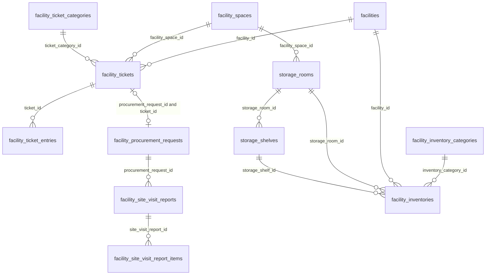

## facility_ticket_categories

**One row per:** ticket category defined by the managing company. **Model:** `App\Models\FacilityTicketCategory`. **Company-scoped:** yes. **Soft deletes:** yes. **Rows in dev DB:** 5.

Maintained by staff under Settings > Tickets > Categories. A category that already has tickets cannot be deleted; it is deactivated instead (`status = 'inactive'`) and stays on the tickets filed under it. The five dev rows are `Default`, `Billing Issues`, `Water Issues`, `Plumbing Issues` and `Generator Issues` (ids 1 to 5), all `active`, all `normal` priority, none procurable and none linked to an expense type.

**Status:**
- `active` : offered when raising a ticket.
- `inactive` : hidden from the pickers; existing tickets keep it. The column was added on 2026-09-30, so every older row defaulted to `active`.

Live rows are `deleted_at IS NULL`. For "categories in use" add `status = 'active'`; when reporting on existing tickets keep inactive categories, because tickets still point at them.

| Column | Type | Points to | Meaning |
|---|---|---|---|
| id | bigint | | Primary key. |
| company_id | bigint | companies.id | Owning company. |
| name | varchar | | Category name shown to users. |
| description | text | | Free text. Searched (with `name`) for the word "billing" when the system files a dispute ticket, see Gotchas. |
| priority | enum('high','normal','low') | | The category's nominal priority. It is not copied onto tickets. |
| expense_type_id | bigint | facility_expense_types.id | Expense type a procurement request raised from a ticket in this category is classified under. Nullable. |
| expense_sub_type_id | bigint | facility_expense_sub_types.id | Expense sub-type, same purpose. Nullable. |
| is_procurable | tinyint | | 1 = tickets in this category can be elevated to a procurement request. Elevation also needs both expense columns filled. |
| status | enum('active','inactive') | | See Status. |
| deleted_at | timestamp | | Soft delete stamp (only possible while the category has no tickets). |

**Joins:**
- `facility_ticket_categories.id ← facility_tickets.ticket_category_id`: one category, many tickets.
- `facility_ticket_categories.expense_type_id → facility_expense_types.id` and `expense_sub_type_id → facility_expense_sub_types.id`: many categories to one type or sub-type (documented in the supplier bills and expenses section).
- `facility_ticket_categories.company_id → companies.id`.

**Gotchas:**
- The PHP status enum is shared by many models and lists many values (`pending`, `suspended`, `expired` and so on); this database column allows only `active` and `inactive`.
- No dev category is procurable or has an expense type, so no ticket in dev could be elevated to a procurement request without first editing its category.
- Dispute tickets are filed under the first active category whose name or description contains "billing" (in dev, id 2 `Billing Issues`), falling back to the first active category. Counts for `Billing Issues` therefore mostly measure document disputes, not complaints.

## facility_tickets

**One row per:** ticket (issue, complaint, maintenance request or billing dispute) raised on one property. **Model:** `App\Models\FacilityTicket`. **Company-scoped:** yes. **Soft deletes:** yes. **Rows in dev DB:** 0.

Created in four ways: by a tenant in the tenant portal (only for a property where the tenant has a lease), by staff in the staff portal, automatically when an invoice, credit note or receipt is disputed (`ticket_type = 'other'`, title such as "Invoice Dispute: #123"). A tenant "withdrawing" a ticket soft-deletes it.

**Status:**
- `open` : default on creation; the issue is outstanding.
- `closed` : resolved. In the current application the only path that closes a ticket is withdrawing the billing dispute that created it; ordinary tickets have no close action yet.

Live rows are `deleted_at IS NULL`. Open tickets are `deleted_at IS NULL AND status = 'open'`, the same predicate the property management dashboard uses for its open-tickets badge.

| Column | Type | Points to | Meaning |
|---|---|---|---|
| id | bigint | | Primary key. Dispute messages quote it as "ticket#id". |
| company_id | bigint | companies.id | Owning company. Nullable in the schema; always set on rows created by the application. |
| title | varchar | | Short subject. |
| description | text | | Full text. For dispute tickets it reads "Invoice ID: n, Lease ID: m, Details: ..." (separated by vertical bars; Credit Note or Receipt in place of Invoice). |
| ticket_type | enum('asset','facility','other') | | What the ticket is about: `facility` = a specific space (then `facility_space_id` is required), `asset` = a piece of equipment (then `asset_id` is required), `other` = anything else, including every billing dispute. |
| priority | enum('high','normal','low') | | Ticket priority. Defaults to `normal`; neither portal lets the user set it, so in practice it is always `normal`. |
| is_procurable | tinyint | | Never written by the application (always 0). Use the category's `is_procurable`. |
| ticket_category_id | bigint | facility_ticket_categories.id | Category. Required. |
| facility_id | bigint | facilities.id | The property. Required. |
| facility_space_id | bigint | facility_spaces.id | The space concerned, for `ticket_type = 'facility'`. Otherwise NULL. |
| asset_id | bigint | | Not used (NULL on every row); belongs to a module this guide does not cover. |
| created_by_id | bigint | users.id | Who raised it: the tenant (tenant portal) or the staff user. NULL for tickets raised automatically. |
| user_group_id | bigint | user_groups.id | Portal of the person who raised it: 2 = `tenant` for tenant-portal tickets; for staff, the raiser's first group membership (normally 3 = `app`). |
| awaiting_reply_from | enum('user','staff') | | Whose turn it is in the conversation. Defaults to `staff` and is never changed by the current application. |
| status | enum('open','closed') | | See Status. |
| closed_at | timestamp | | When the ticket was closed. Set only together with `status = 'closed'`. |
| is_elevated | tinyint | | 1 = the ticket was turned into a procurement (work) request. |
| procurement_request_id | bigint | facility_procurement_requests.id | The procurement request created by elevation. Set together with `is_elevated = 1`. |
| deleted_at | timestamp | | Soft delete stamp (withdrawn by the tenant or deleted by staff). |
| old_system_id | varchar | | The id in the old EPMAS system. |

**Joins:**
- `facility_tickets.facility_id → facilities.id`: many tickets per property.
- `facility_tickets.facility_space_id → facility_spaces.id`: many tickets per space (optional).
- `facility_tickets.ticket_category_id → facility_ticket_categories.id`: many tickets per category.
- `facility_tickets.created_by_id → users.id` and `user_group_id → user_groups.id` (the people section explains how to tell tenants from staff).
- `facility_tickets.procurement_request_id → facility_procurement_requests.id`, and the reverse `facility_procurement_requests.ticket_id → facility_tickets.id`: zero or one procurement request per ticket. Elevation writes both; prefer `facility_procurement_requests.ticket_id`, because a request can also be created from the procurement screens with a ticket attached.
- `facility_tickets.id ← facility_ticket_entries.ticket_id`: one ticket, many entries.
- `facility_tickets.id ← facility_invoices.dispute_ticket_id`, `facility_credit_notes.dispute_ticket_id`, `facility_receipts.dispute_ticket_id`: the document whose dispute opened the ticket (at most one; 0 in dev).
- Attachments: `uploads.owner_type = 'App\\Models\\FacilityTicket' AND uploads.owner_id = facility_tickets.id` (polymorphic, no DB constraint; no such uploads in dev, string taken from the code).

**Gotchas:**
- There is no lease column. To tie a tenant ticket to a lease, match `created_by_id = leases.user_id AND facility_id = leases.facility_id`; for dispute tickets the lease id appears only inside `description`.
- When a dispute is withdrawn, the ticket is closed and the document's `dispute_ticket_id` is set back to NULL. The closed ticket survives but loses its database link to the document; only the "Invoice ID: n" text in `description` remains.
- There are no assignee, due date, SLA or escalation-level columns. Age must be computed from `created_at` (and `closed_at` for closed tickets). "Escalation" in this system means `is_elevated`, i.e. turned into a procurement request.
- `priority` and `awaiting_reply_from` look meaningful but carry their defaults (`normal`, `staff`) on every ticket the current application creates.

## facility_ticket_entries

**One row per:** message or log entry posted on a ticket. **Model:** `App\Models\FacilityTicketEntry`. **Company-scoped:** no (scope through the ticket). **Soft deletes:** no. **Rows in dev DB:** 0.

Intended as the reply thread under a ticket. The current application only reads entries (they are shown on a ticket's detail page); no screen or API writes them yet, so expect the table to stay empty until that feature ships.

| Column | Type | Points to | Meaning |
|---|---|---|---|
| id | bigint | | Primary key. |
| ticket_id | bigint | facility_tickets.id | The ticket. Required. |
| title | varchar | | Entry subject. |
| description | text | | Entry text. |
| created_by_id | bigint | users.id | Author (tenant or staff user). |
| old_system_id | varchar | | The id in the old EPMAS system. |

**Joins:**
- `facility_ticket_entries.ticket_id → facility_tickets.id`: many entries per ticket.
- `facility_ticket_entries.created_by_id → users.id`: many entries per author.

**Gotchas:** entries are not removed when their ticket is soft-deleted; join to `facility_tickets` and filter `facility_tickets.deleted_at IS NULL`. Order a thread by `created_at`.

## facility_site_visit_reports

**One row per:** report a supplier files after visiting the site of one procurement (work) request. **Model:** `App\Models\FacilitySiteVisitReport`. **Company-scoped:** yes. **Soft deletes:** yes. **Rows in dev DB:** 0.

Filed from the supplier portal while the procurement request is open for quotes (`facility_procurement_requests.status = 'order'`) and the supplier has been invited to quote; requests flagged `require_site_visit = 1` expect one. A supplier may file several reports for the same request. The report proposes a delivery date and lists the items the job needs (next table); it informs the supplier's quote rather than replacing it.

| Column | Type | Points to | Meaning |
|---|---|---|---|
| id | bigint | | Primary key. |
| company_id | bigint | companies.id | Owning company (the request's company). |
| procurement_request_id | bigint | facility_procurement_requests.id | The work request visited. Required. |
| vendor_id | bigint | users.id | The supplier account (a user in the `vendor` group). |
| technician_id | bigint | users.id | The user who submitted the report: the supplier itself or one of its technician sub-users. |
| delivery_at | timestamp | | Proposed delivery or completion date. Stored as a plain date at midnight; the time part has no meaning. |
| notes | text | | The supplier's findings. |
| deleted_at | timestamp | | Soft delete stamp. |
| old_system_id | varchar | | The id in the old EPMAS system. |

**Joins:**
- `facility_site_visit_reports.procurement_request_id → facility_procurement_requests.id`: many reports per request (procurement is documented in its own section).
- `facility_site_visit_reports.vendor_id → users.id` and `technician_id → users.id`.
- `facility_site_visit_reports.id ← facility_site_visit_report_items.site_visit_report_id`: one report, many items.

**Gotchas:**
- There is no `facility_id`. The property is the request's `facility_procurement_requests.facility_id`.
- Despite the name, this is not a staff inspection or checklist. Staff do not create these rows.
- Photos sent with a report are not stored against it; there is no upload link to analyse.

## facility_site_visit_report_items

**One row per:** product or service line on a site visit report. **Model:** `App\Models\FacilitySiteVisitReportItem`. **Company-scoped:** no (scope through the report). **Soft deletes:** no. **Rows in dev DB:** 0.

Created together with the report. The supplier either picks an existing purchase item or types a new name; a typed name is matched to an existing purchase item by exact name, and when none exists a new purchase item is created on the spot (see Gotchas).

| Column | Type | Points to | Meaning |
|---|---|---|---|
| id | bigint | | Primary key. |
| site_visit_report_id | bigint | facility_site_visit_reports.id | The report. Required. |
| type | enum('service','product') | | Labour or service line versus physical product. |
| purchase_item_id | bigint | facility_purchase_items.id | The catalogue item. Nullable in the schema, but the application always resolves or creates one. |
| title | text | | Copy of the purchase item's name at the time (or the typed text). |
| notes | text | | Supplier's note on the line. |
| quantity | decimal(10,3) | | Quantity needed, in the unit below. Fractions allowed. |
| stock_keeping_unit_id | bigint | stock_keeping_units.id | Unit of measure (units are documented with purchase items). |
| old_system_id | varchar | | The id in the old EPMAS system. |

**Joins:**
- `facility_site_visit_report_items.site_visit_report_id → facility_site_visit_reports.id`: many items per report.
- `facility_site_visit_report_items.purchase_item_id → facility_purchase_items.id`: many lines per purchase item.
- `facility_site_visit_report_items.stock_keeping_unit_id → stock_keeping_units.id`.

**Gotchas:** a purchase item created from a typed site visit line is filed under the first inventory category (id 1, `Water`) whatever it is, so such purchase items carry a meaningless category.

## facility_inventory_categories

**One row per:** inventory category (a classification of stock and of catalogue purchase items). **Model:** `App\Models\FacilityInventoryCategory`. **Company-scoped:** no (there is no `company_id`; the list is shared by every company). **Soft deletes:** no. **Rows in dev DB:** 6.

Each category maps to an expense type. The six dev rows (id, name, expense type id) are 1 `Water` (27), 2 `Generator Maintenance` (11), 3 `Cleaning Services` (3), 4 `Sanitation and Fumigation` (20), 5 `Administrative Expenses` (1) and 6 `Repairs & Maintenance` (18). In every case the category name equals the name of its expense type, and no row has a sub-type.

| Column | Type | Points to | Meaning |
|---|---|---|---|
| id | bigint | | Primary key. |
| expense_type_id | bigint | facility_expense_types.id | Expense type the category belongs to. Required. |
| expense_sub_type_id | bigint | facility_expense_sub_types.id | Optional sub-type. NULL on all dev rows. |
| name | varchar | | Category name. |
| description | text | | Free text. |

**Joins:**
- `facility_inventory_categories.id ← facility_inventories.inventory_category_id`: one category, many inventory items (0 in dev).
- `facility_inventory_categories.id ← facility_purchase_items.inventory_category_id`: one category, many catalogue purchase items (documented in the procurement section). This is where the table is actually used in dev: all 99 purchase items carry a category (category id → items: 1 → 1, 2 → 2, 3 → 17, 4 → 70, 5 → 8, 6 → 1).
- `facility_inventory_categories.expense_type_id → facility_expense_types.id`, `expense_sub_type_id → facility_expense_sub_types.id`.

**Gotchas:** no status and no soft delete, so every row is live. See the note under `facility_site_visit_report_items` about category id 1 acting as a default.

## facility_inventories

**One row per:** stock item held at one property (a spare part or a consumable), with its current quantity. **Model:** `App\Models\FacilityInventory`. **Company-scoped:** yes. **Soft deletes:** yes. **Rows in dev DB:** 0.

A list screen exists in the staff portal, but the current application has no create or update path, so rows can only come from data loads. `current_stock` is a single running figure; there is no stock movement history table.

**Status:**
- `active` : item in use.
- `inactive` : item retired from the list.

Live rows are `deleted_at IS NULL AND status = 'active'`.

| Column | Type | Points to | Meaning |
|---|---|---|---|
| id | bigint | | Primary key. |
| company_id | bigint | companies.id | Owning company. |
| inventory_category_id | bigint | facility_inventory_categories.id | Category. Required. |
| purchase_item_id | bigint | facility_purchase_items.id | The catalogue item this stock is, when known. |
| facility_id | bigint | facilities.id | The property holding the stock. Required. |
| storage_room_id | bigint | storage_rooms.id | Room where it is kept. Optional. |
| storage_shelf_id | bigint | storage_shelves.id | Shelf where it is kept. Optional. |
| barcode | varchar | | Barcode or stock code. |
| name | varchar | | Item name. |
| description | text | | Free text. |
| type | enum('part','consumable') | | `part` = spare part (typically for an asset), `consumable` = used up in operation. |
| asset_id | bigint | | Not used (NULL on every row); belongs to a module this guide does not cover. |
| current_stock | int | | Quantity on hand, in the unit below. Whole numbers only. |
| stock_keeping_unit_id | bigint | stock_keeping_units.id | Unit of measure. |
| status | enum('active','inactive') | | See Status. |
| created_by_id | bigint | users.id | User who created the row. |
| deleted_at | timestamp | | Soft delete stamp. |
| old_system_id | varchar | | The id in the old EPMAS system. |

**Joins:**
- `facility_inventories.facility_id → facilities.id`: many items per property.
- `facility_inventories.inventory_category_id → facility_inventory_categories.id`: many items per category.
- `facility_inventories.purchase_item_id → facility_purchase_items.id`: many stock rows per catalogue item (in principle one per property; nothing enforces it).
- `facility_inventories.stock_keeping_unit_id → stock_keeping_units.id`.
- `facility_inventories.storage_room_id → storage_rooms.id` and `storage_shelf_id → storage_shelves.id`.
- `facility_inventories.created_by_id → users.id`.

**Gotchas:**
- Do not sum `current_stock` across different `stock_keeping_unit_id` values; group by unit.
- Nothing checks that the storage room is a space of the same property as `facility_id`, or that the shelf belongs to the room. Use `facility_id` for the property.
- The PHP status enum is the same shared one as for ticket categories; the database allows only `active` and `inactive`.
- `current_stock` is an integer while purchase and site visit quantities are `decimal(10,3)`.

## storage_rooms

**One row per:** storage room, defined as a space of a property. **Model:** `App\Models\StorageRoom`. **Company-scoped:** yes. **Soft deletes:** no. **Rows in dev DB:** 0.

A named store room tied to one `facility_spaces` row. No screen creates rooms in the current application.

| Column | Type | Points to | Meaning |
|---|---|---|---|
| id | bigint | | Primary key. |
| company_id | bigint | companies.id | Owning company. |
| facility_space_id | bigint | facility_spaces.id | The space that is the store room. Required. |
| name | varchar | | Room name. |
| description | text | | Free text. |
| old_system_id | varchar | | The id in the old EPMAS system. |

**Joins:**
- `storage_rooms.facility_space_id → facility_spaces.id`: many rooms per space (normally one). Reach the property through the space hierarchy (see the properties section).
- `storage_rooms.id ← storage_shelves.storage_room_id`: one room, many shelves.
- `storage_rooms.id ← facility_inventories.storage_room_id`: one room, many inventory items.

**Gotchas:** there is no `facility_id`; to get the property, go through `facility_spaces` and its floor, or use the `facility_id` of the inventory rows stored in the room.

## storage_shelves

**One row per:** shelf inside a storage room. **Model:** `App\Models\StorageShelf`. **Company-scoped:** yes. **Soft deletes:** no. **Rows in dev DB:** 0.

| Column | Type | Points to | Meaning |
|---|---|---|---|
| id | bigint | | Primary key. |
| company_id | bigint | companies.id | Owning company. |
| storage_room_id | bigint | storage_rooms.id | The room. Nullable: a shelf can exist without a room. |
| name | varchar | | Shelf name or code. |
| description | text | | Free text. |
| old_system_id | varchar | | The id in the old EPMAS system. |

**Joins:**
- `storage_shelves.storage_room_id → storage_rooms.id`: many shelves per room.
- `storage_shelves.id ← facility_inventories.storage_shelf_id`: one shelf, many inventory items.

**Gotchas:** use a LEFT JOIN to `storage_rooms`, since `storage_room_id` is nullable.

## Worked queries

**1. Open tickets per property and category, with their average and oldest age in days.**

```sql
SELECT f.id AS facility_id, f.name AS property_name,
       c.id AS category_id, c.name AS category_name, t.priority,
       COUNT(*) AS open_tickets,
       ROUND(AVG(DATEDIFF(CURDATE(), t.created_at)), 1) AS avg_age_days,
       MAX(DATEDIFF(CURDATE(), t.created_at)) AS oldest_age_days,
       COUNT(CASE WHEN t.is_elevated = 1 THEN 1 END) AS elevated_to_procurement
FROM facility_tickets t
JOIN facilities f ON f.id = t.facility_id
JOIN facility_ticket_categories c ON c.id = t.ticket_category_id
WHERE t.deleted_at IS NULL
  AND t.status = 'open'
GROUP BY f.id, f.name, c.id, c.name, t.priority
ORDER BY oldest_age_days DESC;
```

Ran on dev: 0 rows (there are no tickets in dev).

**2. Every ticket category with its live ticket count, split by status and elevation.**

```sql
SELECT c.id AS category_id, c.name AS category_name, c.status AS category_status,
       c.priority AS category_priority, c.is_procurable,
       (c.deleted_at IS NOT NULL) AS category_deleted,
       COUNT(t.id) AS tickets,
       COUNT(CASE WHEN t.status = 'open' THEN 1 END) AS open_tickets,
       COUNT(CASE WHEN t.status = 'closed' THEN 1 END) AS closed_tickets,
       COUNT(CASE WHEN t.is_elevated = 1 THEN 1 END) AS elevated_to_procurement
FROM facility_ticket_categories c
LEFT JOIN facility_tickets t
       ON t.ticket_category_id = c.id
      AND t.deleted_at IS NULL
GROUP BY c.id, c.name, c.status, c.priority, c.is_procurable, c.deleted_at
ORDER BY tickets DESC, c.id;
```

Ran on dev: 5 rows, one per category (ids 1 to 5, all `active`, not procurable, not deleted), every count 0.

**3. Live inventory quantity per property, category, item type and unit.**

```sql
SELECT f.id AS facility_id, f.name AS property_name,
       ic.id AS inventory_category_id, ic.name AS inventory_category,
       i.type AS item_type,
       sku.name AS unit,
       COUNT(*) AS inventory_items,
       SUM(i.current_stock) AS total_current_stock,
       COUNT(CASE WHEN i.current_stock <= 0 THEN 1 END) AS items_out_of_stock
FROM facility_inventories i
JOIN facilities f ON f.id = i.facility_id
JOIN facility_inventory_categories ic ON ic.id = i.inventory_category_id
LEFT JOIN stock_keeping_units sku ON sku.id = i.stock_keeping_unit_id
WHERE i.deleted_at IS NULL
  AND i.status = 'active'
  AND f.deleted_at IS NULL
GROUP BY f.id, f.name, ic.id, ic.name, i.type, sku.id, sku.name
ORDER BY f.id, ic.name, i.type;
```

Ran on dev: 0 rows (there is no inventory in dev).

# 11. Appendix

## 11.1 Every table and where it is documented

| Table | Section | Approx. rows (dev) |
|---|---|---|
| `activity_log` | 8. 8. Approvals, pending tasks, responsibility transfers, notifications and the activity log | 219,588 |
| `alerts` | 8. 8. Approvals, pending tasks, responsibility transfers, notifications and the activity log | 0 |
| `applicant_guarantors` | 4. 4. Lease applications and letters of offer (LOO) | 71 |
| `approval_steps` | 8. 8. Approvals, pending tasks, responsibility transfers, notifications and the activity log | 384 |
| `approval_template_bypass_roles` | 8. 8. Approvals, pending tasks, responsibility transfers, notifications and the activity log | 0 |
| `approval_template_steps` | 8. 8. Approvals, pending tasks, responsibility transfers, notifications and the activity log | 26 |
| `approval_templates` | 8. 8. Approvals, pending tasks, responsibility transfers, notifications and the activity log | 8 |
| `bank_account_payment_methods` | 5. 5. Tenant invoices, receipts, credit notes and bank accounts | 0 |
| `bank_account_transactions` | 5. 5. Tenant invoices, receipts, credit notes and bank accounts | 4 |
| `bank_accounts` | 5. 5. Tenant invoices, receipts, credit notes and bank accounts | 782 |
| `bank_branches` | 5. 5. Tenant invoices, receipts, credit notes and bank accounts | 1,351 |
| `bank_reconciliation_reports` | 5. 5. Tenant invoices, receipts, credit notes and bank accounts | 0 |
| `bank_statement_line_classifications` | 5. 5. Tenant invoices, receipts, credit notes and bank accounts | 0 |
| `banks` | 5. 5. Tenant invoices, receipts, credit notes and bank accounts | 51 |
| `billing_addresses` | 1. 1. Companies, people (staff, tenants, landlords, suppliers) and access | 0 |
| `cities` | 9. 9. Reference data, settings, uploads, document templates and integrations | 404 |
| `companies` | 1. 1. Companies, people (staff, tenants, landlords, suppliers) and access | 0 |
| `company_department_divisions` | 1. 1. Companies, people (staff, tenants, landlords, suppliers) and access | 0 |
| `company_departments` | 1. 1. Companies, people (staff, tenants, landlords, suppliers) and access | 0 |
| `company_messaging_channels` | 1. 1. Companies, people (staff, tenants, landlords, suppliers) and access | 0 |
| `company_offices` | 1. 1. Companies, people (staff, tenants, landlords, suppliers) and access | 0 |
| `company_users` | 1. 1. Companies, people (staff, tenants, landlords, suppliers) and access | 186 |
| `countries` | 9. 9. Reference data, settings, uploads, document templates and integrations | 2 |
| `currencies` | 9. 9. Reference data, settings, uploads, document templates and integrations | 2 |
| `currency_conversions` | 9. 9. Reference data, settings, uploads, document templates and integrations | 0 |
| `currency_rate_histories` | 9. 9. Reference data, settings, uploads, document templates and integrations | 0 |
| `customer_invoice_items` | 9. 9. Reference data, settings, uploads, document templates and integrations | 0 |
| `customer_invoices` | 9. 9. Reference data, settings, uploads, document templates and integrations | 0 |
| `customers` | 9. 9. Reference data, settings, uploads, document templates and integrations | 48 |
| `document_billing_addresses` | 1. 1. Companies, people (staff, tenants, landlords, suppliers) and access | 0 |
| `document_templates` | 9. 9. Reference data, settings, uploads, document templates and integrations | 8 |
| `epmas_import_aliases` | framework table, ignore (0.10) | 799 |
| `expense_categories` | 6. 6. Supplier contracts, bills, expenses, remittances and landlord payouts | 4 |
| `facilities` | 2. 2. Properties, space hierarchy, occupancy and utilities | 101 |
| `facility_bank_accounts` | 2. 2. Properties, space hierarchy, occupancy and utilities | 204 |
| `facility_bill_items` | 6. 6. Supplier contracts, bills, expenses, remittances and landlord payouts | 3,370 |
| `facility_bill_withholdings` | 6. 6. Supplier contracts, bills, expenses, remittances and landlord payouts | 1,349 |
| `facility_bills` | 6. 6. Supplier contracts, bills, expenses, remittances and landlord payouts | 3,262 |
| `facility_blocks` | 2. 2. Properties, space hierarchy, occupancy and utilities | 9 |
| `facility_budget_expense_items` | 6. 6. Supplier contracts, bills, expenses, remittances and landlord payouts | 0 |
| `facility_budget_income_items` | 6. 6. Supplier contracts, bills, expenses, remittances and landlord payouts | 0 |
| `facility_budgets` | 6. 6. Supplier contracts, bills, expenses, remittances and landlord payouts | 0 |
| `facility_contract_withholdings` | 6. 6. Supplier contracts, bills, expenses, remittances and landlord payouts | 300 |
| `facility_contracts` | 6. 6. Supplier contracts, bills, expenses, remittances and landlord payouts | 556 |
| `facility_credit_note_applications` | 5. 5. Tenant invoices, receipts, credit notes and bank accounts | 910 |
| `facility_credit_note_items` | 5. 5. Tenant invoices, receipts, credit notes and bank accounts | 2,747 |
| `facility_credit_notes` | 5. 5. Tenant invoices, receipts, credit notes and bank accounts | 2,205 |
| `facility_expense_remittance` | 6. 6. Supplier contracts, bills, expenses, remittances and landlord payouts | 0 |
| `facility_expense_sub_type_vendors` | 6. 6. Supplier contracts, bills, expenses, remittances and landlord payouts | 880 |
| `facility_expense_sub_types` | 6. 6. Supplier contracts, bills, expenses, remittances and landlord payouts | 77 |
| `facility_expense_types` | 6. 6. Supplier contracts, bills, expenses, remittances and landlord payouts | 31 |
| `facility_expenses` | 6. 6. Supplier contracts, bills, expenses, remittances and landlord payouts | 0 |
| `facility_floors` | 2. 2. Properties, space hierarchy, occupancy and utilities | 622 |
| `facility_history_expenses` | 6. 6. Supplier contracts, bills, expenses, remittances and landlord payouts (reference only) | 0 until `history:import-epmas` runs |
| `facility_history_remittances` | 6. 6. Supplier contracts, bills, expenses, remittances and landlord payouts (reference only) | 0 until `history:import-epmas` runs |
| `facility_inventories` | 10. 10. Property operations: tickets, site visit reports and inventory | 0 |
| `facility_inventory_categories` | 10. 10. Property operations: tickets, site visit reports and inventory | 6 |
| `facility_invoice_component_receipt_allocations` | 5. 5. Tenant invoices, receipts, credit notes and bank accounts | 11 |
| `facility_invoice_items` | 5. 5. Tenant invoices, receipts, credit notes and bank accounts | 10,717 |
| `facility_invoices` | 5. 5. Tenant invoices, receipts, credit notes and bank accounts | 6,049 |
| `facility_ledger_items` | 6. 6. Supplier contracts, bills, expenses, remittances and landlord payouts | 0 |
| `facility_ledgers` | 6. 6. Supplier contracts, bills, expenses, remittances and landlord payouts | 0 |
| `facility_management_contracts` | 2. 2. Properties, space hierarchy, occupancy and utilities | 101 |
| `facility_payment_voucher_items` | 6. 6. Supplier contracts, bills, expenses, remittances and landlord payouts | 0 |
| `facility_payment_voucher_settlement` | 6. 6. Supplier contracts, bills, expenses, remittances and landlord payouts | 0 |
| `facility_payment_vouchers` | 6. 6. Supplier contracts, bills, expenses, remittances and landlord payouts | 0 |
| `facility_payout_items` | 6. 6. Supplier contracts, bills, expenses, remittances and landlord payouts | 0 |
| `facility_payouts` | 6. 6. Supplier contracts, bills, expenses, remittances and landlord payouts | 0 |
| `facility_procurement_lpo_items` | 7. 7. Procurement: requests, quotes, purchase orders and the purchase catalogue | 294 |
| `facility_procurement_lpos` | 7. 7. Procurement: requests, quotes, purchase orders and the purchase catalogue | 116 |
| `facility_procurement_request_bid_items` | 7. 7. Procurement: requests, quotes, purchase orders and the purchase catalogue | 231 |
| `facility_procurement_request_bids` | 7. 7. Procurement: requests, quotes, purchase orders and the purchase catalogue | 41 |
| `facility_procurement_request_items` | 7. 7. Procurement: requests, quotes, purchase orders and the purchase catalogue | 15 |
| `facility_procurement_request_purchase_item_option_items` | 7. 7. Procurement: requests, quotes, purchase orders and the purchase catalogue | 0 |
| `facility_procurement_request_purchase_item_options` | 7. 7. Procurement: requests, quotes, purchase orders and the purchase catalogue | 0 |
| `facility_procurement_request_steps` | 7. 7. Procurement: requests, quotes, purchase orders and the purchase catalogue | 469 |
| `facility_procurement_requests` | 7. 7. Procurement: requests, quotes, purchase orders and the purchase catalogue | 67 |
| `facility_purchase_item_prices` | 7. 7. Procurement: requests, quotes, purchase orders and the purchase catalogue | 16,598 |
| `facility_purchase_items` | 7. 7. Procurement: requests, quotes, purchase orders and the purchase catalogue | 99 |
| `facility_receipt_allocations` | 5. 5. Tenant invoices, receipts, credit notes and bank accounts | 8 |
| `facility_receipt_remittance` | 5. 5. Tenant invoices, receipts, credit notes and bank accounts | 0 |
| `facility_receipts` | 5. 5. Tenant invoices, receipts, credit notes and bank accounts | 5 |
| `facility_remittances` | 6. 6. Supplier contracts, bills, expenses, remittances and landlord payouts | 0 |
| `facility_residential_units` | 2. 2. Properties, space hierarchy, occupancy and utilities | 0 |
| `facility_role` | 1. 1. Companies, people (staff, tenants, landlords, suppliers) and access | 303 |
| `facility_settlements` | 6. 6. Supplier contracts, bills, expenses, remittances and landlord payouts | 0 |
| `facility_site_visit_report_items` | 10. 10. Property operations: tickets, site visit reports and inventory | 0 |
| `facility_site_visit_reports` | 10. 10. Property operations: tickets, site visit reports and inventory | 0 |
| `facility_spaces` | 2. 2. Properties, space hierarchy, occupancy and utilities | 6,645 |
| `facility_ticket_categories` | 10. 10. Property operations: tickets, site visit reports and inventory | 5 |
| `facility_ticket_entries` | 10. 10. Property operations: tickets, site visit reports and inventory | 0 |
| `facility_tickets` | 10. 10. Property operations: tickets, site visit reports and inventory | 0 |
| `facility_types` | 2. 2. Properties, space hierarchy, occupancy and utilities | 3 |
| `facility_units` | 2. 2. Properties, space hierarchy, occupancy and utilities | 0 |
| `facility_user` | 1. 1. Companies, people (staff, tenants, landlords, suppliers) and access | 5,197 |
| `facility_utilities` | 2. 2. Properties, space hierarchy, occupancy and utilities | 202 |
| `facility_vendor_statements` | 6. 6. Supplier contracts, bills, expenses, remittances and landlord payouts | 3,194 |
| `facility_wings` | 2. 2. Properties, space hierarchy, occupancy and utilities | 0 |
| `failed_jobs` | framework table, ignore (0.10) | 6 |
| `frc_sanction_audits` | 9. 9. Reference data, settings, uploads, document templates and integrations | 0 |
| `frc_sanction_matches` | 9. 9. Reference data, settings, uploads, document templates and integrations | 0 |
| `frc_sanction_notices` | 9. 9. Reference data, settings, uploads, document templates and integrations | 0 |
| `frc_sanctions` | 9. 9. Reference data, settings, uploads, document templates and integrations | 0 |
| `frc_watchlist_names` | 9. 9. Reference data, settings, uploads, document templates and integrations | 0 |
| `jobs` | framework table, ignore (0.10) | 0 |
| `landlord_default_accounts` | 2. 2. Properties, space hierarchy, occupancy and utilities | 120 |
| `landlord_users` | 1. 1. Companies, people (staff, tenants, landlords, suppliers) and access | 0 |
| `lease_application_documents` | 4. 4. Lease applications and letters of offer (LOO) | 132 |
| `lease_application_escalations` | 4. 4. Lease applications and letters of offer (LOO) | 53 |
| `lease_application_facility_space` | 4. 4. Lease applications and letters of offer (LOO) | 160 |
| `lease_application_facility_space_components` | 4. 4. Lease applications and letters of offer (LOO) | 293 |
| `lease_application_residential_unit_types` | 4. 4. Lease applications and letters of offer (LOO) | 0 |
| `lease_applications` | 4. 4. Lease applications and letters of offer (LOO) | 163 |
| `lease_billings` | 3. 3. Leases, lease charges and tenant accounts | 13,606 |
| `lease_collections` | 3. 3. Leases, lease charges and tenant accounts | 6 |
| `lease_components` | 3. 3. Leases, lease charges and tenant accounts | 13 |
| `lease_components_payment_priorities` | 3. 3. Leases, lease charges and tenant accounts | 0 |
| `lease_deposits` | 3. 3. Leases, lease charges and tenant accounts | 3,519 |
| `lease_escalations` | 3. 3. Leases, lease charges and tenant accounts | 1,798 |
| `lease_history_billings` | 3. 3. Leases, lease charges and tenant accounts (reference only) | 0 until `history:import-epmas` runs |
| `lease_history_collections` | 3. 3. Leases, lease charges and tenant accounts (reference only) | 0 until `history:import-epmas` runs |
| `lease_item_components` | 3. 3. Leases, lease charges and tenant accounts | 11,908 |
| `lease_items` | 3. 3. Leases, lease charges and tenant accounts | 6,562 |
| `lease_opening_balances` | 3. 3. Leases, lease charges and tenant accounts | 8,185 |
| `lease_utility_meter` | 2. 2. Properties, space hierarchy, occupancy and utilities | 851 |
| `leases` | 3. 3. Leases, lease charges and tenant accounts | 4,093 |
| `loo_comments` | 4. 4. Lease applications and letters of offer (LOO) | 9 |
| `loo_space_components` | 4. 4. Lease applications and letters of offer (LOO) | 231 |
| `loo_spaces` | 4. 4. Lease applications and letters of offer (LOO) | 125 |
| `loo_tag_values` | 4. 4. Lease applications and letters of offer (LOO) | 11,043 |
| `loo_tags` | 4. 4. Lease applications and letters of offer (LOO) | 140 |
| `loo_templates` | 4. 4. Lease applications and letters of offer (LOO) | 36 |
| `loos` | 4. 4. Lease applications and letters of offer (LOO) | 105 |
| `message_deliveries` | 8. 8. Approvals, pending tasks, responsibility transfers, notifications and the activity log | 51 |
| `migrations` | framework table, ignore (0.10) | 448 |
| `model_has_permissions` | 1. 1. Companies, people (staff, tenants, landlords, suppliers) and access | 0 |
| `model_has_roles` | 1. 1. Companies, people (staff, tenants, landlords, suppliers) and access | 4,478 |
| `notifications` | 8. 8. Approvals, pending tasks, responsibility transfers, notifications and the activity log | 29 |
| `password_reset_tokens` | 1. 1. Companies, people (staff, tenants, landlords, suppliers) and access | 0 |
| `payment_methods` | 5. 5. Tenant invoices, receipts, credit notes and bank accounts | 7 |
| `pending_tasks` | 8. 8. Approvals, pending tasks, responsibility transfers, notifications and the activity log | 161 |
| `permissions` | 1. 1. Companies, people (staff, tenants, landlords, suppliers) and access | 397 |
| `personal_access_tokens` | 1. 1. Companies, people (staff, tenants, landlords, suppliers) and access | 8 |
| `procurement_request_step_template_groups` | 7. 7. Procurement: requests, quotes, purchase orders and the purchase catalogue | 0 |
| `procurement_request_step_templates` | 7. 7. Procurement: requests, quotes, purchase orders and the purchase catalogue | 7 |
| `procurement_request_vendors` | 7. 7. Procurement: requests, quotes, purchase orders and the purchase catalogue | 238 |
| `quickbooks_connections` | 9. 9. Reference data, settings, uploads, document templates and integrations | 1 |
| `responsibility_transfer_handovers` | 8. 8. Approvals, pending tasks, responsibility transfers, notifications and the activity log | 0 |
| `responsibility_transfer_items` | 8. 8. Approvals, pending tasks, responsibility transfers, notifications and the activity log | 0 |
| `responsibility_transfers` | 8. 8. Approvals, pending tasks, responsibility transfers, notifications and the activity log | 0 |
| `role_has_permissions` | 1. 1. Companies, people (staff, tenants, landlords, suppliers) and access | 3,448 |
| `roles` | 1. 1. Companies, people (staff, tenants, landlords, suppliers) and access | 25 |
| `sessions` | 1. 1. Companies, people (staff, tenants, landlords, suppliers) and access | 14 |
| `settings` | 9. 9. Reference data, settings, uploads, document templates and integrations | 54 |
| `stock_keeping_unit_types` | 7. 7. Procurement: requests, quotes, purchase orders and the purchase catalogue | 0 |
| `stock_keeping_units` | 7. 7. Procurement: requests, quotes, purchase orders and the purchase catalogue | 99 |
| `storage_rooms` | 10. 10. Property operations: tickets, site visit reports and inventory | 0 |
| `storage_shelves` | 10. 10. Property operations: tickets, site visit reports and inventory | 0 |
| `taxes` | 9. 9. Reference data, settings, uploads, document templates and integrations | 4 |
| `telescope_entries` | framework table, ignore (0.10) | 1,240,773 |
| `telescope_entries_tags` | framework table, ignore (0.10) | 802,219 |
| `telescope_monitoring` | framework table, ignore (0.10) | 0 |
| `tenant_exit_notice_items` | 3. 3. Leases, lease charges and tenant accounts | 0 |
| `tenant_exit_notices` | 3. 3. Leases, lease charges and tenant accounts | 2 |
| `tenant_statements` | 3. 3. Leases, lease charges and tenant accounts | 8,243 |
| `tenant_users` | 1. 1. Companies, people (staff, tenants, landlords, suppliers) and access | 0 |
| `uploads` | 9. 9. Reference data, settings, uploads, document templates and integrations | 13,265 |
| `user_approval_codes` | 1. 1. Companies, people (staff, tenants, landlords, suppliers) and access | 0 |
| `user_auth_activities` | 1. 1. Companies, people (staff, tenants, landlords, suppliers) and access | 86 |
| `user_groups` | 1. 1. Companies, people (staff, tenants, landlords, suppliers) and access | 6 |
| `user_password_reset_codes` | 1. 1. Companies, people (staff, tenants, landlords, suppliers) and access | 3 |
| `user_temporary_pins` | 1. 1. Companies, people (staff, tenants, landlords, suppliers) and access | 0 |
| `user_user_group` | 1. 1. Companies, people (staff, tenants, landlords, suppliers) and access | 4,030 |
| `users` | 1. 1. Companies, people (staff, tenants, landlords, suppliers) and access | 3,888 |
| `utilities` | 2. 2. Properties, space hierarchy, occupancy and utilities | 0 |
| `utility_billings` | 2. 2. Properties, space hierarchy, occupancy and utilities | 0 |
| `utility_meter_readings` | 2. 2. Properties, space hierarchy, occupancy and utilities | 0 |
| `utility_meters` | 2. 2. Properties, space hierarchy, occupancy and utilities | 855 |
| `utility_prices` | 2. 2. Properties, space hierarchy, occupancy and utilities | 0 |
| `vendor_users` | 1. 1. Companies, people (staff, tenants, landlords, suppliers) and access | 0 |
| `withholding_taxes` | 9. 9. Reference data, settings, uploads, document templates and integrations | 4 |

## 11.2 Class name to table (for polymorphic `_type` columns)

| Value in a `_type` column | Table |
|---|---|
| `App\Models\Alert` | `alerts` |
| `App\Models\ApplicantGuarantor` | `applicant_guarantors` |
| `App\Models\ApprovalStep` | `approval_steps` |
| `App\Models\ApprovalTemplate` | `approval_templates` |
| `App\Models\ApprovalTemplateBypassRole` | `approval_template_bypass_roles` |
| `App\Models\ApprovalTemplateStep` | `approval_template_steps` |
| `App\Models\Bank` | `banks` |
| `App\Models\BankAccount` | `bank_accounts` |
| `App\Models\BankAccountPaymentMethod` | `bank_account_payment_methods` |
| `App\Models\BankAccountTransaction` | `bank_account_transactions` |
| `App\Models\BankBranch` | `bank_branches` |
| `App\Models\BankReconciliationReport` | `bank_reconciliation_reports` |
| `App\Models\BankStatementLineClassification` | `bank_statement_line_classifications` |
| `App\Models\BillingAddress` | `billing_addresses` |
| `App\Models\City` | `cities` |
| `App\Models\Company` | `companies` |
| `App\Models\CompanyDepartment` | `company_departments` |
| `App\Models\CompanyDepartmentDivision` | `company_department_divisions` |
| `App\Models\CompanyMessagingChannel` | `company_messaging_channels` |
| `App\Models\CompanyOffice` | `company_offices` |
| `App\Models\CompanyUser` | `company_users` |
| `App\Models\Country` | `countries` |
| `App\Models\Currency` | `currencies` |
| `App\Models\CurrencyConversion` | `currency_conversions` |
| `App\Models\CurrencyRateHistory` | `currency_rate_histories` |
| `App\Models\Customer` | `customers` |
| `App\Models\CustomerInvoice` | `customer_invoices` |
| `App\Models\CustomerInvoiceItem` | `customer_invoice_items` |
| `App\Models\DocumentBillingAddress` | `document_billing_addresses` |
| `App\Models\DocumentTemplate` | `document_templates` |
| `App\Models\ExpenseCategory` | `expense_categories` |
| `App\Models\Facility` | `facilities` |
| `App\Models\FacilityBankAccount` | `facility_bank_accounts` |
| `App\Models\FacilityBill` | `facility_bills` |
| `App\Models\FacilityBillItem` | `facility_bill_items` |
| `App\Models\FacilityBillWithholding` | `facility_bill_withholdings` |
| `App\Models\FacilityBlock` | `facility_blocks` |
| `App\Models\FacilityBudget` | `facility_budgets` |
| `App\Models\FacilityBudgetExpenseItem` | `facility_budget_expense_items` |
| `App\Models\FacilityBudgetIncomeItem` | `facility_budget_income_items` |
| `App\Models\FacilityContract` | `facility_contracts` |
| `App\Models\FacilityContractWithholding` | `facility_contract_withholdings` |
| `App\Models\FacilityCreditNote` | `facility_credit_notes` |
| `App\Models\FacilityCreditNoteApplication` | `facility_credit_note_applications` |
| `App\Models\FacilityCreditNoteItem` | `facility_credit_note_items` |
| `App\Models\FacilityExpense` | `facility_expenses` |
| `App\Models\FacilityExpenseRemittance` | `facility_expense_remittance` |
| `App\Models\FacilityExpenseSubType` | `facility_expense_sub_types` |
| `App\Models\FacilityExpenseSubTypeVendor` | `facility_expense_sub_type_vendors` |
| `App\Models\FacilityExpenseType` | `facility_expense_types` |
| `App\Models\FacilityFloor` | `facility_floors` |
| `App\Models\FacilityHistoryExpense` | `facility_history_expenses` |
| `App\Models\FacilityHistoryRemittance` | `facility_history_remittances` |
| `App\Models\FacilityInventory` | `facility_inventories` |
| `App\Models\FacilityInventoryCategory` | `facility_inventory_categories` |
| `App\Models\FacilityInvoice` | `facility_invoices` |
| `App\Models\FacilityInvoiceComponentReceiptAllocation` | `facility_invoice_component_receipt_allocations` |
| `App\Models\FacilityInvoiceItem` | `facility_invoice_items` |
| `App\Models\FacilityLedger` | `facility_ledgers` |
| `App\Models\FacilityLedgerItem` | `facility_ledger_items` |
| `App\Models\FacilityManagementContract` | `facility_management_contracts` |
| `App\Models\FacilityPaymentVoucher` | `facility_payment_vouchers` |
| `App\Models\FacilityPaymentVoucherItem` | `facility_payment_voucher_items` |
| `App\Models\FacilityPaymentVoucherSettlement` | `facility_payment_voucher_settlement` |
| `App\Models\FacilityPayout` | `facility_payouts` |
| `App\Models\FacilityPayoutItem` | `facility_payout_items` |
| `App\Models\FacilityProcurementLpo` | `facility_procurement_lpos` |
| `App\Models\FacilityProcurementLpoItem` | `facility_procurement_lpo_items` |
| `App\Models\FacilityProcurementRequest` | `facility_procurement_requests` |
| `App\Models\FacilityProcurementRequestBid` | `facility_procurement_request_bids` |
| `App\Models\FacilityProcurementRequestBidItem` | `facility_procurement_request_bid_items` |
| `App\Models\FacilityProcurementRequestItem` | `facility_procurement_request_items` |
| `App\Models\FacilityProcurementRequestPurchaseItemOption` | `facility_procurement_request_purchase_item_options` |
| `App\Models\FacilityProcurementRequestPurchaseItemOptionItem` | `facility_procurement_request_purchase_item_option_items` |
| `App\Models\FacilityProcurementRequestStep` | `facility_procurement_request_steps` |
| `App\Models\FacilityPurchaseItem` | `facility_purchase_items` |
| `App\Models\FacilityPurchaseItemPrice` | `facility_purchase_item_prices` |
| `App\Models\FacilityReceipt` | `facility_receipts` |
| `App\Models\FacilityReceiptAllocation` | `facility_receipt_allocations` |
| `App\Models\FacilityReceiptRemittance` | `facility_receipt_remittance` |
| `App\Models\FacilityRemittance` | `facility_remittances` |
| `App\Models\FacilityResidentialUnit` | `facility_residential_units` |
| `App\Models\FacilityRole` | `facility_role` |
| `App\Models\FacilitySettlement` | `facility_settlements` |
| `App\Models\FacilitySiteVisitReport` | `facility_site_visit_reports` |
| `App\Models\FacilitySiteVisitReportItem` | `facility_site_visit_report_items` |
| `App\Models\FacilitySpace` | `facility_spaces` |
| `App\Models\FacilityTicket` | `facility_tickets` |
| `App\Models\FacilityTicketCategory` | `facility_ticket_categories` |
| `App\Models\FacilityTicketEntry` | `facility_ticket_entries` |
| `App\Models\FacilityType` | `facility_types` |
| `App\Models\FacilityUnit` | `facility_units` |
| `App\Models\FacilityUser` | `facility_user` |
| `App\Models\FacilityUtility` | `facility_utilities` |
| `App\Models\FacilityVendorStatement` | `facility_vendor_statements` |
| `App\Models\FacilityWing` | `facility_wings` |
| `App\Models\FrcSanction` | `frc_sanctions` |
| `App\Models\FrcSanctionAudit` | `frc_sanction_audits` |
| `App\Models\FrcSanctionMatch` | `frc_sanction_matches` |
| `App\Models\FrcSanctionNotice` | `frc_sanction_notices` |
| `App\Models\FrcWatchlistName` | `frc_watchlist_names` |
| `App\Models\LandlordDefaultAccount` | `landlord_default_accounts` |
| `App\Models\LandlordUser` | `landlord_users` |
| `App\Models\Lease` | `leases` |
| `App\Models\LeaseApplication` | `lease_applications` |
| `App\Models\LeaseApplicationDocument` | `lease_application_documents` |
| `App\Models\LeaseApplicationEscalation` | `lease_application_escalations` |
| `App\Models\LeaseApplicationFacilitySpace` | `lease_application_facility_space` |
| `App\Models\LeaseApplicationFacilitySpaceComponent` | `lease_application_facility_space_components` |
| `App\Models\LeaseBilling` | `lease_billings` |
| `App\Models\LeaseCollection` | `lease_collections` |
| `App\Models\LeaseComponent` | `lease_components` |
| `App\Models\LeaseComponentsPaymentPriority` | `lease_components_payment_priorities` |
| `App\Models\LeaseDeposit` | `lease_deposits` |
| `App\Models\LeaseEscalation` | `lease_escalations` |
| `App\Models\LeaseHistoryBilling` | `lease_history_billings` |
| `App\Models\LeaseHistoryCollection` | `lease_history_collections` |
| `App\Models\LeaseItem` | `lease_items` |
| `App\Models\LeaseItemComponent` | `lease_item_components` |
| `App\Models\LeaseOpeningBalance` | `lease_opening_balances` |
| `App\Models\Loo` | `loos` |
| `App\Models\LooComment` | `loo_comments` |
| `App\Models\LooSpace` | `loo_spaces` |
| `App\Models\LooSpaceComponent` | `loo_space_components` |
| `App\Models\LooTag` | `loo_tags` |
| `App\Models\LooTagValue` | `loo_tag_values` |
| `App\Models\LooTemplate` | `loo_templates` |
| `App\Models\MessageDelivery` | `message_deliveries` |
| `App\Models\PaymentMethod` | `payment_methods` |
| `App\Models\PendingTask` | `pending_tasks` |
| `App\Models\Permission` | `permissions` |
| `App\Models\PersonalAccessToken` | `personal_access_tokens` |
| `App\Models\ProcurementRequestStepTemplate` | `procurement_request_step_templates` |
| `App\Models\ProcurementRequestStepTemplateGroup` | `procurement_request_step_template_groups` |
| `App\Models\ProcurementRequestVendor` | `procurement_request_vendors` |
| `App\Models\QuickBooksConnection` | `quickbooks_connections` |
| `App\Models\ResponsibilityTransfer` | `responsibility_transfers` |
| `App\Models\ResponsibilityTransferHandover` | `responsibility_transfer_handovers` |
| `App\Models\ResponsibilityTransferItem` | `responsibility_transfer_items` |
| `App\Models\Role` | `roles` |
| `App\Models\Setting` | `settings` |
| `App\Models\StockKeepingUnit` | `stock_keeping_units` |
| `App\Models\StockKeepingUnitType` | `stock_keeping_unit_types` |
| `App\Models\StorageRoom` | `storage_rooms` |
| `App\Models\StorageShelf` | `storage_shelves` |
| `App\Models\Tax` | `taxes` |
| `App\Models\TenantExitNotice` | `tenant_exit_notices` |
| `App\Models\TenantExitNoticeItem` | `tenant_exit_notice_items` |
| `App\Models\TenantStatement` | `tenant_statements` |
| `App\Models\TenantUser` | `tenant_users` |
| `App\Models\Upload` | `uploads` |
| `App\Models\User` | `users` |
| `App\Models\UserApprovalCode` | `user_approval_codes` |
| `App\Models\UserAuthActivity` | `user_auth_activities` |
| `App\Models\UserGroup` | `user_groups` |
| `App\Models\UserPasswordResetCode` | `user_password_reset_codes` |
| `App\Models\UserTemporaryPin` | `user_temporary_pins` |
| `App\Models\UserUserGroup` | `user_user_group` |
| `App\Models\Utility` | `utilities` |
| `App\Models\UtilityBilling` | `utility_billings` |
| `App\Models\UtilityMeter` | `utility_meters` |
| `App\Models\UtilityMeterReading` | `utility_meter_readings` |
| `App\Models\UtilityPrice` | `utility_prices` |
| `App\Models\VendorUser` | `vendor_users` |
| `App\Models\WithholdingTax` | `withholding_taxes` |

## 11.3 Glossary

| Term | Meaning |
|---|---|
| Agent / managing agent | The property management company that runs this system. In `user_groups` the staff group is `app` (label "Staff"); the group `agent` is a legacy label for property managers. |
| Allocation (receipt) | The part of a receipt applied to one invoice (`facility_receipt_allocations`), and further to one lease component (`facility_invoice_component_receipt_allocations`, `lease_collections`). |
| Allocation (staff) | A staff member being given visibility of a property (`facility_user`), as opposed to holding a named role on it (`facility_role`). |
| Approval chain | The ordered `approval_steps` rows copied from an `approval_templates` row when a document is submitted. |
| Bill | A supplier's invoice to the property (`facility_bills`). "Invoice" in this system always means an invoice to a tenant (`facility_invoices`). |
| Block, wing, floor, space | The physical hierarchy of a property. A space is a lettable unit. |
| Collection | Money received from tenants (`facility_receipts`); "collections" in reports are confirmed receipt allocations. |
| Credit note | A reduction of what a tenant owes (`facility_credit_notes`), applied to invoices. |
| CU / ETR / eTIMS | Kenya Revenue Authority tax-register signing of invoices and credit notes; the `cu_*` and `etr_*` columns carry the device response. |
| Deposit | Security money taken on a lease per charge type (`lease_deposits`), billed as deposit components. |
| EPMAS | The previous property management system. `old_system_id` columns hold its ids; the cut-over was end of September 2026. |
| Escalation | A scheduled increase of a lease charge (`lease_escalations`). On lease applications, the requested escalation terms. |
| Exit notice | A tenant's notice to leave (`tenant_exit_notices`), which releases the spaces and settles the deposit. |
| Facility | A property. |
| FRC | Financial Reporting Centre (Kenya). The `frc_*` tables hold the sanctions list and screening results. |
| EPMAS history | The old system's ledgers before the cut-over, kept for reference only: the tenant ledger in `lease_history_billings` / `lease_history_collections` (its `cutover_reconciliation` rows make it add up to the opening balances), property expenses in `facility_history_expenses` and landlord remittances in `facility_history_remittances`. Never part of a balance. |
| Held balance | The part of an invoice balance reserved by a receipt or credit note that is still pending approval. |
| Landlord | The owner of a property, a `users` row in the `landlord` group, pointed to by `facilities.landlord_id`. |
| Lease component | A charge type in the catalogue (`lease_components`): Rent, Service Charge, Parking, Signage, Water, Electricity, deposits, legal fees. Flags such as `is_rent`, `is_service_charge`, `is_utility_charge` give each row its role. |
| Letting fee / re-letting fee | The company's fee for placing a new tenant or renewing one, billed to the landlord through a `facility_bills` row and a `customer_invoices` row. |
| LOO | Letter of offer (`loos`): the offer sent to an applicant before a lease is created. |
| LPO | Local purchase order (`facility_procurement_lpos`), the order issued to a supplier at the end of a procurement request. |
| Management fee | The company's percentage (or fixed) fee on collections, set on `facility_management_contracts`. |
| Opening balance | A balance carried from EPMAS at the cut-over (`lease_opening_balances` and the opening invoices, credit notes and bills). |
| Payment voucher | An instruction to pay a supplier or landlord (`facility_payment_vouchers`), settled against bank accounts. |
| Pending task | A to-do row for a user (`pending_tasks`): an approval to act on, a procurement step, an application to review. |
| Property Manager | The staff member responsible for a property: the holder of the Property Manager role in `facility_role`. |
| Remittance | The periodic payment of net collections to the landlord (`facility_remittances`). |
| Service charge | The charge for shared services on a property, tracked separately from rent on every space. |
| SKU | Stock keeping unit (`stock_keeping_units`): a unit of measure (square foot, kWh, cubic metre, piece). |
| Space unit | The unit of area on a property (`facilities.space_unit_id`), square feet in the current data. |
| Supplier / vendor | A company or person that services properties, a `users` row in the `vendor` group, pointed to by `vendor_id` columns. |
| Tenant | The party on a lease, a `users` row in the `tenant` group, pointed to by `leases.user_id`. |
| Tenant statement | The per-lease ledger of invoices, credit notes and receipts (`tenant_statements`). |
| Withholding tax | Tax deducted at source from supplier payments and landlord remittances (`withholding_taxes`, `facility_bill_withholdings`). |

